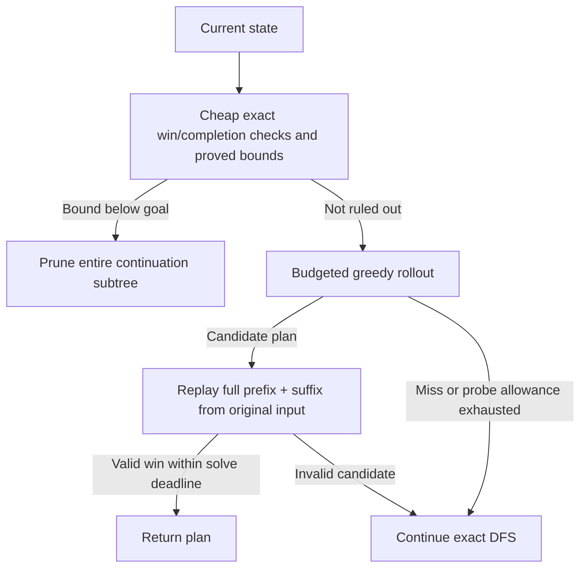
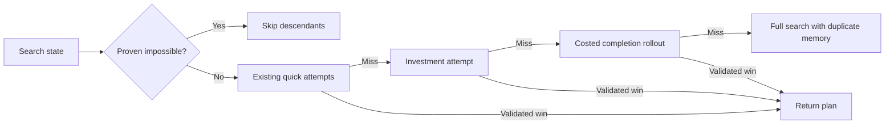
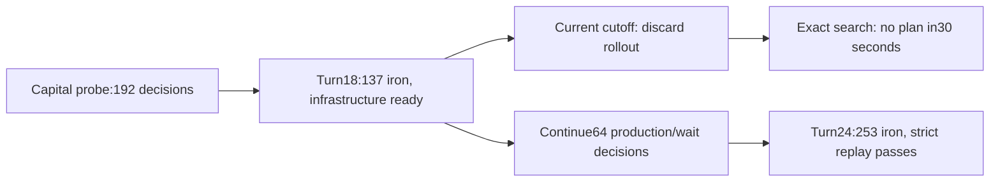

# Recruitment solver delivery archive

<!-- sdd: delivery-archive -->

| Field | Value |
| --- | --- |
| Issues | [#1](https://github.com/hhhhhusky777/blade_runner/issues/1), [#2](https://github.com/hhhhhusky777/blade_runner/issues/2), [#3](https://github.com/hhhhhusky777/blade_runner/issues/3), [#4](https://github.com/hhhhhusky777/blade_runner/issues/4), [#5](https://github.com/hhhhhusky777/blade_runner/issues/5); retained follow-ups, not closed by this archive |
| Closing pull request | [#6](https://github.com/hhhhhusky777/blade_runner/pull/6) |
| Whiteboard source SHA256 | `446eaa688657df6497ad6e922ce93f3cf22a5c9284db1d973ccb913dac391aa4` |
| Final plan source SHA256 | `cf71a7c443325583bd265396ed0debc8140327f6ca0213d357516f4d96d8c926` |

The complete sources follow. Only embedded lifecycle markers, heading depth and
relative-link prefixes are adapted to this archive location. No source section
is omitted. The original concluded whiteboard is unchanged. The closing PR owns
review, final check and actual merge evidence; prior delivery restrictions in the
embedded sources are historical and superseded by the owner's publication request.

## Concluded whiteboard

### Solution Whiteboard — Recruitment solver and review delivery

<!-- sdd: archived-whiteboard -->

| Field | Value |
| --- | --- |
| State | `CONCLUDED` — C1 accepted by the owner after both independent reviews |
| Need / issue | Owner requests conclusion of the adopted solution, clean reviewable code and a recruiter report explaining evidence, proofs, all three stages and recorded work time |
| Owner | Project owner |
| Conclusion candidate | `C1` — adopted algorithms plus bounded delivery promotion |
| Concluded design revision | `C1` — candidate commit `cb929ff0a5ca0569069920890b181b469487ab64`, SHA256 `764c31a8143fe90694ae5b39acbda62f60b3ed076baacfd5abe208497a706d4f` |
| Open owner decisions | `None` for C1 — owner accepted the whiteboard and confirmed that the report belongs to implementation on 2026-10-18 |

#### Conclusion candidate C1

This section owns the proposed final design. The historical discussion below
retains its original dates, rejected candidates, proofs and measurements; its
old present-tense defaults/statuses are historical and do not override C1.
The owner has authorized preparation of this concrete conclusion and delivery.
The installed workflow requires exact review and owner disposition before its
state/revision-only freeze and implementation plan. No new game task, submission,
email, source publication, push or merge belongs to this delivery preparation.

##### Outcome and acceptance boundary

Deliver a small Python3.13 application that a recruiter can read, run and test
without the5.5GB research directory. Preserve the algorithms/settings that
completed all three stages; improve organization, naming, formatting, function
contracts and explanations. Provide the submission helper, portable regression
fixtures, a concise review entry point and a local source ZIP. Preserve the
research/evidence and all historical hashes; it is an immutable baseline, not
an import dependency of official runtime code.

The recruiter report tells the progression from model and baseline, through
measured experiments and rejected options, to observed completion. It includes
conditional correctness arguments, explicit worst-case complexity, performance
comparisons, the three stage reports, available work-time evidence and linked
remaining issues. It must describe the offline-first intent honestly:93tasks
passed on their only submitted plan, but five were late and series restarted.
It must not claim a single uninterrupted perfect advancement run, full input
coverage, verified server equivalence, human labor hours or universal30s solving.

##### Final adopted solution

| Decision | Final choice / reason |
| --- | --- |
| C1-01 State search | Serial memoized DFS over the exact normalized state; every affordable legal build, optional manufacturing and necessary turn advance remains available. Resource-aware routes/projects order choices, never limit legal alternatives. |
| C1-02 Stage1 | Selected last-topology connectivity reuse and minimum-investment DP, cheap one-quarry/wait completions and success-only greedy probes; unlimited state count in the live preset. Preserve the adopted C02-G path and its shared probe-work allowance. |
| C1-03 Stage2 | Typed stocks/resources, typed capital DP, original probes plus saving-aware and relaxed-resource policies (`guidance=both`, `improvements=none`, matching relays, no state cap). Use the Stage1 projection only under its existing precondition. |
| C1-04 Stage3 | Exact component stock pooling; explicit1/2-cycle manufacturing choices; whole-road-plus-producer project ordering; initial512 decisions per policy, interval512 DFS states, later32 per policy; production DP activates once after initial probes miss. Non-IRON goals reuse Stage2. |
| C1-05 Correctness boundary | Independent raw-action replay against the original input; free ordered transfers, cardinal adjacency, renewable exact-five extraction, one initial BASE, unlimited storage and BASE-funded construction remain the stated local model. Both retained relay modes validate every saved plan; no universal server-equivalence claim. |
| C1-06 Time and failure | Preserve FEASIBLE / INFEASIBLE / UNKNOWN, original cooperative deadlines and child isolation. A probe miss, DP budget skip or timeout never proves impossibility. Keep one submission, bounded creation reconciliation and exact progression/reset verification. |
| C1-07 Official code | Ordinary `game_solver/solver/` package under the existing Python application. Use relative imports and thin entry points; no benchmark/run.py imports, global socket changes on import, runtime source patching or dependency on research fixtures. |
| C1-08 Compatibility | Preserve starter API models/client and original JSON plan; leave original research runner/script and frozen sources intact. Add an official `submit.sh`; do not redirect historical hashes or rewrite prior reports to claim the promoted code ran previously. |
| C1-09 Readability | Document state fields/units, canonicalization, optimistic-bound direction, DP recurrence, production choices, policy ordering and error meanings. Apply normal formatting and type contracts at public boundaries. Avoid a new planner framework or algorithm rewrite. |
| C1-10 Regression policy | All19Stage1 +36Stage2 +38Stage3 task IDs are portable source-bound regressions, including the18new Stage3 maps and earlier stopped-map observations. Deduplicate inputs only with an explicit task-to-input mapping. Keep the307Stage3 historical configuration controls and earlier stage corpora, impossible witnesses/certificates and forced-DFS controls. |
| C1-11 Evidence/report | Keep each comparison's corpus, timing boundary, source, baseline, repeats, UNKNOWNs and worst regressions. Separate historical measurements from migration validation. Keep all three stage reports as appendices/linked chapters and publish no new data externally. |
| C1-12 Time accounting | Reconstruct root turn start/end durations, excluding inter-turn gaps and unsummed parallel-agent labor. Report assistant-turn elapsed time, including tools/tests/waits; active human/tracker time is unavailable. Include cutoff and sanitized per-turn ledger, not raw private conversation. |
| C1-13 Package | Explicit file allowlist: official runtime, starter client/lock/config needed to run, tests/fixtures, review README, concluded design and recruiter/stage reports with compact evidence. Exclude .env/tokens, .git, venvs/caches, original conversation and bulk research. Include archive inventory/checksums and verify the extracted copy independently. |

##### Reconciliation of the research draft

| Draft item | C1 disposition |
| --- | --- |
| DR01/02/05/07/10: prefix funds, joint construction/income, all legal branches, sound verdicts, success-only probes | Retained in C1-01/04/05/06 and the conditional proofs below. |
| DR03: repair/reuse starter simulation and BaseStrategy | Superseded for this bounded delivery: reuse the client/models, use independent strict replay as the legality owner, and preserve the starter separately. Its permissive simulator is not a release oracle; no unrelated simulator rewrite is needed. |
| DR04/08: shortcuts, proof and comparative PoCs | Resolved by the selected stage presets and retained baseline/candidate evidence. Old shortlists are historical, not alternative current defaults. |
| DR06: reserve replay/network time | Existing runner guard retained; observed timings and the unresolved combined-budget risk are disclosed, not called a hard end-to-end guarantee. |
| DR09/Q06: parallel search | Deferred; serial implementation remains the delivery candidate. No CPU worker pool or asyncio search is added. |
| Q01/Q04: adjacency and extraction contract | Conditional supported-domain boundary, existing issue2; not silently declared universally settled. |
| Q02/Q03: achieved coverage / selected reductions | Final stage presets above; all93task records and retained local controls must pass promotion validation. Global optimality/unseen-map deadlines remain unproven. |
| Q05: real progression | Resolved by saved GET-verified completion:31levels,81required positions,93passed tasks,88timely flags and5late completions. Seven earlier series credits were lost through resets. |
| Q07: slow acquisition plus hard fallback | Observed Stage3 miss corrected by the initial-probe allowance, general budget risk remains issue1; do not hide it in the final report. |
| Optional Stage2 pruning/reuse, adaptive policy-trigger variants, failed-probe reuse | Only the adopted presets ship. Unadopted experimental variants stay in research; issue5 tracks useful future probe-progress reuse. |

##### Mathematical guarantees and limits

Let V be board cells, K resource nodes and T the finite turn limit. Under the
stated local rules, total resource units never exceed
`M = initial total inventory + 5*K*T`: extraction adds at most5 per node/turn;
manufacturing exchanges one ore for one iron; construction only consumes stock.

A normalized Stage3 state is `(turn, roads, extractors, smelters, produced_this_turn,
pooled_stock)`. Stage1/2 are the corresponding resource/structure restrictions.
Each resource has its own occupied transfer graph: cardinal edges require a ROAD
endpoint; a storage-to-storage edge alone is illegal. A graph path splits at
storage endpoints into legal transfers with road-only interiors. Free, reversible,
unbounded transfers make component totals an exact quotient. Canonical roots
prefer BASE and, for ore, an ore mine; only equivalent stock distributions merge.

Mining early is safe because it is free, non-consuming and unbounded in storage.
Mine each new extractor and each existing extractor once per turn, then pool.
Manufacturing remains optional: feed exactly1 or2 ore to an unused smelter, then
produce/pool, so mixed ore goals are not destroyed by eager consumption. Every
legal raw plan has a normalized trace with no worse spendable funds at each
construction prefix; every normalized transition expands into legal raw actions.
The detailed induction is retained under [Stage1 normalization](#normalize-free-mining-and-transfers)
and [Stage3 exact normalization](#exact-normalization-and-completeness).

Exact memoization uses the complete future-relevant key, including topology,
resource inventories, turn and manufacturing activations. Equal counts of
producers/turns alone are insufficient. Cache keys omit a field only for helper
calculations proved independent of that field (for example geometry vs inventory).
Failed probe paths are not recorded as exact-search dead states.

All pruning is a necessary-condition test. Pool remote stock, grant free roads,
optimistically activate producers or solve an easier investment/production game.
Every real winning continuation projects into that easier game. Therefore failure
there implies failure here; success only means 'not ruled out'. For Stage3,
with future turn advances d, missing iron H and currently available smelter
activations a, existing f smelters can supply at most `2*a + 2*f*d` more iron.
Each new smelter supplies at most `2*(d+1)`; every additional iron costs one ore.
These capacity and funding lower bounds feed the resource/capital/production DPs.
The retained derivations specify exact recurrences and budget weak-pass behavior:
[Stage2 bounds](#conditional-correctness-and-pruning),
[Stage3 resource/production](#safe-resource-and-production-pruning),
[production funding](#production-funding-bound-and-proof).

A representative Stage1 investment recurrence uses current stone w, built
quarries q, d future turn advances and free immediate access to every site:
`F(0,q)=goal`; for d>0,
`F(d,q)=min(goal, max(0,F(d-1,q)-5*q), max(10,F(d,q+1)+5))`,
omitting the build alternative when all sites are used. BUILD pays10 before
new mining returns5, hence both the prefix10 and the net5 requirement.
If even pooled current wealth is below F, no real construction plan can win.
Typed Stage2 DP tracks missing ore batches and15-stone mine investments;
Stage3 additionally accounts for conversion demand and20-stone smelter funding.
On-demand activation delays an already sound test; it does not strengthen its
verdict. Exhausted optional DP work/memory budgets weak-pass and keep search.

Construction occupies a new cell; production consumes an unused activation;
END advances the finite turn index. Thus the normalized graph has finite depth
`O(V*T)` and no reversible-action loops. A deliberately loose bound on distinct
states is `N <= T * 12**V * (M+1)**(3*V)` (geometry/activation and stock assignments,
mostly unreachable). Full DFS with sound cuts and complete-state deduplication
is complete if allowed to exhaust this graph. A finite deadline can stop it
before a valid state is reached: UNKNOWN is then the only justified answer.
Ordering and successful probes can accelerate discovery but do not alter that
completeness statement. Raw replay establishes soundness of each returned plan.

Time is `O(N*C + W_DP + W_probe + A_raw)`, where C includes successor generation,
ordering, graph queries, hashing and bounds per expanded state; W_DP/probe are
actually executed optional work and A_raw includes emitted/replayed path work.
Space is `O(N*B_state + cache/DP storage + path/output storage)`, with
`B_state=O(V*(log(V+1)+log(M+1))+log(T+1))` bits up to representation overhead. Python big
integers and graph/cache misses are not unit-cost assumptions. Worst-case time
and space remain exponential; the measured25×25 cases do not prove a polynomial
algorithm, minimum-turn optimality or universal30-second coverage.

##### Clean promotion mapping and validation design

| Existing owner | Official responsibility / bounded change |
| --- | --- |
| `search.py` | Stage1 normalized geometry/search core; preserve choices/order/bounds and allow selected model/bound dependencies explicitly where needed. |
| Selected `cache_benchmark.py` / `memory_benchmark.py` helpers | Extract only last-topology cache, investment thresholds and the adopted Stage1 preset into runtime code; remove benchmark imports and temporary global configuration from the public path. |
| `stage2.py`, `stage2_resource_guidance.py` | Typed Stage2 engine and measured guidance, package-relative imports; keep adopted preset. Experimental-only optimization modules are not release runtime dependencies. |
| `stage3.py` | Manufacturing engine, project ordering and on-demand production DP; expose documented constants with unchanged512/512/32 values. |
| `reference.py`, `stage2_reference.py`, `stage3_reference.py` | Independent validation owner and small raw oracles for tests; preserve parser/action semantics, split test-only enumeration only if it simplifies dependencies without altering replay. |
| `live_attempt.py`, starter client/models | Official runner preserves request/submission/verification/recovery behavior; replace research-only smoke fixture with one fixed packaged example. Apply network denial only in the explicit offline child, not library import. |
| Existing fixed cases and retained receipts | Extract portable test corpus with original source hashes/truth and task-ID mapping; no runtime access to labels, witnesses or fixture IDs. |

Validate behavior before claiming promotion: differential original/adopted solves
for all93task records under actual stage presets, original-input strict replay,
all historical stage configuration controls, targeted tiny raw-oracle/bound/partial
production/deadline checks and fake-client runner recovery/ambiguity cases.
Compare deterministic semantic work/plans where applicable; elapsed-time equality
is not required. Run the package with `experiments/` absent and confirm importing
it leaves sockets/environment untouched. Test the extracted ZIP using only its
included dependencies/fixtures, verify inventory and secret exclusion, and retain
failed/unrun checks. No new server task is needed for this behavior-preserving
promotion. Any material semantic change returns to the same conclusion reviewers.

This uses existing Python application conventions rather than introducing a
packaging framework. [Python __main__ guidance](https://docs.python.org/3.13/library/__main__.html)
supports thin entry points with importable functions; [PyPA layout trade-offs](https://packaging.python.org/en/latest/discussions/src-layout-vs-flat-layout/)
explain isolation costs and why the existing application layout needs explicit
clean-copy/import checks. These sources support organization, not solver proofs.

##### Validation inventory and disposition

**None.** No new game contract rejection, heuristic pruning rule, automatic
submission behavior or acceptance gate is designed. Existing parser/replay,
UNKNOWN/deadline, one-submission and exact progression controls remain. The
corpus, import-isolation and extracted-package checks are ordinary evidence
under the existing focused/final validation gate, extended for the accepted
reviewable-package outcome.

| Material premise | Classification / evidence | Impact and handling |
| --- | --- | --- |
| Conditional local rules match the supported problem model | DISCLOSE — capabilities, raw replay and93observed tasks; external equivalence is not proven | Keep proofs conditional; no claim about every unseen server input. Existing issue2 retains the boundary. |
| Conversation durations can establish active human effort | Rejected — logs measure assistant-turn elapsed including tool/test/wait time | Report the measured quantity and cutoff; do not invent tracker/human hours or add overlapping child labor. |
| The current research import layout is review-ready | Rejected — runtime imports benchmark/run.py and changes sockets on import | Extract the adopted pure helpers and test a clean package; keep research snapshots intact. |
| All observed tasks are already automatic regressions | Rejected —18freshStage3 maps are only retained/replayed so far | Include those18 with all previous task records and validate before reporting complete observed-task regression coverage. |

Independent conclusion-review dispositions: Reviewer A — APPROVE exact C1, findings None; Reviewer B — APPROVE exact C1 design, findings None. Validation inventory None — approved by both reviewers.
Owner disposition: ACCEPTED on 2026-10-18 after both independent approvals. Owner: “The report would be part of the implementation” and “I accept the whiteboard. We can conclude.” Report completion remains an implementation outcome, not a separate design acceptance requirement.

#### Historical research discussion and evidence

The following content is retained as historical research. In particular, old
statements about no submissions, old defaults and pending levels are historical;
C1 above describes the proposed final adopted solution and delivery boundary.

#### Discussion draft

Find a legal winning plan from the actual map, starting stone, goal and turn
limit. The owner authorized mathematical derivation and local PoCs. These are
experimental programs, not an installed product solver. Initial authorization
was local-only. On2026-10-16 the owner requested a real submission and configured
credentials privately; the bounded live experiment below is separately
authorized. Production implementation, later-stage automation, publication,
source-code email and merge remain outside this scope.

| ID | Decision / constraint | Current disposition |
| --- | --- | --- |
| DR01 | Respect action-prefix funds, legal routes, game turns and the 30-second task clock. | Required; local runtime is not request-to-submission timing. |
| DR02 | Solve construction, investment order and mining schedule together. | Supported by the counterexample below. |
| DR03 | Reuse the starter client, serialization and strategy extension point in production; repair legality in its existing simulation owner. | Proposed; independent replay / enumeration below are offline test instruments. |
| DR04 | Try inexpensive single-quarry / greedy plans first. | Useful fast path; proved incomplete as the sole solver. |
| DR05 | Keep every affordable adjacent build; omit only proved unnecessary waits. Route hints order surviving choices. | Conditionally complete without time/state caps; no route shortlist. |
| DR06 | Reserve measured time for strict replay, serialization and network. | Still unmeasured end to end; no universal 30-second guarantee. |
| DR07 | Distinguish sound answers, complete search and finishing before a deadline. | Required; time/state exhaustion means UNKNOWN. |
| DR08 | Derive guarantees, compare candidates offline, retain counterexamples. | C02-R is the retained control; compare road-aware C02-B, probe-only C02-Q and combined C02-G with equal deadline limits. |
| DR09 | Improve serial search before adding CPU workers. | Owner priority: current experiment has no worker pool; parallel-search candidate below is deferred. |
| DR10 | A cheap greedy probe may prove a win, but a miss must keep exact-search fallback. | Implemented experimentally in C02-Q/G; full original-input replay is required before accepting a probe win. |

#### Authority and evidence

| Source | Establishes | Limit |
| --- | --- | --- |
| [README](../../../README.md#stage-1-rules), [game page](https://bladerunner.reef.pl/) | Documented actions, costs, progression, map limits and timing. | README records the inspected page; no server acceptance or task dataset. |
| [API models](../../../game_solver/api_client/models.py) | Input fields and JSON plan shape. | Does not settle every enforcement detail. |
| [Actions](../../../game_solver/game_simulation/actions.py), [state](../../../game_solver/game_simulation/game_state.py), [experience](../../../docs/experience.md) | Starter mechanisms and known validation gaps. | Permissive starter execution is not a correctness oracle. |
| [BaseStrategy](../../../game_solver/strategies/base_strategy.py), [CLI](../../../game_solver/main.py) | Existing extension / submission flow. | `advance` can create and submit tasks; never invoked by the PoC. |
| [Research guidance](../knowledge-base/solution-research.md), [simple design](../knowledge-base/simple-design-and-reuse.md) | Compare relevant alternatives; keep unique decisions here. | No separate PoC report, optimizer dependency or approval gate is needed. |

#### Conditional mathematical model

Let V/E be grid vertices/edges, K stone nodes, S0 initial base stone, G target,
and T available turns. Stage 1 documents V <= 625 and K <= 24. Use positive
integer turns; T=0 has no available CLAIM action and is rejected as infeasible.

The proof and PoCs assume cardinal adjacency, one initial base, no initial
roads/quarries, renewable production of exactly 5 per quarry per turn, free
ordered actions, unlimited storage/transfers and base-only construction payment.
Ordinary terrain is GRASS or PLANNED_ROAD; only stone nodes admit quarries.
Roads cost 1, quarries 10. A quarry mines at most once in a turn. A transfer
has distinct storage endpoints and at least one ROAD interior; every step is
adjacent. These are conditional premises, not a declaration of server equivalence.

Conservation after every action is:

```text
base stone + quarry stone = S0 - roads built - 10 × quarries built + 5 × mines
```

The base must separately afford every build when it occurs. A turn-end balance
or total stone alone cannot establish affordability or a delivered goal.
The objective is any legal plan with base stone >= G and CLAIM_WIN within T.

#### Correctness derivation

##### Normalize free mining and transfers

Build a transfer graph from existing roads and storage vertices, deleting every
storage-to-storage edge. A connected component represents storage structures
that can exchange stone, possibly through several separate transfers. Ordinary
structure connectivity is insufficient: BASE–QUARRY–ROAD–QUARRY does not give
the base a valid transfer connection.

After every build and at each turn start, mine every unused quarry and collect
all stone in the base's transfer component. Search state becomes:

```text
s = (turn t, road mask R, quarry mask Q, base cash B, quarry stocks z[1..K])
```

All built quarries have already mined this turn. Branch only over every
currently affordable adjacent ROAD / QUARRY build and, when t<T, END, subject
to the proved zero-income wait reduction below.
Include quarries that are not yet connected for transport.

**Completeness proof.** Compare an arbitrary legal plan with its normalized
simulation at identical build / turn boundaries. Keep the same structures and
turn. For each transfer component, normalized total inventory is at least the
original total; its base-component inventory is concentrated at the base.
Original transfers preserve component totals. Mining early already covers any
original mining. Structures only grow, so components only merge and their
inventory inequalities add. Therefore every original build remains affordable;
paying its cost and mining any new quarry preserve the invariant. Induction
reproduces every original construction / turn sequence and reaches any original
goal. Compare component totals, not individual quarry stocks: disconnected
quarries may redistribute inventory without changing future purchasing power.

**Soundness proof.** Each normalized build checks placement and current funds.
Early mining is legal under the premises. In the base component, choose a
storage spanning tree whose edges have road-only witness paths; transfer stock
upward, splitting at quarry endpoints. This executes collection with legal
ordered actions. An emitted CLAIM checks B>=G. Induction yields a legal plan.
Independent strict replay checks the emitted actions from the original input.

This reduction relies on free renewable production, unbounded inventory and
monotone topology. Changed premises require a new proof.

##### Safe pruning, finite search and A*

For equal `(t,R,Q)`, pointwise greater-or-equal B and every z entry dominate
less inventory: replaying the same successors preserves the order. This rule
remains proved but **not implemented**. Diagnosis found no matching-topology
inventory alternatives in the failed prefixes, so scans / extra caches would
add cost without removing those observed states. Exact-state deduplication is
retained. Baseline C02/C03 use the following loose bound.

With W=B+sum(z), q=number of quarries:

```text
UB(s) = W + 5 × [K(T-t) + (K-q)]
```

Grant every unbuilt quarry free immediate activation and all K quarries every
remaining turn, ignoring costs and connection. This can only overestimate the
attainable goal. Thus UB<G safely prunes. It does not prove feasibility.

The improved DFS charges construction in its bound. Let D=T-t and W=B+sum(z):

```text
UB_net = W + 5qD + (K-q) × max(0, 5(D+1)-10)
```

**Proof.** Existing quarries add at most 5D each. Any new quarry pays 10 and
produces at most 5(D+1) if built now; building later cannot improve that net
contribution. Credit every positive contribution, discard negative losses,
and grant free roads / connections. The result still overestimates any final
base balance, including plans needing an unprofitable quarry as a relay.

When exactly three turns remain (D=2), only quarries built **now** can add
positive net stone (+5); later builds contribute at most zero. All inventories
relaxed into spendable cash give this stronger count and bound:

```text
m = min(K-q, max(0, floor((W-5)/5)))
UB_3 = W + 10q + 5m
```

Each current-turn quarry requires 10 before mining, then reduces W by 5.
The m-th such purchase therefore needs W-5(m-1)>=10. Roads only reduce funds.
This caps profitable current-turn activation even in the relaxed model. Use
UB_3 when D=2; otherwise UB_net. Prune only if the bound is below G. Do not
apply the three-turn funding cap to longer horizons: future income can fund
later investments with positive return.

**Road-aware bound (C02-B/G).** The previous inventory bounds grant free roads.
Let P=5(D+1)-10, U=K-q, c0=count of unbuilt nodes adjacent to any already-built
ROAD, and A=maximum number of stone nodes adjacent to a road-capable nonbase
cell. A is static: include both existing and unbuilt road-capable cells.
For m new origins contributing profitable output, at most c0 need no new
adjacent road; all others require at least `ceil(max(0,m-c0)/A)` new roads.
The relaxed bound is:

```text
UB_road = W + 5qD + max over m [m*P - ceil(max(0,m-c0)/A)]
0 <= m <= U; when D=2 also m <= max(0, floor((W-5)/5))
```

Use m=0 when P<=0. When P>0 it is at least five, whereas the extra road cost
rises by at most one per added origin, so the maximum uses the largest allowed
m; no enumeration is needed. If static A=0, no new origin can ever deliver
through a road, so only m=0 contributes. Existing stocks and future output
receive free base access, including disconnected inventories. Already-paid
roads cost nothing further. Other new quarries / roads, relay costs and losses
are ignored. Those relaxations can only raise the achievable balance. With
D=2, only current-turn activations have positive net return; later zero-net
origins may be ignored, preserving the existing funding cap. Thus UB_road<G
proves that the entire continuation subtree cannot win. Passing it means
**not ruled out**, not proved winnable. No closed-form certificate is used as a
feasibility oracle.

Setup is O(V+E+K), then O(K) per state under the existing unit-cost mask model.
It keeps the prior finite-search completeness proof and worst-case exponential
state count. A forced-all-node / stronger connection bound was considered but
is deferred unless this simpler rule and the probe leave demonstrated gaps.

**Omit END when base income is zero and B<G.** In any winning continuation,
consider the first build that connects a quarry for base income. Before it,
base cash only decreases, so move that entire construction prefix to the
current turn; all its builds remain affordable and quarries activate no later.
Move the skipped waits immediately after that connection. At the original
connection turn, topology matches and inventory is no smaller. Resume the
original suffix within T. Without a future productive connection, B cannot
reach G. This removes useless early waits without removing disconnected quarry
investment or waiting after production is connected.

Do **not** remove a quarry simply because its own net production is negative.
For example, on a 4x2 grid with BASE(0,0), nodes (1,0), (3,0), (1,1), S0=60,
G=62, T=3: build cells [1,2,3,4,6] in turn 1 (row-major indices), then wait
twice. Turn 3 has base 37 and two stranded stocks of 15. Building quarry at
cell 5 costs 10, adds 5 and relays both stocks to reach 62. It is a necessary
extension of that state despite its negative net production. This does not
claim that the initial map requires postponing the relay until turn 3.

Inventory is bounded by I=S0+5KT. Each nonbase cell admits at most one structure
type, giving the loose normalized-state bound:

```text
Mmax <= T × 2^(V-1) × (I+1)^(K+1)
depth d <= (V-1 builds) + (T-1 ENDs) = V+T-2
successors a <= V
```

This is a finite DAG: built-cell count plus turn strictly increases. The depth
counts construction / END transitions, not all output actions or coordinates.
With enough time and memory, DFS or A* exhausts all normalized possibilities;
only exhaustion or a proved upper bound establishes infeasibility.

For A*, BUILD costs zero turns; END costs one, so g=t-1. For K>0 use:

```text
h(s) = ceil(max(0, G-W-5(K-q)) / (5K))
f(s) = t-1+h(s)
```

This grants free connectivity / quarry activation, so h is a lower bound on
additional turns. It is consistent: for x=G-W-5(K-q), ROAD increases x by 1,
QUARRY plus immediate mining increases x by 10, and END reduces x by 5q, at
most 5K. Hence a zero-cost build cannot lower h and END lowers it by at most
one. Handle K=0 separately. Equal complete states have equal g, so enqueue-time
deduplication cannot discard a cheaper path. A popped goal is minimum-turn
within this conditional model; feasibility alone is enough for our objective.
Large zero-cost plateaus can still exhaust memory.

##### Candidate boundaries and actual costs

Let M be reached states, sigma their stored size, L emitted output size including
coordinates, C=O(V+E+K) for a normalized successor, and
P=O(VK+V log V+V+E) for the PoC's choice generation / sorting. The following
first uses unit-cost mask/integer operations; it is not a polynomial bound
because M can grow as above.

| Candidate | Guarantee / implementation | Time | Space, including caches |
| --- | --- | --- | --- |
| C01 greedy | Connect the cheapest currently affordable quarry; wait for income / finish from current production. Returned answers must replay; stuck means UNKNOWN. | O((K+T)K(V+E) log V + dC + L) with this implementation's repeated Dijkstra routing. | O(KV + V + K + L), including retained route candidates and output. |
| C02 baseline DFS | All original normalized transitions, exact deduplication, loose UB; conditional completeness without caps. No route shortlist. | O(M(P+aC) + dC + L). | O(M sigma + da + d sigma + L); choice lists are materialized at each active depth. |
| C02+ improved DFS | Net/funding bounds, zero-income wait omission, productive ordering and guaranteed completion; conditionally complete without caps. C02-P uses only the pruning bundle; C02-O only ordering. | Same O(M(P+aC) + dC + L) bound, plus O(V+E+K) initial fast-path setup. New per-state bound/income/routing work is O(V+E+K+V log V), within P. | O(M sigma + da + d sigma + V + L); temporary routing arrays add O(V), with no topology cache. |
| C02-R serial control | C02+ with route hints limited to the existing gross-affordability filter; same builds, bounds and outputs on all 48 fixtures. | Same worst-case bound; routing visits the base component plus the road-cost-bounded region. | Same asymptotic storage; fewer temporary routing entries on constrained maps. No new cache. |
| C02-B road-bound ablation | C02-R plus UB_road before routing at the root and before continuing each state. | Existing DFS bound plus O(V+E+K) setup and O(K) per state; still exponential in M. | Existing DFS storage plus O(V+K) mask entries; no per-state cache added. |
| C02-G combined candidate; C02-Q probe-only main-search ablation | Success-only legal rollouts, full-plan replay, then exact fallback on a miss. G also uses UB_road in main search; Q uses it only inside its probe. | DFS cost plus at most 4 probe invocations, each up to two 128-transition rollouts; see below. | Existing DFS plus static masks, O(a+256) rollout work and temporary reconstructed output. No worker pool or persistent probe cache. |
| C03 A* | Same state/transitions/pruning; consistent h, popped goals; each reached state enqueued once. | O(M(P+aC) + M log M + dC + L). | O(M sigma + M + L); potentially large heap. |
| C04 atomic BFS reference | Enumerate BUILD, MINE, every positive integer TRANSFER amount, END; independent legality code, no normalization. | With MA atomic states and aA=O(V+K+K²I+1): O(MA[K²(V+E)+aA C_A]); C_A includes copying, hashing and route checking. | O(MA sigma_A + L). A loose MA bound is 2^K Mmax, including mining flags. |
| C05 CP-SAT reserve | Exact only after modeling within-turn order, route legality and every action-prefix balance; not implemented / benchmarked. | Exponential worst-case search remains possible; no solver-specific bound or timing claim derived from an unbuilt encoding. | Depends on the chosen encoding; model / search memory not measured. |

For Python's actual arbitrary-size integers, let D=ceil(V / digit_bits) and J
bound inventory arithmetic. A conservative successor cost is
O((V+E+K)D+KJ); choice generation also pays mask costs. State storage includes
two D-digit masks and K inventories. Hash-table bounds are expected bounds.
DFS without its global cache can use O(d sigma) path memory with truly lazy
successors, but repeated build orders increase time; that is not this PoC.
Reconstruction adds O(dC+L). No route/topology cache is hidden in these costs.

The atomic reference needs only one legal road-only path per ordered storage
pair: given the same amount, every such path has the same state effect. It
still enumerates all positive integer amounts, mining choices and legal builds,
so it does not depend on the normalized-search proof.

##### Ordering and safe greedy completions

One multi-source 0–1 BFS starts at the base transfer component: existing roads
cost zero, new roads one, unbuilt quarry nodes are terminal endpoints, and
storage-to-storage edges remain forbidden. Add 10 for a new quarry endpoint.
Prefer the first unbuilt cell on an affordable connection: pending quarries
with stored stone first, then cheapest new quarry. Next try exposed quarry
builds, END, and other roads. Keep every other affordable build; a different
route may share infrastructure or have a better investment schedule.

Some branches can finish without search:

- If B>=G, claim immediately.
- If r currently connected quarries satisfy B+5r(T-t)>=G, wait
  ceil((G-B)/(5r)) turns and claim. No investment is needed.
- At the initial state, try the one-quarry test below. Its failure falls back
  to search; it is never an infeasibility certificate for the whole task.

These shortcuts construct feasibility witnesses and undergo strict replay.
They do not establish the fastest possible multi-quarry plan. The unchanged
A* minimum-turn argument applies to C03, not these DFS shortcuts.

A direct single-quarry fast path has a stronger limited guarantee. For a legal
shortest route with r new roads, c=r+10. If S0>=G, claim immediately. Otherwise,
that plan family succeeds iff S0>=c and S0-c+5T>=G. Build in turn 1 and wait
until the first sufficient harvest. A shorter valid route never costs more or
produces later. Failure says nothing about multi-quarry plans. Uniform-cost BFS
per node costs O(K(V+E)+L); this formula is separate from the measured greedy.

For a future exact CP-SAT formulation, normalization gives a finite action
horizon H=(d+1)(2K+1)+1: at each boundary, at most K mines and K postorder
transfers plus construction / END and the final claim. Encode occupancy,
inventory in [0,I], mined flags, turn changes, legal road-interior paths and
prefix cash at every layer; pad with no-ops. Any modeled solution replays, and
the normalization proof maps any winning plan into such layers. This is a
constructive encoding obligation, not a completed CP-SAT proof or experiment.
A turn-end-only funding model would be unsound.

#### Local comparative evidence

[Search](../../../experiments/stage1_poc/search.py),
[independent reference](../../../experiments/stage1_poc/reference.py),
[runner](../../../experiments/stage1_poc/run.py) and
[tests](../../../experiments/stage1_poc/test_poc.py) share one conditional model;
the reference owns separate strict replay / atomic enumeration for testing.
[Original fixtures](../../../experiments/stage1_poc/fixtures.json) are unchanged,
SHA-256 `2730e0dba31b43dee6eb557e02cd48b19ddfc6fac1ca70bb60391560f3656aee`.
[Initial results](../../../experiments/stage1_poc/results-initial.json) preserve the
first comparison and source hashes. [Current results](../../../experiments/stage1_poc/results.json)
contain exact Python hashes and every rerun outcome / timing / plan.
[Before-routing results](../../../experiments/stage1_poc/results-before-routing.json)
preserve the preceding 330-row comparison.

Python 3.13.13, macOS 26.6.2 arm64, standard library only; sequential fresh
subprocesses, no client / starter simulator imports or credentials. Runner
sockets are disabled. Witnesses establish feasible labels through strict replay
and are never supplied to the candidate. Timing includes setup and answer
construction; replay / serialization are separately timed. RSS is the process
peak including interpreter and fixture loading, not per-state allocation.
One final comparison run supports state / coverage comparisons; small timing
differences are not stable microbenchmark rankings.

##### Why baseline DFS failed

[Instrumented baseline evidence](../../../experiments/stage1_poc/diagnosis.json)
is separate from uninstrumented timing. Its source hash matches the initial
search hash `b353c3b55efaa36f167925bd8b7e59569bd0c7071f88e580a3fdb23fa5773689`.
The current baseline rerun reproduces the same failures / counts.

| Constrained map | Reached / expanded | Expansions on turn 3 | Duplicate successor attempts | Old UB prunes |
| --- | --- | --- | --- | --- |
| 8x8, 4 nodes | 100,000 / 99,999 | 99,996 | 73.48% | 70,082 |
| 12x12, 8 nodes | 100,000 / 99,999 | 99,996 | 72.91% | 0 |
| 25x25, 24 nodes | 100,000 / 99,999 | 99,996 | 73.62% | 0 |

Confirmed mechanism: quarry-first ordering builds the stranded adjacent Q2,
then END-first ordering spends both early turns without base income. The
search allowance is exhausted in that root subtree before trying even the
first road of the known winning witness. Distant hypothetical free quarries
make the old bound ineffective as K grows. Exact deduplication already removes
many duplicate build orders; 100,000 distinct structural states still remain.
Every reached `(turn,R,Q)` bucket contains one inventory vector: adding
same-topology dominance would remove **zero observed states**.

##### Controlled rerun and limits

The preserved 24-fixture suite contains 12 tiny generated cases (all proved
infeasible), six targeted cases (four feasible / two infeasible) and six stress
cases with valid witnesses: 8x8/4 nodes, 12x12/8 nodes, 25x25/24 nodes, both
funded and constrained. Seeds remain 16102026, 161100–161102 and
162100–162102. The named `same-turn-reinvestment` fixture already affords both
quarries; a separate S0=17/G=22/T=3 regression actually requires reinvestment.
The supplied ramp_up strategy was inspected, not benchmarked as a general
solver; C01 is the explicit connect-first greedy baseline.

[24 additional small fixtures](../../../experiments/stage1_poc/validation-fixtures.json),
seed 2026101602, were fixed before their comparison: independent random 3x2
maps, two nodes, starting funds 16–25, goal above starting funds and 3/4 turns.
Atomic C04 completed all 24: 20 feasible, four infeasible. This checks more
positive cases but is still development evidence, not an unseen server sample.
Its SHA-256 is `6f02ead5a8050eef69087fc3c39d6416d25a05931ec4242b3b642d3dbf6da94a`.

Variants deliberately share the existing transition / reconstruction engine:
C02-P bundles the proved bounds and zero-income END removal; C02-O changes
only ordering; C02+ combines both and completion shortcuts; C02-R adds the
affordable-hint optimization proved below. The pruning-only
comparison measures that bundle, not each reduction's separate contribution.
All use the same cooperative 20-second search budget / 100,000-state threshold;
A* checks between expansions and may overshoot by at most a-1. Independent C04
uses 2 seconds / 50,000 states. Replay / serialization follow outside the search
budget; worker wall caps are 23 seconds (C04: 5). State guards protect memory;
there is no OS byte cap. No time limit was hit. The current comparison includes
the harder suite below, inside the proposed 20-minute allowance; that suite
timer is not enforced automatically. A timed server submission still has no
measured budget.

| Candidate | Wins / 10 feasible original cases | Proven infeasible / 14 | UNKNOWN | Worst solve+plan ms, original suite | Peak RSS MiB, original suite |
| --- | --- | --- | --- | --- | --- |
| C01 greedy | 6/10 | 0 | 18 | 28.260 | 30.7 |
| C02 baseline DFS | 7/10 | 14 | 3 | 4618.931 | 77.7 |
| C03 A* | 4/10 | 14 | 6 | 2021.420 | 90.1 |
| C02-P pruning only | 10/10 | 14 | 0 | 1.143 | 30.7 |
| C02-O ordering only | 10/10 | 14 | 0 | 48.358 | 30.8 |
| C02+ prior combined | 10/10 | 14 | 0 | 1.902 | 30.7 |
| C02-R affordable hints | 10/10 | 14 | 0 | 0.843 | 30.8 |

| Original constrained case | Baseline expanded / result | Pruning-only expanded | Ordering-only expanded | C02+ expanded | C02-R expanded |
| --- | --- | --- | --- | --- | --- |
| 8x8 | 99,999 / UNKNOWN | 54 | 7 | 6 | 6 |
| 12x12 | 99,999 / UNKNOWN | 53 | 11 | 6 | 6 |
| 25x25 | 99,999 / UNKNOWN | 64 | 7 | 6 | 6 |

The original-48 subset has **378 comparisons**: seven candidates on 48 fixtures
plus C04 on 42 small cases. All six exact-search variants match all 42 completed
oracle outcomes (**252/252 agreements**). All **221 returned plans** in that
subset pass strict replay. Nineteen focused tests pass,
including exhaustive continuations on a tiny map checking bound admissibility
and zero-income wait equivalence, relay retention, routing and completion.
C02-P/O/+/R also solve the additional 20 feasible cases and prove the four
infeasible cases. C02-R preserves C02+'s **30/30 known-feasible** wins, 18 proved
infeasible outcomes, complete plans and expanded / reached counts on all 48.

Greedy completion is useful: C02+ directly handles 25 of the 30 feasible cases
with one quarry. The other five use search followed by a guaranteed waiting
completion. This is not evidence that connect-first greedy is complete.
Ordering alone can overinvest: it expands 107 states on funded 25x25 versus
baseline's 10, with extra routing cost. C02+ handles that case by the direct
one-quarry exit. Pruning-only is cheaper than combined on the constrained
25x25 sample despite expanding more states; keep the overhead / state tradeoff
visible rather than calling the most elaborate variant universally fastest.

##### Routing benchmark retained as baseline

[Paired benchmark code](../../../experiments/stage1_poc/benchmark.py) and
[raw performance data](../../../experiments/stage1_poc/performance.json) are the
repeatable speed baseline. C02+ is the unrestricted routing control; C02-R is
the routing-improvement control for this retained test. Both use the same shared model / search implementation,
with the routing-budget flag as the difference. Profiling, vertex counts and
fresh-process RSS run separately from paired timing.

Method: load the same 48 fixtures before timing, warm both variants twice,
then run 31 rounds with shuffled case order (seed 2026101603), alternating
variant order. Each sample averages ten calls with fresh Model construction.
Pipeline timing adds independent strict replay and JSON encoding. This warm benchmark intentionally keeps the original 48 inputs; the new harder
suite uses bounded cold comparisons below. The 48-case
total is the sum of those per-case sample averages; it excludes Python startup,
fixture decoding and network. p95 is the nearest-rank percentile of 31
batch-average samples, not a production traffic percentile. Raw samples and
code / input hashes are retained. Benchmarks ran sequentially.

| Paired metric | C02+ baseline | C02-R current | Change |
| --- | --- | --- | --- |
| 48-case solve total, median | 5.059 ms | 3.357 ms | 33.64% less |
| 48-case solve + replay + JSON total, median | 5.878 ms | 4.165 ms | 29.14% less |
| Constrained 25x25 solve, median / p95 | 1.724 / 1.786 ms | 0.371 / 0.380 ms | Median 4.65x faster |
| Largest per-case median solve among all 48 | 1.724 ms | 0.735 ms | 57.35% less; current slowest is funded 25x25 |
| Cold-process peak RSS, maximum across original 48 workers | 30.69 MiB | 30.78 MiB | Interpreter / all-fixture loading included |
| Constrained 25x25 expanded search states | 6 | 6 | Unchanged |

Profile evidence identifies routing, not repeated tiny connectivity walks, as
the highest-return target. In the unrestricted control, connection_routes
accounts for approximately 52% of profiled solve time across all 48 and 85%
on constrained 25x25; tree connectivity is below 1% on that large case.
These are inclusive profiler times and must not be added as independent shares.
After the cap, routing's share is approximately 26% across the suite and 17%
on constrained 25x25. Model setup, mainly grid-neighbor preparation, becomes about 47% of that
case's profiled time; no grid cache or additional optimization is introduced.

**Small change / proof.** Only routing hints are bounded. Let B be current
base cash. If a built quarry is outside the base transfer component, permit
road cost up to B; otherwise eligible endpoints are new quarries costing 10,
so permit road cost up to B-10. Negative budget yields no eligible hint.
Every edge has cost zero or one. A route within budget therefore has every
prefix within budget; ignoring relaxations above it preserves all endpoint
distances and witness paths that pass the existing gross-cost filter. Use
budget+1 as the unseen-distance default so those entries are never enqueued.
This changes no legal BUILD choices, pruning bounds or state representation.

The scope is the existing hint filter, not every fundable construction
sequence: intermediate stock delivery can finance a longer route exceeding
current cash. The original hint filter also excluded that whole route; atomic
build search still retains it. Tests compare every eligible affordable endpoint
on all states of the tiny regression and identical answers / state counts on
all 48 fixtures. Worst-case complexity remains unchanged.

| Constrained fixture | Routing calls, both variants | Discovered routing vertices, baseline -> current |
| --- | --- | --- |
| 8x8 | 6 | 384 -> 111 |
| 12x12 | 6 | 864 -> 111 |
| 25x25 | 6 | 3,750 -> 111 |

Counts sum discovered vertices across calls; they are not unique cells or
search states. The funded 25x25 case has ample cash, so its routing region
covers the board: median solve is 0.734 -> 0.735 ms, effectively unchanged.
The optimization is selected for its measured constrained-map gain, small
constant-space change and preserved answers. Sharing connectivity / adding
caches is deferred until new workload evidence justifies it. Current remaining
costs include grid setup, plan construction, replay, repeated connectivity and
exponential search now exposed by the harder fixtures below.

##### Harder cases: necessary investment, shared roads and no spare turns

[Fixed hard fixtures](../../../experiments/stage1_poc/hard-fixtures.json) and their
[generator / certificates](../../../experiments/stage1_poc/hard_cases.py) add 16
cases, fixed before candidate runs, seed **2026101604**. SHA-256:
`df91adffe2eabc909e0b498f91da48a2339d618cded80bb9aea488eb01ac7c20`.
The original 48 inputs and solver bytes are unchanged. We now have **64 cases:
42 known feasible and 22 proved infeasible**. These are constructed development
cases, not samples of the server generator or an unseen holdout.

The 12 feasible cases have independently replayed winning witnesses. Their
certificates require 4–24 quarries, some road sharing, all available game turns
and reinvestment of mined stone. Every witness reaches the goal exactly and
hits zero base cash at some action prefix. The dense cases reach the global
resource ceiling: even one extra road or one missed mine prevents the win.
Spaced cases certify at least 11/22 quarries; their witnesses use 12/24.
A delayed connection is a witness property, not a claim that every solution
must delay that particular bridge.

For example, a dense trunk shares each road between two quarries:

```text
  Q Q Q ... Q       24 quarries, 12 roads, 25x25 board
B r r r ... r       initial stone 137; goal 245; three turns
  Q Q Q ... Q       Q = quarry; r = road; B = base
```

Turn 1 builds all 12 roads and 24 quarries, mining / delivering immediately
after each quarry: `137 - 12 - 240 + 120 = 5` in base. Turns 2 and 3 add 120
each, reaching 245 exactly. Building everything before mining would require
252 upfront; reinvestment makes the supplied schedule affordable. Rotation,
spaced nodes, two arms and unconnected early mining vary this pattern.

**Independent necessity proof.** Let A be the maximum number of stone nodes
adjacent to a road-capable non-base tile. Let q count quarry origins whose
output reaches / funds the base. Each origin needs an adjacent road, even when
quarries relay transfers, and one road touches at most A origins. Thus at least
`ceil(q/A)` roads and q quarry builds must be paid for. Optimistically give all
q quarries every turn's production and ignore all other costs:

```text
base_final <= U(q,T) = S0 + q * (5*T - 10) - ceil(q/A)
U_max(m,T) = max U(q,T), over 0 <= q <= m
```

If `U_max(m,T) < G`, m or fewer quarries cannot win; if
`U_max(K,t) < G`, t or fewer turns cannot win. If all contributing quarries
had separate first roads, the upper bound would instead use q road cost;
its failure certifies that some sharing is necessary. Initial cash below
`10*m + ceil(m/A)` proves mining must help fund construction; this quantity is
a construction-cost lower bound, not a required starting balance. The four
controls raise the dense goal by one, remove one initial stone, or remove one
turn. Their upper bound falls below the goal, proving infeasibility independently
of search. These certificates use the full conditional model above, including
road-interior transfers, base-only spending and one initial base. They label
fixtures; **the candidate solver does not yet use this road-count bound**.

The retained state-capped comparison records **442 rows in 119.72 seconds**: the original
378 plus four candidates on 16 hard fixtures. All **241 returned plans** pass
strict independent replay; no completed result disagrees with its independent
label. The hard inputs expose the following bounded coverage:

| Candidate, hard suite only | Wins / 12 feasible | Proved infeasible / 4 | UNKNOWN | Worst solve+plan | Peak RSS |
| --- | --- | --- | --- | --- | --- |
| C01 | 0/12 | 0/4 | 16 | 0.046 s | 30.7 MiB |
| C02-P | 4/12 | 1/4 | 11 | 4.775 s | 81.9 MiB |
| C02+ | 8/12 | 1/4 | 7 | 7.004 s | 77.5 MiB |
| C02-R | 8/12 | 1/4 | 7 | 4.720 s | 77.5 MiB |

| Hard fixture | Minimum necessary quarries / witness roads | Initial / goal / turns | Retained C02-R result | Solve+plan ms |
| --- | --- | --- | --- | --- |
| dense-4-t3 | 4 / 2 | 27 / 45 / 3 | WIN | 1.128 |
| dense-8-t3 | 8 / 4 | 49 / 85 / 3 | WIN | 0.718 |
| dense-12-t3 | 12 / 6 | 71 / 125 / 3 | UNKNOWN (100k states) | 2197.154 |
| dense-18-t3 | 18 / 9 | 104 / 185 / 3 | UNKNOWN (100k states) | 4272.358 |
| dense-24-t3 | 24 / 12 | 137 / 245 / 3 | UNKNOWN (100k states) | 4719.855 |
| dense-24-t4 | 24 / 12 | 137 / 365 / 4 | WIN | 11.733 |
| spaced-12 | 11 / 11 | 76 / 125 / 3 | WIN | 2.508 |
| spaced-24 | 22 / 23 | 148 / 245 / 3 | WIN | 17.174 |
| two-arms-12 | 12 / 6 | 71 / 125 / 3 | UNKNOWN (100k states) | 4085.046 |
| delayed-6 | 6 / 5 | 39 / 64 / 3 | WIN | 3.203 |
| delayed-12 | 12 / 8 | 72 / 124 / 3 | WIN | 2.014 |
| delayed-24 | 24 / 14 | 138 / 244 / 3 | WIN | 12.170 |
| control-12-goal-plus-one | Infeasible certificate | 71 / 126 / 3 | UNKNOWN (100k states) | 1947.002 |
| control-12-cash-minus-one | Infeasible certificate | 70 / 125 / 3 | UNKNOWN (100k states) | 2046.937 |
| control-12-turn-minus-one | Infeasible certificate | 71 / 125 / 2 | PROVED IMPOSSIBLE | 0.126 |
| control-24-goal-plus-one | Infeasible certificate | 137 / 246 / 3 | UNKNOWN (100k states) | 4420.473 |

RSS is measured, not a byte limit. Solve+plan excludes startup, fixture decoding,
replay and encoding; per-worker wall times are retained in the raw file.
With the state guard, control C02-R solves **38/42 feasible** cases and proves
**19/22 infeasible** across all 64; the other seven are UNKNOWN. These are
**state-capped outcomes, not failures against the 30-second deadline**.

Cold comparison runs C01, C02-P, C02+ and C02-R on all 16 new cases. This scope
was fixed before observing results; the seven-candidate original-48 comparison
and small atomic oracle remain unchanged. Each new candidate gets one fresh
worker, the same 20-second / 100,000-state limits and independent replay.
Witnesses and labels are not passed into `solve`. UNKNOWN is neither a win nor
an infeasibility proof. This measures bounded coverage and cold latency, not
31-round warm speed on the harder distribution.

The retained missing answers expose a search-coverage gap, not a 20-second timeout:
all seven state-capped UNKNOWNs reach 100,000 states. Four have known legal wins;
three have independent impossibility proofs. Repeated topology and extra map
area alone do not predict difficulty: some 24-quarry cases solve quickly while
the dense 12-quarry / three-turn case does not. The retained winning witnesses
make future prefix-by-prefix diagnosis possible. C02-R still preserves C02+'s
answers, plans and expanded / reached counts on these inputs.

##### Deadline check: 30 seconds is the primary limit

The actual task clock runs from task creation through submission. The 100,000-
state comparison above is a reproducible search diagnostic, not the acceptance
criterion. The owner clarified that deadline coverage must also be measured.
[Deadline benchmark](../../../experiments/stage1_poc/deadline_benchmark.py) runs
C02-R on all 64 fixed cases with **no state cap** and a **30-second subprocess
timeout**. A cooperative 28-second solve budget leaves an experimental two
seconds for startup, fixture loading, strict replay and JSON encoding. This
timeout is not a strict 30.000-second full-wall guarantee: process creation and
kill / cleanup add overhead. Use the recorded process wall times when assessing
local deadline results.
There is no memory cap; peak RSS is recorded when the worker returns.
Network and server overhead remain unmeasured, so this is a local deadline
probe, not a server-ready budget or a universal guarantee.

[Raw deadline results](../../../experiments/stage1_poc/deadline-results.json) record
**64 cases in 191.44 seconds**: **38/42 wins, 21/22 infeasibility
proofs and five UNKNOWNs**. Hard-suite coverage is **8/12 wins and 3/4 proofs**.
All 38 emitted plans pass strict replay. Maximum observed process wall time is
**28.081 seconds**; no outer timeout fired. The five UNKNOWNs hit the
28-second solve budget, so they remain unanswered under this allocation, not
proved impossible or disproved for every possible allocation of 30 seconds.

| Previously state-capped case | Result without state cap | Reached states | Process wall | Peak RSS |
| --- | --- | --- | --- | --- |
| dense-12-t3 | UNKNOWN (28s solve budget) | 1,150,839 | 28.081 s | 442.7 MiB |
| dense-18-t3 | UNKNOWN (28s solve budget) | 601,369 | 28.065 s | 306.4 MiB |
| dense-24-t3 | UNKNOWN (28s solve budget) | 516,354 | 28.064 s | 266.3 MiB |
| two-arms-12 | UNKNOWN (28s solve budget) | 634,307 | 28.055 s | 272.8 MiB |
| control-12-goal-plus-one | PROVED IMPOSSIBLE | 1,260,833 | 26.468 s | 473.8 MiB |
| control-12-cash-minus-one | PROVED IMPOSSIBLE | 1,018,072 | 22.860 s | 413.2 MiB |
| control-24-goal-plus-one | UNKNOWN (28s solve budget) | 561,152 | 28.058 s | 291.0 MiB |

The uncapped 28-second configuration recovers two correct impossibility proofs,
while peak RSS rises from **77.5 MiB to 473.8 MiB** for C02-R. The winning case
count is unchanged. Both the state cap and solve budget changed (20 to 28
seconds), so this is a combined configuration comparison, not an isolated
measurement of either setting. The recovered proofs reach over one million
states and take over 20 seconds of search; the earlier configuration stops
before completing them. Retain both experiments rather than treating 100,000
states as the task limit. The
original-48 paired microbenchmark remains a speed control and makes no claim
about these expensive searches.

**Next bounded research:** check whether a state-aware road-cost / production
bound can cut the proved-impossible controls and wasted investment prefixes,
then diagnose the four missed witnesses before changing ordering. A root-only
certificate is not a correctness proof for pruning arbitrary descendants.
The time-based rerun tests a longer uncapped configuration; do not add a solver
dependency without comparing its cost against these preserved failures. No
additional solver change is included in this experiment.

##### Serial improvement: prove a loss, probe a win, otherwise search

This experiment implements the owner's requested ordering of effort. A state
can be proved unwinnable by an admissible upper bound; an optimistic bound
passing does not establish that a win exists. A greedy miss never becomes an
infeasibility result or an entry in the exact-search visited set.



The probe is a success-only feasibility shortcut, not a literal Bloom filter.
It tries two deterministic orders: quarry-first and connected-quarry / road-first.
Road ties favor uncovered quarry contacts and neighboring roads with useful
future contacts. Those are ordering hints, not rules for pruning full search.
Both orders can retain early unconnected quarry investment; a miss is harmless
to completeness. Existing claim, guaranteed-wait and initial one-quarry exits
remain cheaper fast paths.

Each invocation permits up to 128 BUILD/END transitions per order, at most four
invocations per solve: the first surviving root state, then surviving multiples
of 64 expanded states. The cumulative cooperative allowance is the smaller of
50 ms and 5% of the solve budget, with up to 20 ms per invocation and the same
absolute solve deadline. A first order may consume that allowance before the
second starts. Ranking, one child step, full-plan reconstruction and replay can
overshoot an allowance; replay is charged afterward and the solve deadline is
checked before acceptance. These are cooperative limits, not strict wall caps.
`probe_steps` counts child trials including bound-rejected ones, not emitted
JSON actions or selected transitions.

A reviewer identified avoidable per-choice work: the first version constructed
and settled every candidate child before choosing an action. The current version
ranks first and steps candidates lazily until one survives the bound. New-quarry
connectivity is determined by an adjacent ROAD in the current base component.
This preserves the greedy ranking while avoiding unnecessary state copies and
connectivity walks. The two-arm case benefits from preserving useful expansion
routes, beyond merely counting immediate quarry contacts.

With Np<=4 and Lp<=256 rollout transitions per invocation, extra worst-case time
is O(Np*Lp*(P+a*(C+K)+a log a)) plus at most Np full-prefix reconstruction / replay
costs. Here P/a/C are the existing choice / successor costs, not the quarry
payback P used in the bound equation. Temporary storage is O(V+K+a+Lp+d+L)
mask / state / output entries; Python bigint and output-path costs still apply.
The overall exact-search worst case remains exponential. Bounded probes add
finite work and remove no legal exact continuation; replay makes returned
probe plans sound under the conditional model.

**Review and comparison boundary.** Both existing independent reasoning agents
reviewed the exact code / focused tests read-only. Their checks are bounded PoC
reviews, not the fresh retained pair required for design conclusion. No
production strategy, API client, task request or submission is changed.

[Serial benchmark](../../../experiments/stage1_poc/optimization_benchmark.py) and
[raw serial results](../../../experiments/stage1_poc/optimization-results.json)
compare four variants on the same fixed 64 inputs, with a fresh 42-case atomic
oracle rerun, hard certificates / witnesses and strict replay. R is the retained
control; B adds only the main-search road bound; Q adds only probes to main
search (its rollout still uses the road bound); G combines both. All get
28 seconds, no state cap and a 30-second subprocess timeout. Subprocesses run
**serially**, solely to isolate timing / RSS; no parallel search workers exist.
The probe / bound ablations isolate the new mechanisms; production network
budget and universal timing remain unestablished.

Warm timing follows cold checks: original-48 R/G, 31 shuffled alternating rounds
averaging ten solves per sample; hard-16 G-only, 31 rounds with one solve per
sample. Pipeline samples add final independent replay and JSON encoding. Startup
and input decoding are excluded from warm timing. We do not repeat expensive
UNKNOWN searches to produce a misleading warm percentile. Old benchmark files
remain historical evidence; `search-before-probes.txt` preserves their search
source SHA `7187976585f0ca8f8c349f91e9be8714d8bbb983d725ed78b5cf2ddaf5afcf55`.

The run completed in **305.73 seconds** (297.83 seconds for cold checks).
**256 candidate rows** cover four variants on 64 cases; all **164 returned
plans** pass strict independent replay. The fresh atomic oracle completes
all 42 small cases (24 feasible / 18 infeasible). Completed candidate results
agree with every independent label. The unchanged fixed-input hashes bind
these results; code hashes and raw warm samples are retained in the artifact.

| Candidate | Wins / 42 feasible | Proved infeasible / 22 | UNKNOWN | Worst cold solve+plan | Worst cold process wall | Peak RSS |
| --- | --- | --- | --- | --- | --- | --- |
| C02-R | 38/42 | 21/22 | 5 | 28000.057 ms | 28083.403 ms | 441.6 MiB |
| C02-B | 42/42 | 22/22 | 0 | 14417.414 ms | 14483.665 ms | 223.8 MiB |
| C02-Q | 42/42 | 21/22 | 1 | 28000.005 ms | 28064.019 ms | 423.4 MiB |
| C02-G | 42/42 | 22/22 | 0 | 6.266 ms | 62.157 ms | 31.0 MiB |

| Previously UNKNOWN case | C02-R solve+plan | C02-B solve+plan | C02-G solve+plan / result |
| --- | --- | --- | --- |
| dense-12-t3 | UNKNOWN at 28 s | 1.746 ms | 1.120 ms / WIN |
| dense-18-t3 | UNKNOWN at 28 s | 9.466 ms | 3.339 ms / WIN |
| dense-24-t3 | UNKNOWN at 28 s | 11.183 ms | 4.303 ms / WIN |
| two-arms-12 | UNKNOWN at 28 s | 14417.414 ms | 1.772 ms / WIN |
| control-24-goal-plus-one | UNKNOWN at 28 s | 0.319 ms | 0.311 ms / PROVED IMPOSSIBLE |

The road bound alone answers all 64 within the allocation; it resolves the
three dense first-road failures and rejects every hard control at the root.
It still expands **520,725 states** on two-arm-12 and takes **14.417 seconds**.
The probe finds a replayed winning plan at that root in **1.772 ms**, including
model setup and reconstruction. Probe-only Q finds all 42 wins but leaves
the 24-quarry impossible control UNKNOWN; a failed probe correctly does not
become an infeasibility proof. The combined candidate answers all 64 with
**no UNKNOWNs**, maximum **6.266 ms solve+plan**, **62.157 ms observed process
wall** and **31.0 MiB peak RSS**. These are measured local outcomes, not a
universal or server-timing guarantee. Single cold timings are not percentiles.

C02-G takes 25 initial single-quarry exits, 15 independently verified greedy
probe exits and two ordinary search / guaranteed-wait completions. Ten of
the 12 hard wins come from a root probe. Delayed-6 and delayed-12 miss the
probe and complete through exact fallback, demonstrating why it is retained.
For infeasible cases, 14 are rejected by the root road bound and eight by
exact exhaustion. A bound passing never means the state is known to win.

| Warm metric | C02-R control | C02-G combined | Interpretation |
| --- | --- | --- | --- |
| Original-48 solve total, median / p95 | 3.496 / 3.907 ms | 4.544 / 4.863 ms | +1.048 ms median across all 48 |
| Original-48 solve + replay + JSON total, median / p95 | 4.323 / 4.639 ms | 5.361 / 6.362 ms | +1.038 ms median across all 48 |
| Hard-16 solve total, median / p95 | Not repeated: expensive UNKNOWNs | 34.464 / 35.312 ms | G-only completed-scope measurement |
| Hard-16 solve + replay + JSON total, median / p95 | Not repeated: expensive UNKNOWNs | 37.298 / 38.022 ms | G-only completed-scope measurement |

The combined candidate adds roughly **1.048 ms** to the original-48 summed
median solve time (3.496 to 4.544 ms); it is not faster on every easy case.
That small measured overhead buys the hard-case improvement. No additional
worker, topology cache, dominance scan, beam framework, Bloom filter or
solver dependency is introduced. Keep the cheaper R control and B ablation
for regression and future workload comparisons.

Focused validation now includes 25 tests: every tiny continuation against the
road bound (including zero road coverage), every known witness prefix, the
negative-net relay, noninitial stranded stock, forced misses / invalid probe
successes with exact fallback, expired deadlines and action allowance, all 64
independent labels, rotated two-arm maps and reversed node order. These are
constructed development cases, not a hidden server distribution.

##### Parallel search candidate: asyncio coordinates CPU worker processes

Deferred under the owner's serial-first instruction; no worker implementation
or parallel benchmark is part of the current experiment. The current interpreter was checked:
Python **3.13.13**, GIL enabled, free-threaded build flag zero, and **10 usable
logical CPUs** reported by `os.process_cpu_count()`. This is a runtime snapshot,
not evidence that all ten cores are idle or that ten workers are optimal.

Pure-Python search coroutines run on the event-loop thread; adding asyncio tasks
alone does not distribute this CPU work across cores. Use standard-library
`ProcessPoolExecutor` workers, coordinated through asyncio's `run_in_executor`.
[Python's executor example](https://docs.python.org/3.13/library/asyncio-eventloop.html#executing-code-in-thread-or-process-pools)
recommends a process pool for CPU-bound work; the
[process executor](https://docs.python.org/3.13/library/concurrent.futures.html#concurrent.futures.ProcessPoolExecutor)
bypasses the GIL. No Python-version change or new dependency is proposed.

The current offline harness blocks every `socket.socket` call, including local
`socketpair` communication; a direct local check confirmed that failure. A
parallel PoC must permit local IPC required by asyncio / process workers while
continuing to reject Internet sockets. This is a harness prerequisite, not
authority to make server requests. The guard is unchanged in this discussion.

```text
                      asyncio coordinator
                     /         |         \
               process 1   process 2   process 3
               subtree A   subtree B   subtree C
                     \         |         /
                 first independently valid winning plan
```

Proposed boundary: keep the existing search / reconstruction owner and expose
resumable subtree work, rather than copy the solver into a parallel engine.
Apply cheap proved pruning before dispatch. Expand a shallow frontier covering
all surviving choices, then queue coarse subtree jobs; do not create one
coroutine or cross-process message per state. Workers take new jobs as they
finish. A large remaining subtree may still cause load imbalance; deeper
splitting is a later measured option, not an assumed speedup. Tiny / immediately
solved cases keep the existing serial fast paths.

**Correctness obligations.** Every unpruned continuation must be covered by the
frontier, including END branches retained by current proofs. Each worker gets
the full normalized state and its legal prefix for plan reconstruction; retain
existing transition / pruning rules. Per-worker exact-state sets may duplicate
work across subtrees, but do not lose valid continuations. Start with local sets
rather than a synchronized shared visited dictionary on every expansion.
One complete plan must pass parent-side strict replay before it is accepted.
Only exhaustion of every frontier job establishes infeasibility; a timeout,
worker failure or unfinished job leaves UNKNOWN unless a valid win is found.

**One clock and bounded coordination.** All jobs share the same absolute
monotonic deadline; queued jobs get only the remaining time, never a fresh
28/30 seconds. Pool startup, dispatch, replay and encoding must be accounted
for. A pool could be warmed before any future authorized task creation, but
cold and prewarmed timings must be reported separately. Do not rely on cancelling
an asyncio future to stop CPU work: [executor cancellation](https://docs.python.org/3.13/library/concurrent.futures.html#concurrent.futures.Executor.shutdown)
does not stop already running jobs. Workers need cooperative stop / deadline
checks, and shutdown latency must be measured. macOS defaults to spawn, so
[spawn requirements](https://docs.python.org/3.13/library/multiprocessing.html#contexts-and-start-methods),
serializable job data and the main-module guard apply.

**Local evaluation, not an implemented feature.** If later justified, compare identical search rules
with serial execution and 1/2/4/8 process workers on remaining difficult cases;
keep pruning, ordering and the total local deadline fixed to isolate concurrency.
Measure winning / proved outcomes, wall time including shutdown, total expanded
states, startup / dispatch cost and aggregate memory. Then check all 64 cases
for correctness and small-case regressions. Evaluate stronger pruning separately
before comparing the combined candidate. Choose worker count from useful
coverage / latency and memory, not maximum CPU utilization. Existing 28-second
single-process runs reached roughly 266–474 MiB peak RSS on slow cases; several
workers can substantially increase aggregate memory. Parallel search remains
unimplemented / unbenchmarked, with no linear speedup or 30-second guarantee.

##### Concrete counterexample to connect-first greedy

```text
B  .  Q1       initial stone 16; goal 21; three turns
Q2 .  .        dots are ordinary cells; coordinates start at (0,0)
```

| Turn | Ordered actions / income | Base at end | Q2 stock |
| --- | --- | --- | --- |
| 1 | Build ROAD(1,0), Q1(2,0); mine / deliver 5. Spend remaining 10 building Q2(0,1); mine it before its route is ready. | 0 | 5 |
| 2 | Both mine: Q1 delivers 5, Q2 now holds 10. Build ROAD(1,1) for 1; deliver Q2's 10 through the two roads. | 14 | 0 |
| 3 | Both mine / deliver 10; CLAIM_WIN. | 24 | 0 |

Connect-first greedy postpones Q2 until turn 2 and misses its turn-1 production,
ending with 19. C02/C03 and atomic C04 find winning plans on this small map.
This disproves completeness of that macro; it does not disprove all heuristics.

##### Reproduce offline

From the project root, with Python 3.13 available:

```bash
python3.13 -m unittest discover -s experiments/stage1_poc -v
python3.13 experiments/stage1_poc/run.py --compare
python3.13 experiments/stage1_poc/benchmark.py
python3.13 experiments/stage1_poc/deadline_benchmark.py
python3.13 experiments/stage1_poc/optimization_benchmark.py
python3.13 experiments/stage1_poc/cache_benchmark.py
python3.13 experiments/stage1_poc/memory_benchmark.py
python3.13 experiments/stage1_poc/capital_benchmark.py
```

The tracked fixtures are the input. `--prepare` regenerates the original 24
fixtures and witnesses; the additional validation file remains unchanged.
`python3.13 experiments/stage1_poc/hard_cases.py` deterministically regenerates
the harder suite and verifies every supplied witness. Preserve the fixed SHA
above before comparison. Results are overwritten by the comparison command.
No server action is part of these commands. The deadline benchmark records a checkpoint after each case
in `deadline-results.json`; run `--compare` first to supply independent small-
case oracle labels.

#### Research and current choice

[Build-order planning, 2011](https://ojs.aaai.org/index.php/AIIDE/article/view/12435)
and [search ordering, 2024](https://davechurchill.ca/publications/pdf/necec24searchorder.pdf)
support treating investment as scheduling search, not their runtime transferring
to this game. [Berkeley A*](https://inst.eecs.berkeley.edu/~cs188/textbook/search/informed.html)
and [CMU search notes](https://www.cs.cmu.edu/~07280/notes/search/search_prereading.html)
explain search guarantees / frontier tradeoffs; our normalization and heuristic
proofs above are project-specific. [CP-SAT statuses](https://developers.google.com/optimization/cp/cp_solver)
keep feasible, infeasible and unknown distinct.
[Incremental network optimization](https://arxiv.org/abs/2407.04447) remains an
analogy: network approximation or extra budget slack does not solve prefix funds.

Select **C02-G with work-bounded probes, the last-only cache and investment DP
as the current broader local research candidate**. The new policy removes the
small local wall cutoff while preserving global deadline checks, strict replay
and exact fallback. All108 complete in the fresh cold run; the original failing
map also wins every measured repeat. Cache is cheaper on original / broad cases;
DP avoids the expensive capital-starvation search. Keep the synthetic workload,
cooperative deadline and unknown historical-trigger limits explicit. The change
is confined to offline PoCs; starter strategy remains unchanged. No fixture IDs,
witness coordinates or expected labels are read by the solver.
Same-topology dominance, forced-all-node bounds, CP-SAT and parallel search
remain deferred; no measured current need justifies them yet.

This is a local PoC improvement, not universal Stage 1 coverage or server-clock
readiness. Broader unseen topology, conditional rule equivalence and end-to-end
submission timing remain open. The whiteboard stays OPEN; no production
implementation plan or frozen design is created.

##### Extra memory and search research

The current `parents` table already remembers complete normalized states: an
identical `(turn, roads, quarries, cash, stocks)` is not expanded twice. This is
sparse transposition reuse. A second full-state memo table would duplicate it.
An exact DP indexed only by turn / quarry count would be wrong: two states with
those counts can have different roads, available cash and trapped inventories.
Enumerating every road / quarry subset still requires exponential space.
[DP and relaxed abstractions](https://www.cs.ubc.ca/~poole/aibook/html1e/ArtInt_68.html)
provide a useful alternative: store a much smaller, optimistic subproblem.

###### Connectivity cache: measured local prototype

[cache_benchmark.py](../../../experiments/stage1_poc/cache_benchmark.py) compares
unchanged C02-G with three wrappers; it does not install a cache in `search.py`.
Within one immutable Model, the BASE transfer tree depends only on
`(roads, quarries)`. Turn, cash and inventory do not affect it. All callers read
the parent map, so the prototype caches immutable maps. Every solve creates a
fresh Model and cache; there is no reuse between tasks. This avoids the
object-lifetime hazard of a global cached instance method: Python caches retain
arguments, including `self`, and results until eviction / clearing.
See [Python cache semantics](https://docs.python.org/3.13/library/functools.html).

The comparison uses the same 64 fixed inputs, Python 3.13.13, 256 serial cold
subprocesses and 31 shuffled / alternating warm rounds, three calls per timing
sample. All four variants return **42 FEASIBLE / 22 INFEASIBLE / zero UNKNOWN**.
Each cold plan is independently replayed; all cold plans, reasons and state
counts equal the control. Preflight additionally checks per-Model isolation,
immutable values, inventory-only changes and eviction above capacity.

| Per-solve tree cache | Warm solve sum, median | Change from control | Warm replay + JSON pipeline sum, median | Cold maximum solve | Cold peak process RSS |
| --- | --- | --- | --- | --- | --- |
| None: current G | 38.173 ms | Control | 41.561 ms | 6.212 ms | 31.391 MiB |
| Last topology only | 35.025 ms | 8.25% less | 38.549 ms | 5.676 ms | 31.406 MiB |
| Topology LRU, 64 entries | 33.999 ms | 10.93% less | 37.435 ms | 5.434 ms | 31.938 MiB |
| Complete-state LRU, 64 entries | 36.350 ms | 4.77% less | 39.748 ms | 5.685 ms | 31.828 MiB |

These warm figures sum per-case batch averages across all 64 inputs; they are
not single-task latency or traffic percentiles. Process startup / input parsing
are excluded from warm figures. Cold maximum process wall was respectively
39.109 / 39.065 / 44.932 / 45.320 ms: startup noise exceeds the small solve gain.
RSS is whole-process high-water usage, not cache allocation. Raw samples,
source / fixture hashes, profiles and observations are in
[cache-results.json](../../../experiments/stage1_poc/cache-results.json).
Do not compare absolute times across different benchmark sessions as speedups.

The separate observer saw 3,352 tree calls across one 64-case pass. A one-entry
cache would avoid 1,784 BFS runs (53.2%) and visiting 16,895 of 32,530 parent
vertices. LRU64 would avoid 2,438 runs (72.7%) / 23,677 vertex visits, with at
most 64 maps / 1,359 parent links retained in one solve; last-only retains one
map / at most 48 links on these inputs. Capacity bounds map count, not bytes:
worst-case storage is O(CV) parent entries and O(CV) topology-key bits, for cache
capacity C and V board cells. Lookup removes a BFS on a hit, but hashing large
bitmasks, allocation and wrappers still cost time. These results do not reduce
the exponential worst-case search complexity.

The observer's unbounded "ever seen" topology repeat count is 2,466 (886
distinct topologies), distinct from
LRU64's actual simulated 2,438 hits. It found 2,689 repeated `(quarries, cell)`
road-priority queries among 6,258 queries, and zero alternative inventory vectors
within the same `(turn, roads, quarries)` among states that call `choices`.
That last metric does not enumerate every reached state or prove dominance
would never help unseen inputs. All 64 observed traces and 1,920 profiled runs
match uninstrumented control plans / state counts; instrumentation did not
change outcomes despite consuming probe time. Observation / profiling is
excluded from timed samples.

The baseline profile places tree BFS at 14.2% and successor generation at 26.3%
of inclusive solve CPU, with nested road priority at 15.5%. Inclusive times
overlap and must not be added. Recommended smallest next cache is **last-only**:
it captures most measured benefit with one retained map. LRU64 saves another
1.026 ms across the entire warm suite and is a supported alternative if that
small additional gain matters. Neither is promoted into the solver here.
Per-case median solve was lower on 58/64 inputs with last-only and 56/64 with
LRU64; the largest median regressions were under 0.001 ms on this suite.
A bounded priority cache or per-quarry-mask distance field is a later candidate,
not a measured improvement; initialization and low reuse can erase its gain.

###### Small investment DP: a stronger safe loss test

Imagine a more generous game: all roads and placement are free, every quarry
site is immediately available, and all stored stone is spendable at BASE. Keep
the ten-stone quarry purchase, its immediate five-stone output and five output
per future turn. Every real continuation is allowed in this relaxed game after
removing road costs / delays. If even this game fails, the real state can be
pruned. Success in this game only means "not ruled out".

Let `K` be the total stone sites, `q` built quarries (already mined this turn),
`d = T - t` remaining turn endings, `G` the goal and `W = cash + sum(stocks)`.
Define `F[d,q]` as the minimum cash that can win the relaxed game:

```text
F[0,q] = G
F[d,q] = min(
    G,                              # claim now
    max(10, F[d,q+1] + 5),           # buy one quarry, if q < K
    max(0, F[d-1,q] - 5*q)           # end turn, if d > 0
)
Real W < F[T-t,q]  =>  prune this state and every continuation.
```

**Proof.** Winning cash values are upward closed: more cash cannot invalidate a
plan. Claim needs G. Buying needs ten upfront and leaves five less after mining,
so its threshold is `max(10, F[d,q+1]+5)`. Ending adds `5*q`, giving the third
threshold. These exhaust the relaxed actions; their minimum is exact. With no
future turns, buying only loses cash, so `F[0,q]=G`. Fill d upward and q downward;
every dependency is already computed. Free roads / access and merged inventories
can only help relative to the real conditional model, so failure is safe pruning.
Apply after crediting all current-turn production; zero-turn inputs keep their
separate handling. This proof depends on the same renewable-five model as the
existing bounds.

Precompute T(K+1) entries in O(T(K+1)) time / space under unit-cost arithmetic, then
use O(1) table queries per state. Integer arithmetic also depends on goal / cash
bit length. A root-only query can use rolling O(K+1) storage; queries for arbitrary
search turns need the retained rows. This DP does not replace geometry search.

**Example:** K=4, T=4, q=0, W=11, G=30. Existing total-inventory upper bound is
51; the road upper bound is 49 for A=2, c0=0. Both fail to reject the state.
Even with free roads the maximum ending cash is only 26; the DP requires 15
starting cash. At 11, the best relaxed schedule ends turns with 6, 6, 6, 26:
buy quarry 1; next turn buy quarry 2; next turn buy quarries 3 and 4; collect
four quarries in the last turn. Thus the DP rejects the state correctly.

A bounded independent forward enumeration checked d=0..4, K=0..4, q=0..K,
cash=0..30 against nine goals: 2,325 starts / 20,925 comparisons, zero threshold
disagreements. Its ~0.009 s run used Python 3.14.5 and validates the mathematics,
not the Python 3.13 solver's speed. That mathematical check preceded the four-way wrapper experiment below;
no core-solver promotion or measured coverage improvement is claimed.

###### Four-way experiment: cache alone, DP alone, both

Owner-authorized local experiment: compare current C02-G, last-only connectivity
cache, investment DP, then both. The wrappers in
[memory_benchmark.py](../../../experiments/stage1_poc/memory_benchmark.py) reuse the
existing search; `search.py` remains byte-identical. All variants use 28-second
solve budgets, no state cap and 30-second cold subprocess timeouts. The DP runs
after the existing road bound; its table is allocated lazily per Model, only
when the old bound passes and merged wealth is below the goal. Both exact search
and probe child filtering use it. Setup / table construction stays inside solve
timing; patches restore after every solve and exception. No parallel search or
server action is involved.

Primary cold comparison, all 64 fixed inputs / 256 serial subprocesses:

| Variant | FEASIBLE / INFEASIBLE / UNKNOWN | Solve sum | Maximum solve | Maximum process wall | Peak process RSS | Expanded / reached totals |
| --- | --- | --- | --- | --- | --- | --- |
| Baseline G | 42 / 22 / 0 | 119.980 ms | 18.724 ms | 133.925 ms | 32.984 MiB | 365 / 404 |
| Cache alone | 42 / 22 / 0 | 109.628 ms | 17.250 ms | 128.111 ms | 32.938 MiB | 365 / 404 |
| DP alone | 42 / 22 / 0 | 170.792 ms | 73.257 ms | 180.297 ms | 32.922 MiB | 412 / 451 |
| Both | 42 / 22 / 0 | 108.729 ms | 15.484 ms | 123.910 ms | 32.953 MiB | 365 / 404 |

All 168 cold winning plans pass independent strict replay. Whole-process RSS
high-water values do not isolate cache / DP allocation. Cold sums / maxima are
one sample per input, not stable latency distributions. The DP-only cold run on
`hard-spaced-24` hit the cooperative 20 ms probe cutoff and used exact fallback
(48 expanded / reached); its 73.257 ms solve explains much of that cold sum.
This records a different trace, not proof that the DP caused that scheduling event.

Fresh warm comparison: 31 shuffled / alternating rounds, one call per sample,
no extra warm-up, fresh Model/cache/DP every call. Both solve and pipeline are
measured; pipeline adds independent replay and JSON encoding. All **64 inputs**
completed all rounds: no exclusions, budget stop or UNKNOWN. Each variant has
3,968 calls (64 × 31 × two timing modes).

| Variant | Median solve sum | Change from fresh baseline | Solve sum p95 | Median pipeline sum |
| --- | --- | --- | --- | --- |
| Baseline G | 98.886 ms | Control | 119.606 ms | 106.894 ms |
| Cache alone | 89.381 ms | 9.61% less | 127.415 ms | 98.889 ms |
| DP alone | 99.934 ms | 1.06% more | 128.408 ms | 108.703 ms |
| Both | 91.692 ms | 7.28% less | 128.094 ms | 99.978 ms |

These are suite sums, not single-task or traffic percentiles. Cache median
pipeline saving is 7.49%; both saves 6.47%. Cache solve p95 is worse than the
baseline in this run, so do not claim universal or tail improvement. Six warm
calls switch from root-probe success to exact wait completion; every attempt's
reason / state counts are retained alongside its timing. Startup / input decoding
are excluded from warm timing. Batch1 is noisier than the earlier batch3 study;
compare variants within this fresh session, not absolute times across sessions.
Raw samples / source and input hashes are in
[memory-results.json](../../../experiments/stage1_poc/memory-results.json).

The separate observer covers all 64 inputs for DP and both: **1,081 bound calls,
zero additional DP rejections, 50 table builds, maximum 200 table entries per
solve**, for each variant. These are calls, including probe trials / repeats,
not distinct DFS states. Observed traces match their preflight controls, which
does not imply all timed traces match. On this fixed suite, the DP adds table /
query work without reducing search. Per-state table access is constant time;
forming merged wealth still sums K inventories. Extra storage is O(V) for the
last tree, O(T(K+1)) for DP, and their sum for both, under the existing bit-length
qualifications.

The DP is useful beyond these fixtures: on the existing 3×3 capital-starvation
test (four sites, S0=11, G=30, T=4), baseline / cache exhaust **38 states**, while
DP / both reject at the root (**zero expanded, one reached**). This is a separate
constructed diagnostic from [test_memory.py](../../../experiments/stage1_poc/test_memory.py),
not added to the 64-case timing aggregate and not a general speed claim.

**Historical 64-case-only choice:** retain G plus the **last-only cache** as the next serial research
candidate. Keep DP available in the local experiment, off by default for this
workload: both is slower than cache alone in the repeated median comparison,
and no additional pruning was observed. Neither wrapper is promoted into the
starter strategy or core search here. The whiteboard stays OPEN.

##### Retained timing failure and bounded recovery

An earlier warm attempt aborted on `UNKNOWN` because the reused harness assumed
all calls would finish. End-only saving lost its numerical results and the
case / variant identity. Preserve that failure in
[memory-failed-attempt.json](../../../experiments/stage1_poc/memory-failed-attempt.json)
and its hash-bound
[source snapshot](../../../experiments/stage1_poc/memory-before-timeout-recording.txt).
Do not discard it because the later run completed. A separately reproduced
20 ms probe cutoff confirms that timed search paths can differ; the cause of
that earlier unidentified UNKNOWN remains unconfirmed.

The corrected harness checkpoints cold progress / results, records cold UNKNOWN
and subprocess timeouts, and retains slow / timeout warm triggers immediately.
Warm repetition has a cooperative 120-second phase budget and stops repeating a
case for ALL variants after any cold / warm UNKNOWN or solve over 250 ms. This
is symmetric sampling censoring, not a 30-second failure threshold. Aggregates
use only the final common cohort and completed aligned rounds; partial raw rows
remain available. One in-flight solve / replay can overrun the phase budget.
No censoring happened in the completed run. There are no sample retries to turn
a failure green, and the solver's deadlines were not shortened.

| Problem / impact | Cause judgment / status | Supporting / excluding evidence | Smallest fix or next check | Authority / owner |
| --- | --- | --- | --- | --- |
| Warm UNKNOWN aborted the first comparison and lost results. | Confirmed harness assumption / end-only saving; underlying timeout cause unknown. | Saved exception / exact source; missing case and variant prevent attribution. | Record outcomes and checkpoints, bound repeat sampling; completed run retains all64, while historical failure stays disclosed. | Owner-authorized local PoC; author. |

| Review finding | Concrete example | Solution / author disposition |
| --- | --- | --- |
| Record UNKNOWN rather than aborting / losing the run. | The first warm attempt lost its case / variant and timings. | Retain failure / source; checkpoint and bound repeat sampling; `fixed`. |
| A median gain does not establish better tail latency. | Cache solve p95 rises119.606→127.415ms. | Include p95 and restrict the recommendation to measured median tradeoffs; `fixed`. |
| Keep cold and warm trace counts separate. | Six warm switches plus one cold DP switch, not seven warm switches. | Correct the count and preserve per-attempt reasons / states; `fixed`. |

All **32 tests** pass: seven new cache / DP / sampling checks plus the original
25. Independent relaxed forward checks cover 20,925 goal comparisons; real tiny
continuations verify that DP rejection removes no win. Sampling tests preserve
UNKNOWN / slow triggers, common-case alignment and explicit partial-budget
results. Bounded reviewers checked code, mathematics and raw evidence; these
are research audits, not formal design-conclusion approval.

###### Capital-targeted suite: where the DP pays for itself

The next owner-authorized local experiment adds **12 separate synthetic
capital diagnostics** and reruns all four wrappers on **original64 + targeted12**.
The earlier 64 fixtures and `search.py`, reference validator and memory wrappers
remain byte-identical. These deliberately selected diagnostics test a mechanism;
they are not a representative sample or a holdout claim.

[capital_cases.py](../../../experiments/stage1_poc/capital_cases.py) deterministically
creates [capital-fixtures.json](../../../experiments/stage1_poc/capital-fixtures.json),
frozen before timing at SHA-256
`17e50b92dacb30e4f8eb0b4b57850d1bd051317ad9e9af8b2122cb8448c2ad0f`.
All cases use four turns, cardinal movement and the same conditional rules.

| Family | Cases | Construction / independent evidence |
| --- | --- | --- |
| Capital-starved roots | 4 | 3×3 /4 sites, 8×8 /16 sites, 25×25 /24 sites with S0=11,G30; plus25×25 /24 sites with S0=14,G30. Complete forward enumeration with free roads bounds final stone by26 or29, below30. |
| Solvable, bad investment branches | 8 | Four rotations of a5×5 /6-site map; a12×12 /24-site embedding; three25×25 /24-site embeddings with S0=17/18/19 and G=S0+21. Every full winning witness strictly replays. |

Each solvable case also contains a legal bad prefix. The prefix has two quarries
already mined this turn and total stone `W=S0−15`; its relaxed maximum is
`S0+20=G−1`. The old road bound still passes. Prefix legality is checked by the
independent action replayer on a copy with only the goal changed to zero, then
appending a BASE claim. This proves action legality only, not an original-goal
win. Stone conservation independently derives W; replayed BASE cash, quarry
count and current-turn mining are checked against the normalized state. Root
labels never use the candidate DP table or candidate search. The frozen tests
also verify the old bound passes every diagnostic state.

[capital_benchmark.py](../../../experiments/stage1_poc/capital_benchmark.py) reuses
the existing wrappers, cold replay / RSS worker and bounded warm sampler. A
worker-local input-loader adapter selects the new fixtures; no initial-state
or continuation adapter is used. All measured solves start at the original
BASE-only root. Limits stay28s solve / no state cap /30s cold subprocess timeout.

**Full cold comparison: 76 inputs ×4 =304 serial rows.** Every variant returns
**50 FEASIBLE /26 INFEASIBLE /zero UNKNOWN**; all200 winning plans pass independent
strict replay. Representative diagnostic rows (one cold sample each):

| Case / metric | Baseline | Cache | DP | Both |
| --- | --- | --- | --- | --- |
| 25×25, S0=11,G30: solve | 532.369 ms | 485.665 ms | 0.379 ms | 0.376 ms |
| Same case: expanded | 13,110 | 13,110 | 0 | 0 |
| 25×25, S0=14,G30: solve | 22,615.500 ms | 20,377.989 ms | 0.393 ms | 0.376 ms |
| Same case: expanded | 439,033 | 439,033 | 0 | 0 |
| All12 targeted: expanded / reached | 459,343 /459,343 | 459,343 /459,343 | 8 /12 | 8 /12 |
| All76: maximum solve | 22,615.500 ms | 20,377.989 ms | 6.791 ms | 6.219 ms |
| All76: peak process RSS | 232.828 MiB | 244.703 MiB | 31.906 MiB | 32.734 MiB |

All four impossible roots are rejected by DP before expansion, retaining one
root each. All eight solvable cases finish by a root greedy probe with DP (one
expanded each), while baseline / cache use exact wait completion with8–9 states
(total70). These are measured root-solver benefits, not just the existence of
an unused losing prefix. Whole-process RSS includes search state retention;
the small DP table can reduce overall memory by preventing large searches.
Cold maxima are single samples, not latency distributions.

**Warm comparison:** 31 shuffled / alternating one-call rounds, fresh per-solve
Model/cache/DP, identical solve budgets. The common cohort contains74 inputs:
the two25×25 impossible roots above are excluded for ALL variants because their
completed baseline cold solves exceeded250ms. These are sampling exclusions,
not deadline failures. No other exclusions, UNKNOWNs or warm-budget stop occur.
All raw triggering rows remain; each variant has4,588 warm calls.

| Median warm solve sum by cohort | Baseline | Cache | DP | Both |
| --- | --- | --- | --- | --- |
| Original64 | 39.494 ms | 36.283 ms | 39.762 ms | 36.769 ms |
| New solvable8 | 6.888 ms | 6.532 ms | 4.889 ms | 4.774 ms |
| Entire common74 | 240.517 ms | 209.345 ms | 44.716 ms | 41.623 ms |

The new solvable8 improve by29.02% with DP and30.69% with both versus baseline;
cache alone improves5.16%. Original64 still favors cache alone: DP adds0.68%
median work versus baseline. The common74 aggregate contains the8×8 impossible
case but omits the two largest cold wins; do not call it a76-case timing sum.
Its solve p95 sums are253.255 /222.968 /48.140 /45.658ms respectively. These
suite sums are not single-task or traffic percentiles. Source/input hashes,
cold plans, per-call warm reasons/state counts and samples are retained in
[capital-results.json](../../../experiments/stage1_poc/capital-results.json).
Absolute times must not be compared with earlier benchmark sessions as speedups.

Separate untimed observation covers all12 for DP/both and the solvable8 for
baseline/cache. Each DP variant adds **four root and35 probe rejections, zero
main-search rejections**. Those are39 rejected calls and39 distinct states
summed within individual cases, not a cross-case union. All eight solvable cases
have actual probe cuts. Five visit the exact named certified bad prefix in both
baseline and DP observations; the other three rotations reject different bad
states. All observed plan/reason/state-count signatures match their cold run.
This does not prove every warm call takes that trace.

The solvable5×5 example makes the mechanism plain:

```text
Two quarries, three future turns, 5 stone left
  spend 1 on another road -> 4 stone -> even free roads can reach only39 < goal40
  DP rejects that purchase -> probe tries END -> harvest funds the next quarry
```

**Updated choice:** G with **both the last-only cache and investment DP** is the
broader local research candidate. DP's small cost on the old workload buys safe
capital pruning and better results on these targeted branches; cache alone
remains fastest on original64. This changes the experimental recommendation,
not the core solver / starter strategy. No universal speed, server-equivalence
or task-creation-to-submission guarantee follows. The earlier unidentified warm
UNKNOWN remains retained in the preceding section; this successful run does not
erase it. The whiteboard remains OPEN.

All35 tests pass, including three new tests for frozen generation / independent
certificates, original-fixture preservation and the distinction between prefix
legality and an original-goal win. Both bounded research audits found no
material correctness or measurement defect; neither is formal design approval.

| Review finding | Concrete example | Solution / author disposition |
| --- | --- | --- |
| None | None | None |

| Assumption | Dangerous-assumption category | Evidence / validation state | Impact if false | Handling |
| --- | --- | --- | --- | --- |
| Conditional local rules match the server. | Unverified contract premise | Local strict replay / proofs only; Q01/Q04 remain open. | Bounds or plans may need revision. | DISCLOSE; no server-equivalence claim. |
| Targeted-case frequency represents real tasks. | Single-case generalization | Intentionally favorable synthetic12; original64 reported separately. | Aggregate gains may not transfer. | DISCLOSE; no prevalence / universal speed claim. |

###### Longer turns, seeded geometry and adversarial boundaries

The next frozen suite adds **32 cases:16 feasible /16 impossible**, bringing
coverage to108 inputs (66F /42I). Inputs and labels were fixed before candidate
runs. Seed `2026101605`; [generator](../../../experiments/stage1_poc/broad_cases.py),
[frozen fixtures](../../../experiments/stage1_poc/broad-fixtures.json), SHA-256:

```text
bc8441c70d96cad17776c146b275d95cc113e43613efc80aa94d61646916da23
```

| New group | Count | What it checks / independent evidence |
| --- | --- | --- |
| Exact long-turn wins | 4 | One-quarry25×25 at9 /16 turns; shared combs with8 /24 quarries at12 /24 turns. Witness meets the independent quarry/road upper bound. |
| Combined tight boundaries | 12 | For each exact win, cash−1, goal+1 and turn−1 each become impossible. All other inputs stay fixed; the upper bound proves each label. |
| Seeded random geometry | 8 | Grow3–8 connected roads from a random BASE, then choose2–6 adjacent quarry sites; boards5,8,12,25 square, turns9,12,16,24. All eight generated maps retained; strict winning replay, no candidate-based filtering. |
| Random impossible controls | 4 | Goal is one above the independent upper bound for the first four random maps. |
| Terrain pairs | 4 | Identical geometry / resources / witness in mixedGRASS–PLANNED_ROAD and allGRASS encodings. Cross-replay establishes equivalent legality. |

The random wins are **conditioned on an explicit construction witness**, not
uniform random tasks or a representative server sample. All eight independently
certify minimum turns equal to their limit; their cash / goal are not all
proven tight. The24-turn cases extend the usual single / low-double-digit
horizon as synthetic diagnostics, not a claim about server frequency.
`PLANNED_ROAD` is unbuilt terrain costing one stone to build; mixed maps include
both useful hints and unrelated hints. No obstacle or free existing road is
introduced. Existing random tiny atomic-oracle cases remain in the old corpus.

Plain example: the8-quarry comb starts with49 stone and has4 shared roads.
At12 turns its best possible final base stock is
`49 + 8×(5×12−10) − 4 = 445`, and its witness attains445.

```text
49 stone + goal445 + 12 turns -> replayed win
48 stone + goal445 + 12 turns -> upper444: impossible
49 stone + goal446 + 12 turns -> upper445: impossible
49 stone + goal445 + 11 turns -> upper405: impossible
```

**Fresh cold comparison:** [driver](../../../experiments/stage1_poc/broad_benchmark.py)
reuses the serial capital runner, four wrappers and strict replayer. All108
cases rerun;28-second cooperative solve budget, no state cap,30-second
subprocess timeout. A timeout is UNKNOWN, never an impossibility certificate.
Fresh Model / cache / DP per solve; network disabled. Historical results are
preserved, not spliced into this session's timing.

| Cold measurement | Baseline | Cache | DP | Both |
| --- | --- | --- | --- | --- |
| New32: correct F / correct I / UNKNOWN | 16 /16 /0 | 16 /16 /0 | 16 /16 /0 | 16 /16 /0 |
| All108: correct F / correct I / UNKNOWN | 66 /41 /1 | 66 /41 /1 | 66 /42 /0 | 66 /42 /0 |
| New32: max solve | 42.517ms | 38.465ms | 43.086ms | 53.155ms |
| All108: max solve | 28,008.687ms | 28,000.519ms | 168.860ms | 170.777ms |
| All108: max process wall | 28,616.052ms | 28,404.214ms | 1,050.415ms | 894.141ms |

All264 cold winning plans pass independent strict replay, with no wrong
completed label. Both cold UNKNOWNs are the known impossible
`capital-root-25-s14`: baseline / cache expand97,807 /103,645 states before the
solve deadline; DP / both reject at the root in2.665 /1.203ms. These are single
cold samples. This session's absolute times differ substantially from earlier
sessions; no across-session speedup is inferred. Cooperative limits and process
startup / termination do not establish a strict30-second end-to-end bound.

All16 new impossible inputs are already rejected by the old road bound. Each
variant expands13 states total over the new32;13 wins use a greedy probe and
three use one-quarry completion. Thus the new suite demonstrates broader local
behavior and long-horizon handling, **not additional DP pruning opportunities**.

**Warm comparison:**31 rounds requested,30 fully aligned rounds completed;
the120-second cooperative warm-phase budget stops the partial31st round. Raw
partial rows remain but do not enter suite sums. Common final cohort98:
58 original,9 capital,31 new. Ten inputs are excluded for ALL variants after
any cold / warm UNKNOWN or solve>250ms; this censors slow cases, so cold
all-corpus results above remain the coverage evidence.

| Median sum of warm solves, common cohort only | Baseline | Cache | DP | Both |
| --- | --- | --- | --- | --- |
| Original58 | 103.372ms | 91.830ms | 102.761ms | 93.548ms |
| Capital9 | 46.483ms | 42.246ms | 30.981ms | 30.839ms |
| New31 | 106.350ms | 94.889ms | 99.137ms | 98.700ms |
| All98 | 268.272ms | 228.156ms | 233.501ms | 225.625ms |
| All98 solve p95 sum | 348.880ms | 313.614ms | 392.741ms | 375.282ms |

Each cohort uses the harness's arithmetic median (average of the middle two
for30 rounds); p95 uses nearest rank. Raw percentile metadata is imprecise about
that median distinction. Group medians are computed separately and need not sum
to the all98 median. These sums are not single-task or traffic percentiles. Cache has
the lowest new31 median; both has the lowest all98 median, but cache has lower
all98 p95. The small median difference does not establish a stable winner.

Cold exclusions: `capital-root-8-s11`, `capital-root-25-s11` (completed but slow)
and `capital-root-25-s14` (UNKNOWN). Warm slow-win exclusions:
`hard-spaced-24`, `broad-comb-24-t24`, `hard-dense-24-t3`, `hard-delayed-24`,
`hard-dense-24-t4`, `hard-dense-18-t3`. The final exclusion is a real warm
**UNKNOWN on `hard-two-arms-12`, cache, round20 (zero-based), solve-only**:
28.000s and157,174 expanded states. Its cold cache run won by root probe in
16.748ms; this sample instead entered large fallback search. The recorded data
does not identify why the probe missed (or whether scheduling contributed).
No rerun replaces it. No UNKNOWN was observed for DP / both, but this is not
proof they cannot suffer the same timing-sensitive fallback.

[Full results](../../../experiments/stage1_poc/broad-results.json) retain432 cold
rows and warm per-call statuses / reasons / counts, all exclusions and partial
samples. Warm call counts baseline / cache / DP / both are6,180 /6,181 /6,181 /
6,177; unequal counts reflect censoring and the partial round. They are not
counts of full-corpus repetitions.

The first attempt was intentionally interrupted after131 retained cold rows to
repair missing timing metadata in a memory-limit UNKNOWN response; it was not a
solver failure. [Interrupted rows](../../../experiments/stage1_poc/broad-interrupted-results.json)
and [pre-fix source](../../../experiments/stage1_poc/memory-before-missing-time-fix.txt)
are retained. The only memory-wrapper change handles that optional metadata;
the solver / cache / DP implementation and older four fixture files are
unchanged. All frozen code / input hashes match the completed run;39 tests pass.
Root README and22 starter files remain byte-identical. No game task, submission,
network operation or production strategy change occurred.

**Current choice:** keep G+cache+DP as the broader local research candidate for
its capital-pruning benefit. The expanded suite supports long-turn and mixed
terrain behavior but does not settle tail latency. Before a design conclusion,
investigate probe-to-fallback deadline variability, add less conditioned random
maps / deeper investment schedules, and verify the outstanding server premises.
The whiteboard stays OPEN.

Final bounded math disposition: "No remaining material mathematical or reporting
defect found." Final bounded evidence disposition: "No remaining material issue
in this bounded audit." Both verified the corrected subgroup medians. These are
research audits, not formal design acceptance. Documentation structure / lint,
lifecycle, diff-whitespace and installed-runtime validation pass.

| Finding | Concrete example | Solution / author disposition |
| --- | --- | --- |
| Missing timing metadata could abort warm recording. | Worker UNKNOWN/memory_limit has no search_seconds. | Use optional metadata and test that exact shape; interrupted attempt retained; `fixed`. |
| Group medians initially used a different convention. | With30 rounds, lower nearest-rank median differs from the harness arithmetic median. | Recompute all three group rows with the harness convention; raw samples preserved; `fixed`. |
| Timed probe failure can expose a large fallback. | Cache warm two-arms12 reaches28s despite a cold probe win. | Retain UNKNOWN and censor further repetitions for all variants; cause and mitigation remain `open`. |

| Assumption | Dangerous-assumption category | Evidence / validation state | Impact if false | Handling |
| --- | --- | --- | --- | --- |
| Conditional rules match server. | Unverified contract premise | Local strict replay only; Q01 /Q04 remain open. | Bounds / plans may need revision. | DISCLOSE; no server-equivalence claim. |
| Seeded witnessed maps predict real-task behavior. | Workload generalization | Fixed diagnostic32; eight random wins intentionally witness-conditioned. | Speed / coverage may not transfer. | DISCLOSE; no prevalence or universal deadline claim. |

###### Probe reliability: bounded work before exact fallback

**Observed failure:** cache previously won `hard-two-arms-12` in16.748ms cold,
but one warm solve returned UNKNOWN after28s /157,174 expanded states. Its
record did not capture the probe's stop reason. Exact trigger / scheduling cause
is **unknown**; timing-sensitive loss of the root rollout is the leading
explanation, not a proven history of that sample. The cache's mapping semantics
remain unchanged and independently checked.

**Confirmed mechanism:** the old probe discards its current state / steps on a
20ms local cutoff. The call's elapsed time also consumes the50ms aggregate
allowance; later calls start from different DFS states, rather than continuing
the discarded root rollout. A small timing interruption can therefore switch
from a short greedy win to a very large exact search. Python's
[wall-clock counter includes elapsed waiting](https://docs.python.org/3.13/library/time.html#time.perf_counter);
[its CPU counter excludes sleeping](https://docs.python.org/3.13/library/time.html#time.process_time).
Changing the overall deadline to CPU time would not respect the task's wall
clock, so that alternative is rejected.

The smallest tested remedy is a **work-bounded probe**, shared by all four
wrappers. Resumable slices would need saved policy, state, steps and candidate
cursor plus a fair resume schedule; immediate continuation to a work cap gives
the needed behavior with less machinery. Simply enlarging20ms retains the
same local timing cliff. No threads, workers or new dependency are introduced.

```text
Old: local20ms expires -> discard partial rollout -> DFS may become enormous
New: <=512 total child trials -> keep rolling until win / work cap / global deadline
     valid full-plan replay -> return; otherwise exact search keeps every normal choice
```

[Updated experimental search](../../../experiments/stage1_poc/search.py) keeps
<=4 probe calls, two policy orders and128 BUILD/END steps per order. **512 is
one shared per-solve child-trial allowance**, including rejected trials, fixed
before timing. It replaces both the20ms local and50ms cumulative wall quotas;
it is not an additional512 trials per call. The28s cooperative solve deadline
is checked during scoring / child trials and before / after strict full-prefix
replay. Bound formulas, state normalization, successor ranking, exact-search
choices, cache and investment DP are unchanged.

Probe events now record origin expansion / turn, stop reason, policy, selected
steps in the current policy, proposed suffix length including synthesized waits,
all-policy trials / scored candidates, replay outcome, acceptance stage and
remaining global budget. A global expiry during probing, before replay and
after replay is distinguishable from an invalid plan or a genuine probe miss.
These events are retained in cold AND warm samples. Build/END steps are not
counts of encoded BUILD/MINE/TRANSFER actions.

**Safety / cost:** failure or quota exhaustion proves nothing about feasibility
and never removes an exact-search state. A win still requires independent
original-input replay and an unexpired solve deadline. With no deadline / state
cap, finite extra probe work preserves eventual exhaustive-search completeness
under the conditional model; no finite-deadline guarantee follows.

LetB=512 trials, P<=4 calls, A=128 steps/order, V=cells, K=sites and F<=V be
available frontier cells. Every selected step consumes a trial, with at most one
terminal loop per policy: <=B+2P=520 rollout iterations. Under unit-cost masks,
probe work is `O((B+2P)(V+FK+F log F)+B(V+K))`; local rollout working space is
`O(V+K+A)`. Existing main-search storage, wrapper DP/cache, full-prefix plan
construction, replay and output are additional. Python bigint costs qualify
mask operations. Ranking, BFS, bounds and replay run between checks, so the
wall deadline remains cooperative. Work512 can consume more than the former
50ms on an unseen case and leave less time for fallback; that tradeoff remains
explicit rather than being described as a strict time reserve.

**Controlled evidence:** [reproducer](../../../experiments/stage1_poc/probe_reliability.py)
uses the ORIGINAL two-arm map, same four wrappers and a shared monotone logical
clock. At the root rollout's sixth-quarry child, it advances elapsed time by
0 /60ms /28.001s. No actual sleep is injected. A2048-state cap bounds the old
fallback; this is a mechanism test, not a recreation of the original28s wall
incident or its host conditions. [Results](../../../experiments/stage1_poc/probe-reliability-results.json)
retain all24 predetermined outcomes and real elapsed time separately.

| Controlled condition, each of4 variants | Old policy | Revised policy |
| --- | --- | --- |
| No jump | Valid root-probe win | Valid root-probe win |
| 60ms jump at sixth quarry | Probe abandons partial rollout; fallback UNKNOWN/state_limit at2048 reached states | Valid root-probe win,18 trials /1 expanded state |
| 28.001s jump | UNKNOWN/time_limit; no plan | UNKNOWN/time_limit; no plan |

The [pre-change source](../../../experiments/stage1_poc/search-before-probe-work.txt)
hash exactly matches the historical broad run's search hash. Neither policy
reads fixture IDs / witnesses / labels. Regression checks also show rejected
children consume the quota, an exhausted probe leaves a replayed exact fallback
win available, and replay crossing the global deadline cannot produce a win.

**Same-session cost ablation:** [paired samples](../../../experiments/stage1_poc/probe-policy-ablation.json)
and [exact runner snapshot](../../../experiments/stage1_poc/probe-policy-ablation-runner.txt)
compare old and revised policies on the original two-arm input using real
clocks,31 shuffled rounds, fresh per-solve wrappers, no warmup / injected stall,
same28s budget and no state cap. All248 solves win and independently replay;
no retry / exclusion / partial round occurs. Median solve times, old -> revised:
baseline1.538 ->1.540ms; cache1.460 ->1.464ms; DP1.542 ->1.549ms;
both1.465 ->1.466ms. The tiny observed normal-path difference is one-map
evidence, not a claim about worst-case512-trial cost or unseen workloads.

**Full fresh comparison:** [driver](../../../experiments/stage1_poc/probe_benchmark.py)
reruns the SAME frozen108 cases with28s solve / no state cap /30s subprocess
timeout. All432 cold rows and264 strict winning replays pass; every variant
returns66 feasible /42 infeasible /0 UNKNOWN. No completed-label disagreement
occurs. Historical broad results and UNKNOWNs remain intact.

| Cold metric, full108 | Baseline | Cache | DP | Both |
| --- | --- | --- | --- | --- |
| Correct F / I / UNKNOWN | 66 /42 /0 | 66 /42 /0 | 66 /42 /0 | 66 /42 /0 |
| Max solve | 22,751.848ms | 20,104.091ms | 7.362ms | 6.837ms |
| Max process wall | 22,818.243ms | 20,184.596ms | 55.972ms | 58.727ms |
| Peak process RSS | 251.313MiB | 249.281MiB | 39.375MiB | 39.234MiB |

Baseline / cache maxima are the known impossible capital25-s14. Their completion
this time cannot be attributed solely to the probe change: host timings and the
probe policy both differ from the prior session. DP still supplies the safe
capital rejection; cache+DP remains the broader research candidate.

Warm: all31 requested shuffled / alternating rounds complete within the120s
cooperative phase budget; **no warm UNKNOWN or new exclusion**. Common106
contains64 original /10 capital /32 broad cases; only capital25-s11 and
capital25-s14 are excluded for ALL variants after completed baseline cold
solves above250ms. Each variant has6,572 warm calls. No additional warmup,
retries, cross-task cache warming or parallel solves are used.

| Warm solve sum, common106 only | Baseline | Cache | DP | Both |
| --- | --- | --- | --- | --- |
| Median | 262.179ms | 231.278ms | 67.871ms | 63.418ms |
| p95 | 272.968ms | 247.523ms | 74.922ms | 74.870ms |
| Median: original64 | 39.667ms | 36.471ms | 39.859ms | 37.247ms |
| Median: broad32 | 22.548ms | 21.101ms | 22.775ms | 21.287ms |

Use arithmetic medians / nearest-rank p95 over aligned rounds. Group medians
are separate and need not add up. Suite sums are not single-task or traffic
percentiles; common106 differs from the previous common98, so those aggregates
must not be treated as before/after speedups. Cache remains cheapest on the
original / broad groups; DP's gain is capital pruning.

The original two-arm case wins **63/63 primary measured attempts per variant**
(one cold +31 solve-only +31 replay/serialization pipeline calls). Every attempt
uses the root probe with18 trials. Cache solve-only median /p95 /max is
1.520 /1.603 /1.641ms; max internal solve across its solve/pipeline calls is
1.683ms. These observations support improved local reliability, not an absence
of all future deadline failures. The old warm UNKNOWN is not deleted or retried
into success.

Across the complete run the maximum observed per-solve probe work is84 trials,
well below the frozen512 cap; no work/action/global-deadline probe exit occurs.
The maximum recorded warm cumulative probe elapsed is20.779ms (cache), including
reconstruction / replay, not solely rollout work. Broader unwinnable probes may
cost more. [Full results](../../../experiments/stage1_poc/probe-results.json) retain
all cold plans, per-call warm events, inputs / source hashes and exclusions.
The run uses Python3.13.13 and takes109.955s.

All42 tests, documentation / lifecycle checks and runtime validation pass.
Frozen benchmark code / five input hashes match; prior fixture hashes and the
root README /22 starter files are preserved. Only local PoC search / diagnostics /
measurement and the OPEN whiteboard changed; no server operation or starter
strategy change occurred. An initial extra test import was incompatible with
the harness's socket stub; it was replaced by the existing lightweight patching
style before timing, with no network access enabled.

**Current disposition:** retain the work-bounded G+cache+DP experimental
candidate. The local-cutoff failure mechanism is covered by deterministic
regressions and all108 pass, but the historical sample's exact trigger, server
rule equivalence, arbitrary-map coverage and end-to-end submission timing remain
open. No production implementation plan or design acceptance is created.

Final bounded math disposition: "No material remaining finding after the planned
wording fix." The wording fix is applied. Final bounded evidence disposition:
"No remaining material finding in this bounded audit." The exact paired runner,
shuffle sequence and unchanged numeric results are independently verified.
These are research audits, not formal design approval.

| Finding | Concrete example | Solution / author disposition |
| --- | --- | --- |
| Probe counters / acceptance stages were ambiguous. | Selected steps omitted shortcut waits; a valid replay could still miss the deadline. | Explicit step/suffix names and before/during/after-replay deadline stages; regression added; `fixed`. |
| Paired ablation runner was initially only inline. | Results alone did not expose shuffled order and wrapper restoration. | Preserve exact runner text and SHA; timing rows unchanged; `fixed`. |
| Historical trigger cannot be inferred from a passing rerun. | Prior warm row has no probe stop reason or scheduling trace. | Retain failure; distinguish confirmed mechanism from unknown incident trigger; `open`. |

| Assumption | Dangerous-assumption category | Evidence / validation state | Impact if false | Handling |
| --- | --- | --- | --- | --- |
| The old incident was triggered by the local cutoff. | Causal inference | Mechanism reproduced; historical trigger unlogged. | Another trigger may still need investigation. | DISCLOSE; no confirmed-trigger claim. |
| 512 probe trials are affordable on unseen inputs. | Runtime generalization | Max84 observed; bounded work is not bounded wall time. | Probe may leave too little time for fallback. | DISCLOSE; keep overall deadline / UNKNOWN and measure wider cases. |
| Conditional rules and synthetic108 describe real tasks. | Contract / workload generalization | Local strict replay only; Q01/Q04 remain open. | Plans / coverage may not transfer. | DISCLOSE; no server or universal deadline claim. |

###### First authorized live submission

On2026-10-16 the owner asked "can we do a real submit?" and configured credentials
privately. This authorized a bounded Stage1 live experiment; the whiteboard and
production design remain OPEN. The [experimental adapter](../../../experiments/stage1_poc/live_attempt.py)
reuses the supplied typed GameClient and its configured API origin. No token is
copied into tracked files, the solver subprocess environment or result records.
Starter files and all frozen offline fixtures / algorithms are unchanged.

Read-only capabilities / progress / task-list checks initially showed level1
current and zero tasks. Locked client dependencies were installed BEFORE any
task creation. The offline child path, strict replay and typed plan encoding
passed a smoke check. Solver/network separation is necessary because the PoC
harness disables sockets; only the parent uses the authenticated client.

**Two real tasks were created and each received exactly one submission.**
The first task's game plan passed, but its first submission was late. The
adapter stopped because the supplied response model exposed no usable task ID;
a GET identified the new task, and manual recovery completed that SAME task.
The server recorded48.676s and did not count advancement. This result is retained
as a timing failure, not relabeled success.

The corrected adapter identifies a missing typed ID by a successful GET task-list
difference against preflight IDs: exactly one new explicitly-unsolved task is
required. This occurs inside the original monotonic timer, with no second create
POST. A regression covers the live `ok=True / task_id=None` response; failed /
zero / multiple-match GET results stop without submitting. Existing pending
tasks are stopped for inspection because their creation clock cannot be reset.

Before submit, the runner replays the complete original-input plan, converts it
to existing API Action objects and saves a private checkpoint. A final26s guard
after that work leaves a transport reserve. No POST is retried after an ambiguous
response; only GET reconciliation follows. HTTP phase timeouts and this reserve
are cooperative, not a strict full-wall bound; see [HTTPX timeout semantics](https://www.python-httpx.org/advanced/timeouts/).
The successful task demonstrates the measured path, not a guarantee for all maps.

After fixing and testing the adapter, ONE fresh level1 task was attempted:

| Real task | Server game result | Server first-submit time | Counts toward advancement? |
| --- | --- | --- | --- |
| `8596b928-561b-48a5-b193-75b831d3a7b6` | passed=true, attempts1 | 48.676s | No: accepted=false, first-try-in-time=false; level1 remains current. |
| `809fb61f-0d4a-4fd1-966e-34a274a88f8d` | passed=true, attempts1 | **1.318s** | **Yes:** accepted=true, first-try-in-time=true; level1 done / level2 current. |

Both maps are2×2 with one quarry site, starting12 stone, goal15, limit4 turns.
The solver used the one-quarry completion shortcut in about0.18ms and produced
three-turn plans. The counted attempt's conservative client start-to-before-POST
time is1.337s, response received at1.787s; server time above owns advancement.
GET progress and task status confirm success independently of the POST HTTP200:
level1 series1/1 is done, current index0 ->1, level2 is current. **No level2 task
was created**, so no next-task clock is running from this experiment.

[Sanitized live receipts](../../../experiments/stage1_poc/live-results.json) retain
both original inputs / submitted plans, strict replay summaries, server flags /
timestamps, progression and corrected-source hashes. Private full records stay
in the local temporary directory; credentials remain in the ignored primary
`.env`. The configured API origin matches the separate address supplied in
`game_solver/.env.example`; the browser webpage is not assumed to be the API.

All48 tests pass in the starter's locked Python3.13 environment. New tests cover
one-create / at-most-one-submit, UNKNOWN / invalid plan never submitted,
ambiguous POST no retry, aged-task refusal, post-checkpoint deadline exhaustion
and missing-ID / unsuccessful / ambiguous GET recovery. These checks and both
bounded adapter reviews are experiment evidence, not formal production design
approval. One live level does not establish arbitrary Stage1 coverage or the
server's complete enforcement semantics. Q01 /Q04 remain conditional.

Both bounded audits verified the actual accepted / unaccepted receipts, plan
legality, source hashes and progression. The cited response timing and full
post-attempt task inventory are included in the sanitized evidence; older
no-live-evidence wording is reconciled with the single accepted example.

| Finding | Concrete example | Solution / author disposition |
| --- | --- | --- |
| Final submission reserve was checked too early. | Replay / checkpoint writes could consume the remaining window. | Guard elapsed time immediately before POST and test an expensive checkpoint; `fixed`. |
| An existing task cannot receive a fresh local clock. | A pending task may already be older than30s. | Refuse automatic reuse and inspect its original deadline; `fixed`. |
| Supplied create response model did not expose the live task ID. | First task was created but adapter stopped before fetch / solve. | GET the unique new unsolved ID inside the same clock; require GET ok and exact-one match; `fixed`; original late result retained. |
| Live evidence omitted a cited timing and retained stale wording. | Response-at1.787s was only in the private record; an older row said no live evidence. | Include timing / task inventory in receipts and bound the updated premise to one example; `fixed`. |

| New stop condition | Concrete example | Recovery / best next action |
| --- | --- | --- |
| Capability mismatch / unknown task status | Advertised quarry cost differs, or task completion is absent. | Agent inspects authoritative data and adjusts the conditional adapter before requesting a task. |
| Existing pending task | Task was created earlier and retains its clock. | Agent inspects that task and its age; prepare an explicit same-task recovery before another attempt. |
| No valid plan / exhausted submit reserve | UNKNOWN, invalid replay, or elapsed>=26s after checkpoint. | Agent preserves the created task and plans a same-task recovery; do not create another pending task or submit an unvalidated plan. |
| Ambiguous mutation / ID lookup | Lost POST response, unsuccessful GET or multiple new task IDs. | Agent reconciles progress/task state with GETs; no automatic POST retry. |

| Assumption | Dangerous-assumption category | Evidence / validation state | Impact if false | Handling |
| --- | --- | --- | --- | --- |
| Other tasks follow the tested conditional model and fit the time budget. | Contract / workload generalization | One accepted live level, plus fixed108 local fixtures. | Future tasks may need model / timing changes. | DISCLOSE; no Stage1-wide or universal30s claim. |

###### Reusable Stage1 submission command

The owner requested a reusable submit-and-verify script. The root
[launcher](../../../submit-stage1.sh) reuses the existing experimental adapter and
locked client environment. Run from the delivery worktree root:

```bash
./submit-stage1.sh --check             # Readiness only; also the default.
./submit-stage1.sh --offline-smoke     # Solver / replay check; no network.
./submit-stage1.sh --submit-one        # Create, solve, submit ONE fresh task.
./submit-stage1.sh --verify TASK_ID    # Read existing result; never resubmit.
```

Add `--json` for automation; `--env PATH` selects another explicit configuration.
Worktree-local `game_solver/.env` is ignored and private (0600), provisioned from
owner-configured credentials without changing the primary checkout. The launcher
works from other directories and selects the client environment before any task
clock starts. Without an existing environment it uses the pinned uv project;
see [uv project execution](https://docs.astral.sh/uv/concepts/projects/run/).

Submission checks capabilities and pending tasks, starts a conservative local
clock, requests one task, solves in the network-disabled child, replays the exact
input, submits at most once and GETs the task result and current progress. It
saves a token-redacted receipt in a private temporary directory. It stops on an
aged pending task, invalid / UNKNOWN solution or exhausted26s submission guard.
Single-task mode never advances automatically; neither mode replaces tasks or
retries POSTs. UNKNOWN means
inspect / `--verify` the same task ID before another attempt.

| Outcome / exit status | Meaning |
| --- | --- |
| COUNTED /0 | Matching task GET confirms passed and first-try-in-time, with a completed attempt and no explicit conflicting flags. |
| READY or OFFLINE_OK /0 | Readiness or offline check passed; no task was created / submitted. |
| NOT_COUNTED /1 | Completed attempt is confirmed failed or outside first-try / time requirements. |
| STOPPED or ERROR /2 | Preconditions / local execution failed; inspect the receipt or message. |
| UNKNOWN /3 | Missing, stale, contradictory or failed verification; no automatic resubmission. |

HTTP200, POST acceptance alone, a game pass alone or unrelated progress movement
cannot establish COUNTED. Zero recorded attempts remain UNKNOWN. Task status and
progress are read independently; a progress-read failure does not discard task
proof. `--verify` has no earlier progress baseline and makes no claim of newly
advancing the series. Later attempt counts do not erase an authoritative recorded
first-try success.

All62 local tests pass, including missing / duplicate task IDs, zero-attempt stale
GETs, late game wins, explicit contradictory responses, same-level series
advancement, lost submit responses reconciled without retry, read-only default /
verification, mode exclusivity and escaped-token redaction. Launcher syntax,
help, other-directory execution and offline smoke pass. GET-only live checks on
2026-10-16 reproduce COUNTED /0 for `809fb61f-0d4a-4fd1-966e-34a274a88f8d`
(1.318s), NOT_COUNTED /1 for `8596b928-561b-48a5-b193-75b831d3a7b6`
(48.676s), and READY /0 at current level2, series0/1. **No new server task or
submission was made while building this reusable command.**

The [historical adapter snapshot](../../../experiments/stage1_poc/live-attempt-first-submit.txt)
preserves the earlier live receipt's exact source hash; `source_archives` in the
receipt maps that hash to its snapshot. Solver / reference / fixtures and the
root README plus22 starter files remain unchanged.

Bounded helper review dispositions:

| Finding | Concrete example | Solution / author disposition |
| --- | --- | --- |
| Contradictory flags could produce a definite negative verdict. | passed=false but passed_first_try=true returned NOT_COUNTED. | Check malformed / conflicting flags before both verdicts; regression tests; `fixed`. |
| Failed receipt writes could discard reconciliation evidence. | Disk error after submit escaped the exception handler and hid the task ID. | Require checkpoints before actions; preserve in-memory results and perform GETs after write failure; warn explicitly; four-phase regression; `fixed`. |

Both independent bounded helper rechecks found no remaining material findings.
Documentation structure / lint, lifecycle, diff whitespace and installed runtime
validation pass; the protected-file and historical evidence hashes match.
These reviews do not conclude the production design.

The helper and its tested
verification do not establish complete server-rule equivalence, arbitrary-map
coverage or a universal30-second guarantee. The whiteboard stays OPEN.

###### Continue Stage1 automatically after counted passes

The owner requested an automatic loop. This extends the existing experimental
adapter; it does not freeze or conclude the general solver design.

```bash
./submit-stage1.sh --loop        # Continue Stage1 until complete or stopped.
./submit-stage1.sh --loop --json # One final machine-readable summary.
```

The default remains read-only; `--loop` is exclusive with the other modes.
Each task still gets its own creation clock, original-input replay, at-most-one
submission and private receipt. Human output prints each result and receipt
path, then a final summary; JSON contains the counted-task total, task IDs,
individual verdicts / verification / receipt paths and last observed progress.
Existing per-task receipts remain the evidence owner; there is no parallel
session ledger or duplicate submission implementation.

Before each new task, repeat capability / pending-task / progress checks.
Freeze the finite level order and per-level series totals. Accept continuation
only when the matching task is COUNTED and belongs to the expected current
level, and progress makes exactly one series step: increment that level's
series, or finish it and advance to the next level. The next fresh preflight
must agree with that verified position. Thus each continued iteration increases
a bounded series cursor; the loop cannot cycle through failed / reset series.

COMPLETE /0 means Stage1 completion is verified (including an already-complete
start), and no Stage2 request is made. Any non-counted task, pending task,
checkpoint failure, changed capabilities or missing / stale / reordered /
regressing / jumping progress stops the loop with a nonzero status. A task may
be COUNTED while the loop exits UNKNOWN /3 because advancement is unverified.
An interrupted mutation is reconciled with GETs and never retried; interruption
always stops the loop, even if the last task can be verified COUNTED.

All76 local tests pass. New fake-server sequences exercise a two-task level,
next-level completion, already-complete states, live-shaped missing task IDs on
every create, late / failed / uncertain results, resolved ambiguous submits,
interruption, solver UNKNOWN, malformed / stale / changed progress, mismatched
credited type, pending tasks, later capability mismatch and failed receipt
writes. They assert exact create / submit counts and that every endpoint stays
in Stage1. A provided create-response ID is also rejected if it is already in
preflight inventory, before any input fetch or resubmission. CLI JSON retains
counted-task entries / receipt paths when interrupted during readback or a later
preflight. CLI JSON and mode-exclusivity checks pass. A GET-only live check
validates the loop's progress reader against the actual17-level order at
level4, series0/1. No live automatic loop was
run during development; these tests establish loop control, not coverage of
unseen real maps. The two later authorized one-task runs completed levels2 and3
in1.430s and1.405s respectively; their maps / plans / flags remain in the private
receipts. Last live observation is level4 current.

Bounded loop review dispositions:

| Finding | Concrete example | Solution / author disposition |
| --- | --- | --- |
| A nonempty create ID could refer to a known old task. | A stale response names a completed ID already in preflight inventory. | Reject it before input fetch / solve / submit; one-create / zero-submit regression; `fixed`. |
| Interruption could discard accumulated loop evidence. | Interrupting a later preflight replaced JSON task history with a generic stop. | Retain loop summary and current task report across preflight / readback interruption; regression verifies IDs, counts and receipt paths; `fixed`. |

Both independent bounded loop rechecks found no remaining material findings.
The76-test suite, launcher syntax / help / offline smoke, documentation structure /
lint, lifecycle, runtime provenance, diff whitespace and protected / historical
hashes pass. These checks do not conclude the general production design.

###### Creation timeout and authorized level13 recovery

The first live loop counted nine first-try tasks at levels4–12. It stopped on a
ReadTimeout while creating level13: the client used a3-second read timeout,
while read-only reconciliation found a newly-created task with zero attempts.
The recorded client start / server creation timestamps differ by about3.137s;
this is not pure server duration or a synchronized monotonic measurement. The
underlying server / network delay remains unknown. By reconciliation the task
was older than30s and could no longer count for advancement.

The owner explicitly requested a10-second creation wait, completion of that
unfinished task and resumption of the remaining Stage1 loop. Extend the existing
GameClient owner with optional `request_next_task(..., read_timeout=...)`; its
omitted default keeps existing callers' settings. Copy the HTTPX per-request
timeout and override only read, preserving connect / write / pool settings.
The adapter supplies10 for creation; fetch, progress and submit still use3.
Record creation-call duration with a local monotonic clock, including timed-out
calls. The26-second submit guard and remaining-time solve budget stay intact.
HTTPX read timeout is an inactivity limit, not a strict whole-call duration;
see [HTTPX timeouts](https://www.python-httpx.org/advanced/timeouts/).

This authorized client edit is the only exception to the earlier23-file
preservation baseline: the other22 files remain byte-identical. Preserve the
[original client snapshot](../../../experiments/stage1_poc/starter-client-before-timeout.txt)
and map the historical live receipt's `starter_client_sha256` through its new
`starter_client_source_file` metadata, so old evidence still identifies its
actual source. Frozen solver / fixture code is unchanged.

All81 local tests pass. An isolated HTTPX MockTransport check verifies the real
client's creation read10 / all other phases3, legacy default3, submit3 and no
retry after timeout. Controlled clocks show a10-second creation leaves15seconds
for solving and a27-second creation prevents solve / submit entirely.

For the one authorized late recovery, fetch the exact pending task, require
zero attempts and identical saved original input, independently replay and
encode the saved plan, checkpoint before at-most-one submit, then GET its
completion. Never create a task or retry an ambiguous POST in that recovery.
The saved23×24 input has22 stone nodes, starting15, goal300 and14turns; the
local recovery plan is feasible in14turns, ends with325 stone, and takes0.077s
including process startup / strict replay. It is not a counted live result.
Resume `--loop` only after the old task is confirmed completed; its expired
first attempt requires a fresh level13 series. This recovery is explicitly
owner-authorized, not automatic reuse in ordinary loop mode.

The recovery completed the exact old task with its first and only submission:
passed / solved_at_all true, accepted false,743.974s, and no advancement. The
server then exposed `ready_for_gate` at the current level with series0/1. The
first resume stopped before creating anything because the strict progress
reader recognized only `current`. Accept this observed recovery status only for
the current index at series zero; all other status / cursor / pending checks
remain, and it provides no proof of a counted pass. Regression tests cover a
complete fresh sequence from that state and reject ready_for_gate with a partial
series before any POST. Both reviewers verified the bounded correction.

The resumed loop then counted five fresh tasks and terminated COMPLETE /0:

| Level | Task ID | Creation-call wall time | Server pass time | Attempts / advancement |
| --- | --- | --- | --- | --- |
| 13 | `cb5d8aa0-2e06-4ef3-9bb8-62f2be37fd5b` | 2.907s | 1.608s | 1 / counted |
| 14 | `3fdae01a-2d23-4d34-8844-b22ebc418f6d` | 0.602s | 1.464s | 1 / counted |
| 15 | `6ad9e29b-66d5-4fbb-8897-809133e05108` | 1.160s | 1.481s | 1 / counted |
| 16 | `1d1c8e70-11c2-4c3d-82d2-32e31ab21557` | 2.402s | 1.449s | 1 / counted |
| 17 | `4b4e133d-63cd-4ab1-97da-d3706dc48537` | 0.729s | 1.532s | 1 / counted |

Creation-call wall time includes transport / response, not pure server work.
These five creation calls were each below3s, so they do not prove that a longer
wait cured the original delay; offline transport / clock tests establish the
new setting and its budget boundary. Server pass time is measured per task from
server creation and owns advancement, not the sum across this table.

A separate GET-only verification confirms all17 Stage1 levels done,
current_index17, zero pending tasks and19 total tasks:17 counted first-try passes
plus the two legal late completions. **No Stage2 task was requested.** The
[completion receipts](../../../experiments/stage1_poc/stage1-completion-results.json)
retain all19 original maps, plans, independent replay summaries, final task
flags / progress, timing and resumed-loop source hashes. All19 plans replay
against their saved original inputs. Earlier per-attempt adapter hashes were
not recorded; the artifact explicitly limits exact source provenance to the
resumed loop. This is full live Stage1 progression evidence, not a proof for
all possible maps or complete server-rule equivalence. The production design
whiteboard remains OPEN.

| Finding | Concrete example | Solution / author disposition |
| --- | --- | --- |
| Recovery safety checks could disappear under optimization. | Python -O removes assert-based pending-ID / input checks. | Use explicit guards and pin module / config paths to the intended worktree; `fixed`. |
| Final recovery receipt failure could suppress useful output. | Disk write fails after GET confirms completion. | Reuse best-effort checkpoint and preserve displayed verdict / task ID; `fixed`. |
| Recovery status was outside the loop's validated input domain. | Current level13 reported ready_for_gate at series zero. | Accept only that observed current / zero-series state; test partial-series rejection; `fixed`. |
| Historical timing mixed the initial stop with later recovery. | The first late task had elapsed_total1.306s beside its48.676s pass. | Rename initial_adapter_stop_elapsed, restore canonical recovery submit timing and label scope; `fixed`. |

Both independent bounded reviews found no remaining material findings after
these corrections. No solver / reference / frozen fixture algorithm changed.
The authorized client timeout extension is recorded above; all other22
protected files retain their baseline bytes.

###### Other techniques and priority

| Technique | Plain meaning / safety boundary | Decision from current evidence |
| --- | --- | --- |
| Optimistic abstraction / pattern database | Precompute a simpler game whose failure implies real failure. Unrelated heuristic values cannot simply be added without avoiding double-counted costs. | Investment DP is included in the broader research candidate after targeted capital tests; cache alone remains cheaper on original64; [Fast Downward's evaluator docs](https://www.fast-downward.org/latest/documentation/search/Evaluator/) describe abstraction tables and admissibility limits. |
| Pareto dominance | At equal turn / topology, discard a state only if another has at least as much cash and every quarry stock. Larger total stone alone is insufficient. | No opportunities observed in choices-bearing states; comparisons and retained Pareto fronts may cost more than they save. |
| Partial-order reduction | Avoid exploring different orders of truly independent actions. | Two affordable builds can commute, but always keeping the lowest cell can lose plans that omit it. Need dependency / enabling and deduplication proofs before pruning; [ICAPS 2012](https://ai.dmi.unibas.ch/papers/wehrle-helmert-icaps2012.pdf). |
| Symmetry reduction | Treat equivalent positions as one only under a symmetry of this exact map, BASE, resources and indexed inventories. | Rotated different fixtures are not automatically symmetric states of one input; no new reduction installed. |
| Successor ordering / success-only probes | Try a promising cheap plan first; on failure retain exact search. | Already supplies the major hard-case gain in C02-G. More ordering affects speed, not completeness, while fallback remains complete within the model. |

Good search algorithms save time by avoiding impossible branches, merging
repeated work, then making remaining states cheaper. Extra RAM helps only when
a correct reusable subproblem exists; a larger cache alone does not establish a
better search or a universal 30-second bound.

Both independent bounded research audits found no remaining material defect;
the evidence reviewer requested only the counter wording clarifications below.
All 25 existing tests pass; documentation structure / lint, lifecycle,
`git diff --check` and installed runtime validation pass. The root README and
22 starter files remain byte-identical to the baseline. These audits are not
formal design-conclusion approval.

Bounded research review dispositions:

| Finding | Concrete example | Solution / author disposition |
| --- | --- | --- |
| Instrumentation can change deadline-limited paths. | Observer work consumes the same 20 ms probe allowance. | Record and compare every observed / profiled trace with control; zero differences; `fixed`. |
| Preflight alone does not validate timed cold results. | A later cold run could select a different result near a deadline. | Compare every measured row's status, reason, counts and plan with controls; require independent plan replay; `fixed`. |
| Reuse counters need precise names. | Topology repeats 2,466 are not the 886 unique layouts; zero alternatives is not zero vectors. | Separate these quantities and bound the dominance inference; `fixed`. |

| Assumption | Dangerous-assumption category | Evidence / validation state | Impact if false | Handling |
| --- | --- | --- | --- | --- |
| Local conditional rules equal server rules. | Unverified contract premise | A simple live plan is accepted; cardinal / renewable-five / base-payment / transfer semantics are not established for arbitrary tasks or complete server enforcement. | DP and search proofs may not apply to the server. | DISCLOSE; keep Q01 / Q04; one accepted example is not server-equivalence proof. |
| Fixed-suite cache savings generalize. | Workload representativeness | Fresh caches, paired local samples and exact outputs on 64 fixed cases only. | Unseen inputs may benefit less or regress. | DISCLOSE; prototype only, no universal timing claim. |

##### Read-only audit and material assumptions

Both bounded independent reasoning / code checks found no material correctness
defect in the reviewed serial PoC. They are not the retained design-conclusion
gate. Final bounded dispositions: math audit — "No material correctness defect
or measured-result overclaim found in the reviewed serial PoC; this is not
formal design-conclusion approval." Evidence / code audit — "No remaining
material findings." Both verified the final source hashes, counts and cold /
warm metrics; neither is formal design-conclusion approval.

| Finding | Concrete example | Solution / author disposition |
| --- | --- | --- |
| Certificate premises were incomplete in the generator comment. | Its road-count proof needs a ROAD interior and base-only spending. | Refer to the complete conditional model; `fixed` before final rerun. |
| Witness structure must not be overstated as necessary. | Spaced 24 certifies at least 22 quarries; the delayed bridge is one schedule. | Preserve those exact limits above; `fixed` documentation. |
| Subprocess timeout is not a strict full-wall deadline. | Process creation / kill cleanup can extend a 30-second timeout. | Report measured wall times and the exact timeout semantics; `fixed` documentation. |
| Deadline rerun changes two settings. | Recovered proofs exceed both 100k states and 20 seconds. | Attribute results to the combined uncapped / 28-second configuration, not the state cap alone; `fixed` documentation. |
| Probe constructed every candidate child before ranking. | Spaced-24 spent its 20 ms probe allowance and then used fallback in the first smoke run. | Rank first and lazily construct child states; `fixed` before timing. |
| Probe limits and ablation labels could be overstated. | Replay may overrun 20 ms; Q still uses UB_road inside its rollout; probe_steps includes rejected trials. | State cooperative limits and exact metric / variant meanings; `fixed` documentation. |
| Complexity rows were duplicated into the historical numeric results table. | Formula text occupied a wins / latency column. | Keep complexity only in its candidate table; `fixed` documentation. |

| Assumption | Dangerous-assumption category | Evidence / validation state | Impact if false | Handling |
| --- | --- | --- | --- | --- |
| Server uses cardinal adjacency. | Unverified contract premise | Conditional local graph only; capability text says adjacent. | Routes / proofs may not match server. | DISCLOSE; Q01 stays open. |
| Renewable exact-five production matches server. | Unverified contract premise | Starter adds five; no reserve field, text says up to rate. | Bounds and normalization may be invalid. | DISCLOSE; Q04 stays open. |
| Free ordered actions, unbounded storage / transfers, base payment, permanent structures. | Model-premise scope | Documented rules / client shapes; strict local replay only. | Commuting waits, funds and component proofs need reconsideration. | DISCLOSE; no server-equivalence claim. |
| Two seconds would cover all non-solve work. | Unverified runtime reserve | Experimental local margin; no request-to-submission timing. | A locally valid plan could miss the real deadline. | DISCLOSE; do not treat this margin as server-ready or a 30-second impossibility proof. |

#### Stage 1 client evaluation summary

Owner request: retain the complete task summary and a client-facing Stage 1
report; reconcile the combined evaluation after all stages are complete.
[Stage 1 delivery report](../../../docs/reports/stage-1-report.md) is the human
assessment artifact, not a new design / execution authority. The JSON metrics
and completion receipts own the recorded data.

Stage 1 completed 17/17 levels. All 19 submitted plans passed on their only
submission; 17 counted and two were late. Counted server time has median 1.481 s,
maximum 2.815 s; all 19 solver runs total 73.433 ms. The 17 counted client windows sum
to 64.696 s, including solver process startup / verification but excluding earlier
preflight, CLI startup and gaps. This is not total project elapsed time.

All amounts below are stone; map dimensions are width × height.

| Level | Map | Stone sites | Starting → goal | Turns used / limit | Solver ms | Server s | Client s | Result |
| --- | --- | ---: | ---: | ---: | ---: | ---: | ---: | --- |
| 1 | 2×2 | 1 | 12 → 15 | 3 / 4 | 0.18 | 48.676 | — | Late |
| 1 | 2×2 | 1 | 12 → 15 | 3 / 4 | 0.18 | 1.318 | 2.604 | Counted |
| 2 | 5×6 | 2 | 15 → 20 | 4 / 5 | 0.22 | 1.430 | 2.827 | Counted |
| 3 | 10×6 | 2 | 17 → 27 | 6 / 6 | 0.28 | 1.405 | 2.965 | Counted |
| 4 | 12×9 | 8 | 15 → 100 | 9 / 9 | 3.89 | 2.304 | 3.877 | Counted |
| 5 | 12×11 | 10 | 15 → 25 | 5 / 6 | 0.32 | 1.411 | 3.741 | Counted |
| 6 | 21×14 | 4 | 15 → 33 | 6 / 7 | 0.41 | 1.393 | 3.275 | Counted |
| 7 | 22×15 | 14 | 16 → 258 | 14 / 14 | 12.73 | 1.495 | 3.658 | Counted |
| 8 | 21×17 | 16 | 15 → 25 | 5 / 6 | 0.49 | 1.481 | 3.564 | Counted |
| 9 | 14×14 | 5 | 12 → 75 | 9 / 9 | 3.74 | 1.789 | 3.340 | Counted |
| 10 | 23×24 | 5 | 18 → 53 | 11 / 11 | 0.64 | 2.815 | 5.304 | Counted |
| 11 | 10×10 | 9 | 12 → 135 | 9 / 9 | 2.18 | 1.919 | 4.339 | Counted |
| 12 | 23×25 | 5 | 15 → 36 | 7 / 10 | 0.63 | 2.445 | 5.386 | Counted |
| 13 | 23×24 | 22 | 15 → 300 | 14 / 14 | 17.38 | 743.974 | — | Late |
| 13 | 23×23 | 22 | 15 → 300 | 13 / 13 | 14.18 | 1.608 | 5.438 | Counted |
| 14 | 17×17 | 8 | 12 → 120 | 11 / 11 | 8.02 | 1.464 | 2.936 | Counted |
| 15 | 25×23 | 6 | 19 → 29 | 6 / 9 | 0.65 | 1.481 | 3.514 | Counted |
| 16 | 25×24 | 23 | 17 → 27 | 6 / 6 | 0.69 | 1.449 | 4.716 | Counted |
| 17 | 15×15 | 14 | 12 → 210 | 11 / 11 | 6.63 | 1.532 | 3.213 | Counted |

- **Solver:** original in-process model / search / plan time. It excludes solver process startup, outer replay / encoding and network.
- **Server:** creation to successful submission, measured by the server; this owns the 30-second eligibility check. Late rows include human / debugging / recovery waiting, not server CPU time.
- **Client:** before task creation through task / progress verification, including solver process startup. It excludes earlier preflight checks, CLI startup and gaps between tasks. A dash means a comparable full-run duration was not recorded.

The [metrics artifact](../../../experiments/stage1_poc/stage1-task-metrics.json)
contains exact row values, creation times for the final five tasks, construction
counts and solver methods. The [completion artifact](../../../experiments/stage1_poc/stage1-completion-results.json)
now preserves the original search_seconds / reason / expanded statistics for
all 19 cases, copied from private per-task receipts without rerunning the solver,
with source receipt hashes. These fields reproduce the reported solver metrics;
older adapter-code provenance remains explicitly limited as described above.

Bounded document review found one evidence gap: the metrics file originally
referenced completion receipts that omitted solver statistics. Preserve those
original statistics in each completion case with source receipt hashes; all 19
now match the metrics. Both bounded fact / evidence reviews report no remaining
material findings. This is not a Stage 2 design-conclusion review.

#### Stage 2 capability discussion

Initial discovery scope was GET-only capability / progress / task-list inspection.
On2026-10-17 the owner authorized the local experimental extension documented
below. Discovery and local validation did not authorize task creation; the
separately authorized one-task live result is recorded below.

The [saved server snapshot](../../../experiments/stage2_research/capabilities.json)
retains Stage 1 /2 capabilities and Stage 2 progress / empty task inventory, with
account identity omitted. Read `new` as this stage's additions and `available`
as the complete usable set; an empty new.actions does not remove old actions.

| Capability | Stage 1 | Stage 2 |
| --- | --- | --- |
| Resources | STONE | STONE and IRON_ORE |
| Extractors | STONE_QUARRY:10 STONE, rate 5 STONE | Retains quarry; adds IRON_MINE:15 STONE, rate 5 IRON_ORE |
| Other structures | BASE, ROAD 1 STONE | Unchanged |
| Actions | BUILD, MINE, TRANSFER, CLAIM_WIN | Same four actions and field shapes |
| Terrain | GRASS, PLANNED_ROAD | Unchanged |
| Processing / conversion | None advertised | No smelting or conversion advertised |

IRON_MINE has Buildable / Storage / Extraction interfaces and resource_allow
IRON_ORE. It extracts ore at an ore site and stores output locally. Each
extractor may MINE at most once per turn; transfer output to BASE through a path
with Storage endpoints, at least one Transport-only ROAD interior, and at least
three coordinates. Mines / quarries are storage, not road interiors. The server
says mining yields up to rate 5, not an independently established infinite
exact-five guarantee.

All advertised construction costs remain STONE. Thus ore cannot pay for roads,
quarries or iron mines under these capabilities. A stone quarry can be necessary
funding for an ore goal even when stone is not the final target.


Illustration, not a fetched task: BASE at 0, 0 starts with 16 STONE and 0 ORE; ROAD at 1, 0
costs 1, and an IRON_MINE on an ore node at 2, 0 costs 15. Assuming two activations
can yield 5 ORE each, turn 1 builds both, mines and transfers 5 ORE; turn 2 mines /
transfers 5 more and claims a 10 ORE goal. Stone ends at 0. With a 5 ORE goal the first
turn could already win, so Stage 1's final-turn quarry profitability logic cannot
be copied to iron mines.

The saved capability-discovery progress lists seven levels with required series totals
1, 3, 3, 6, 3, 6, 8: **30 qualifying tasks if every task counts**. Level 1 is current,
series 0/1, and the task inventory was empty at that snapshot. Exact fresh maps, starting inventory,
goals and turn limits remain undisclosed until task creation. Later failures
may require extra tasks / a series restart.

##### Changes identified during capability discovery

| Area / current owner | Required change | Why the Stage 1 assumption fails |
| --- | --- | --- |
| Starter enums, structures and factories | Add IRON_ORE / IRON_MINE, 15 STONE cost and typed extraction / inventory loading; preserve capability checks. | Current enums / build dispatch support only STONE and quarries. Skipping compatibility checks does not implement missing types. |
| Experimental parser / strict replay | Parse typed nodes / inventories / goals; validate both build types, resource transfers and every requested goal component. | reference.py explicitly rejects non-STONE nodes, inventories and goals. |
| Search state / successors | Separate BASE stone budget from ore balance; retain resource type at every stockpile; charge 10 or 15 correctly. | search.py treats every node as a 10 STONE quarry and folds all settled output into scalar stone cash. |
| Construction and ordering | Balance stone investment against ore delivery; allow useful stone quarries for ore goals and share road infrastructure. | Building only goal-resource mines may run out of construction funds. |
| Bounds / DP / dominance | Rederive resource-specific optimistic bounds, capital DP, componentwise comparisons and final-turn feasibility. | Ore and stone are not interchangeable; final-turn iron investment can win, and zeroSTONE income does not justify pruning a productive ore wait. |
| Plan completion | Find one common wait count satisfying every required resource; emit typed MINE / TRANSFER / CLAIM actions. | The current completion shortcuts test only one scalar stone target. |
| API / runner | Reuse generic string / inventory-dictionary API models, 10 s creation reads, deadline / receipt / verification machinery; make Stage 2 targeting explicit only after support is validated. | Existing experimental calls and launcher deliberately target Stage 1. The JSON action envelope itself needs no new action type. |
| Local evidence | Preserve all 19 Stage 1 replays; add mixed-resource examples, quarry-funded ore growth, shared roads, final-turn mine wins, invalid ore-as-cash spending, tight budgets / turns and impossible cases. | Stage 1 success does not establish correctness or runtime for the larger resource-aware state. |

The local extension below reconciles these search / validation adaptations;
starter integration and live-runner targeting remain future work. This is not
an accepted production implementation plan. Reuse serial search / route / probes
where their premises survive; scalar DP requires the relaxation proof below.
Pure connectivity caches may remain keyed by topology within a fixed map when
all Storage endpoints share the same permissions. Production / feasibility
results must include resource labels, extractor types, costs and inventories;
if relay permissions differ by resource, routing caches must also distinguish it.

##### Stage 2 facts still needed before claiming correctness

- Goal / input domain: capabilities do not supply the actual tasks or prove that
  every Stage 2 goal is ore-only. Read target_resources rather than hardcoding it.
- Mining / connectivity premises: recheck exact renewable output, cardinal
  adjacency, same-turn extraction and storage / transfer permissions before
  relying on the corresponding normalization proofs. In particular, determine
  whether typed extractors can hold other resources when used as relay storage.
- Search proofs / runtime: derive safe two-resource pruning and test local
  cases before a timed Stage 2 attempt. That initial research started no task
  clock; the later authorized first attempt is recorded below.

#### Stage 2 local solver extension — 2026-10-17

Owner scope: extend the existing experimental solver, generate local cases,
prune proved-impossible branches, remember searched states, use independent
reviewers, and validate locally. This authorizes the PoC below. The whiteboard
remains OPEN; no production integration, accepted design freeze, server task,
submission, email, publication or merge is implied.

##### Implementation and reuse

[stage2.py](../../../experiments/stage1_poc/stage2.py) is the offline entry point:
`solve(level, variant='typed', seconds=24, max_states=None,
relay_mode='unrestricted')`. It returns FEASIBLE with an independently replayed
JSON plan, conditional INFEASIBLE, or UNKNOWN when a search budget ends.

- Preserve the established Stage 1 engine for inputs whose nodes, initial
  inventory and goal contain only stone. Zero-valued ore keys are normalized in
  a fresh view; the caller's input is preserved. Any ore-bearing map stays on
  the typed engine, including stone-only goals. Results identify the engine.
- Reuse Stage 1 grid adjacency, occupancy, 0–1 route search, parent reconstruction,
  topology caching approach, and scalar investment recurrence. The sole existing
  implementation change is an optional `max_states` argument to the existing
  memory wrapper, with its previous infinity default unchanged.
- Keep two BASE balances, typed extraction costs/output, and each site's remaining
  stock. Mining and collection are normalized after every build and turn start.
  Construction always checks current BASE STONE; ore never pays for a build.
- Remember exact states, including turn, both structure masks, both BASE balances
  and every stock. A repeated state need not be searched again. This is duplicate
  suppression, not a certificate that a timed-out state is impossible.
- Keep every affordable adjacent build and END after any extractor exists. Before
  the first extractor, an empty turn provides no income and can be shifted away.
  A single completion wait count must satisfy both resource goals.
- Run bounded success-only probes before full DFS. Route and PLANNED_ROAD hints
  change ordering only; misses remove no exact choices. An invalid probe witness
  falls back to full search. At most 512 trial transitions across at most four
  probe calls; each rollout has an action cap and shares the solve deadline.
- The existing Stage 1 wrapper temporarily changes process-local search hooks.
  This entry and benchmarks remain serial; they are not thread-safe APIs.

Generic typed search initially lost several tuned Stage 1 shortcuts: 13 of the
108 stone cases reached a 0.5-second diagnostic cutoff. The narrow dispatcher
preserves the measured existing engine rather than rebuilding those shortcuts.
A shared-road Stage 2 witness initially needed 31,663 exact expansions (~0.52 s)
when both greedy policies picked locally cheap detours. An additional probe
ordered suggested roads first; the fixed witness then succeeds by probe. The
hint is never treated as a prebuilt road or a completeness restriction.

##### Conditional correctness and pruning

The supported local domain retains one initial BASE, cardinal adjacency,
monotone construction, unlimited storage and free ordered actions/transfers,
renewable exactly-five output, and STONE-only build costs. The saved capabilities
say mining yields *up to* five; they do not establish all these premises for
Stage 2 server tasks. No server-equivalence claim follows from local success.

Relay permission is explicit: `unrestricted` allows any Storage to relay either
resource; `matching` permits an extractor to hold only its output resource.
Each resource then has its own transfer graph, deleting direct storage-storage
edges and, in matching mode, incompatible storage vertices. Two relay fixtures
have opposite answers under the two interpretations. Neither mode silently
claims to resolve the server contract.

**Normalization proof.** Compare each resource's total inventory in each of its
transfer components at identical construction/turn boundaries. Mining early
cannot reduce it; collection concentrates the BASE component at BASE. Transfers
preserve component totals. Permanent construction only merges components or
adds legal storage vertices, so component inequalities add. Every original
STONE-funded build remains affordable. Output collection along a spanning tree
is emitted as separate ROAD-interior transfers between permitted Storage
endpoints. Induction preserves both goal components. Full replay checks every
returned witness from the original input, independently of search transitions.

**Cheap bounds.** Let `D=T-t`; `W_s,W_o` include BASE plus all stocks; `q_s,q_o`
are built extractors and `u_s,u_o` unbuilt sites. Built extractors have already
mined this turn. Grant free roads/access and immediate activation:

```text
U_s = W_s + 5*q_s*D + u_s*max(0, 5*(D+1)-10)
U_o = W_o + 5*q_o*D + 5*u_o*(D+1)
m   = max(0, ceil((G_o-W_o-5*q_o*D)/(5*(D+1))))
```

Prune if ore bound `U_o` is below `G_o`, required mines `m` exceed `u_o`,
or stone bound `U_s-15*m` is below `G_s`. Existing stone extraction adds
at most `5*q_s*D`; each new quarry's best net contribution is its maximum output
less its 10-STONE cost. Ignore losses and all road costs, so the result remains
optimistic. Any real win needs at least `m` new iron mines and must spend their
15-STONE costs. Thus failure is necessary, while passing proves nothing about
actual reachability. Final-turn iron builds and ore-only waits remain legal.

**Scalar DP reuse.** Pretend stone/ore are interchangeable, all extractors cost
10 and output five, and the scalar target is `G_s+G_o`. This easier game permits
the existing `investment_thresholds` recurrence. It is only a necessary filter:
5 STONE does not actually satisfy a 5 ORE goal. The existing Stage 1 road-aware
wrapper is not applied unchanged to ore-bearing states.

**Typed investment DP.** `F(d,q_s,q_o,h)` is minimum STONE needed in a free-road,
immediate-access economy; `h=ceil(max(0,G_o-W_o)/5)` counts missing ore activations.
Let `K_s,K_o` be all typed site counts. Take the minimum of available alternatives:

```text
CLAIM:       G_s                                      if h=0; infinity otherwise
END:         max(0, F(d-1,q_s,q_o,max(0,h-q_o))-5*q_s) if d>0
BUY QUARRY:  max(10, F(d,q_s+1,q_o,h)+5)              if q_s<K_s
BUY MINE:    max(15, F(d,q_s,q_o+1,max(0,h-1))+15)     if q_o<K_o and h>0
```

The quarry first requires 10 and then returns five, a net loss of five. An iron
mine consumes 15 STONE and returns one ore activation. END produces from existing
extractors. These enumerate all useful actions in the relaxed economy; dependencies
are acyclic because time decreases or built counts increase. If
`h>q_o*d+(K_o-q_o)*(d+1)`, even free mine activation cannot supply enough ore.
A real plan maps to this easier game by ignoring access/road costs and granting
all stock as immediately spendable, so `W_s<F` safely prunes. Arbitrary initial
ore is handled by rounding its deficit up to five-unit activations.

Cache entries belong to one solve and its goals/site counts. At the entry/time
allowance, or for `d>128`, return zero as a safe weaker funding threshold, never
an uncomputed failure. Such lower bounds propagate through every alternative;
truncation can miss pruning but cannot manufacture impossibility. New target
values require fresh values, not a new algorithm. Optional filters are compared
as baseline / scalar / typed / both; all retain exact-state hashing and cheap
resource bounds. Default is typed: adding scalar provides no observed additional
pruning on this corpus.

**Search argument and cost.** Normalization plus all affordable builds/END covers
any conditional winning plan. Equal normalized states have identical futures,
so exact hashing preserves feasibility. A failed bound removes only impossible
futures; a replayed probe supplies a witness. Time/state exhaustion returns
UNKNOWN, never a proof. Without caps, monotone building and bounded turns make
search finite; this remains exponential, with no universal 30-second guarantee.

For `V` cells, `K` sites and `M` explored normalized states, state size is
`O(V/word_size+K)` plus integer balances. At most `V+1` successors, each with
`O(V+K)` settlement, give a conservative search cost
`O(M*(V*(V+K)+V*log(V)))`; parent/memo storage is `O(M*(V/word_size+K))`.
The two-resource DP adds at most
`O(T*(K_s+1)*(K_o+1)*(ceil(G_o/5)+1))` constant-work entries before its allowance;
scalar DP adds `O(T*(K+1))`. Plan reconstruction/replay also depend on emitted
mining/transfer actions and their route lengths, and are included in the entry
clock. Disconnected stock and typed goal values can substantially enlarge M.

##### Local evidence and practical limits

[Fixtures](../../../experiments/stage1_poc/stage2-fixtures.json),
[benchmark and oracle evidence](../../../experiments/stage1_poc/stage2-results.json),
[atomic reference](../../../experiments/stage1_poc/stage2_reference.py), and
[regressions](../../../experiments/stage1_poc/test_stage2.py) are reproducible with
Python 3.13 using the existing environment. From the worktree root:

```bash
PYTHONDONTWRITEBYTECODE=1 game_solver/.venv/bin/python -m unittest discover -s experiments/stage1_poc -p test_stage2.py
PYTHONDONTWRITEBYTECODE=1 game_solver/.venv/bin/python experiments/stage1_poc/stage2_benchmark.py
```

39 frozen synthetic cases have hand proofs or independently replayed witnesses:
23 solvable, 16 impossible. Coverage includes mixed/stone/ore goals, initial ore,
zero turns, last-turn extraction, ore-only waits, quarry-funded mines, deliberately
losing iron-first branches, shared roads, relay permissions, disconnected stock,
PLANNED_ROAD construction cost, tight funds/production, 150 turns, seeded spine
layouts, and 25x25 maps with up to 24 typed nodes. Seeded wins are witness-conditioned
examples, not a random-server distribution or holdout.

Historical initial-extension benchmark (before the corrections below):
Python 3.13.13; serial, fresh per-solve caches, 24-second local solve budget and
100,000-state allowance. All four variants resolved all 39 fixtures correctly
(23 wins /16 proofs), with no UNKNOWN. Three pure-STONE cases per variant
use the same Stage 1 engine; the actual typed ablation has 36 cases.

| Variant | Cold pipeline median / max | Cold process max | Expanded states, all 39 | Peak process RSS |
| --- | --- | --- | --- | --- |
| baseline | 0.188 /2977.076 ms | 3019.035 ms | 11,470 | 34.95 MiB |
| scalar | 0.183 /13.606 ms | 59.078 ms | 189 | 30.89 MiB |
| typed | 0.155 /10.345 ms | 51.683 ms | 41 | 30.95 MiB |
| both | 0.163 /10.608 ms | 52.270 ms | 41 | 30.95 MiB |

Pipeline timing includes parse/model/search, plan construction, internal and
external strict replay, and JSON encoding. Cold process wall additionally
includes interpreter/import/startup/output overhead. RSS is total process peak,
not DP-only allocation. Values are observed samples, not latency guarantees.

Five shuffled repeat rounds on the decisive 38-case fast cohort agree; that
cohort explicitly excludes the roughly three-second baseline economic trap.
The excluded case was separately rerun five times for every variant:

| 25x25 capital trap | Median pipeline, five repeats | Cold expanded states |
| --- | --- | --- |
| baseline | 3172.134 ms | 11,379 |
| scalar | 14.221 ms | 110 |
| typed | 0.311 ms | 0 |
| both | 0.298 ms | 0 |

Typed and both have the same 41 total cold expansions and 12 typed rejections;
adding scalar produces no extra rejections in both. Choose typed as the default
for the smaller mechanism; small timing differences do not justify stacking
redundant checks. The 25x25 case has 9 STONE and remote quarry sites: optimistic
production exists, but the player cannot fund the first productive investment.

- All 96 tiny raw-action oracle comparisons are decisive: 38 FEASIBLE and 58
  INFEASIBLE. All four candidate variants and the unpruned/unmemoized control
  agree, under both relay interpretations. Raw actions include partial transfers.
- 6,528 independently forward-enumerated investment decisions agree with the
  backward typed DP, including mixed goals and nonmultiple initial ore.
- All 81 pre-existing tests plus 17 Stage 2 regression tests pass (98 total).
  They include probe rejection/fallback, deadline and state caps, dispatcher
  preservation/state-cap forwarding, relay cuts, and losing investment prefixes.
- All 19 retained real Stage 1 plans replay. Fresh solutions on 108 local cases
  plus those 19 maps pass seven paired rounds against the selected old engine:
  1,778 attempts, no UNKNOWN or outcome regression.
  Paired pipeline medians: old 0.289 ms /extended 0.438 ms;
  observed maxima 29.259 /20.693 ms. The new entry adds parsing and
  original-input replay; preserve that small absolute overhead as an explicit
  compatibility cost, without interpreting noisy maxima as a speedup.
- Evidence hashes bind source and frozen inputs; source/fixture drift during
  a benchmark aborts evidence generation. No environment file or credential is
  loaded by these experiments.

Research supports the existing approach rather than a wholesale planner rewrite:

| Primary source | Applicable idea | Local decision / limit |
| --- | --- | --- |
| [Metric-FF author documentation](https://fai.cs.uni-saarland.de/hoffmann/metric-ff.html) | Monotone numeric relaxations guide resource planning. | Use optimistic bounds/DP; helpful actions only order search here, because arbitrary action removal lacks our completeness proof. |
| [Gnad, dominance pruning (AAAI 2021)](https://ojs.aaai.org/index.php/AAAI/article/view/17403) | Dominance-check overhead can outweigh extra pruning; exact hashing can pay off. | Retain exact typed-state hashing; no unmeasured Pareto scan. Its decoupled planner is an analogy, not our proof. |
| [Numeric LM-cut/operator counting (ICAPS 2021)](https://ojs.aaai.org/index.php/ICAPS/article/view/15964) | Numeric planning can use admissible cuts and optimization-based bounds. | Keep as a future option if measured hard failures justify integration/solver cost; no new package or external optimizer now. |

Remaining overhead: repeated route BFS/successor settlement, exact-state hashing
and retained parents, lazy DP work, full plan replay/encoding, and interpreter
startup. Caches and DP are fresh per solve. Server creation/fetch/submission time
is absent from local timing; the 24-second search allowance leaves nominal room
inside the 30-second task clock but is not a measured end-to-end guarantee.

No new acceptance gate is introduced by this research. Existing strict input /
replay rejection now covers both resources; invalid inputs raise ValueError and
are not reported as infeasible maps. Recovery: the solver author corrects the
unsupported/malformed input or adds support plus tests before retrying locally.
Search time/state exhaustion returns UNKNOWN; the author retains the map and
profiles/improves it or explicitly raises a local budget before retrying. A
probe miss or optional-DP allowance simply falls through to existing search.
Before a real Stage 2 attempt, the owner must separately authorize server actions
and the selected rule premises must be reconciled with available server evidence.

Independent review covers this local experimental candidate and its evidence,
not formal design conclusion or product/live-run readiness. Review findings and
material assumptions are reported in the owner response. The Stage 1 client
report remains historical server evidence; reconcile the client report across
all stages after they are completed.

#### Stage 2 first bounded live attempt — 2026-10-17

After local validation above, the owner instructed: “let's use the script to
submit stage 2”. This supersedes the prior local-only boundary for one fresh
Stage 2 create/solve/submit/verify attempt. No automatic level loop, Stage 3,
email, publication or merge follows from this bounded run.

The existing launcher now accepts `--stage 2`; its default remains Stage 1.
The adapter forwards the selected stage through capabilities, progress, task
inventory, creation, input, submission and verification. For this first bounded
attempt, Stage 2 loop automation was disabled before client access; later
loop authorization is recorded below.
The same network-free
child solver uses typed DP with matching-resource storage relays, so returned
plans do not depend on the unresolved permission for quarry Storage to hold ore.
The parent independently replays the original input under that restriction.

```bash
./submit-stage1.sh --stage 2 --check
./submit-stage1.sh --stage 2 --submit-one
./submit-stage1.sh --stage 2 --verify TASK_ID
```

Read-only readiness confirmed Stage 2 level 1, series 0/1, and no pending task.
Capabilities match the local quarry/mine costs and extraction types/rates.
The script retains the 10-second creation read, 3-second other requests, shared
solve deadline, final submission reserve, checkpoints, one POST attempt and
independent task/progress readback. No retry follows an ambiguous POST.
The prior adapter is retained in
[stage1-live-attempt-before-stage2.txt](../../../experiments/stage1_poc/stage1-live-attempt-before-stage2.txt)
for exact historical evidence.

Seven new runner tests cover Stage 2 endpoint routing, the actual offline child,
strict replay, capability mismatch, GET-only verification, Stage 2 loop rejection before client access,
invalid plans and ambiguous writes. Existing Stage 1 runner tests also pass.
Both retained reviewers approved the exact one-task adapter candidate after a
scope correction: the first draft also enabled a Stage 2 loop; that extra
capability was removed and its test now confirms zero client access. All 105
local tests passed on the corrected candidate before the live POST. Runtime
validation and whitespace checks passed.

The [retained task evidence](../../../experiments/stage2_research/first-submit.json)
contains the original map, plan, server task flags, progress snapshots, source
hashes and timing scopes. The script created exactly one task and made one
submission. Independent task readback confirmed COUNTED; progress separately
advanced from level 1 series 0/1 to level 2 series 0/3.

| Metric | Observed value |
| --- | --- |
| Task | 3a5156a6-2c65-425b-bca7-ad3d26434007 |
| Input | 12x9 map; 3 stone nodes and 1 ore node; BASE at7,0 with15 STONE |
| Goal / game limit | 5 IRON_ORE at BASE within6 turns |
| Submitted plan | 6 turns,67 actions; final BASE5 STONE /15 IRON_ORE; minimum prefix STONE0 |
| Solver | Typed engine; greedy-probe win;1 exact expansion;39 probe trials;48 DP entries |
| Local solver time | 3.964 ms, including model/search/plan/internal replay |
| Task creation response | 0.702 s |
| Client before / after submission | 1.584 /2.000 s from before creation |
| Client through GET verification | 2.789 s |
| Server task clock / attempts | 1.283 s /1; first-try timely pass confirmed |

The saved plan also passes independent replay under both relay interpretations.
This first observed ore-goal task supports the chosen model for this case; it
does not establish universal server-rule equivalence or future deadline coverage.
That first run created no second task and left the Stage 2 loop disabled. The Stage 1
client report and frozen local benchmark evidence remain unchanged.

#### Stage 2 remaining-level loop — 2026-10-17

The owner subsequently instructed: “Let's enable the Stage 2 loop and run the
remaining levels, verifying each result and stopping if a task fails or doesn't
count.” This explicitly authorizes the remaining Stage 2 loop and supersedes
the earlier one-task boundary. Stage 3, email, publication and merge remain
outside scope.

Reuse the existing verified Stage 1 loop with an explicit stage parameter,
defaulting to Stage 1. The Stage 2 solver, matching-mode replay, deadlines,
checkpoints and no-POST-retry rules remain unchanged. Each task must be COUNTED
by task-ID readback; its task type and exact series/level advancement must match
before the next fresh readiness check may create another task. Pending work,
failed/late/unverified results, inconsistent progress, capability changes,
receipt failures and interruption all stop the loop. Completion stops within
Stage 2; no next-stage task is requested.

```bash
./submit-stage1.sh --stage 2 --loop
```

Initial read-only readiness: level 2, series 0/3, no pending task. The saved
seven-level series totals imply 29 tasks remain if every result counts. The
server's verified progress cursor, not a guessed iteration count, owns stopping.
The pre-loop adapter is retained in
[stage2-adapter-before-loop.txt](../../../experiments/stage1_poc/stage2-adapter-before-loop.txt),
matching the source hash recorded by the first Stage 2 receipt.

Focused tests cover Stage 2 remaining-level completion, no Stage 3 access,
failed/late/unverified-task stops, ambiguous creation, pending tasks, progress
mismatch and CLI stage forwarding, plus the existing Stage 1 loop regressions.
The first loop stopped after one COUNTED task (1.357 s): the server changed
its current-item label to ready_for_gate at series 1/3. The client previously
accepted that label only at series zero. The numeric advancement and task-ID
proof were correct. The bounded correction accepts ready_for_gate for any
valid current partial-series cursor, retaining all countedness, range, type,
exact-advancement and fresh-preflight checks. New regression coverage reproduces
that label across partial series. All 109 tests passed before resumption; fresh
readiness confirmed level 2 series 1/3 and no pending task. The pre-correction
adapter is retained in
[stage2-loop-before-ready-progress.txt](../../../experiments/stage1_poc/stage2-loop-before-ready-progress.txt).
No failed or uncounted game task triggered this correction.

The loop is **stopped**, preserving the requested failure boundary. Across
both loop runs, five additional tasks counted; the sixth fresh task reached
the local state cap and was never submitted. Including the prior first task,
**six Stage 2 tasks have counted, levels 1–2 are complete, and level 3 is at
series 2/3 with one unfinished task**. Stage 2 is not complete.

[Retained loop evidence](../../../experiments/stage2_research/loop-results.json)
includes every new input, returned plan, task-ID flags, progress snapshots,
per-task timing, source provenance, both loop exits and the earlier client
status-label correction. Winning plans independently replay; no POST retry,
uncounted server submission or later-stage task occurred.

| Level / task | Result | Local solve | Server task clock |
| --- | --- | --- | --- |
| 2 /5a92dc59-21d1-490a-9059-ccfe5b180e02 | COUNTED | 4.227 ms | 1.357 s |
| 2 /d1f340b6-5539-449b-bac5-ef43b1e2844e | COUNTED | 20.167 ms | 1.629 s |
| 2 /e8efefa0-b399-482e-9bd8-cee3f8a6384e | COUNTED | 16.892 ms | 2.016 s |
| 3 /6de39d3b-cf78-4c1e-bb9b-d2330f53e6f9 | COUNTED | 6.836 ms | 1.358 s |
| 3 /e08425c4-65df-4132-8075-37a792df7781 | COUNTED | 6.312 ms | 1.417 s |
| 3 /8086d0d8-567d-4cb2-bf92-fec6312a72c5 | UNKNOWN /not submitted | 4247.471 ms | No submission |

The stopped input is 23x16 with five stone and six ore nodes, BASE15 STONE,
a175 IRON_ORE goal and14 turns. Typed search reached its100,000-state
allowance after4.247 s:209,948 duplicate attempts,10,472 cheap-bound
rejections,79,449 typed-DP rejections,512 probe trials and6,822 DP entries.
This is UNKNOWN, not an impossibility proof. No candidate plan was sent;
server readback confirms attempts_count0 and solved_at_all false.
Client create-through-verification elapsed7.944 s. No automatic cap increase,
retry or next task followed the stop.

The local correction documented below now solves this saved case. The server
task remains untouched and retains its original creation clock;
resubmission cannot restart it. Resume remains blocked by the normal pending-
task check until that task is explicitly handled. The owner-requested stop
was honored; no further live action is undertaken in this run.

#### Stage 2 state-cap and routing correction — 2026-10-17

The owner challenged the reintroduced state cap: the real wall-clock allowance
is 30 seconds per task, not a number of searched states. Two separate faults
were confirmed; neither establishes that the map is impossible.

| Problem | Confirmed cause / evidence | Correction |
| --- | --- | --- |
| Search stopped after4.247s at100,000 states | Stage1 live used the memory wrapper's infinity default; Stage2 live called solve without overriding its experimental100,000-state default. This was an author-introduced integration mistake, not a server rule. | Default max_states is now None, including pure-STONE delegation to unlimited-state Stage1 search. Explicit small caps remain available only when requested for offline tests/comparisons. |
| Greedy probes built mines whose ore stayed stranded | Stage2 ordering used connection_routes with a generic tree, while live settlement/replay used matching-resource graphs. A generic ore hint crossed a quarry forbidden by the selected local relay rule. | Reuse the same0–1 BFS with an optional resource, use that resource's BASE roots, exclude incompatible extractors in matching mode, and select its matching path parents. Stage1 calls with no resource preserve their previous behavior. |

Concrete old-order example: an IRON_MINE at14,9 built on turn6 had five ore
stored locally. Its generic hinted route crossed STONE_QUARRY17,10 on the way
to BASE20,8. The matching-mode ore graph excludes that quarry. Nevertheless the
hint reported distance zero and an empty missing-road path, so the probe treated
the mine as connected and preferred waiting. This was a heuristic/collection
inconsistency; no illegal winning plan was submitted. The server's actual
foreign-resource Storage permission remains unspecified, so the correction
respects the conservative live rule rather than claiming a new server restriction.

The map needs investment: initial15 STONE can fund either nearest quarry route
(14 STONE including roads), but the nearest ore route needs20. Ore is a
175-unit goal, so a useful schedule must grow stone funding and deliver enough
ore early. The funding DP ignores road geometry and immediate access as a
safe optimistic relaxation; at the root its threshold is10. Passing that check
therefore cannot select the real network or construction schedule. Exact hashing
correctly suppressed209,948 duplicate attempts, but distinct road layouts,
inventory distributions and construction times still generated100,000 states.
The original probes used their512-trial allowance without a winning witness.

The initial Stage2 local corpus rarely exercised deep exact search: its typed
variant expanded only41 states across39 cases, at most six in one case. A large
witness-funded board was not equivalent to this low-capital, far-apart network
with a large ore target. The saved real input is now an explicit regression.

##### Discriminating local experiments

[Retained triage evidence](../../../experiments/stage2_research/state-cap-and-routing-triage.json)
contains all three outcomes, exact source hashes/archives, winning plans,
fresh-child repetitions, fixture comparisons, raw-oracle comparisons and Stage1
compatibility results. No server action occurred during diagnosis/correction.

| Experiment on the exact saved input | Outcome | Search work / elapsed |
| --- | --- | --- |
| Original live solver | UNKNOWN: state limit | 100,000 states /4.247s |
| Only remove the state cap; keep original ordering | UNKNOWN: time limit | 486,786 states /24.000s; process peak RSS about212MiB |
| Resource-aware route hints, even retaining explicit old100,000 cap | FEASIBLE, independently replayed | One exact expansion; succeeds by probe |
| Time-only default plus resource-aware hints | FEASIBLE, independently replayed | One exact expansion,161 probe trials; initial local measurement44.419ms |

Thus the cap explains the premature live stop, but removing it alone does not
repair search efficiency. The isolated routing correction supplies the missing
fast path without changing pruning or discarding any successor.

The corrected solver's witness uses14 turns and204 actions, finishes with
17 STONE /180 IRON_ORE at BASE, and never spends below zero. It builds quarries
on turns1,3,8 and iron mines on turns4,6,9,10,12,13. Those mines provide
`11+9+6+5+3+2=36` five-unit activations, yielding180 ore against the175 goal.
Independent strict replay succeeds under both relay interpretations.

Five fresh invocations of the actual network-free live child solve the same
input: median43.294ms solver time /85.609ms process-through-parent-replay time;
max44.367 /86.653ms. This excludes server requests and uses a fresh model/cache
per invocation. These are observed local timings, not a universal guarantee.
The 30-second server window still includes creation/fetch/replay/submission;
the runner allocates the remaining local budget while reserving transport time.
There is no default state-count termination. Probe/optional-DP work allowances
only weaken guidance or hand control back to full search.

##### Regression and provenance boundary

- New regressions cover the formerly wrong cross-resource route hint, the exact
  saved live map, and unlimited-state delegation for the default pure-STONE path.
- All112 unit/regression tests pass. All39 fixtures across four variants agree;
  all96 raw-action oracle comparisons and127 paired Stage1 cases agree. Fresh
  child results and original-input replay validate the actual live solver path.
- Historical benchmark comparisons retain an explicit100,000-state setting in
  both measured and compatibility paths; their configuration is not silently
  changed by the new default. Existing frozen benchmark files are preserved.
- Previous Stage2, Stage1 routing-helper and benchmark sources are archived in
  the triage evidence's source map. The cap-only intermediate source also has
  an exact archive matching its measured hash. Old live results remain historical.
- No server task was created or submitted after the requested loop stop. The
  existing pending task's original deadline remains expired; local success does
  not count toward progression. Any later handling needs a new owner instruction.

#### Stage 2 harder local coverage — 2026-10-17

The owner requested harder Stage2 cases and comparison under the real
30-second ceiling, with everything local. The solver and live runner are
unchanged in this experiment. The new benchmark passes max_states=None;
there is no state-count or memory termination. Internal probe/optional-DP work
allowances still hand control back to exact search rather than ending it.
The independent atomic oracle also defaults to no state cap; explicit caps
remain only as historical/offline validation controls.

##### Frozen inputs and independent answers

| Cohort | Inputs | Independent answer source / coverage |
| --- | --- | --- |
| Existing Stage2 fixtures | 39:23 wins,16 proofs | Preserve the original boundary, relay, economy and long-turn regressions. |
| New public branching cases | 44:36 wins,8 proofs | Fixed investment schedules create branching road trees; elementary proofs cover unaffordable first investment, insufficient ore production and missing ore. |
| New heldout branching cases | 12 wins | Separate seed; inputs and witness plans frozen before candidate evaluation. These become evaluated holdouts after the first cold run. |
| Deliberate greedy-miss cases | 9 wins on8 base layouts | Seven mixed-goal instances on6 base layouts; two STONE-goal controls contain ore decoys. One mixed instance is an explicitly labeled90-degree rotation. |
| Saved real Stage2 maps | 7 wins | Original saved inputs and independently replayed plans, including the previously stopped map; no server request. |

Total:111 inputs,87 independently certified solvable and24 impossible.
The65 new inputs add low funding, quarry-funded remote mines, branching/shared
roads, misleading nearby ore, retained-STONE goals, initial ore, partial
transfers and planned-road hints. All111 inputs span0–324 starting STONE,
0–150 turns,0–24 nodes, boards up to25x25, STONE goals up to120 and ore goals
up to750. The new branching corpus spans7–303 STONE,2–21 turns and6–24 nodes;
its48 winning witnesses all replay under both relay interpretations. Its24
planned-road maps still pay to construct those roads. Across the entire run,
67 inputs use matching-resource relay and44 unrestricted relay.

[Generator](../../../experiments/stage1_poc/stage2_hard_cases.py) uses public seed
260101701 and heldout seed73192027. The frozen56-case file hashes to
36f3dcd7cdf8252f1e926d7b932c21dd4fcc22e587e01e40eb0c536fcfb753bf;
its canonical heldout list hashes to
d487cda7b5414713cc59d0cef96c347c24f79675f952cbe1a46a78922335b669.
Goals are conditioned on independent affordable schedules. These are varied
local stress cases, not an unbiased sample of server maps or a promise that
all large maps are difficult. The deliberately selected fallback cohort is
also development evidence, not heldout evidence.

##### Genuine greedy misses and the measurement boundary

A natural full-search win requires unchanged default probes ON, at least one
probe call, zero invalid probe witnesses, more than one exact expansion and a
final reason of goal or wait_completion. A later greedy_probe result after a
search prefix is reported separately as a search-assisted probe win. Disabling
the probes is a useful control but does not prove a default greedy miss.
The nine deliberate cases additionally have standalone normal-budget root
probe diagnostics and independent atomic witnesses; no forced probe failure
or changed heuristic budget supplies their labels.

For example, fallback-spine-4 starts with57 STONE and needs15 STONE plus45
ore in three turns. Its independent witness builds two roads, one quarry and
three iron mines on turn1, then mines/delivers from every extractor each turn.
Total STONE is `57-2-10-45+15=15`; ore is `3*3*5=45`. The normal root
probe misses this solvable input. Full search can try other ordered builds;
a greedy miss supplies no impossibility proof.

The four variants share exact search, cheap bounds, memoization, route caching
and probes: baseline has no capital DP; scalar uses combined-resource DP;
typed uses the two-resource funding DP; both applies both filters.
Pure-STONE dispatches are marked as the unchanged Stage1 engine and do not
compare four typed implementations.

[Time-only harness](../../../experiments/stage1_poc/stage2_hard_benchmark.py) runs
serially, in a fresh Python3.13 process for each case/variant. The parent starts
its30-second timer before input serialization/spawn; it includes imports,
solve, plan construction, independent replay, encoding, response receipt and
parent replay. Result-file persistence is outside the measured operation.
A parent-observed overrun is UNKNOWN even if the raw solver returned a win;
raw status/reason/plan remain separately available. Process startup/termination
cannot promise exact hard-wall interruption, so observed cleanup time is
retained. Timings exclude server creation, fetching and submission.

Every cold result is retained, including UNKNOWN/error rows. Eighteen cases
are selected before results for three matched repeat rounds. A frozen rule
adds one four-variant repeat for up to three other slow/UNKNOWN new cases:
stable first ID per family, then first three family names. Slow means over
one second in any cold variant. All four variants repeat on each selected
input; heldout repeats are repetitions of already observed inputs.
Peak RSS covers the entire completed child process. Timeout RSS and missing
expansion counters remain unavailable and are counted explicitly, not zero.

The [frozen manifest](../../../experiments/stage1_poc/stage2-hard-manifest.json)
binds all inputs, sources and repeat rules. Every checkpoint row carries its
manifest hash. Source/manifest stability is checked before a row becomes a
resumable checkpoint, and incompatible checkpoints are rejected. These are
offline evidence-integrity checks, not solver pruning or extra search limits.
Two partial runs stopped for reviewer-requested harness corrections before
heldout evaluation; their completed observations and old sources are preserved
under stage2-hard-incomplete-before-review and
stage2-hard-incomplete-before-checkpoint-order-fix. Interrupted workers are not
completed outcomes. Neither run changed the solver or supplied heldout tuning.

##### Cold comparison and remaining deadline gaps

[All result rows](../../../experiments/stage1_poc/stage2-hard-rows.jsonl) and
[summary](../../../experiments/stage1_poc/stage2-hard-results.json) retain the
444-case/variant cold matrix. Frozen manifest SHA256 is
8ca7d4ef1eb252e7285473fed9d5c9ccaf814eb0a651bfb4adefcdbaca251def;
the Stage2 solver remains at68189c9037dae511f8f5cc76f24986096f15bd3be7f048a4c289c0765212c970.

| Variant | Wins / proofs / UNKNOWN | Median full pipeline | Max observed pipeline | Available expansion count | Available child peak RSS |
| --- | --- | --- | --- | --- | --- |
| baseline | 81 /24 /6 | 60.455 ms | 30.0082 s | 29,909 | 34.83 MiB |
| scalar | 81 /24 /6 | 51.025 ms | 30.0082 s | 6,218 | 30.94 MiB |
| typed | 81 /24 /6 | 51.902 ms | 30.0078 s | 6,070 | 48.14 MiB |
| both | 81 /24 /6 | 51.171 ms | 30.0070 s | 6,070 | 48.19 MiB |

Every variant resolves105/111 cases correctly, including81/87 certified wins;
there is no incorrect decisive answer or invalid winning plan. The same six
solvable cases are UNKNOWN across all variants. Each variant lacks RSS and
expansion measurements for those six killed/timed-out children; the two
available-metric columns exclude them and are not an overall memory ceiling
or total search effort. Max wall times include small timeout cleanup overruns,
which do not count as successes. Medians include every input, including failures.

The new56-case branching corpus produces42 wins,8 proofs and6 UNKNOWN per
variant. The12 heldouts produce9 wins and3 UNKNOWN, without tuning the solver
after seeing them. All39 old fixtures and all7 saved real maps still pass.
Three pure-STONE inputs use the legacy engine; they are compatibility checks.

All nine deliberate cases are natural full-search wins for every variant;
none is a later-probe-assisted success. Typed uses134–1,833 exact expansions
and39.994–74.438 ms whole-pipeline time. Its root probes genuinely miss, while
all independent witnesses and returned plans replay. The nine typed controls
with probes disabled also win, independently confirming the fallback path.

Capital DP is useful on bad investments: on the original25x25 no-funding trap,
baseline spends6.392 s /11,379 expansions, scalar68.294 ms /110 expansions,
and typed40.481 ms /zero expansions. On new public proof01, baseline spends
1.726 s /2,712 expansions while both scalar and typed reject at the root.
However, typed and both have the same cold expansion total and outcome coverage;
small timing differences do not justify stacking filters. Typed remains the
research default. None of these comparisons fixes the six search deadlines.

| Certified-solvable deadline case | Board | Initial STONE / ore | Goal STONE / ore | Turns | Quarry / mine sites |
| --- | --- | --- | --- | --- | --- |
| Public low-capital-growth02 | 19x17 | 14 /0 | 0 /125 | 14 | 5 /5 |
| Public near-ore-investment-traps01 | 21x23 | 18 /0 | 0 /219 | 17 | 3 /8 |
| Public partial-stock-mixed02 | 17x23 | 26 /2 | 34 /407 | 20 | 2 /8 |
| Heldout branching-mixed-goals00 | 21x19 | 39 /0 | 96 /266 | 13 | 5 /8 |
| Heldout near-ore-investment-traps00 | 23x21 | 19 /0 | 0 /220 | 16 | 3 /9 |
| Heldout partial-stock-mixed01 | 23x17 | 30 /3 | 30 /234 | 16 | 2 /6 |

These are deadline failures, not impossibility proofs. Each of these six retained witnesses
reaches zero prefix construction cash and still wins within its turn limit.
Larger fully funded boards can be easier than smaller funding-sensitive maps.
Next local work should compare these independent schedules with actual probe
choices, then profile exact-search ordering and repeated route/settlement work.
A geometry-free funding bound cannot itself choose the real construction
network. The observations do not yet establish a specific root cause or justify
removing legal successors, weakening replay, adding state caps or worker pools.

All681 measured runs are complete:444 cold,216 predeclared matched repeats,
nine typed probe-disabled controls and12 additional slow-case repeats. There
are513 FEASIBLE,132 INFEASIBLE and36 UNKNOWN observations, with no worker
error, invalid plan or incorrect decisive answer. Repeated observations are
not additional independent input maps.

| Variant | Matched repeats: wins / proofs / UNKNOWN | Repeat median / max pipeline | Extra difficult-map repeats |
| --- | --- | --- | --- |
| baseline | 45 /9 /0 | 60.805 /5107.433 ms | 3 UNKNOWN |
| scalar | 45 /9 /0 | 57.088 /164.823 ms | 3 UNKNOWN |
| typed | 45 /9 /0 | 54.218 /169.611 ms | 3 UNKNOWN |
| both | 45 /9 /0 | 52.687 /166.545 ms | 3 UNKNOWN |

The frozen slow-case rule selects public low-capital-growth02, heldout
branching-mixed-goals00 and heldout near-ore-investment-traps00. All four
variants time out again on each. The other three cold deadline cases are
retained in the complete cold matrix, without redundant repeated timeouts.
Typed's nine probe-disabled controls all win, with44.466 ms median and68.893 ms
max pipeline. These controls support fallback reliability; the unchanged
probe-enabled wins establish the stronger natural-fallback result.

The harness validates/resumes this frozen run with --run. Before preparing a
new run with --prepare, preserve the prior manifest/rows/results together;
incompatible or unbound checkpoints cannot be silently reused. Old capped
stage2-results.json evidence and its harness remain historical, unchanged.

All122 unit/regression tests across12 isolated test files pass, including ten
new checks for frozen generation/proofs, natural probe miss/full-search wins,
time-only oracle behavior, deadline demotion and checkpoint provenance. Runtime
validation is CURRENT; documentation/link/secret checks and whitespace checks
pass. The remaining deadline UNKNOWNs are benchmark outcomes, not failing unit
tests or evidence of impossible maps. No server call or live-adapter change
occurred in this work.

##### Review corrections and material assumptions

| Review finding | Solution / disposition | Evidence |
| --- | --- | --- |
| Checkpoints could mix runs or retain a row measured after source drift | Fixed: manifest-bound rows; refuse stale/unbound resumes; verify sources and manifest before checkpoint append/publish. Both partial runs preserved outside the final dataset. | Checkpoint mismatch and drift-before-append regressions. |
| A raw win received after the pipeline deadline could remain in win-class counts | Fixed: retain raw status/reason/class; compute effective class after deadline demotion. | FEASIBLE-overrun regression. |
| Timeout rows could make available memory/search totals look like full-corpus measurements | Fixed: label available-worker metrics and count missing RSS/expansion rows explicitly. | Six missing rows per cold variant; final result summaries. |

These changes protect offline evidence integrity. They add no solver rejection,
search-state limit, production acceptance gate or external action. If frozen
sources or checkpoints differ, the benchmark author preserves the old evidence
and prepares a separate frozen run; that is the smallest recovery for those
local evidence checks. Solver UNKNOWN retains the map for further local work.

| Material assumption | Basis | Effect | Limit | Next evidence |
| --- | --- | --- | --- | --- |
| Conditional action/economy model, including exactly-five renewable output | Existing independent model and saved accepted plans | Proofs and replay use these semantics | Full server-rule equivalence remains unproven; relay permission stays explicit | Reconcile authoritative capabilities before widening a server claim |
| Planted and discovery-selected fixtures represent useful stress, not task frequencies | Independent schedules, separate seed and disclosed selection | Reproducible hard cases and counterexamples | No unbiased server success-rate estimate | Keep these regressions and add distinct mechanisms when evidence identifies a gap |
| Local30-second pipeline excludes network operations | Parent/child measurement boundary | Honest per-case local deadline results | Does not establish request-to-submission success within30 seconds | Only separately authorized live measurements can establish progression timing |

Independent final review covers this completed local experiment and its
evidence; it does not conclude the OPEN production design or authorize server
actions. Reviewer A independently replayed all513 returned winning plans,
matching both stored replay summaries. Both reviewers verified all681 unique
planned rows, frozen hashes, counts, selections, timings and conclusions.

| Retained reviewer | Exact final disposition |
| --- | --- |
| Stage2 reviewer A | APPROVE the completed local benchmark, evidence and whiteboard candidate. Findings: None. |
| Stage2 reviewer B | Final candidate approved. Findings: None. |

#### Why the six Stage 2 deadline cases fail — local diagnosis

[Raw traces, profiles, diagnostic sources and counterfactual plans](../../../experiments/stage2_research/six-timeout-diagnosis.json)
retain the evidence. At this diagnostic boundary the solver and frozen681-run benchmark were unchanged.
These six observed maps, including three previously evaluated heldouts, now
serve as development regressions for this hypothesis; the original heldout
cold results remain historical first-evaluation evidence.

##### Shared mechanism confirmed by the traces

All six start with14–39 STONE,13–20 turns,2–5 quarry sites and5–9 ore sites;
ore goals are125–407, and three also require retained STONE. Every first
quarry is affordable on turn1. Later quarry projects require saving stone
and paying for roads before their production can fund ore expansion.
These properties describe the cases; they are not alone sufficient to predict
failure, and no proof makes the retained witness schedules mandatory/optimal.

At the first ore-mine decision in the capital root probe, all six have15–17
STONE before payment, while the cheapest remaining quarry plus its current
route costs19–28. Model.ordered omits projects costing more than current
cash from its preferred route targets. It therefore prefers an affordable
mine or its route over waiting to save for another quarry. The END action and
all affordable roads remain legal exact-search choices: no quarry branch is
removed from full search by this heuristic. A15-STONE mine produces ore but
cannot increase the STONE available for the next construction project.

| Case | Capital probe: turn / cash before first mine | Cheapest remaining full quarry route | Checked witness: second quarry turn |
| --- | --- | --- | --- |
| Public low-capital-growth02 | 4 /17 | 21 | 6 |
| Public near-ore-investment-traps01 | 2 /15 | 26 | 4 |
| Public partial-stock-mixed02 | 1 /16 | 20 | 2 |
| Heldout branching-mixed-goals00 | 1 /16 | 19 | 1 |
| Heldout near-ore-investment-traps00 | 2 /17 | 27 | 4 |
| Heldout partial-stock-mixed01 | 1 /16 | 28 | 3 |

For example, public low-capital-growth02's capital probe buys an ore mine on
turn4 and delays its next quarry until turn8. The independent witness instead
builds its next quarry on turn6 and reaches five quarries by turn8, funding
five iron mines on turns9–11. The winning construction order matters, even
when a nearby mine can make immediate progress toward the ore goal.

Every original root policy eventually has no successor passing the optimistic
bounds and stops. Root probes use104–274 total trials; each policy selects
22–74 actions. Thus neither the512-trial root allowance nor128-action rollout
ceiling causes these root misses. This does not describe every later probe:
three profiled fallback runs use the full shared512 trials after four calls.

##### Discriminating counterfactual and fallback cost

A diagnostic wrapper changes only the capital policy's action ordering:
when an additional quarry route exists but none is currently affordable,
positive STONE income exists and END is legal, try END before other actions.
Original probe policies, bounds, action set and work allowances remain in use.
All six then yield independently replayed legal winning plans, using100–261
probe trials and one to six promoted waits. Observed root-probe time is
38.459–94.051 ms, excluding process startup and whole-pipeline work. This is
causal evidence that saving versus immediate spending is a shared useful
choice; it is not a shipped correction or a universal quarry-first policy.

Fallback search is also expensive. Separate two-second cProfile diagnostics
return UNKNOWN after7,720–19,008 expansions and12,090–29,141 duplicate
attempts. Typed DP rejects6,700–17,173 states, but its optimistic free-road
model does not select the real route or investment order. In these initial
profile windows, connection_routes consumes about57–83% cumulative time:
2,392–3,536 repeated full-grid route computations. Profiler overhead affects
these counts/timings; they locate work rather than replace the original
30-second benchmark. Completion/income connectivity checks are another cost.
The broad exact action set plus expensive repeated routing contributes to
missing the deadline after the greedy policies fail.

| Problem / impact | Cause judgment / status | Supporting / excluding evidence | Smallest fix or next check | Authority / owner |
| --- | --- | --- | --- | --- |
| Root probes miss all six solvable maps | Confirmed ordering weakness: immediate affordable ore investment outranks saving for currently unaffordable quarry growth | Original trace versus one-ordering-rule counterfactual; six strict-replayed wins; root budgets unchanged | Test a saving-aware additional probe policy against the full corpus, retaining original probes and exact fallback | Solver author; implementation remains a separate requested action |
| Exact fallback misses30-second deadline | Confirmed expensive route recomputation in initial profiled search; full30-second cost distribution remains unmeasured | Six original deadline failures plus two-second profiles; counts are diagnostic samples | Evaluate route-work reuse or cheaper ordering only after measuring correctness and full-pipeline coverage | Solver author; no search-state cap or worker pool added |

#### Stage 2 pruning review before optimization

The owner requested a fresh pruning audit with both retained reviewers before
changing probe ordering, routing reuse or duplicate-work handling. Adding ore
creates separate construction and goal balances and more investment schedules;
site types are fixed, so this does not automatically double every map choice.
The review asks two different questions: can a cut discard a winning branch,
and does it discard enough losing branches to help the deadline?

**Result:** no false-pruning defect was found under the conditional local
model. The filters are nevertheless materially weak about transport costs,
transport permissions and spendable construction funds. This is a completed
local review, not a solver correction or a claim of universal30-second success.
[Audit results, inputs, diagnostic sources and hashes](../../../experiments/stage2_research/pruning-review.json)
retain the evidence. Solver and frozen benchmark sources were unchanged at this review boundary; the original source is retained by the subsequent comparison.

##### What the current filters guarantee

| Existing mechanism | Soundness argument | Remaining weakness |
| --- | --- | --- |
| Cheap typed resource bounds | Grant free roads/access and maximum production; reject only when even this optimistic economy misses a goal | Stranded stocks count as usable wealth; road costs and transport cuts disappear |
| Typed funding DP | Models separate STONE spending, retained STONE, ore production and investment timing in a free-road economy; its minimum capital cannot exceed real requirements | Disconnected production is immediately useful; optional DP work limits return a weaker bound, never a full-search rejection |
| Normalization and exact visited-state table | Preserve both BASE balances, every site's stock, turn and geometry; automatic legal collection removes unnecessary action order | Exact duplicates are removed; economically dominated but different states can remain |
| Exact fallback and success-only probes | Every affordable adjacent build remains available; a probe miss is not an impossibility proof | Ordering can spend time on losing branches; finite deadline still yields UNKNOWN |

If a state is proved impossible, every legal continuation is impossible too:
a winning continuation from a descendant would also be a winning continuation
from its ancestor. Therefore the entire branch can be skipped. The important
condition is a valid impossibility proof. Greedy failure, current disconnection,
a low search priority or exhausting the deadline is not such a proof.

Reviewer A passed20 existing Stage2 tests, including6,528 typed-DP forward
comparisons, then independently checked6,528 cheap-bound economy decisions.
Another56 time-only atomic-oracle evaluations gave32 FEASIBLE and24 INFEASIBLE
results; all224 four-variant comparisons agreed, with probes disabled and no
state cap. These are finite checks, not56 distinct maps or server equivalence.
Reviewer B independently checked transport/funding counterexamples and an
impossible branch inside an otherwise solvable typed map.

##### Losing states that currently survive

| Checked example | Both current bounds | Independent result / implication |
| --- | --- | --- |
| One ore mine two cells from BASE;15 STONE, ore goal5, one turn | Pass | Exhausts2 atomic states: mine costs15 and its mandatory road costs1 |
| Same line,16 STONE, goals STONE1 and ore5 | Pass | Exhausts9 states: construction consumes all16, violating retained STONE |
| Mixed3×2 map, quarry stock5 stranded after building/mining; BASE STONE0 /1 /2, no STONE income | Pass in all three | Continuations exhaust7 /28 states as impossible, versus a feasible176-state search with cash2; money to repair the route matters |
| Ore behind a quarry in a five-cell line | Pass under both relay modes | Matching-resource transport is impossible in92 states; unrestricted relay wins in97. Actual permissions matter |
| Solvable mixed3×3 map: BASE(0,0), quarry(1,0), ore(2,2), starting STONE12, goal STONE13, turns3; buy quarry and two wrong roads | Pass with BASE0 and stranded STONE5 | Bad branch exhausts7 states; a two-road detour from the same initial map independently replays to STONE15 |

The last example directly demonstrates avoidable branch work on a solvable
input, rather than only impossible initial maps. The repairable cash2 control
also rules out simply rejecting every disconnected stock.

##### Small pruning candidates, with proof boundaries

| Candidate / next evaluation order | Necessary condition and benefit | Cost and boundary |
| --- | --- | --- |
| 1. No funding can change | After existing completion fails, zero connected STONE income plus no currently affordable BUILD means no future construction or new funding is possible; prune | Reuse completion's income and existing legal choices. Detects the cash0 branch; does not detect the cash1 example |
| 2. Optimistic resource reachability | Grant every possible road and extractor free, retain the selected resource's transfer rules; a source unreachable even then can never deliver | Precompute once per map/resource. Preserve unrestricted relays and the ban on direct storage-to-storage transfer; current route hints are not this graph |
| 3. Minimum distinct road contacts for required ore mines | A productive new mine needs an adjacent ROAD. Count the least number of distinct future roads that could touch the minimum required new mines | Precompute static contacts; respects shared roads and avoids repeated path searches. Weak about long routes and when funds become available |

For candidate3, reuse the cheap bound's minimum required new mines m and its
optimistic total STONE upper bound Us. Let f be the number of unbuilt ore sites
already touching any existing road, even a disconnected one. Let A be the
maximum number of ore sites touched by one road-eligible ordinary cell. Then
Set L=0 when m≤f. If m>f and A>0, L = ceil((m−f)/A) future roads are
necessary; if m>f and A=0, delivery is impossible. Otherwise Us−15m−L
must still cover the retained STONE goal.
At most f required mines can reuse existing contacts; each future road can
cover at most A of the rest. This counts shared roads once rather than summing
individual shortest paths. Granting extra sites/free contacts only weakens the
filter, so it remains optimistic under the documented action rules.

A diagnostic implementation of this inequality retained all87 certified-feasible
initial roots in the111-input corpus and rejected two additional impossible
manual roots plus the cash0 prefix. It still passed the cash1 and incompatible
relay counterexamples. This is finite compatibility evidence, not an integrated
benchmark or a measured improvement on the six large deadline cases.

Do not add L directly to the funding DP's minimum starting-capital threshold:
future quarry income can pay for roads. For example, a connected quarry with
cash0 and four END opportunities can produce20 STONE, enough for a15-STONE
mine and one road; requiring one extra initial STONE would reject that win.
Likewise, summing separate shortest paths can overcharge shared roads. Stronger
cash-flow/path bounds need their own proof and measured marginal value.
The general research principle is an optimistic relaxation or necessary cost
constraint, as in [numeric planning operator-counting work](https://ojs.aaai.org/index.php/ICAPS/article/view/15964);
the arguments above, rather than that reference alone, justify these candidates.

| Problem / disposition | Evidence and smallest next action | Owner / boundary |
| --- | --- | --- |
| Proven impossible states can survive both bounds | Preserve these counterexamples; evaluate the cheap funding dead-end first, then static reachability and shared-road-safe contacts | Solver author; proposed only, no new runtime rejection implemented |
| Large solvable cases still miss the deadline | Existing six-case saving-order evidence remains separate; compare any later pruning change against the frozen corpus before claiming a speedup | Solver author; no universal runtime guarantee or added state cap |

New runtime/contract rejections and acceptance checkpoints in this review:
**None.** Diagnostic predicates are not installed. The current OPEN design,
conditional action rules, explicit relay mode and server-authorization boundary
remain in force. No new implementation plan or external task is created.

| Retained reviewer | Audit disposition |
| --- | --- |
| Stage2 reviewer A | APPROVE under the documented local model. Findings: None. |
| Stage2 reviewer B | Safe but materially weak bounds; no unsound pruning demonstrated by this review. The existing OPEN PoC remains supportable. |

#### Stage 2 pruning and reuse comparison

The owner authorized evaluating the three reviewed cuts and five work-reuse
changes against the current typed solver, separately and together. This is an
OPEN local experiment. The shared engine retains its default `improvements=none`;
no live runner setting, probe policy, Stage1 algorithm or server task changes.
The separate saving-aware probe remains outside this comparison.

| Variant | Change from the frozen current typed solver |
| --- | --- |
| Baseline | Byte-identical original solver snapshot, including typed funding DP and original probes |
| Pruning | Add no-funding dead-end, maximal resource reachability and shared-road-safe contact bounds |
| Reuse | Cache unfiltered routes and connectivity/income by layout/resource; share repeated state totals; avoid ROAD stock copies and unchanged settlement objects |
| Combined | Apply both experimental bundles |

The [original control](../../../experiments/stage2_research/stage2-before-optimization.py)
retains SHA256 `68189c9037dae511f8f5cc76f24986096f15bd3be7f048a4c289c0765212c970`.
A small routing hook and optional selector reuse the existing DFS, DP, legal
choices and probes. The [optional model](../../../experiments/stage1_poc/stage2_optimizations.py)
reuses the existing connectivity builder. Cached graph data is read without
mutation; totals use exact immutable-state identity. No route shortlist or
state dominance rule is added. The128-layout LRU limit bounds optional cache
storage only: eviction causes recalculation and never stops search.

##### Measurement and correctness boundary

The [frozen manifest](../../../experiments/stage1_poc/stage2-optimization-manifest.json)
retains the exact111 previous inputs and source/fixture hashes. All are now
development evidence, including the previously evaluated heldouts. Each solve
runs serially in a fresh process with30 seconds for input encoding, startup,
imports, solving, independent worker replay, response receipt and parent replay.
Every variant reserves the same0.25 seconds for returning its answer. No network calls occur; checkpoint bookkeeping is outside the per-input
pipeline measurement.
No state or memory cutoff is used. Pure-STONE compatibility cases retain the
existing Stage1 dispatch; these techniques do not apply inside that engine.

The684 jobs were fixed before outcomes:444 cold rows and240 repeats. The six
historical deadline cases get one additional four-variant round. Nine fallback
fixtures plus one public case per hard family, including three proof families,
get three additional rounds. Sources and manifest are verified before and after each worker; loaded
checkpoints must be a manifest-bound exact prefix of the frozen job order.
Errors remain errors even when late, and late successful answers become UNKNOWN. CPU and peak RSS are measured, never capped.

[Validation evidence](../../../experiments/stage2_research/optimization-validation.json)
retains136 passing tests across13 fresh test-module processes, including14 new
regressions. These cover original/default parity, cached helper/order equality
in both relay modes,140 connected layouts with eviction, immutable siblings,
23 atomic-oracle root evaluations and69 optional-variant comparisons, four raw
prefix continuations, shared-road/repair/waitable-ore controls and three
late-result/error tests. Earlier combined-process discovery failed three imports:
the existing socket-disable guard ran before SSL initialization. Running modules
in fresh processes preserved that guard and every test; no solver assertion
failed in that earlier attempt.

##### Completed results and interpretation

[All rows and summaries](../../../experiments/stage1_poc/stage2-optimization-results.json)
and [reconciled metrics, analysis source and hashes](../../../experiments/stage2_research/optimization-analysis.json)
retain every outcome. All684 planned rows are present and hash-bound, with no
ERROR or incorrect decisive answer. An additional independent pass replayed
all504 winning plans and matched both saved replay summaries. Every variant
has the same cold81 wins,24 proofs and six known-solvable UNKNOWNs. Its60
repeat rows give45 wins,9 proofs and the same six UNKNOWNs. Thus each of the
six difficult inputs times out twice per variant; no coverage gain is shown.
All rows retain RSS and expansion counts; some typed-only counters are absent
from the three legacy-dispatch cases and are not treated as zero evidence.

The81 winning-input subset was selected from the historical baseline before
this experiment. All variants won those same inputs. Peak RSS below is the
maximum child-process total across all111 cold inputs, including timeouts.

| Variant | Cold win / impossible / UNKNOWN | Same81 wins total seconds | Same81 median ms | All111 total seconds | Cold child CPU seconds | Cold peak RSS MiB |
| --- | --- | --- | --- | --- | --- | --- |
| Baseline | 81 / 24 / 6 | 5.898 | 61.15 | 185.491 | 184.832 | 241.11 |
| Pruning | 81 / 24 / 6 | 6.097 | 61.38 | 185.713 | 184.397 | 230.09 |
| Reuse | 81 / 24 / 6 | 5.551 | 59.92 | 185.150 | 184.278 | 178.97 |
| Combined | 81 / 24 / 6 | 5.513 | 59.85 | 185.117 | 184.457 | 179.08 |

Combined reduces total pipeline time on the same81 solved inputs by6.5%;
reuse alone reduces it by5.9%, while pruning alone increases it by3.4%.
Across all111 inputs combined reduces elapsed total by only0.2%, because the
six deadline cases dominate. These are observed cold totals, not universal
speedups or statistical significance. The selected completed-case repetitions
have four observations per variant, while each hard case has only two.

Overall cold peak RSS falls from241.11 to179.08 MiB with combined, about25.7%.
The tradeoff is different among completed inputs: their peak rises from48.73
to59.16 MiB because the reuse cache retains more graph data. Repeated-case peak
RSS is227.02 MiB baseline,223.50 pruning,160.36 reuse and170.77 combined.
These are total interpreter/search/cache peaks; cache bytes are not isolated.
Cache entries never exceed128, and eviction is observable as recomputation.

Pruning reduces the nine fallback controls from5,980 to3,402 expansions,43.1%
less. Fallback-spine-4 changes from379 expansions to an initial-probe win;
the other eight remain natural full-search wins. Reuse alone preserves all
nine baseline fallback traces. Across the entire cold comparison, baseline
versus reuse and pruning versus combined each have105 decisive pairs with
identical plans, reasons and all compared search/DP/probe counters.

The102 matching decisive typed traces in pruning versus combined show the
work saved by reuse; this is not an operation-count comparison against the
uninstrumented original baseline:

| Operation | Pruning | Combined |
| --- | --- | --- |
| Route computations | 10,372 | 7,543 |
| Connectivity-tree computations | 20,260 | 12,062 |
| Income computations | 8,322 | 6,286 |
| Resource-total computations | 24,517 | 10,513 |
| Stock-list copies | 30,334 | 7,945 |

Those same traces record663 contact-bound rejections, two reachability
rejections and one funding rejection in each pruning variant. Counts include
probe checks and repeated checks; they are not unique states or a pruning
percentage. Baseline operation counters are unavailable, and candidate
instrumentation cost is included in all reported timings. On long timeout
searches route-cache locality can remain poor, so fewer copies do not imply
more wins or a guaranteed per-map speedup.

The combined bundle is a useful optional local candidate: it reduces avoidable
work and the largest observed search-memory peaks. The remaining six gaps
still need a better way to find their investment schedule. The separately
measured saving-aware probe is the next bounded experiment; it was not added
here. Keep the default none, exact fallback, original control and all hard
regressions. No arbitrary-map or server-clock guarantee follows.

##### Optional experimental pruning inventory

The cuts use the preceding review's necessary-condition proofs. They skip
losing search branches only in the explicit pruning/combined experiment; passing
a filter never establishes a win. Existing strict winning-plan replay remains
the acceptance check. No new server/contract rejection or acceptance gate is
introduced. Owner disposition for all three rows is authorized local evaluation;
production activation is outside this experiment.

| ID | Validation / authority / execution boundary | Protected outcome / risk / marginal value | Concrete invalid case | Failure effect / recovery | Cost / risk reduction | Existing or cheaper mechanism / coverage / why insufficient | Fail-close / test reference | Owner disposition |
| --- | --- | --- | --- | --- | --- | --- | --- | --- |
| OPT01 | Reviewed no-funding proof; optional normalized-state cut after existing bounds | Avoid continuations that cannot change spendable funds or win by waiting | BASE0, stranded STONE5, no STONE income and no affordable BUILD | Skip branch. Solver author preserves input, compares `none`, and corrects/retests predicate before reuse if contradicted | Reuses income/completion; cheap affordability check, no search cap | Existing DP grants stranded wealth, missing this dead end | New bad-branch and repair/wait controls | Local evaluation authorized |
| OPT02 | Maximal per-resource transfer graph; optional upper bound | Exclude sources unable to deliver under any future construction | Matching-mode ore behind an incompatible quarry in a five-cell line | Skip only if projected optimistic budget fails. Solver author preserves input/mode and corrects/retests graph before reuse if contradicted | Precompute two optimistic graphs once; retain all legal construction choices | Current disconnection or route hints cannot prove future unreachability | Matching/unrestricted raw-oracle controls | Local evaluation authorized |
| OPT03 | Reviewed distinct-road contact conservation; optional upper bound | Account for mandatory roads without double-charging sharing | 15 STONE cannot pay for a15-STONE mine plus one road | Skip branch. Solver author preserves input and checks shared-road accounting against `none` before corrected reuse | Static contacts plus small per-state count; never add roads to minimum initial-capital DP | Existing bound grants all roads free; separate shortest-path sums can falsely reject | Road-cost and shared-road winning controls | Local evaluation authorized |

##### Optimization review corrections and material assumptions

| Finding / example | Solution | Author disposition |
| --- | --- | --- |
| A late invalid replay could be relabeled UNKNOWN, hiding an error behind a timeout | Preserve ERROR and record pipeline_overrun separately; three deadline regressions pass | Fixed |
| New regression code read an input fixture absent from the new freeze list | Hash pruning-review.json alongside tests and solver dependencies | Fixed |

| Assumption | Dangerous-assumption category | Evidence / validation state | Impact if false | Handling |
| --- | --- | --- | --- | --- |
| Cardinal, renewable-five, BASE-paid construction and documented transport permissions govern the local model | Conditional external-contract premise | Existing independent parser/replay and explicit relay alternatives; full server equivalence remains unproven | Could invalidate pruning or returned plans under different rules | Keep claims local and relay mode explicit; no new live attempt |
| Topology-only queries use immutable per-model geometry/resource rules; balances/stocks/turn are excluded only where irrelevant | Cache validity/lifetime premise | Both-mode helper/ordering, changed-balance, eviction and immutable-sibling tests | Wrong cache key could alter choices, income or plans | Resource/layout keys, exact-state totals and bounded cache lifetime; preserve independent replay |
| This111-input corpus and repeated small samples expose useful mechanisms, not server frequencies or guaranteed timing | Selection/generalization premise | Same frozen inputs, full outcomes, fixed repeats; six hard cases have only two observations per variant | Aggregate improvement may not transfer to unseen tasks | Report coverage before timing, retain UNKNOWNs and avoid significance/universal claims |

The [Python cache documentation](https://docs.python.org/3.13/library/functools.html#functools.lru_cache)
explains cache retention and validity limits; [pyperf guidance](https://pyperf.readthedocs.io/en/stable/run_benchmark.html)
supports fresh-process repetition and accounting for variation. No new benchmark
library or dependency is introduced. The frozen raw manifest intentionally
retains the exact local interpreter identity for runtime verification. Its sole
machine-path lint finding is preserved as provenance: portable-document checks
exclude that file, then a separate scan checks it with only that exact
interpreter line allowed. All source/input hashes remain unchanged; no secret
or other path finding is waived.

Final independent review applies to this completed local experiment. It does
not conclude the OPEN production design or activate the optional techniques.

#### Stage 2 saving and relaxed resource guidance comparison

The owner requested the relaxed resource model first, followed by baseline,
saving-aware, relaxed-only and both. This continues the OPEN local experiment;
no game task, submission, production activation, worker pool or state cap is
introduced. The previous pruning/reuse candidates remain separate. This matrix
sets `improvements=none` for every new candidate so its measured axis is guidance.

##### Candidate, derivation and correctness boundary

| Variant | Change from the original typed control |
| --- | --- |
| Baseline | Original68189 solver snapshot; unchanged typed funding DP, original probes and exact fallback |
| Saving-aware | After original root probes miss, add one capital-policy rollout. Promote legal END when connected STONE income is positive and every remaining reachable quarry project costs more than current BASE stone |
| Relaxed resource | After original root probes miss, add one rollout ranking quarry, mine and stranded-stock delivery projects using current route cost, funding wait and the existing optimistic DP |
| Both | Try the relaxed rollout, then the saving rollout if needed; retain exact fallback after both miss |

The [guidance module](../../../experiments/stage1_poc/stage2_resource_guidance.py)
reuses `CapitalDP.required`; no LP library or second economic solver is added.
Let F(d,qs,qo,m) be minimum initial STONE in the existing free-road economy
with d additional ENDs, built counts qs/qo and m missing five-unit ORE batches.
All currently held stock is granted immediate delivery. The model keeps STONE
and ORE separate, charges extractor construction and credits production in the
correct turn. It assumes renewable five-unit extraction, as the existing model
does; deposit depletion is not implemented.

For a project costing C at its current compatible route, estimate the wait w
to fund C from actual BASE stone and connected STONE income. Project the
aggregate balances after those w turns, subtract C and credit the new
extractor's immediate output once. Find the smallest further horizon d for
which projected STONE covers F, using binary search over the remaining turns.
Rank projects by w+d, then prefer existing-stock delivery and greater funding
slack. Promote the chosen route's first unbuilt cell, or legal END when saving
is needed; preserve the fallback order of every other legal choice.

The unchanged aggregate DP is an optimistic necessary-condition filter:
real feasibility implies relaxed feasibility. Its thresholds cannot increase
with extra available turns when exact values are calculated. Existing DP
allowance/deadline weakening returns lower bounds; if any weakening occurs,
resource guidance keeps the original ordering instead of interpreting those
values as a predicted schedule.

**Project scores are not admissible bounds.** They charge one currently chosen
route but grant later routes free, and other real projects can share or change
those routes. They may rank branches incorrectly and never justify a new cut.
Every returned ordering is a permutation. Every proposed win is independently
replayed from the original input; invalid proposals and probe misses retain
full exact search. There is no minimum-turn or universal30-second guarantee.

Per ranking call, two0–1 BFS route maps cost O(V+E), project path reconstruction
costs O(KV) worst case, and binary horizon search performs O(K log(D+1)) DP
queries, plus the cost of newly materialized shared DP entries. Extra transient
storage is O(V+K), excluding the existing shared DP cache and input choices.
The caller's balanced fallback ordering is additional measured work. Expensive
ranking is used only in the root probe, not at every exact-search state.

[Numeric resource-flow planning](https://arxiv.org/abs/1402.0564) and
[LP/IP heuristic research](https://tidel.mie.utoronto.ca/pubs/Piacentini_AAAI18.pdf)
support the relaxation approach. The local DP proof, choice preservation and
strict replay establish this candidate's correctness boundary; those papers do
not prove this project's heuristic ranking fast or accurate.

##### Relaxed-first pilot and cause of its misses

The [six-case pilot](../../../experiments/stage2_research/resource-guidance-pilot.json)
ran relaxed-only first with the same30-second full-pipeline boundary. All six
still timed out. ResourceGuidance.ordered itself used about10–25ms per case;
that component timing excludes original probes, balanced fallback ordering,
process startup and exact search.

The [retained executable diagnosis](../../../experiments/stage2_research/resource-guidance-diagnosis.json)
explains the first case, public-low-capital-growth02. On turn4 with17 STONE,
the15-STONE ore project predicts finishing on turn12. Saving one turn for a
21-STONE quarry predicts turn13, so the model still prefers ore. Its second
quarry arrives on turn8; the successful historical saving diagnostic builds
its second quarry on turn5. The separate independent witness has its own valid
schedule; neither schedule is asserted mandatory or optimal.

On turn13 of14, the failed relaxed rollout has15 STONE and95/125 ORE, with
four producing mines. The DP grants a fifth mine costing15 now and reaches125
next turn. The real remaining mine needs four roads plus15 STONE:19 total.
Waiting first and building that mine on the last turn reaches only120 ORE.
The probe stops naturally after48 selected actions and110 child trials;
there is no128-action/512-trial exhaustion, DP weakening, deadline interruption
or preferred-target switch during road construction. All62 final successors
fail an existing bound:61 typed and one cheap resource bound. Optimism remains
safe for pruning while differing across branches enough to mislead ordering.

##### Frozen measurement and completed results

The [new manifest](../../../experiments/stage1_poc/stage2-guidance-manifest.json)
freezes the same111 historical inputs and684 preselected jobs:444 cold rows
and240 repeat rows. The six difficult cases each have two observations per
variant; the selected fallback/family controls have four. Former heldouts are
now development inputs. The33 source/fixture dependencies are checked around
every serial fresh-process solve. The30-second pipeline includes encoding,
startup/imports, solving, worker replay, receipt and parent replay; every
variant reserves the same0.25seconds for returning its result. Bookkeeping
and later analysis are outside that per-input time.

The original probes retain512 shared child trials. Each additional policy may
try512 children and128 selected actions. Both can therefore use two additional
rollouts versus one for saving-only/relaxed-only. These are optional heuristic
allowances, not global search-state limits. All variants share the same total
time boundary. Resource guidance also populates the existing DP cache; its
preparation, new entries and potential weakened filtering are part of the
measured candidate, not an independent cost-free oracle.

[Complete rows/results](../../../experiments/stage1_poc/stage2-guidance-results.json)
and [reconciled analysis with its source](../../../experiments/stage2_research/guidance-analysis.json)
retain every outcome, plan, replay, CPU/RSS and available search/probe counter.
All684 jobs completed with no ERROR, invalid decisive answer, pipeline overrun
or missing RSS. All528 winning rows were replayed again by the analysis.

| Variant | Cold wins / proofs / UNKNOWN | All111 pipeline total seconds | Same historical81 wins total seconds | Cold peak child RSS MiB |
| --- | --- | --- | --- | --- |
| Baseline | 81 / 24 / 6 | 186.187 | 6.516 | 230.78 |
| Saving-aware | 87 / 24 / 0 | 8.415 | 6.491 | 47.72 |
| Relaxed resource | 81 / 24 / 6 | 186.239 | 6.540 | 230.33 |
| Both | 87 / 24 / 0 | 8.733 | 6.620 | 47.80 |

| Variant | Repeat wins / proofs / UNKNOWN | Repeat pipeline total seconds |
| --- | --- | --- |
| Baseline | 45 / 9 / 6 | 187.079 |
| Saving-aware | 51 / 9 / 0 | 10.507 |
| Relaxed resource | 45 / 9 / 6 | 187.157 |
| Both | 51 / 9 / 0 | 10.448 |

All24 impossible cold inputs retain their proofs. Saving-only and both solve
all87 certified-solvable inputs; baseline and relaxed-only retain the same six
UNKNOWNs. Both observations of each hard input have the same outcome.
The following ranges include cold plus its one fixed repeat, not only best runs:

| Former timeout case | Saving-only status and time range | Both status and time range |
| --- | --- | --- |
| heldout-branching-mixed-goals-00 | FEASIBLE/FEASIBLE; 0.192–0.266s | FEASIBLE/FEASIBLE; 0.204–0.355s |
| heldout-near-ore-investment-traps-00 | FEASIBLE/FEASIBLE; 0.189–0.291s | FEASIBLE/FEASIBLE; 0.206–0.374s |
| heldout-partial-stock-mixed-01 | FEASIBLE/FEASIBLE; 0.142–0.375s | FEASIBLE/FEASIBLE; 0.180–0.418s |
| public-low-capital-growth-02 | FEASIBLE/FEASIBLE; 0.105–0.201s | FEASIBLE/FEASIBLE; 0.149–0.202s |
| public-near-ore-investment-traps-01 | FEASIBLE/FEASIBLE; 0.138–0.285s | FEASIBLE/FEASIBLE; 0.195–0.311s |
| public-partial-stock-mixed-02 | FEASIBLE/FEASIBLE; 0.125–0.311s | FEASIBLE/FEASIBLE; 0.157–0.370s |

All69 original root-probe wins keep identical plans and make zero added
guidance calls in each candidate. Remaining differences include additional
root attempts and shared-DP warming; no generic speed or significance claim
follows from these small samples. Peak-memory reductions on saving/both arise
largely from avoiding long failed searches, not a separate memory optimization.

**Decision:** retain saving-aware as the simpler optional candidate from this
comparison. Relaxed-only adds no coverage, and both wins the six through its
saving policy after the relaxed policy misses. It performs extra rollout work without a
coverage gain. Cold total time is0.318s higher than saving-only, while repeat
total time is0.058s lower; these observations do not establish a consistent
timing advantage for either. The recommendation favors the simpler mechanism
with equal measured coverage. Leave defaults `guidance=none` and `improvements=none`;
production activation and combinations with the earlier reuse/pruning bundle
have not been evaluated or authorized by this experiment.

The [validation record](../../../experiments/stage2_research/guidance-validation.json)
retains162 passing tests in16 fresh module processes, including26 new tests
for integration, choice preservation, resources, deadlines, weak-DP fallback,
binary horizons, harness isolation and error accounting. Both retained
reviewers approved the exact implementation for this final validation, with
findings None. No new runtime/contract rejection or acceptance gate is added.
The only limits on claims remain the conditional local rules and measured
corpus; no server task was used.

The [pre-guidance source archive](../../../experiments/stage2_research/stage2-before-guidance.py)
retains SHA03ca6019. Historical684-run pruning/reuse artifacts remain byte-for-byte
unchanged; their source hashes verify using that archive in place of the old
stage2.py path. The new manifest owns current-source identity. As before, raw
manifests retain an exact local interpreter path as provenance; scoped portable
checks validate that single line separately without rewriting frozen evidence
or waiving secret checks.

| Material assumption | Category / evidence | Impact if false / handling |
| --- | --- | --- |
| Current cardinal adjacency, renewable-five output, BASE payment and explicit relay mode describe supported local rules | Conditional external-contract premise; independent parser/replay and regression controls | Different server rules can invalidate plans or bounds. DISCLOSE; keep claims local and require separately authorized live verification |
| Project completion predictions rank useful real investments | Approximation, deliberately unproven; pilot and first-case trace expose six misses | Poor order wastes deadline. DISCLOSE; guide never prunes, keep exact fallback and prefer measured saving candidate |
| Historical111 inputs represent useful mechanisms, not unseen-server frequencies | Selection/generalization premise; repeated development corpus only | Gains may not transfer. DISCLOSE; retain raw failures and avoid universal or statistical claims |

#### Stage 2 favorable economic cases — decision test

The owner requested cases intended to favor relaxed resource guidance before
choosing whether to retain that added probe. Keep all solver source and defaults
unchanged. This is a local comparison, with no server tasks or submissions.
It tests the additional guidance policy; the existing typed funding DP remains
part of every variant and is not a removal candidate.

##### Fixed inputs and exposure correction

The independent [economic generator](../../../experiments/stage1_poc/stage2_economic_cases.py)
and [32 frozen cases](../../../experiments/stage1_poc/stage2-economic-fixtures.json)
cover four families, each with six design and two reserved seeds:

| Family | Intended reason resource planning might help |
| --- | --- |
| Moderate growth with optional quarries | Decide when to stop growing income and start ore production |
| Short horizon with optional growth | Avoid investments that cannot repay before the deadline |
| Retained stone plus ore | Balance construction spending against simultaneous resource goals |
| Many projects sharing cheap roads | Reduce geometric approximation error so economics drives selection |

Fixed witnesses use 1–4 quarries among 10–18 available, 3–9 turns, 51–103
starting stone and at most 24 resource nodes. Shared-road spending is 5.4–10.3%
of construction cost. Witnesses replay under both relay interpretations.
These are intended favorable conditions, not proof of difficulty or optimal
quarry counts. A 25×25 board with a local cluster does not establish that empty
space adds economic difficulty.

The generator and seeds were frozen before any candidate outcomes. A subsequent
[original-probe diagnostic](../../../experiments/stage2_research/economic-design-root-diagnostic.json)
found that all 24 design cases already win through original probes, using
5–37 child trials. They remain in the study; no reserved case was queried by
that diagnostic. Such cases measure coverage and dispatch overhead, but do not
exercise an additional probe and cannot alone justify dropping it.

A separate development challenge cohort is therefore declared before querying
saving or relaxed outcomes. Its fixed pool contains 128 independently
constructed, low-capital shared-road cases. Select the first eight completed
original-root misses, or stop at the end of the pool. Original-root screening
uses the original 68189 control, typed bounds, 512 shared trials, original
per-policy action allowance and the case's relay mode. A deadline interruption
is UNKNOWN; an invalid proposed plan is ERROR. Neither qualifies as a miss.
Keep the complete pool, all screened outcomes, selected IDs and explicit
unscreened labels. Validate every pool witness and canonical input uniqueness.
Selection must never depend on saving or relaxed success. Report this cohort
separately; it is deliberately conditioned on baseline weakness, not blind
coverage or an estimate of server frequencies.

##### Frozen comparison and decision rule

Use the existing serial fresh-process pipeline: 30 seconds per solve, the same
0.25-second return reserve, strict worker and parent replay, CPU/RSS measurement
and no global search-state or memory cap. Keep the original 111 controls once;
run each fixed new case and selected challenge three times per variant. Four
variants remain baseline, saving, relaxed and both, with pruning/reuse disabled.
The declared schedule was 828 jobs plus 12 per selected challenge, at most 924.
The completed pool screen found seven misses and 121 wins, with zero UNKNOWNs
or errors; it exhausted all 128 recipes without replacements. All seven selected
[challenge cases and complete screening evidence](../../../experiments/stage1_poc/stage2-economic-challenge-fixtures.json)
are retained. The actual frozen schedule has 912 jobs:444 historical controls,
384 fixed-family observations and 84 challenge observations. All inputs and
sources must be bound before the four-way measurements.

Primary comparison is relaxed-only against saving-only. A material opportunity
is either a case solved on all three relaxed observations while saving times
out on all three, or a full-search case where both baseline and saving need
natural exact search and every paired observation has at least 2× lower elapsed
time and fewer expansions with relaxed guidance. Keep raw times and ratios;
this operational rule is not a statistical-significance claim. Report mixed
outcomes and all coverage regressions even if this strict rule is not met.

For each family and split, report the exposure funnel: original-root miss,
additional relaxed attempt, projects/DP queries without weakening, relaxed
witness success, and exact-fallback result/work. Existing immutable counters
suffice; no new solver instrumentation is added. Separate an unexercised policy
from an exercised policy with no marginal benefit. Both may spend two added
rollouts, so record which policy actually succeeds.

The study can support omitting this particular added probe when adequate
exposure shows no useful marginal benefit. It cannot prove no possible input
ever benefits, or that resource relaxations in general should be abandoned.
Insufficient exposure or contrary cases make the decision inconclusive or
require retaining the candidate for further consideration. No automatic
activation or source deletion follows from this benchmark.

##### Completed evidence and revised recommendation

The [frozen manifest](../../../experiments/stage1_poc/stage2-economic-manifest.json)
binds 150 maps and 42 source/input files to 912 ordered runs. The
[raw rows](../../../experiments/stage1_poc/stage2-economic-rows.jsonl),
[complete results](../../../experiments/stage1_poc/stage2-economic-results.json) and
[reproducible analysis](../../../experiments/stage2_research/economic-analysis.json)
retain every outcome. All 804 winning plans independently replay; the 96
impossibility results match independent labels. The 12 UNKNOWNs are the six old
cases under baseline and relaxed-only. There are zero errors, pipeline overruns,
missing RSS measurements or wrong decisive answers. Previous guidance and
optimization artifacts remain byte-for-byte unchanged.

One observation per map across all 150 maps gives:

| Variant | Wins | Impossibility proofs | UNKNOWN | Sum of observed pipeline time |
| --- | ---: | ---: | ---: | ---: |
| Baseline | 120 | 24 | 6 | 216.854 s |
| Saving | 126 | 24 | 0 | 39.228 s |
| Relaxed | 120 | 24 | 6 | 202.866 s |
| Both | 126 | 24 | 0 | 25.483 s |

These are measured times, including actual deadline runs, with no invented
penalty for a timeout. Corpus weighting is deliberate and does not estimate
server frequencies. All 32 fixed economic maps win through original root
probes in all three observations and every variant:96 wins per variant, zero
additional-policy exposure. They provide regression coverage, not evidence
that relaxed guidance is useless.

The seven baseline-miss-selected challenges give 21 wins per variant across
three observations each. Baseline and saving require natural full search on
all 21. Relaxed and both instead win through the relaxed root policy on 18
observations across six maps; their remaining three runs use full search.
For relaxed-only, all 21 added attempts evaluate projects without DP weakening
or deadline fallback:570 ordering calls and 8,577 project evaluations. These
counters establish project evaluation, not that every call changes the first
choice; the 18 replayed relaxed-policy wins establish useful executed guidance.
The cohorts remain separate and no candidate was tuned after these outcomes.

The following times are medians of three observations; ratios are the minimum
and maximum saving/relaxed elapsed ratios across the three paired rounds.

| Challenge ID suffix | Baseline | Saving | Relaxed | Both | Saving / relaxed range | Meets declared speed rule |
| --- | ---: | ---: | ---: | ---: | ---: | --- |
| 014 | 10.5181 s | 10.5764 s | 0.0572 s | 0.0576 s | 184.04–186.17× | Yes |
| 032 | 0.1118 s | 0.1151 s | 0.0501 s | 0.0507 s | 2.27–2.30× | Yes |
| 034 | 15.3529 s | 15.6392 s | 15.3200 s | 15.4603 s | 1.00–1.04× | No |
| 039 | 2.2376 s | 2.2930 s | 0.0635 s | 0.0644 s | 32.81–36.21× | Yes |
| 064 | 0.9445 s | 0.9463 s | 0.0530 s | 0.0527 s | 17.78–18.41× | Yes |
| 122 | 0.0977 s | 0.1023 s | 0.0590 s | 0.0592 s | 1.71–1.77× | No |
| 124 | 0.4008 s | 0.4094 s | 0.0613 s | 0.0609 s | 6.45–6.86× | Yes |

For example,014 starts with 28 stone and 4 ore, targets 71 stone and 152 ore,
and permits 8 turns on a map with 18 quarry sites and 6 ore sites. Saving does
not find a quick witness and falls back to 302,596 expanded states. Relaxed
finds a checked plan in its root probe, with one expanded state; its guide
spends about 0.0033 s evaluating projects in the first observation. The plan builds
six quarries and six ore mines. The independently generated
witness used five quarries: neither witness is claimed optimal.

All five speed-rule winners have fewer expansions in every paired observation.
No new coverage-only benefit occurs: saving already solves all seven within 30 s.
Case 122 improves by less than the declared 2× threshold and remains reported.
Case 034 still expands 377,886 states in every variant and observation; neither
added policy resolves that search difficulty. These are repeatable local
observations, not statistical significance or a proof about all maps.

Across the entire 912-run schedule, observed pipeline sums are 279.242 s baseline,
102.797 s saving,237.200 s relaxed and 59.972 s both; measured child CPU sums are
278.043 s,101.809 s,236.137 s and 59.088 s respectively. Maximum worker RSS is
244.31,210.25,244.58 and 210.55 MiB respectively. No memory cap is applied; the
remaining hard full-search case dominates peak memory for saving/both.

**Revised recommendation: retain both optional guidance policies.** The earlier
111-input preference for saving alone is superseded by this expanded evidence.
Saving handles the six old deadline gaps that relaxed still misses; relaxed
avoids costly searches on economic cases that saving solves by full search. The existing
`both` order tries relaxed, then saving if needed, then the unchanged exact
fallback. This preserves the successful mechanism from each cohort. Additional
relaxed work costs 0.229 s in aggregate on the 111 historical controls compared
with saving in this run, while the new repeated challenge cohort drops from
90.343 s saving to 47.326 s both. Neither policy is uniformly faster or sufficient.
The existing typed funding DP remains in all variants. Defaults stay
`guidance=none` and `improvements=none`; this study does not activate a live
configuration, delete candidates, or test a combination with the earlier
pruning/reuse bundle.

The [validation record](../../../experiments/stage2_research/economic-validation.json)
retains 185 passing tests in 19 fresh module processes, including 23 new tests
for case truth, fixed generation, selection provenance and adapter integration.
Both retained reviewers approved the exact frozen runner and fixtures after
one metadata correction: the copied old two-observation description now
correctly says one historical observation and three new-case observations.
Final retained review dispositions:

- Reviewer A: **APPROVE the completed evidence and documentation candidate. Findings: None.**
- Reviewer B: **APPROVE completed OPEN favorable-economic experiment, Findings None.**

Both independently reconciled the frozen inputs, ordered rows, metrics and
recommendation; A replayed all 804 winning plans and B replayed all 84 screened
challenge winning rows during this final audit. Documentation, local links,
scoped secret checks, Markdown lint and whitespace checks pass. The raw
manifest's sole local interpreter path is verified as provenance, with no
blanket path or secret-check exemption.
Validation inventory: **None**. This experiment adds no solver runtime or
contract rejection, acceptance checkpoint or production gate; existing replay,
deadline and frozen-checkpoint checks are reused.

| Material assumption | Category / evidence | Impact if false / handling |
| --- | --- | --- |
| Supported local rules describe the intended server problem | Conditional external-contract premise; independent parser/replay and unchanged controls | Plans and bounds may differ under other rules; disclose and keep live verification separately authorized |
| Baseline-miss-selected economic maps provide useful policy exposure | Deliberate sampling; full 128 pool, all screening rows, seven selected cases and three observations retained | Results cannot estimate server frequency; report separately and do not generalize speed ratios to unseen maps |
| Three repeated observations establish a practical local advantage | Operational criterion, not a statistical claim; five cases meet the rule in every pair | Environment noise can affect small differences; retain raw metrics and distinguish large gains from threshold misses |

#### Stage 2 guidance adoption and authorized live resumption

The owner now explicitly authorizes adopting saving-aware and relaxed guidance
for real Stage 2 submissions and attempting the remaining tasks. This accepts
the reviewed optional `both` candidate for the submission path; it does not
change the standalone experimental solver defaults or add deeper-state probes.
The solver runs locally and sends action plans to the existing game server.

The [live adapter](../../../experiments/stage1_poc/live_attempt.py) changes only its
Stage 2 child call: `guidance='both'`, `improvements='none'`, `max_states=None`,
with the existing matching-resource replay. Original probes run first, followed
by relaxed then saving if needed, then exact fallback. Existing 24-second
maximum local solve allocation, remaining-time calculation, submission reserve,
socket-disabled child, single-POST behavior and COUNTED-only loop continuation
remain unchanged. Stage 1 behavior is unchanged; no Stage 3 task is authorized.

[Three real-child integration tests](../../../experiments/stage1_poc/test_stage2_live_guidance.py)
exercise relaxed success, saving success after relaxed misses, and an original
probe win that avoids added work. Their witnesses replay in both relay modes.
The [final local validation](../../../experiments/stage2_research/guidance-adoption-validation.json)
records 188 passing tests in 20 fresh module processes. The prior live adapter
is [archived exactly](../../../experiments/stage2_research/live-before-guidance-adoption.txt)
at SHA571b428c for historical receipts. All 42 economic-benchmark dependencies
and historical measurement artifacts remain unchanged.

The expired task `8086d0d8-567d-4cb2-bf92-fec6312a72c5` was recovered with
one legal late submission. It passed, did not count, and reset level 3's series
from 2/3 to 0/3. The authorized loop then counted **14 fresh tasks**, with server
times of **1.339–1.653 s**. At that checkpoint, levels 1–5 were complete and
level 6 was at **2/6**.
The [live receipts](../../../experiments/stage2_research/guidance-live-results.json)
preserve every input, plan, solver metric, replay result, server flag and timing,
including the stopped creation call. These receipts use the historical
10-second creation policy, whose source is archived separately.

That creation call timed out, but the server subsequently created task
`fc441739-a54e-4b2a-b108-6c48fe68c484`. GET-only reconciliation retained its
[map and status](../../../experiments/stage2_research/guidance-task-creation-timeout.json).
It had zero attempts and its deadline had expired. The loop stopped until
the owner requested continued submissions; the recovery and completion below
resolve this historical pending state.
No new server request is part of the following local retry-policy validation.

##### Creation timeout and retry window

The owner requested **5-second creation reads and retries within 30 seconds**.
Reuse the original monotonic task clock: retries never start a new budget.
A definite connection/pool failure before sending permits another creation
request after a successful GET confirms no pending task. A read/write timeout,
malformed creation response, or confirmed creation without an ID switches to
GET-only polling; an empty inventory does not authorize another creation POST.
Poll at most once per second between completed calls, clipping timeouts and
pauses to the remaining window. Stop starting acquisition work at 30 seconds.
Finding a task late does not reset the solve allowance or the existing
26-second submission guard. Submissions are still never retried automatically.

For example, a creation response lost at 5 s followed by an empty lookup and a
task visible at 6 s uses one creation POST and leaves 19 s for the local solver.
A lookup returning after 30 s retains the task ID but cannot solve or submit.
HTTPX bounds inactivity separately for connect/read/write/pool, not total wall
time; an in-flight call may return after the window. Deadline checks prevent
subsequent work. This does not claim hard cancellation at exactly 30 s.
See the [official timeout semantics](https://www.python-httpx.org/advanced/timeouts/).

The [local validation](../../../experiments/stage2_research/creation-retry-validation.json)
records **204 passing tests in 21 fresh module processes**, including 16 retry
regressions. Real HTTPX MockTransport tests verify per-call timeout isolation
and malformed JSON/encoding recovery without a second creation POST. No live
API calls were made for this validation. Solver algorithms and all 42 frozen
economic-benchmark dependencies remain unchanged.

| Review finding | Correction / evidence | Disposition |
| --- | --- | --- |
| A: confirmed creation without an ID bypassed repeated lookup | Route it through the common GET-only polling helper; delayed visibility and lookup-timeout tests | Fixed; both reviewers approved |
| A/B: malformed JSON bypassed ambiguous-response recovery | Handle JSON and encoding errors; real-client regression verifies one creation and successful lookup | Fixed; both reviewers approved |

Retained final implementation review dispositions:

- Reviewer A: **APPROVE the corrected creation-retry candidate. Both P2s resolved; findings: None.**
- Reviewer B: **APPROVE corrected implementation — Findings: None.**

Validation inventory: **None**. The user changes timing/retry behavior within
existing pending-task, identity, replay and submission boundaries; no new
runtime rejection or acceptance gate is added.

| Material assumption | Category / evidence | Impact if false / handling |
| --- | --- | --- |
| Connect/pool failures occur before sending this request | HTTPX exception contract; narrow exception list and local tests | Ambiguous errors never retry POST; inspect via GET |
| Original clock and transport reserve conservatively protect eligibility | Existing runner invariant; controlled-clock boundary tests | Late acquisition stops; server flags remain advancement authority |
| Per-phase timeout is sufficient to regain control promptly | Operational premise, not a hard total deadline | A late return is recorded; no subsequent solve/submit after its guard |

##### Stage 2 completion with the reviewed retry policy

The owner requested continued submissions on 2026-10-17. Both retained reviewers
approved exact recovery source `71b471ea…`, findings **None**. The runner fetched
the same original input and submitted one checked plan for the expired task
`fc441739-a54e-4b2a-b108-6c48fe68c484`. The
[recovery receipt](../../../experiments/stage2_research/creation-timeout-pending-recovery.json)
confirms a legal pass, no advancement credit, cleared pending inventory and
level 6's series reset from 2/6 to 0/6.

The resumed loop then counted **14/14 fresh tasks**: six for level 6 and eight
for level 7. **All seven Stage 2 levels are now complete**, with no pending task.
The final server inventory contains **36 tasks: 34 counted and two legal late
completions**. Every task passed on its only submission. Extra counted tasks
reflect progress lost when a later task's late completion reset its series;
they do not change the required level sizes. No Stage 3 task was requested.

The [completion evidence](../../../experiments/stage2_research/creation-retry-live-results.json)
retains the final inventory/progress, all 14 new maps/plans/metrics, source
archives, private-receipt byte hashes and the recovery reference. All 15 plans
from this resumption (including cleanup) independently replay in both relay
modes. Previous evidence remains intact.

| Latest 14 qualifying tasks | Observed result |
| --- | --- |
| Server creation-to-success time | Median 1.844 s; range 1.454–3.201 s |
| Client task window, including final verification | Median 7.290 s; maximum 24.672 s; summed windows 145.047 s |
| Acquisition, including creation POST, GET lookups and pauses | Median 5.116 s; maximum 21.923 s |
| Solver in-process model/search/plan time | Median 35.238 ms; maximum 203.250 ms; sum 639.723 ms |
| Creation / submission writes | 14 / 14; exactly one of each per task |
| Task-ID reconciliation | All 14 recovered through GET; six followed a creation ReadTimeout |

Acquisition duration is the whole helper call, not just a server processing
measurement. Server and client clocks have different start/end boundaries;
neither their difference nor the summed client windows measure project work
time. These live results establish successful delayed-response recovery on
these inputs, not universal 30-second solvability or hard wall cancellation.
The previously passed 204-test candidate and its algorithms are unchanged.

##### Automatic recovery when restarting the submission loop

The owner requests one-command resumption after improving the solver. The
existing client exposes no standalone reset operation; two retained live
cleanup receipts establish that a correct late completion clears the pending
task and resets only its current level's series. Extend the existing
`--loop` path to perform that recovery once at startup, then use the ordinary
fresh-task loop. `--check`, `--verify` and `--submit-one` retain their boundaries.

```text
Start → pending task? → solve its original map → submit once → verify pass
                                                        → reset or advance
                                                        → fresh-task loop
Fresh failure / late result / unknown state → stop → improve solver → rerun
```

Recovery preserves the task's original creation timestamp and attempt count in
its receipt. It gets up to 24 seconds of local solver time, which does not
restart the server's eligibility clock. A still-timely first pass counts
normally; a legal non-counted pass is labeled `RECOVERED` and adds zero counted
tasks. Existing input/identity, attempt-state, replay, checkpoint and progress
checks are reused from the reviewed manual recoveries: fresh reads must still
match before the one submission, and continuation requires the exact attempt
increment, no pending task, unchanged level layout and either the next series
step or the same current level at series zero. The next preflight must agree.
The recovery allowance is consumed once: a new failure cannot trigger a reset
loop. A completed stage performs no writes and no later stage is selected.

[Usage](../../../README.md#resume-the-experimental-submission-loop) now needs only
`./submit-stage1.sh --stage 2 --loop`. Run one loop at a time. This is a new
recovery attempt on each explicit invocation, not an automatic retry of an
uncertain submission response within the same invocation. Missing or
conflicting proof stops before a fresh task is created; fix the solver or
inspect `--check`/`--verify`, then rerun once state is coherent.
[Research](https://aws.amazon.com/builders-library/making-retries-safe-with-idempotent-APIs/)
reinforces reconciling uncertain effects rather than blindly repeating writes;
this API does not expose an idempotency token, so no such guarantee is invented.

The [local validation](../../../experiments/stage2_research/startup-recovery-validation.json)
records 216 passing tests in 22 fresh module processes. Twelve new tests cover
late/timely/prior-failure recovery, state/input drift, failed or uncertain
submissions, receipt failure and the next fresh-task stop. One uses the real
offline Stage2 child through recovery and subsequent tasks. The solver
algorithms and all 42 frozen benchmark dependencies remain unchanged.
No live task is created to test a reset; Stage2 is already complete.

| Review finding | Correction / evidence | Disposition |
| --- | --- | --- |
| B: explicit `ok:false` could coexist with passing GET flags and promote cleanup to RECOVERED | Reject that response/readback conflict; fake-server regression confirms zero fresh creates | Fixed; both reviewers approved |

Both retained implementation reviewers approved the exact corrected candidate:
A **APPROVE. Findings: None.**; B **APPROVE corrected candidate `eeec746b…`.
Findings: None; the response-conflict issue is fixed.** The
[completed-stage smoke](../../../experiments/stage2_research/startup-recovery-complete-smoke.json)
ran the actual command against Stage2 and returned COMPLETE with zero attempts
and zero counted tasks; its completed-stage path performs only preflight GETs.
No new game task or recovery submission was needed for that check.

Validation inventory: **None**. Reuse existing manual recovery and loop safety
checks; add no independent runtime rejection, acceptance checkpoint or gate.

| Material assumption | Category / evidence | Impact if false / handling |
| --- | --- | --- |
| Server pass/reset behavior applies to other unfinished tasks in the same stage | Conditional external contract; two verified late cleanup receipts and local boundary tests | Unexpected flags/cursor stop continuation; retain receipt and inspect |
| One loop owns this account's submission flow at a time | Operating premise; server provides no atomic compare-and-submit or idempotency token | Before/after reads detect observed drift; do not claim concurrency-safe exactly-once recovery |

#### Stage 2 performance report and long-run investigation

The owner requested the same client evaluation as Stage1, including every task
and investigation of long runs. The [Stage2 report](../../../docs/reports/stage-2-report.md)
and [task metrics](../../../experiments/stage2_research/stage2-task-metrics.json)
reconcile all 36 unique IDs against the final server inventory. All 36 submitted
plans passed once; 34 counted, two were late, and no task remains unfinished.
The seven level series require 30 tasks; the extra four counted credits were
lost at two partial-series resets. All 36 maps/plans remain retained in original
receipts, and independent replay passes 72/72 checks across both rule modes.
Historical stopped calls remain separate observations, not extra tasks.

| Counted-task measure, n=34 | Result |
| --- | --- |
| Server creation-to-pass | Median 1.4985 s; max 3.201 s |
| Local solver model/search/plan timer | Median 20.249 ms; max 203.250 ms; sum 1.062 s |
| Client create-through-verification window | Median 4.662 s; max 24.672 s; sum 228.598 s |

Two cleanup receipts lack comparable complete client timings; do not fill them
with zero or their task ages. Likewise, the old 20 creation durations measure
POST only, while the latest 14 measure the entire acquisition helper including
GETs/pauses. Their summaries stay separate. All successful live solves expanded
one state: 35 original greedy wins, one relaxed-guidance win; 34 typed engines
and two Stage1 dispatches. There is no recorded live saving-policy success,
mixed-resource goal or initial ore, although local coverage exercises them.

The longest successful client task `3c38aee4` takes 24.672 s, including 21.923 s
acquisition and 89.013 ms solving. It uses one creation POST and nine GET lookups,
not repeated creations or costly full search. The exact upstream reason for
creation/visibility delays remains unknown without server-side evidence. The
46,248.142 s and 2,804.840 s late task ages include intervening research/waiting;
cleanup solves take only 45.764 and 59.040 ms. The original `8086d0d8` failure
was real: its 100k state cap stopped at 4.247 s; uncapping alone still timed out
at 24 s. Correcting resource-specific route ordering solved the same map with
the old cap in 49.658 ms. Keep these distinct causes and their counterfactuals.

A newly identified combined risk is reproduced by the
[local latency-budget diagnostic](../../../experiments/stage2_research/latency_budget_diagnostic.json)
with its [retained source](../../../experiments/stage2_research/latency_budget_diagnostic.py).
Injecting an aggregate 21.923 s acquisition delay leaves the real Stage2 child
3.013 s to solve known-solvable economic case034: it returns UNKNOWN/time_limit
and submits nothing. The fake delay tests budget composition, not HTTPX or a
live server failure. Earlier frozen ample-budget observations solve034 in about
15.46 s; no matched speed or universal timing claim follows.

The retained034 benchmark also exposes a separate CPU-heavy fallback: all
12 variant/round observations expand377,886 states and skip681,600 duplicates;
both added policies miss. An example both run uses15.453 CPU seconds within
15.472 pipeline seconds. Memoization already skips many repeated paths. A
[3s cProfile prefix](../../../experiments/stage2_research/profile_stage2_fallback.json)
with [retained source](../../../experiments/stage2_research/profile_stage2_fallback.py)
records0.850s self time in587,571 connectivity-tree calls (includingcachehits)
and0.736s in12,426 route searches: about53% of profiled self time. Instrumentation
changes the prefix/throughput; this is not a full-run timing or speedup claim.
The live path retains improvements=none. Compare the existing experimental
geometry-reuse option together with guidance=both on034 and controls before
adding new caches; that combination remains unmeasured.

Before changing the guard, test slow acquisition together with hard fallback,
and evaluate authoritative task-age accounting with clock uncertainty. Improve
phase names/measurements inside existing receipts; older missing timings cannot
be reconstructed. More workers do not address the observed acquisition tail.
This report implements no solver or deadline change, creates no game tasks and
starts no Stage3 work. The method separates testable causes from unknowns,
consistent with [SRE troubleshooting](https://sre.google/sre-book/effective-troubleshooting/).
Validation inventory: **None**; this evidence/report adds no runtime gate.
The whiteboard remains OPEN and the client report will be reconciled across
all stages after completion.

#### Retained Stage 2 maps and remaining issue backlog

The owner requested the missing29 server maps as regressions and GitHub issues
for remaining Stage1/2 gaps. This bounded addition extends the ongoing delivery;
solver, deadline and submission behavior are unchanged.

The [live-map index](../../../experiments/stage1_poc/stage2-live-regressions.json)
now covers all36 retained Stage2 task IDs: the original7 plus29 additions.
It references original receipts, checks their file hashes and JSON pointers,
and freezes task identity, map and saved-witness digests. The
[regression runner](../../../experiments/stage1_poc/stage2_live_regressions.py)
uses the actual network-disabled submission child with guidance=both,
improvements=none, matching relay mode, a24s solver budget and no state cap.
Every map regenerates a winning plan; the36 saved and36 fresh plans each pass
both strict replay modes (144checks). UNKNOWN/errors are retained without retry
or exclusion. New answers need not equal the saved witnesses.

[Retained results](../../../experiments/stage2_research/live-map-regression-results.json)
record36/36 passes and29 additions. Child pipeline wall time, including startup
and outer matching replay, has median0.064s, max0.253s and sum2.815s; these local
observations are not comparable to the report's original in-process solver timer.
[Validation](../../../experiments/stage2_research/live-map-regression-validation.json)
passes219 tests across23 fresh-process modules; all42 old frozen sources remain
unchanged. The ordinary new regression module solves all36 maps, so the added29
are covered by repeatable solver tests, not just saved-plan replay. Both retained
reviewers approved the loader/index/tests with no findings; final evidence and
documentation receive the same pair's review. Validation inventory: **None**;
these are ordinary tests under the existing gate, not new runtime rejection.

Stage1 has no known unresolved progression defect:17 levels completed,19 server
maps retained in its compatibility benchmark. Stage2 has7 completed levels and
36 passed tasks. These positive samples do not prove universal30s solvability.
The resolved29-map coverage gap is not left as an open issue. Remaining work is:

| GitHub issue | Priority / relation to Stage3 |
| --- | --- |
| [#1: deadline allocation after slow acquisition](https://github.com/hhhhhusky777/blade_runner/issues/1) | P2; shared Stage1/2 runner. Validate combined acquisition plus hard fallback before claiming unattended Stage3 deadline readiness. Existing diagnostic is offline; no current live failure established. |
| [#2: rule assumptions and Stage3 model boundary](https://github.com/hhhhhusky777/blade_runner/issues/2) | P2; carryover Q01/Q04 and relay premises. Read Stage3 capabilities first; reconcile material rules or define a conservative supported domain, then extend strict replay and local tests before Stage3 submissions. |
| [#3: comparable phase timing](https://github.com/hhhhhusky777/blade_runner/issues/3) | P3 follow-up; acquisition wait is observed, upstream cause remains unknown. Preserve missing historical measurements. |
| [#4: existing geometry reuse plus adopted guidance](https://github.com/hhhhhusky777/blade_runner/issues/4) | P3 local experiment; compare explicit baseline, reuse-only, guidance-only and combined arms on034 and controls. Benefit remains unmeasured. |

All four issues were created and read back with matching bodies and OPEN status.
Their evidence paths identify local retained files; no source, raw map, credential
or archive was published. Read-only Stage3 discovery can begin now; the P3
experiments need not block it. No Stage3 capability call or game task was made
for this addition. No push or merge occurred.

#### Stage 3 local solver, production proof and comparison

The owner explicitly authorized a local solver extension, mathematical
pruning/DP derivation, hard cases, benchmarks and two independent reviewers.
This remains OPEN research in the existing owned worktree. It does not enable
Stage3 in the submission runner, change the shared deadline guard or authorize
server tasks/submissions. The retained [capabilities](../../../experiments/stage3_research/capabilities.json)
were obtained earlier with GET only; no game API call is needed for this work.

##### Rules and supported domain

Stage3 adds IRON and SMELTER costing20 STONE. Its recipe consumes1 IRON_ORE
and produces1 IRON, at most2 cycles on each PRODUCE activation. Each smelter
activates once per turn; it runs min(2,ore currently inside), and zero input
fails. Storage holds the output until TRANSFER. Smelter is not Transport.
All earlier structure/action definitions in the snapshot remain unchanged.
There are7 levels with series1,3,3,6,3,6,12 (34 required counted passes), but no
Stage3 task has been created.

Proofs remain conditional on the established local domain: cardinal adjacency,
one initial BASE, no other initial structures, unlimited inventories,
renewable exact-five extraction, free ordered reversible transfers with ROAD-only
interiors and at least3 coordinates, ordinary terrain for ROAD/SMELTER and
matching extractors on resource nodes. Both matching and unrestricted relay
interpretations remain explicit. In matching mode SMELTER accepts ore/iron;
BASE accepts all, quarries stone and mines ore. These premises are not a
server-equivalence proof; Q01/Q04 and [issue2](https://github.com/hhhhhusky777/blade_runner/issues/2)
remain open. Mixed goals and initial ore/iron are local robustness cases, not
claims about an unseen server task distribution.

##### Existing owners and smallest extension

[stage3.py](../../../experiments/stage1_poc/stage3.py) reuses the unchanged Stage2
investment DP and old solver for no-IRON goals. The old-resource projection
removes PRODUCE, drops irrelevant initial iron, and replaces each SMELTER with
a cheaper ROAD. Build adjacency is preserved, transport can only improve,
and split relay paths can be concatenated. Hence an old-resource goal needs
no new manufacturing search. Original Stage3 input is still strictly replayed.
Bounds/probe options affect only the Stage3 engine; reused controls retain
Stage2's established guidance and bounds.

Production requires a new state, rather than extending the old scalar-stock
settlement blindly. State is (turn, ROAD mask, extractor mask, SMELTER mask,
this-turn produced mask, canonical inventory). The
[independent reference](../../../experiments/stage1_poc/stage3_reference.py) reuses
old checked geometry/actions, retains raw mining and every integer partial
transfer, and adds checked production/placement. It never imports the candidate.
The existing typed API capability model gains only an optional recipe field;
without it the starter silently discarded production recipes. No client,
credential handling, live stage switch or production simulator is added.

##### Exact normalization and completeness

For each resource, form a graph of occupied compatible Storage and ROAD cells.
An edge joins cardinal neighbors only when at least one endpoint is ROAD.
Adjacent storage alone therefore cannot transfer. Every graph path splits at
Storage vertices into legal ROAD-interior transfer actions; each segment has
at least3 coordinates. Transfers are free, reversible and unbounded, so all
inventory distributions with the same component totals are mutually reachable.
Store each total at a canonical Storage root, preferring BASE, then an ore mine
for ore, then a stable coordinate. Layout/path caches are per solve and bounded;
eviction recomputes helpers and never removes search states.

Only BASE and mines originate ore. Builds never remove vertices or edges, so
every positive-ore component retains BASE or a mine. Its canonical ore root is
therefore not a smelter. To produce k=1 or2, move exactly k ore to the chosen
empty smelter, PRODUCE, then pool its iron. Surplus ore stays outside. Thus the
solver represents a one-cycle choice even when the component owns2+ ore,
without changing the server's automatic min(2,input) rule. Explicit optional
production preserves mixed ore goals; eager consume-all would be unsound.

Mining is free, non-consuming and cannot reduce a goal inventory or block an
action under unlimited storage. Move each extractor's one allowed activation
to its construction instant or the start of a later turn. Mine immediately,
then pool; production remains explicit. END is retained even without extractors,
because initial ore can feed a smelter over later turns.

Every affordable adjacent legal build remains: extractor at its matching node,
ROAD and SMELTER alternatives at every ordinary cell. Every unactivated smelter
with ore gets both feasible feed choices, and END advances/reset activations.
Ordering and four short greedy policies change only priorities. Probe misses
fall back to memoized DFS; periodic probes may try again deeper. Probe work
budgets do not cap full search. No search state cap exists. Construction fills
a cell, production marks a smelter, or END increases time, so this finite quotient
has no reversible-action loops. Exhaustion proves local INFEASIBLE; the deadline
returns UNKNOWN. Returned plans undergo independent strict replay.

##### Safe resource and production pruning

Let d=T−turn be future turn advances; current mining is already credited.
Let (S,O,I) be total stock across every component, (q,m,f) built quarry/mine/
smelter counts, a unactivated smelters this turn, and (Gs,Go,Gi) BASE goals.
Using all stocks and ignoring transport is optimistic. Define:

```text
H  = max(0, Gi − I)                           # additional iron required
nf = max(0, ceil((H − 2a − 2fd) / (2(d+1))))  # minimum new smelters
D  = max(0, Go + H − O)                       # future ore extraction required
nm = ceil(max(0, D − 5md) / (5(d+1)))         # minimum new ore mines
```

Existing smelters offer at most2a+2fd more conversions; even an immediately
built new smelter offers at most2(d+1). Each conversion consumes one ore, so
retaining Go while producing H requires Go+H ore equivalents. Existing mines
supply at most5md more; a new mine at most5(d+1). Reject if nf exceeds available
ordinary empty cells or nm exceeds unbuilt ore nodes. These availability counts
ignore future roads, which only makes them optimistic.

For unbuilt quarry count uq, the optimistic remaining stone is:

```text
Supper = S + 5qd + uq·max(0, 5(d+1) − 10) − 15nm − 20nf
```

Each new quarry's best possible net gain is output5(d+1) minus its cost10;
negative optional gains are omitted. Roads are free in this bound; prefix funding
and all delivery restrictions are ignored. If Supper<Gs, no real continuation
can win. The conjunction of these necessary conditions only rejects impossible
states; it does not promise a plan for a surviving state.

##### Production-aware DP by projection

Reuse the untouched Stage2 minimum-funding DP with terminal stone goal
Gs+20nf and ore goal Go+H. Delete future smelter builds/payments, retain the ore
that real production would consume, ignore roads/transport and pool all stock.
Any real winner then projects to an investment trace with at least Go+H ore
and Gs+20·actual_new_smelters stone at its end. Since actual_new_smelters≥nf,
the relaxed trace also meets the weaker Gs+20nf terminal requirement. Existing
smelter costs are sunk and are never charged again.

Only future extraction arrives in batches of5. Therefore missing ore is rounded
as ceil(D/5); current ore/iron amounts remain exact. Write F(d,q,m,z) for minimum
current stone in this relaxed quarry/mine game, where z is missing ore batches
and terminal stone goal is g=Gs+20nf:

```text
finish:   g, if z=0
wait:     max(0, F(d−1,q,m,max(0,z−m)) − 5q), if d>0
quarry:   max(10, F(d,q+1,m,z) + 5), if another quarry exists
mine:     max(15, F(d,q,m+1,max(0,z−1)) + 15), if another mine exists
F:        minimum of the applicable alternatives; impossible branches = infinity
```

A quarry costs10 then immediately yields5, hence the +5 net funding threshold;
a mine costs15 and immediately reduces z by one batch. Every recursion decreases
d or increases a bounded built count. Reject only when S<F(d,q,m,ceil(D/5)).
Optional DP cache/deadline exhaustion yields the weak lower bound0, not failure.
This cannot prune a winning state. Separate fee goals own separate per-solve
DP caches; no table is shared across tasks or incompatible goals.

The research comparison uses the existing mechanism instead of adding an LP/MIP
runtime dependency. [Build-order research](https://ojs.aaai.org/index.php/AIIDE/article/view/12435)
supports resource-aware search abstraction; [numeric flow planning](https://arxiv.org/abs/1402.0564)
explains why consumption must be tracked when raw materials become products.
These are method references, not correctness or speed evidence for this solver.
The projection above supplies the project-specific admissibility argument.

##### Time and space

Let A be ordinary non-BASE cells, K resource cells, V=A+K+1, and
B=initial total inventory+5KT. Smelting conserves ore+iron, so all inventories are
bounded by B. Geometry has at most3^A·2^K possibilities (empty/ROAD/SMELTER,
unbuilt/built extractor), production flags at most2^A, and turns T. A loose state
bound is M≤T·6^A·2^K·(B+1)^(3V). This is exponential, not a30s guarantee.

A transfer BFS takes O(V). Current uncached layout construction can take O(V²):
repeated minimum-seed selection over many disconnected components adds scans.
Canonical inventory has at most3V entries. Project ordering costs up to O(V²) per state, with bounded
probe multiplicity. With O(V) choices, straightforward normalization/child
work can require O(V³) per expansion with uncached layouts, ignoring integer
bit costs. A conservative search bound is O(M·(V³+V²logV)), plus DP/probe/plan work and O(M·V) reached-state/parent storage;
retained DFS iterators can add O(depth·V). Sorting inventories may add logV.
For each deferred-fee goal, the DP has at most
O((d+1)(Ks+1)(Ko+1)(Z+1)) keys and constant transitions, with Z=ceil(D/5).
Its optional caches and deadline bound practical work by weakening the filter;
full search remains limited only by time. Layout/route LRU capacities affect
recomputation, not mathematical completeness.

##### Validation and benchmark boundary

Validation inventory: **None**. Production checks extend the existing strict
local action validator; ordinary tests verify the same input/action contract.
No new server-access, submission, deployment or human-approval gate is introduced.
The owner explicitly authorized this local implementation and evaluation; no
whiteboard freeze, production enablement or merge is claimed.

The frozen [28-map corpus](../../../experiments/stage1_poc/stage3-fixtures.json)
contains14 independently planted/rotated schedules,11 boundary controls and3
transparently discovery-selected fallback witnesses. It includes a25×25 map,
many quarries/smelters, shared roads, low/high cash, initial ore/iron, mixed goals,
odd production, tight budgets/turns and certified impossibilities. Discovery
selection is not held-out validation or a server frequency estimate. Raw replay
independently validates every positive witness in both relay interpretations.

Thirteen focused tests include15 bounded raw-oracle inputs (14 across all4
variants; the capital-lock input checks the combined filter),
mining income, affordability, remote component merging, partial feed, activation,
path/placement errors, malformed inventories, exact tiny winning-continuation
bound safety and a natural greedy miss followed by full-search success.
The raw oracle enumerates partial transfers/mining/production independently;
only exhaustion proves infeasibility. Its own deadline would be UNKNOWN.

[Benchmark harness](../../../experiments/stage1_poc/stage3_benchmark.py) compares
none/resource/DP/both with identical fixtures, two deterministically shuffled
rounds and a fresh network-disabled process per observation. Each gets a30s
solver/replay budget and no state cap. Worker wall includes the solve plus both
external replays; imports and JSON decoding are outside that timer. Whole-process
pipeline wall includes startup/I/O; its outer guard is32s. An external-replay
worker overrun becomes UNKNOWN while raw status/plan remain retained. This is
not a game end-to-end30s eligibility test. No-IRON dispatch retains Stage2 bounds
and is reported as an unchanged compatibility path, not a no-pruning ablation.
All errors and UNKNOWNs stay in denominators, with source bindings checked at
checkpoint writes. The interrupted preliminary candidate is retained separately
and excluded from the final paired comparison.

##### Final local results and decision

The [final observations](../../../experiments/stage3_research/benchmark-results.json)
and [analysis](../../../experiments/stage3_research/benchmark-analysis.json) bind the
exact candidate/fixtures and contain224 attempted runs:28 cases ×4 variants ×2
rounds. The21 positive maps and7 independently justified negative maps are the
same in every arm. All168 returned winning plans pass both strict replay modes
(336 checks). There are no ERRORs. Timeouts remain UNKNOWN, not false proofs.

| Variant | Wins / proofs / UNKNOWN (56 runs) | Total pipeline s | Total worker CPU s | Expanded states | Peak RSS MiB |
| --- | --- | ---: | ---: | ---: | ---: |
| No new bounds | 42 / 10 / 4 | 144.380 | 141.302 | 1,079,780 | 127.6 |
| Resource only | 42 / 14 / 0 | 12.581 | 10.092 | 104,354 | 51.2 |
| Projected DP only | 42 / 14 / 0 | 3.604 | 1.095 | 562 | 34.4 |
| Both | 42 / 14 / 0 | 3.636 | 1.104 | 548 | 34.3 |

Totals include all outcomes and deadline-censored UNKNOWNs; they are not a
universal speedup or server eligibility comparison. The baseline times out on
no-ore and ore-conservation in both rounds. All three bounded variants classify
all28 inputs correctly in each round. The final28-case study supersedes, but
does not overwrite, the [initial27-case completed study](../../../experiments/stage3_research/benchmark-before-capital-case.json).
A separately retained [interrupted preliminary candidate](../../../experiments/stage3_research/benchmark-preliminary-partial.json)
is excluded. Early reviewer tests may overlap that preliminary run; final
measurements run sequentially without concurrent validation/profile work.

DP's distinct benefit is prefix funding. In capital-lock, initial9 STONE cannot
pay the first quarry10 or smelter20, even though the aggregate future-output
bound passes. No-bounds exhaustion takes8.622/8.483s; resource-only exhaustion
4.536/4.552s; DP initial proof0.045/0.043s; both0.042/0.041s. These include child
startup, not just DP evaluation. A tiny independent raw oracle confirms the same
mechanism; no candidate-generated schedule establishes its negative truth.

On discovery-fallback-000, baseline expands2,519 states; resource/both102 and
DP103 in each round. Greedy still misses and exact search finds the plan.
The25×25 case takes0.638/0.784s baseline and0.384/0.412s with both, including
startup. This is one witnessed map, not arbitrary25×25 coverage.

Retain both bounds in the local default: cheap resource checks short-circuit
obvious conservation/capacity failures; DP adds the otherwise-missed prefix
funding proof. DP-only and both have similar observed CPU/wall totals; two
rounds do not establish a meaningful speed difference between them. The benefit
is case-dependent and does not justify a new optimization dependency or workers.

The [final validation](../../../experiments/stage3_research/validation.json) passes
232 tests across24 isolated modules, including all219 prior tests. All19 saved
Stage1 and36 saved Stage2 maps regenerate through the new Stage3 entry, using
the unchanged old engine and independently replaying the original inputs in
both modes (55 wins/110 checks). All42 historical frozen sources remain byte
identical. Recipe retention is the only shared API-model change.

Reviewer A and Reviewer B approved the implementation/proofs with no blocking
findings. Their P3 complexity correction is applied: disconnected-component
seed scans make uncached layout O(V²), so the documented search bound remains
conservative. Parser feedback is fixed with malformed-input tests. A dedicated
capital-starvation control tests DP value absent from the first27-map study.
Final dispositions: Reviewer A, "APPROVE completed OPEN Stage3 local research
candidate. Findings: None." Reviewer B, "APPROVE final candidate and evidence.
Findings: None." Both reviewed the retained final evidence.

Remaining boundaries are explicit: no Stage3 server task/submission or client
loop enablement; no shared acquisition-budget change ([issue1](https://github.com/hhhhhusky777/blade_runner/issues/1));
conditional adjacency/mining/relay assumptions remain ([issue2](https://github.com/hhhhhusky777/blade_runner/issues/2)).
Exact search is exponential, and finite synthetic coverage gives no arbitrary
30s success guarantee. The starter simulator is not promoted to strict-validator
authority. No commit, push, merge or email is performed for this local work.

##### Broader frozen coverage and unchanged-solver evaluation

The owner requested more Stage3 cases and evaluation. This continues the OPEN
local research delivery: the solver, original28 cases and42 historical frozen
sources stay unchanged. The original four-variant study above remains the
pruning comparison; this expansion tests only the adopted `both` default.
It adds coverage, rather than another solver optimization.

The [new fixtures](../../../experiments/stage1_poc/stage3-broad-fixtures.json) add78
maps, giving106 total. Before any candidate solve, fixed development seed510310
and held-out seed910730 produced39 new cases each. The
[frozen manifest](../../../experiments/stage1_poc/stage3-broad-manifest.json) binds
all106 inputs, truth labels, witness digests and21 source hashes. Manifest SHA256
is `b3c33d8cffef9cca9b3719d5760414c97266138a85c950da5db0cf1b230260b8`;
solver SHA256 remains `767e2a53eabcc069d067580a9466c33365abf1794665b75c6a4e4e6c453df354`.
No cases were selected, removed or replaced using solver results.

| Added family | Maps | What it exercises |
| --- | ---: | --- |
| Full-board layouts and rotations | 18 | 13/17/21/25-cell sides, resources and witness roads spread across both dimensions; up to24 quarry/mine sites |
| Random scatter and symmetries | 22 | Non-grid endpoint positions, different BASE locations, shared roads and terrain hints |
| Economic/adversarial constructions | 8 | Quarry-first funding, production pressure, misleading PLANNED_ROAD hints, distant capital |
| Plus/minus-one boundaries | 16 | Starting cash, turn allowance and stone/ore/iron goals changed individually |
| Analytic negative controls | 8 | Initial funding lock, road fee, ore+iron conservation and affordable production capacity |
| Remote production | 2 | Produce before an iron route reaches BASE, then complete a separate road connection |
| Long-turn controls | 4 | 65/130 turns, initial ore and partial iron, repeated production/reset behavior |

The25×25 cases use up to24 resource sites and over100 distinct witness cells,
including opposite edges; these are not large empty padding around a small
problem. Partial initial iron remains below the goal, so manufacturing is still
required. Long-turn cases are synthetic horizon controls, not claims about
server task sizes. Turn limits equal the constructive witness length where
specified; they are not proved globally minimal. Held-out means fixed before
candidate observation, not39 independent random samples: it includes related
rotations and shared constructions, including analytic and remote controls.

Ground truth before evaluation is85 FEASIBLE cases with independently replayed
plans,15 analytic INFEASIBLE cases and6 UNCLASSIFIED boundary variants. Failing
to replay a parent's witness after a ±1 change never proves impossibility.
The [generator](../../../experiments/stage1_poc/stage3_broad_cases.py) imports raw
reference helpers, not the candidate solver. All positive witnesses pass both
strict relay interpretations. Both retained reviewers approved the exact frozen
candidate before evaluation, with no findings.

The [broad harness](../../../experiments/stage1_poc/stage3_broad_benchmark.py)
ran one cold process for every input, sequentially, shuffled with seed512091,
with30s for solving and strict replay, no state cap and the existing32s outer
process guard. Socket creation is disabled. No validation/profile jobs ran
concurrently with this timed evaluation. Every outcome remains in the
[observations](../../../experiments/stage3_research/broad-results.json); the
[derived analysis](../../../experiments/stage3_research/broad-analysis.json)
reports splits, families, unknown truth and worst cases separately.

| Split | Known solvable passed | Known impossible correctly rejected | New replayed wins from unknown truth | Still unconfirmed negative | Timed out | Total pipeline s |
| --- | ---: | ---: | ---: | ---: | ---: | ---: |
| Legacy | 21/21 | 7/7 | 0 | 0 | 0 | 1.734 |
| Development | 32/32 | 4/4 | 2 | 1 | 0 | 11.746 |
| Held-out | 31/32 | 4/4 | 2 | 1 | 1 | 41.251 |
| Total | 84/85 | 15/15 | 4 | 2 | 1 | 54.731 |

There are88 returned winning plans, all passing both strict replays (176 checks),
no ERRORs and no contradictions to independently known truth. The two
cash-minus-one variants return INFEASIBLE by exhaustion, but remain
**UNCONFIRMED_NEGATIVE** because their negative truth has no independent proof.
They are not counted as passed negative controls. The four newly replayed wins
do not rewrite the preregistered truth labels. Median pipeline time is0.073s;
worker CPU totals49.747s; peak process RSS is44.3MiB. Totals retain the timeout.
This single cold run is coverage evidence, not a repeated speed comparison.

All18 full-board cases pass; the slowest successful input takes1.562s. However,
`broad-heldout-random-scatter-026` is independently solvable and returns UNKNOWN
at30.047s pipeline wall (30.004s worker wall; raw status also UNKNOWN, no plan).
It is11×11 with4 resource sites and11 turns. Initial stock is26 stone,4 ore and
2 iron; goals are14 stone,3 retained ore and32 iron. Its independent witness
uses32 cells across the board. Search expands40,231 states, skips120,539
duplicates, rejects434,807 branches with DP and169 with resource bounds, and
tries315 probes (29,293 probe-work units). These counters demonstrate substantial
fallback work; they do not identify the exact winning branch or prove a root
cause. The retained witness establishes that the deadline miss is a coverage
gap, not an impossible task. No held-out tuning or rerun replaces this result.

Most successes still come from probes:84 of88 wins. The two130-turn controls
win through a later probe after256 expansions each. The three existing genuine
fallback witnesses still win with24/102/127 expansions; the remaining search
win is an already-met goal. Thus this expansion tests a much larger failed
fallback search, but does not yet establish successful large fallback coverage.
Map size and node count alone are poor difficulty measures: the11×11 miss is
harder for the current ordering than the passing25×25 constructions.

The [expanded validation](../../../experiments/stage3_research/broad-validation.json)
passes238 tests across25 isolated modules, including6 new fixture/protocol
checks and all232 prior tests. The earlier55 Stage1/2 compatibility wins and110
strict replays are reused only after checking every source binding is unchanged;
they are not reported as freshly rerun solves. All42 historical frozen sources
remain identical. Remaining work is the retained solvable timeout, independently
resolving the two negative predictions, and successful harder fallback coverage.
The shared server-clock/rule gaps above remain. No server task, submission,
runner enablement, commit, push or merge occurred.

Both retained reviewers approved the completed expansion with no findings.
Reviewer A independently replayed all88 returned plans in both modes; Reviewer B
independently replayed the timed-out map's retained witness in both modes and
reconciled the frozen inputs, outcome counts and evidence. Scoped Markdown,
local-link, sensitive-content and whitespace checks pass.

##### Stage3 timeout triage and reconciled gaps

The owner requested triage of the timeout and existing gaps. This is local
diagnosis within the same OPEN research delivery. The solver, frozen labels,
original benchmark and historical sources remain unchanged. Evidence lives in
[triage observations](../../../experiments/stage3_research/triage-evidence.json)
and a separate [single ordering check](../../../experiments/stage3_research/triage-ordering-check.json).
The [reproducer](../../../experiments/stage1_poc/stage3_triage.py) retains source
hashes, the30s reproduction, an8s profile, all four root-probe traces, witness
prefix checks and independent negative certificates. It disables sockets.

Diagnosis follows hypothesis checks from
[Google SRE](https://sre.google/sre-book/effective-troubleshooting/).
[Python3.13 profiling guidance](https://docs.python.org/3.13/library/profile.html)
explains why instrumented timings locate work but are not speed benchmarks.
The profile is separate from the unchanged reproduction; no success replaces
failed evidence and no larger time allowance is treated as a fix.

| Problem / impact | Cause judgment / status | Supporting / excluding evidence | Smallest fix or next check | Authority / owner |
| --- | --- | --- | --- | --- |
| Solvable026 misses30s | Confirmed reproducible deadline miss; early factory priority contributes | Original40,231 expansions; unchanged reproduction40,387,30.049s pipeline, rawUNKNOWN/no plan. Ordering-only intervention makes3/4 probes win. | Evaluate an investment-aware probe across the full corpus before adoption; preserve all exact-search choices. | AGENT_ACTION: next solver experiment; current work is diagnosis only. |
| Repeated search overhead | Confirmed repeated ordering/connectivity work; exact uninstrumented cost shares unknown | Eight-second profile: ordered4.068s cumulative, its nearest-road sort key2.595s; layout2.779s. These overlap and must not be added. Resource and capital filters total0.392s. | First reuse nearest-road distances/road coordinates; then assess rejecting resource-impossible children before expensive normalization. | AGENT_ACTION: implementation and comparative evidence needed, no change adopted. |
| Two UNCONFIRMED_NEGATIVE predictions | Independently closed as local INFEASIBLE | Initial10STONE; first income needs at leastROAD1+QUARRY10=11. Parent11STONE witnesses pass both modes. | Keep frozen preregistered labels and attach independent certificate overlay; focused funding regression added. | NONE: diagnosis closed under stated local rules. |
| Successful large fallback coverage | Still open | Three nontrivial benchmark search wins remain24/102/127 expansions; this large timeout is a failure, not successful fallback evidence. Diagnostic probe wins do not close it. | Add or independently discover larger greedy-miss/exact-win cases after the ordering experiment, with retained witnesses and no replacement of failures. | AGENT_ACTION: future local coverage work. |
| Shared acquisition deadline and external rule equivalence | Existing gaps unchanged, no new live incident | [Issue1](https://github.com/hhhhhusky777/blade_runner/issues/1) owns budget allocation; [issue2](https://github.com/hhhhhusky777/blade_runner/issues/2) owns adjacency/mining/relay premises. No Stage3 server evidence exists. | Reuse these owners; require separately authorized contract/live evidence for server claims and measure acquisition+solve+submission together. | DISCLOSE: does not block local diagnosis; no API request authorized here. |

The witness is not missing from the search model. It maps to56 legal quotient
BUILD/PRODUCE/END choices, every prefix passes both filters, and the emitted plan
passes matching/unrestricted raw replay in11 turns with52STONE,14ORE,32IRON.
This excludes normalization or a false prune **on this witness route**; it is
not a new proof that every possible implementation branch is correct.

The four root traces identify different allocation failures. Balanced and
production build the first quarry with one road, then spend all20 remaining
stone on a smelter in turn1 before building a mine or a second quarry. Both
finish their probes without a winning continuation in turn5. Capital builds
three quarries, then a smelter in turn4 and another in turn5 before acquiring
an ore mine; its probe stops in turn6. Planned builds9 roads before the first
quarry, although that quarry is available after the first road. It completes
its first mine in turn6 and first smelter in turn7, then stops in turn7 after
spending more cash on roads. Project scores are recomputed after every cell;
no commitment to fund/finish the selected project is retained. The traces
confirm these choices; they do not prove that every early factory is a losing
investment or that the planned-road discount alone explains the whole search.

One prespecified diagnostic intervention tests the factory-order hypothesis:
when no mine exists and total ore is below retained-ore goal plus missing iron,
move new SMELTER builds after other choices, including END. No action is removed,
no bound is changed and no alternative thresholds are screened. Balanced and
production now win in10 turns (47STONE,14ORE,32IRON); capital wins in11 turns
(51STONE,14ORE,32IRON). All three plans pass both raw replay modes, six checks.
Planned still misses. This confirms an input-specific causal contribution and
provides a simple candidate to evaluate, not a proven general priority rule.
It can delay needed early capacity on other inputs; exact-search completeness
survives a priority change but deadline performance can regress. The previously
held-out map is now consumed for development and cannot validate future tuning
as unseen evidence. Its original held-out result remains unchanged.

The profile also reveals duplicate preparation work. The nearest-road sort key
re-enumerates road bits for each empty candidate cell:444,762 key calls and over
5.27million generator calls in the instrumented run. An exact Manhattan-distance
field from all current roads could compute the same priority key in O(V) per
road layout instead of O(V·R) repeated scans, with the empty-road sentinel
preserved. This is a proposed equivalence optimization, not a measured speedup.
Layout construction runs38,046 times in that profile; the unchanged30s
reproduction records423,242 layout-cache misses. Many children are normalized
before DP rejects them. Moving a conservative totals/counts check earlier could
avoid some graph work, but needs proof that it matches the accepted optimistic
bound and does not use unearned BASE cash. No larger cache, new DP, workers or
LP dependency is justified by this diagnosis alone.

Both negative certificates use an income invariant independent of candidate
exhaustion. Each starts with one BASE,10STONE,0ORE,2IRON and needs20IRON. Every
resource node is at least two cardinal cells away. Before the first extractor,
only roads are affordable; each costs1. A quarry then costs10, so first income
needs at least11 before any output exists. Mines15 and smelters20 are also
unaffordable; waiting yields no resources and iron has no reverse recipe.
Hence every branch remains below the iron goal. The unmodified11STONE parent
witnesses pass with minimum cash0, and12STONE variants with minimum cash1,
establishing the exact10/11 feasibility boundary for these fixed inputs.
The proof does not depend on renewable-five yield or relay interpretation,
but still assumes paid construction and initially unbuilt PLANNED_ROAD hints.

Updated independent truth is89 solvable and17 impossible maps. The unchanged
benchmark therefore has88 wins,17 independently supported negative results and
one known-solvable timeout. This is a later truth overlay, not a rewrite of the
frozen85/15/6 labels or original verdict denominators. Two new
[focused regressions](../../../experiments/stage1_poc/test_stage3_triage.py) pass:
the first-income cash boundary and representable, unpruned timeout witness.
The prior238-test evidence remains source-verified, not freshly rerun. No solver
fix, full improved-variant comparison or server-readiness claim is made.

Recommended order: evaluate an additional investment-aware probe first,
retaining the existing winning probes and fallback; measure nearest-road work
reuse separately; then compare both and add meaningful successful fallback
coverage. Early bounds are a secondary optimization requiring equivalence
checks. Preserve time-only full search and all old regressions in every arm.

Both retained reviewers approve this triage candidate. Reviewer A:
"APPROVE the triage candidate. Findings: None." Reviewer B:
"APPROVE final triage candidate. Findings: None."

| Review finding | Concrete example | Author solution / disposition |
| --- | --- | --- |
| B, P3: clarify filter timing total | possible() includes dispatch overhead; direct resource+capital calls total0.392s, not0.412s. | Fixed the table to name the direct filters and0.392s; no source or experiment change. |

| Assumption | Dangerous-assumption category | Evidence / validation state | Impact if false | Handling |
| --- | --- | --- | --- | --- |
| Local adjacency, paid construction, mining and storage rules describe the intended game | Server-owned contract premise | Strict local replay and conditional proofs; external equivalence remains unresolved in issue2. | Proofs and plans may not apply to server tasks. | DISCLOSE: keep conclusions local; obtain authoritative evidence before server-equivalence claims. |

Validation inventory remains **None**. Two focused regressions, frozen source
checks, scoped Markdown/link/sensitive-content checks and whitespace checks
pass. No full improved-candidate benchmark or new runtime acceptance gate is
claimed.

##### Stage3 investment, production scheduling and exact distance reuse

The owner authorized addressing the triaged gaps and searching for comparable
problems and policies. Work remains local in the same OPEN research delivery;
no game task, submission, runner enablement or shared deadline change is implied.
The [current solver](../../../experiments/stage1_poc/stage3.py) remains the single
search owner. A byte-exact [historical snapshot](../../../experiments/stage3_research/baseline/stage3.py)
retains SHA256`767e2a53eabcc069d067580a9466c33365abf1794665b75c6a4e4e6c453df354`.
It is comparison evidence, not a separately maintained production engine.

| Comparable problem / primary source | Useful policy | Applied boundary |
| --- | --- | --- |
| [StarCraft build-order optimization](https://ojs.aaai.org/index.php/AIIDE/article/view/12435) | Search resource-feasible construction sequences; use abstractions and economic heuristics to focus work. | Our observed failure buys capacity before acquiring its feedstock. The paper motivates resource-aware priorities, not this particular rule or a30s guarantee. |
| [FF planner](https://fai.cs.uni-saarland.de/hoffmann/ff.html) and [Metric-FF](https://fai.cs.uni-saarland.de/hoffmann/metric-ff.html) | Relaxed plans guide useful actions; greedy search can fail on dead ends/goal ordering, so retain complete fallback. Numeric consumption matters. | Reuse existing exact bounds and append a heuristic policy. Do not copy helpful-action pruning as an unproved exclusion of legal game actions. |
| [Multi-source BFS](https://www.redblobgames.com/pathfinding/distance-to-any/) | Start BFS from every source to obtain distance to the nearest source in one grid traversal. | Every ROAD cell is a source for the existing Manhattan ranking key. Terrain/storage do not block this priority field. |
| [Distance transforms](https://www.cs.cornell.edu/dph/papers/dt.pdf) | Nearest-point distance fields can replace repeated pairwise distance scans; the paper gives linear-time l1 transforms. | A plain deque BFS is sufficient here; no new numeric library or Euclidean transform is needed. |

These sources support method selection. Local replay, equivalence checks and
paired measurements establish project behavior. No training data, learned
policy, MCTS, external LP/MIP runtime or worker pool is introduced.

The first addition appends an `investment` policy after all four established
probe policies miss. It uses the same ordered choices, then postpones new
SMELTER builds if no mine exists and current total ore is below retained-ore
goal plus missing iron. Every action remains; this is a probe preference,
not an impossibility test. The old probes, exact DFS ordering, transition
model and resource/DP pruning remain unchanged. The new attempt uses the
existing root192/deeper32 decision budgets and the shared solve deadline.
Existing probe winners skip it. Completeness without a time cap is preserved,
but extra probe work can reduce fallback time, so performance must be measured.

The first candidate fixed the original timeout but exposed production-window
failures in the new corpus: quarries kept consuming cash after the production
chain was affordable, or a factory was delayed until too few turns remained.
Its [partial491-observation experiment](../../../experiments/stage3_research/improvement-initial/improvement-results.json)
and exact source/manifest snapshots are retained under
[the initial archive](../../../experiments/stage3_research/improvement-initial/archive.json).
The run was stopped to repair these failures; it is incomplete and excluded
from the final paired totals. The separately recorded in-flight attempt is
ABORTED, with no completed timing or outcome imputed. The original candidate solver was
`7c1260ce0cd1b4469c957e1403b333f2b438d4a514d308861b8be638cec5b3e4`.
No observed cases were removed or relabeled after these misses.

A sixth `economic` rollout now follows all five earlier misses. When ore is
short, it can commit to the cheapest fully affordable mine connection, paying
every road and mine cost before choosing another project. Otherwise it uses
the ordinary ranking to grow income. At each state of this sixth rollout only,
it tries a costed one-new-factory completion. A failed attempt rolls back its
private state and returns to the rollout/search; it never proves impossibility.

Let S/O/I be current BASE stocks, H=max(0,goalIRON−I), d the number of future
turn changes, Q the number of currently BASE-connected quarries, and C the
actual road-plus-factory project cost. Require O≥goalORE+H, so production does
not spend the retained-ore goal. With income J=5Q, the funding wait is
w=0 when S≥C; otherwise require J>0 and w=ceil((C−S)/J). If J=0 and
S<C, the attempt misses. A sufficient schedule
requires w≤d, H≤2(d−w+1), and S−C+Jd≥goalSTONE. Construction happens after w
turn changes; a genuinely new connected factory can produce up to2IRON in
one activation per turn for d−w+1 turns. Existing connected quarries contribute Jd future stone, so the
last inequality leaves the terminal stone goal. Current mining is already
credited, not counted again. An IRON connection from BASE through roads and
smelters also carries ORE under the local typed-relay rules. Actual legal
choices and final strict replay still verify every schedule. If iron finishes
before the stone goal, waiting continues. Missing iron0 creates no factory.

These are sufficient conditions for this particular completion, not necessary
conditions for the task. Streaming ore, several factories and other layouts
can win outside them. The exact DFS and bounds retain every old action.
The sixth rollout shares the old192/32 action allowance and global deadline;
failed completion work also consumes that allowance. At most one completion
project is tried per rollout state. Selecting its endpoint costs O(V²) in the
worst case with cached routes (V candidate paths of length≤V); its K≤192 or32
macro transitions use the existing step/normalization costs. It adds no new
DP table or search-state exclusion and changes no exponential worst-case bound.

For example, after connecting one quarry, suppose BASE has19STONE/6ORE,
needs10STONE/1ORE/5IRON, and has four future turn changes. A factory using
existing roads costs20, and connected income is5 per future turn. Waiting one
turn funds it; four remaining production turns can make5IRON; final stone is
19−20+5×4=19≥10 by the last turn. This attempt finishes the chain instead of spending the saved
cash on another quarry. The same state with only one future turn change has
insufficient production capacity for this schedule; that is only a probe miss.



Quick attempts run at the root and every128 expanded states. The diagram's
completion step is heuristic; only the proven resource/DP bounds can certify
an impossible state. Failed quick attempts do not mark descendants impossible.

The second addition computes a nearest-road distance field by multi-source BFS
on the unobstructed cardinal grid. A path between any two cells on this grid
has shortest length equal to Manhattan distance, so the field exactly equals
the old `min` across ROAD coordinates. No-road distance stays1000, and all
secondary sort keys/ties stay unchanged. A per-model64-entry LRU keyed only by
ROAD mask reuses immutable fields; eviction only recomputes. For V cells and
R roads, field construction is O(V) instead of O(V·R) repeated scans; O(VlogV)
candidate sorting still exists. Extra retained storage is O(64V). This changes
preparation cost, not legal routes, resource bounds or the exponential state
space. Probe preferences and distance reuse have independent switches.

The [new36-case corpus](../../../experiments/stage1_poc/stage3-improvement-fixtures.json)
contains18 development/18 held-out controls fixed with seeds720410/920410
before initial-candidate observations. Those observations were used to repair
the economic policy, so the final comparison treats all142 as development
evidence; original split labels remain provenance only. Twenty-four are disclosed derivatives of
three historically discovery-selected fallback maps;12 use fixed independent
raw construction schedules. Embedding/decoy/resource changes preserve raw
witnesses, with decoys outside every witness cell. Both independent reviewers
of these files verified exact regeneration and72 raw replays. Related held-out
controls are not independent unseen families, and all prior106 maps are now
previously observed development evidence. Actual probe misses and successful
DFS sizes are measured outcomes, not promised by the generator.

The [comparison manifest](../../../experiments/stage1_poc/stage3-improvement-manifest.json)
freezes142 maps (125 witnessed solvable/17 independently impossible), candidate,
snapshot and dependency hashes. It carries the later six-case truth overlay
without rewriting the earlier85/15/6 labels. Historical manifests/results stay
byte-identical and correctly reject current source drift; active tests verify
the new comparison and archived original-source hashes. The
[harness](../../../experiments/stage1_poc/stage3_improvement_benchmark.py) compares
baseline/investment/distance/both in two shuffled cold rounds, fresh process per
observation,30s for solving plus two strict replays,32s outer guard and no
state cap. Socket creation is disabled. All outcomes remain in denominators;
there is no concurrent test/profile work during timing.

Before timing, the author and both retained reviewers audited the final solver
`71b64cc030dd8798f6f34997b02fe5f23aba7cf3f033e011da4c020f5a5bae22`,
harness`e4028c9975c4ea575da5eaa759519bc08fde084670e1471347e97d22df44366a`
and manifest`37ab7484aa0570677b323b8a38973298dac8237af5c3cf3cf5b29995e46be84a`.
All249 tests across27 isolated modules passed;55 saved Stage1/2 inputs passed
fresh current-entry solves and110 raw replays. Detailed evidence is retained in
[validation](../../../experiments/stage3_research/improvement-validation.json) and
[compatibility](../../../experiments/stage3_research/improvement-compatibility.json).
One funding-wait test initially used27STONE, which could already fund the
factory;25STONE exercises the intended mandatory wait without changing rules.

Separate [full-DFS checks](../../../experiments/stage3_research/improvement-large-fallback.json)
explicitly disabled all probes on two fixed new cases. They found independently
replayed wins after119,997 states in27.609s and16,417 states in3.042s. These checks
add successful deep-fallback coverage beyond the old127-state maximum. They
are separate diagnostics, not default-variant speed claims or part of the
four-arm paired totals.

The completed [paired observations](../../../experiments/stage3_research/improvement-results.json)
contain all1136 planned runs:142maps×4variants×2coldrounds. The reproducible
[postprocessor](../../../experiments/stage3_research/analyze_improvements.py) and
[analysis](../../../experiments/stage3_research/improvement-analysis.json) bind the
raw-result hash and final source manifest. Every arm has284 observations:
250 solvable trials and34 independently impossible trials. Missing timing
measurements would remain missing with observation counts; CPU is never
substituted with wall time. Extra-policy wins require final FEASIBLE status;
a timed-out policy tag is not a win. Timing ratios involving UNKNOWN are
explicitly marked budget-censored, not interpreted as completed-run speedups.

| Arm | Winning plans /250 | Impossible /34 | UNKNOWN | Total CPU(s) | Median timed worker(s) | Max timed worker(s) | Peak RSS(MiB) |
| --- | --- | --- | --- | --- | --- | --- | --- |
| Archived baseline | 236 | 34 | 14 | 524.030 | 0.0181 | 30.0123 | 89.6 |
| New probes | 250 | 34 | 0 | 42.132 | 0.0138 | 1.7028 | 45.2 |
| Distance reuse | 237 | 34 | 13 | 486.274 | 0.0132 | 30.0119 | 93.2 |
| Both | 250 | 34 | 0 | 13.873 | 0.0111 | 0.4935 | 45.3 |

Timed worker duration includes solving and two independent strict replays;
process startup is separately retained in pipeline duration. The combined
arm's maximum pipeline duration is0.5633s, with maximum worker0.4935s and
95th-percentile worker0.3238s. All284 CPU/wall observations are present per arm.
All973 accepted winning plans passed both relay-mode replays (1946 checks).
There are zero errors, wrong positive/negative verdicts or status regressions
against independently correct baseline successes. Total CPU includes failed
30s budgets; the524.030s versus13.873s totals describe this benchmark's cost,
not a universal speedup claim.

Both new-probe arms solve125/125 maps in each round; baseline solves118/125
in each. Distance-only solves119/125 then118/125: the marginal
`improvement-development-lineage-00-2` win at119,997 states/27.920s in round0
becomes UNKNOWN in round1. Thus distance reuse improves work rate without
reliably repairing the search-order failures. On prior106 inputs, combined
results are89wins/17impossible each round, closing the original timeout.
On all36 additions it wins36/36 each round, versus baseline30/36 each round.

The original `broad-heldout-random-scatter-026` now wins at the root through
`investment` in0.0425/0.0442s worker time, versus two baseline30s misses.
The economic completion policy wins12 other distinct maps in both rounds;
these successes include production-window misses and several former full-search
wins. Original probes still return before these policies when they succeed.
The two arm switches separate the new-probe portfolio (fifth investment plus
sixth economic rollout) from distance reuse; the fifth policy alone is not the
final `investment` benchmark arm. The initial partial experiment retains its
separate fifth-only meaning and is not pooled into these totals.

Distance reuse alone reduces aggregate CPU on the18fixed full-board maps
(13×13to25×25;36observations per arm) from35.179s to9.848s, about3.57×; all those runs complete.
No new probe is needed on these cases. Some already-fast cases are slightly
slower: the largest paired median CPU increase for combined versus baseline is
0.00356s on a long-turn input (0.013887→0.017447s). No per-input speed guarantee
is claimed. The combined local default is supported by full deadline coverage
and lower benchmark cost; the live Stage1/2 runner remains unchanged.

| Gap / outcome | Current evidence | Remaining boundary |
| --- | --- | --- |
| Original solvable timeout | Closed locally in both cold rounds by an additional probe; no DFS action removed. | No arbitrary-map30s guarantee. |
| Quarry overinvestment / missed production window | Costed completion closes every observed new-corpus failure; all36 additions pass twice. | One-factory/all-ore-ready schedule is sufficient only; streaming supply and multi-factory schedules may need other policies/search. |
| Repeated nearest-road work | Exact field reuse preserves priority keys and gives measured full-board benefit. | Layout normalization, path reconstruction, candidate sorting and exact visited-state storage still cost time/space. Early bounds remain a separate unimplemented optimization. |
| Successful deep fallback coverage | Natural baseline/distance wins reach104,158/119,997 states; final-candidate probes-disabled checks reach119,997/16,417 states. | Final default's natural Stage3 search wins still reach only127states; the larger checks isolate DFS, not natural default probe failure. |
| Stage1/2 compatibility | All249 tests and55 fresh saved-map wins/110 independent replays pass on the final source. | Old server results remain historical, not new server validation. |
| Representative unseen inputs | Expanded fixed142-map regression corpus, all outcomes retained. | All142 were observed during development; no independent unseen-family generalization claim. |
| Acquisition clock and server rules | Existing [issue1](https://github.com/hhhhhusky777/blade_runner/issues/1) and [issue2](https://github.com/hhhhhusky777/blade_runner/issues/2) retain these owners. | No task creation, submission, live Stage3 enablement or shared deadline-policy change in this delivery. |

Both retained reviewers approved the exact final solver/manifest before timing.
Reviewer A: "APPROVE final solver `71b64cc0…` and manifest `37ab7484…`. Findings: None."
Reviewer B: "APPROVE corrected candidate. Findings: None."
The new corpus was authored by B and independently reviewed by A and the
additional isolated corpus reviewer; B's approval is not counted as an
independent review of its own generator/fixtures.

| Review finding | Concrete example | Author solution / disposition |
| --- | --- | --- |
| B, P3: stop after failed completion exhausts its allowance. | A one-action completion can build a factory and miss before producing, leaving no allowance for another action. | Fixed with an immediate budget check before another committed/normal action; both reviewers approved the corrected source. |
| A/B, P3: define zero-income wait explicitly. | S≥C,J=0 needs no wait; writing ceil((C−S)/J) would be undefined. | Fixed the piecewise definition; code already handled it. |
| A/B, P3: state the production rate without implying repeat activation. | Two PRODUCE actions in one turn are illegal even though up to2 units can be converted. | Fixed the proof wording to one activation per turn. |
| A, P3: label the full-board aggregate dimensions correctly. | The18-case group includes13×13,17×17,21×21 and25×25 boards, not just25×25. | Fixed the group label; timings and denominators are unchanged. |
| A, P3: preserve censored/missing measurement semantics. | UNKNOWN may retain an economic policy tag; missing CPU cannot be replaced by wall time. | Fixed final-FEASIBLE counting, observed-only timing aggregates, round-set checks and censor flags in the postprocessor; all raw outcomes retained. |

| Assumption | Dangerous-assumption category | Evidence / validation state | Impact if false | Handling |
| --- | --- | --- | --- | --- |
| Cardinal adjacency, renewable-five mining and typed relays model the intended game. | Server-owned contract premise | Conditional proofs and strict local replays; external equivalence unresolved in issue2. | Local feasibility proofs or plans may not match server behavior. | DISCLOSE: keep the result local and require authoritative evidence before server-equivalence claims. |

Validation inventory remains **None**: these changes extend the existing local
solver and replay checks; they introduce no runtime gate or new acceptance
workflow. The same OPEN research whiteboard retains the design and remaining
gaps. The [experience index](../../../docs/experience.md) links the reusable
overinvestment/production-window lesson to this canonical proof.

##### Stage3 final audit: ordering, memoization, quick policies and pruning

The owner requested a final review of these four mechanisms. This was a
read-only audit of solver`71b64cc030dd8798f6f34997b02fe5f23aba7cf3f033e011da4c020f5a5bae22`
in the same OPEN local research delivery. No solver/test source changed, no
benchmark was rerun and no server request was made. The frozen142-case source
bindings still verify. Both retained reviewers independently inspected the
candidate; the author confirmed the two concrete probe findings below.

| Area | Current mechanism | Audit result / remaining limit |
| --- | --- | --- |
| State ordering | Cost/benefit hints consider ore demand, investment, remaining smelter capacity and routes. Full DFS always uses balanced ranking and retains every legal choice; the16 factory endpoints are hints only. | Sound action support, useful measured ordering, but no adaptive choice of a different DFS policy. Different priorities live mainly in the probes. |
| DP and memoization | Full-state visited map; per-goal minimum-funding DP; per-model topology, resource-route and nearest-road caches. | Keys and isolation are sound under the local model. They do not eliminate all repeated child preparation or repeated rejected-state checks. |
| Fast greedy probes | Six named policies; root192 and every128th expanded-state32 step allowance, per policy, under the shared wall deadline. | Useful diversity and strong known-case coverage, but correlated traces and an exact-allowance victory-check bug remain. These are deterministic quick attempts, not feasibility proofs on a miss. |
| Safe branch pruning | Optimistic production/site/total-resource bounds and relaxed minimum-funding DP; exact visited states skip repeated search. | No unsafe rejection found. Surviving a bound does not prove a win; road costs, detailed connectivity and production funding time are deliberately relaxed. |

Three kinds of memory serve different purposes. The exact-state key includes
turn, roads, extractors, smelters, factories already activated this turn, and
sorted stocks by resource component. Equal global totals alone would be unsafe:
ore stranded at a remote mine cannot always replace ore at BASE. The DP key
is remaining turns, quarry/mine counts and missing ore batches, within a table
owned by one terminal stone fee goal; its geometric omissions are valid only
for the optimistic filter. Topology/route/distance caches depend on their
relevant immutable masks and the owning model. DP stores zero and infinity
using membership checks; unknown/budget-skipped work is not cached as a proof
of impossibility. Optional cache exhaustion weakens the filter, never caps
exact search. This use of memoization follows the argument-dependent cache
model documented by [Python3.13](https://docs.python.org/3.13/library/functools.html).

The six policies are not six independent algorithms:

| Policy | Distinct preference or control |
| --- | --- |
| planned | Discounts PLANNED_ROAD cells; identical to balanced without hints. |
| balanced | Default project cost/benefit ranking and production choices. |
| capital | Increases quarry priority and can wait to fund the chosen project. |
| production | Increases ore-project weight; it does not introduce a separate multi-factory scheduler. |
| investment | Postpones new factories only while no mine exists and total ore is short; otherwise its ordering is balanced. |
| economic | Uses balanced ranking plus committed funded mine connections and a costed one-new-factory completion schedule. |

In the completed combined arm, first-winning-policy counts across250 positive
trials are planned82, balanced4, capital132, production2, investment2,
economic24 and no policy4 (already-won/exact-search results). These are
order-dependent attribution, not six individual ablations proving each policy
indispensable. The correct sufficiency claim is125/125 known solvable maps in
two cold rounds, not guaranteed coverage of every future decision sequence.
Streaming ore, several factories, late funding and mixed retained-resource
goals remain valuable challenge families. A streaming helper miss alone is
not a portfolio miss: a bounded3×2 example with36STONE, mine(2,0),4IRON+4ORE
goals and2turns survives through PRODUCE2/END/PRODUCE2 and both raw replays;
the filters reject the tempting PRODUCE1 branch that leaves insufficient
capacity. Numeric planning research likewise treats resource consumption as
important to guidance; see [Metric-FF](https://fai.cs.uni-saarland.de/hoffmann/metric-ff.html).

| Finding | Concrete example / evidence | Proposed solution | Author disposition |
| --- | --- | --- | --- |
| B, P3: final allowed probe action can win without being recognized (`stage3.py:421–441`). | Legal3×1 task:21STONE/33ORE, goal33IRON,T17; build ROAD(1,0), SMELTER(2,0), produce1. The resulting state needs16 END/PRODUCE2 pairs. Capturing the actual unchanged nested probe gives None at limit32 but a32-step win at limit33; the complete plan passes both relay replays with33IRON on turn17. | Check victory after the last applied step or on normal loop exit, retaining deadline handling. Add an exact-allowance regression. | **fixed** in the follow-up below. The audit itself found no false INFEASIBLE result or demonstrated142-case regression. |
| A, P3: planned/balanced duplicate work without road hints (`stage3.py:330,415`). | 52of142 frozen inputs have no PLANNED_ROAD; their planned priority keys equal balanced. If the first attempt misses, balanced repeats from the same state. This is an eligibility count, not a measured duplicate-attempt count. | Skip the inactive planned variant, reusing the conditional policy selection already present in Stage2. Validate outcomes and saved work before adoption. | **fixed** in the follow-up below; measured probe work falls, without a demonstrated elapsed-time improvement. |

The remaining optimization candidates need measurement before selection:
reuse one demand summary for resource and DP checks; cheaply apply the same
optimistic total-resource bounds before building a child's transport layout;
and measure repeated certified-rejection keys before adding a rejection cache.
Only proven dead states may enter such a cache; probe misses, interrupted
searches and UNKNOWN must not. Exact current parent memory contains admitted
states, so filtered children can be prepared/rejected again. A larger DP cache
is not automatically the remedy: the retained119,997-state forced-DFS run has
39DP entries but434,943 layout misses. These counters suggest where to measure,
not a new causal timing result or a promised speedup. Stronger DP/dominance
rules require projection/simulation proofs and measured net benefit; top-K or
beam cuts must not silently replace full-search action support.

Reviewer A: "No correctness blocker found on `71b64cc0…`." Its identified
P3 is duplicate inactive planned policy work. Reviewer B: "Four-area audit:
no unsafe pruning or exact-search correctness defect found. One nonblocking
probe bug remains." The author accepted both findings; the subsequent correction and fresh evidence
are recorded below. Existing249-test and55-input compatibility evidence remains
tied to its historical source.

| Assumption | Dangerous-assumption category | Evidence / validation state | Impact if false | Handling |
| --- | --- | --- | --- | --- |
| Cardinal adjacency, renewable-five extraction, unlimited component transfers and typed relays describe the intended game. | Server-owned contract premise | Conditional derivation, unchanged-source checks and independent local replays; server equivalence remains unresolved in issue2. | Search reductions or plans may not apply to the server. | DISCLOSE: findings and sufficiency conclusions remain local. |

Validation inventory remains **None**. The review adds no runtime rejection,
acceptance gate or solver policy; the two corrections and proposed performance
experiments had not been implemented at the audit point. The following section
supersedes the two open finding dispositions.

##### Stage3 probe corrections and the next useful experiment

The owner authorized fixing both audit findings. Solver
`8276d0092c7ee20f9e4e3924d4ffc6bf7b4c97774ae4ef617001202a66378a53`
now checks victory after the final allowed probe transition, with the deadline
check first, and omits planned when there are no PLANNED_ROAD hints. DFS action
support, pruning mathematics, DP keys and limits are unchanged. Retained
reviewers A and B independently approved this exact implementation, harness
`4a5b36840c6fdc9bd524a31e62db210d9f9e4e62230754f67e392b9607d60a83`,
and freeze`ce59547758314c3ae246723c6a581934adc25f1961e5f7cec7f3b87bdf98387b`.

| Finding | Concrete regression | Solution / disposition |
| --- | --- | --- |
| Final-step win missed | A95-turn,189IRON goal wins on probe transition192. Previously the same plan required193 DFS expansions; now it returns from the root probe with1 expansion. Both raw replays pass. | Check the final state before discarding the probe; a win reached after the deadline still returns UNKNOWN. **fixed**. |
| Duplicate inactive policy | Without road hints, planned and balanced follow the same choices; after one misses, the other repeats work. | Omit planned only when hints are absent; preserve it when hints exist. **fixed**. |

All253 tests in28 isolated modules pass, including four new boundary,
deadline and policy-selection regressions. All55 saved Stage1/2 inputs pass
fresh-process compatibility checks and110 strict replays. See
[tests](../../../experiments/stage3_research/probe-fix-validation.json) and
[compatibility](../../../experiments/stage3_research/probe-fix-compatibility.json).

The [paired results](../../../experiments/stage3_research/probe-fix-results.json)
and [analysis](../../../experiments/stage3_research/probe-fix-analysis.json) compare
142 fixed maps, two arms and two cold rounds:568 observations. Each worker has
30s for solving and two strict replays, without a state cap; arm order is
deterministically shuffled and historical bindings verify at each checkpoint. The previous
71b64cc0 solver, harness and freeze are preserved in
[probe-fix-baseline](../../../experiments/stage3_research/probe-fix-baseline/);
original four-arm artifacts remain unchanged.

| Metric,284 observations per arm | Before | Corrected |
| --- | --- | --- |
| Feasible / infeasible / UNKNOWN / errors | 250 /34 /0 /0 | 250 /34 /0 /0 |
| Probe transitions evaluated | 44,590 | 42,984 |
| Expanded states | 1,588 | 1,588 |
| Total observed worker CPU | 13.533s | 13.474s |
| Median solve plus replay wall time | 0.01103s | 0.01096s |
| Maximum solve plus replay wall time | 0.40500s | 0.40512s |
| Total pipeline time, including startup | 27.853s | 27.865s |

There are no outcome regressions; all250 paired winning plans are identical
and500 accepted wins pass1,000 strict replays. Probe work falls by1,606
transitions (3.60%), in44 of284 pairs. Elapsed time is essentially unchanged;
these observations do not establish a speedup. All142 maps are now observed
development evidence, not an unseen-map or server timing guarantee. The long
exact-allowance regression is a separate targeted test, outside these142 maps.

**Why summary reuse and early rejection is the best-supported next experiment:**
it targets repeated work in the fallback path before adding more search
policies or a larger DP table. In the retained forced-DFS run,119,997 expanded
states accompany only39 DP entries, but434,943 transport-layout cache misses,
360,734 admitted-state duplicates,120,037 resource rejections and27,462 DP
rejections. Currently each child is stepped and its layout normalized before
visited/resource/DP checks; resource and capital filters also independently
recompute the same demand summary. These counters motivate measurement; they
are not a profile of the current default or proof of avoidable layout counts.

The smallest first slice is to share one demand summary between the existing
filters. A second slice can apply equivalent optimistic total/count bounds
before preparing transport layouts: transfers conserve global totals, so some
hopeless children might be rejected earlier. Actual BASE stock must still
control construction legality; remote stone is not automatically spendable.
Measure summary-only and then early rejection on hard fallback cases and fast
controls, recording outcomes, CPU/wall time, memory and layouts actually
avoided. Reuse the existing witness-prefix and tiny-oracle checks. Keep a change
only if its net benefit survives its own overhead. A negative cache needs
measured repeated certified failures first; probe misses and interrupted work
must never become impossibility evidence. No part of this performance
experiment is implemented in the present correction.

The material server-model premise in the audit remains unchanged: local
adjacency, renewable extraction and typed relay rules still require
authoritative reconciliation before a Stage3 server-equivalence claim.
Validation inventory remains **None**: this bounded correction adds no runtime
gate or acceptance workflow. Stage3 server tasks remain disabled.

##### Stage3 summary reuse and early rejection experiment

The owner authorized this local experiment after the probe corrections. Both
retained reviewers approve the bounded design; this remains the same OPEN
research delivery. The baseline is the exact8276d009 solver, preserved with its
harness and manifest in
[preparation-baseline](../../../experiments/stage3_research/preparation-baseline/).
The candidates extend the existing solver, not a second search implementation:

| Arm | Change under test |
| --- | --- |
| Baseline | Archived corrected solver, unchanged default probes and distance reuse. |
| Summary | Compute one demand tuple per feasibility check and share it between resource and capital filters. |
| Early | Summary plus the same checks after the full legal action update, before normalizing the child's resource components. |

**Equivalence argument.** Let U be the raw child after BUILD, PRODUCE or END,
and N(U) its normalization. Normalization only transfers/pools resources:
for each resource r, total_r(U)=total_r(N(U)); turn, roads, extractors,
smelters and produced mask are also equal. Existing demand/resource/capital
formulas depend only on these quantities. Thus their mathematical answers
are identical before and after normalization. The callback must sum the updated
stock dictionary: the intermediate raw State still carries its parent's stock
tuple. BUILD costs and immediate mining, PRODUCE consumption/output, and END
mining/activation reset must all precede this check. BASE affordability and
legal action enumeration remain unchanged. Rejected raw children never enter
visited/parent tables or plan reconstruction; emission/replay has no callback.

Earlier DP requests on duplicate children can change bounded-cache admission
and deadline skips. The guarantee is sound optimistic rejection, not identical
observed pruning under optional budgets. UNKNOWN and probe misses remain
unproved; no new impossibility cache, policy, dominance rule or search cap is
introduced. Worst-case search remains exponential. Sharing removes a repeated
O(stock entries + extractors) summary calculation; an early rejection also
avoids that transition's layout normalization, with callback/filter overhead
paid even when the child survives or was already visited.

**Fixed comparison before observations.** Keep all142 existing maps as default
controls, plus exactly the two previously saved probes-disabled DFS maps:
improvement-development-lineage-00-2 and improvement-heldout-lineage-00-2.
The latter share a lineage, so they do not establish broad independent hard-map
coverage. Compare three arms in two deterministically shuffled cold rounds,
fresh worker per observation,30s covering solve and two strict replays,32s
outer guard, no state cap. Keep all errors and deadline-censored results;
report forced DFS separately from normal operation. Do not profile concurrently
with timing. A separate instrumented pass counts summaries/normalizations;
its timings are excluded. Record wall time, CPU, peak RSS, expansions,
layout-cache misses, duplicate checks and early rejections.

Prefer an option only with correct outcomes/replays, a repeatable net fallback
benefit (target at least5% aggregate CPU and wall reduction across completed
matched runs), and no material fast-control regression. A timeout cleared is
valuable but not a precise speed ratio. A small noisy gain does not justify
extra callback complexity. Existing tiny raw-oracle and witness-prefix evidence,
action-by-action raw/normalized equivalence, BASE-cash, DP-skip and deadline
checks protect the unchanged rules. Defaults remain unchanged pending results.
Validation inventory: **None**; this changes when existing checks run, not what
runtime failures they reject or which acceptance checkpoints exist.

###### Preparation experiment outcome

The independently audited candidate is solver
`63f29c6b7ce61e91df30eb1f20f218e08b0776d9ea73194ff06bd5b628b4112d`,
harness`93300e786ad6b40093815e4bf6388a1877b4305527946d54db2180c6112fafad`,
and freeze`5921c806cfee04570fa198014f1f96e0000f52a5a4e8bb88ce93379e5c1fd79b`.
Both retained reviewers approved the implementation before final checks and
timing. All262 tests pass in29 isolated modules;55 saved Stage1/2 inputs pass
110 strict replays. Evidence:
[validation](../../../experiments/stage3_research/preparation-validation.json),
[compatibility](../../../experiments/stage3_research/preparation-compatibility.json),
[all864 observations](../../../experiments/stage3_research/preparation-results.json),
and [analysis](../../../experiments/stage3_research/preparation-analysis.json).
Results hash is
`9ca4b3fe856adbff0d45bdbe3efa96917e6d93fed2b9d052c5f0aa03a08cf703`.
Every observation has CPU, worker wall and peak-RSS measurements; there are no
UNKNOWN, errors, contradictory verdicts or outcome regressions. All254 paired
winning plans per candidate match baseline;762 accepted wins pass1,524 strict
replays. No profilers, diagnostic runs or other tests ran during timing.

| Two cold rounds, sum of solve plus replay work | Baseline8276 | Summary | Early, including summary |
| --- | --- | --- | --- |
| Default142 maps: feasible / infeasible | 250 /34 | 250 /34 | 250 /34 |
| Default worker wall | 13.629s | 13.656s (+0.19%) | 12.851s (−5.71%) |
| Default worker CPU | 13.565s | 13.557s (−0.06%) | 12.809s (−5.57%) |
| Default pipeline wall, including startup | 27.969s | 28.113s | 27.257s |
| Default layout-cache misses | 29,754 | 29,754 | 18,546 |
| Forced DFS2 maps: feasible | 4 | 4 | 4 |
| Forced DFS worker wall | 61.159s | 62.220s (+1.73%) | 62.898s (+2.84%) |
| Forced DFS worker CPU | 61.097s | 62.062s (+1.58%) | 62.641s (+2.53%) |
| Forced DFS expanded states | 272,828 | 272,828 | 272,828 |
| Forced DFS layout-cache misses | 1,008,470 | 1,008,470 | 950,664 |
| Forced DFS maximum process RSS | 92.7MiB | 87.8MiB | 85.2MiB |

Individual forced-DFS solve-plus-replay times, rounded to milliseconds:

| Case / round | Baseline | Summary | Early |
| --- | --- | --- | --- |
| Development00-2 /0 | 27.134s | 28.004s | 28.088s |
| Development00-2 /1 | 27.784s | 28.094s | 28.737s |
| Heldout00-2 /0 | 3.082s | 3.053s | 3.034s |
| Heldout00-2 /1 | 3.159s | 3.069s | 3.040s |

The individual values above are worker intervals, not console pipeline
intervals. The exact JSON observations govern rounding. RSS is per-process
high-water memory, including imports, search, result construction and replay;
two rounds do not prove a stable memory saving. DP entries/skips in forced DFS
remain39 maximum/zero; early checking changes no expanded-state count here.

The [separate diagnostic pass](../../../experiments/stage3_research/preparation-diagnostics.json)
completed all six runs with the same expansions and plans. These are call
counts from one run of each hard map per arm, not additional timing samples;
normalization totals include plan emission. Aggregate counts are:

| Diagnostic work across the two hard maps | Baseline | Summary | Early |
| --- | --- | --- | --- |
| Demand summary calls | 478,878 | 307,661 | 732,366 |
| Total normalization calls | 732,386 | 732,386 | 561,139 |
| Layout-cache misses | 504,235 | 504,235 | 475,332 |

This explains the trade-off more precisely than the original miss count:
sharing cuts summary calls35.8%, but has no repeatable net timing benefit.
Early filtering skips23.4% of normalizations, while expensive layout misses
fall only5.7%. It also performs424,705 more summary checks than summary-only,
matching the duplicate transitions which baseline skips before filtering.
Many avoided normalizations would hit an existing layout, so counting every
early rejection as a saved graph rebuild would overstate the benefit. These
counts support the overhead trade-off; they are not a phase-time profile.
On default controls the layout-miss reduction is37.7%, consistent with the
observed benefit there rather than a universal speedup.

The method follows [Python3.13 profiling guidance](https://docs.python.org/3.13/library/profile.html)
by separating instrumented execution from benchmark timings, and tests the
project-specific hypothesis rather than inferring cost from a counter alone;
see [Google's optimization guidance](https://abseil.io/fast/72). Neither source
establishes a bottleneck or performance guarantee for this solver.

**Decision:** keep default preparation `none`. Neither candidate clears the
pre-registered5% fallback benefit target; the larger hard map is slower in
both rounds. Early checking helps the already-fast default corpus but does
not solve the intended fallback bottleneck. Keep the explicit summary/early
modes only for reproducing this local experiment; do not enable either in the
server runner or infer universal regression freedom. Their correctness is
supported under the same local model; a larger DP cache, rejection cache or
additional policy is not justified by this result alone.

The first full run exposed an obsolete142-total assertion after adding the two
forced observations. It now checks142 controls with125 positive/17 negative
truth labels plus exactly the two probes-disabled entries. The original test,
initial harness/freeze and
[failed validation](../../../experiments/stage3_research/preparation-initial-validation.json)
remain preserved. A combined discovery invocation also exposed the existing
socket-guard/import-order interaction; unchanged tests pass in separate
processes, and README now documents that invocation. No solver fix was needed
for either harness issue.

The analyzer's P3 finding is **fixed**: two correctly INFEASIBLE rows have
None plans, which must not be counted as identical winning plans. Equality now
counts only paired FEASIBLE results. The local rule-equivalence premise remains
external to this experiment; no Stage3 server task or submission was made.
Validation inventory remains **None**.

##### Stage3 hard-case diagnosis: ordering and delayed factory funding

The owner requested an explanation of the expensive hard runs. This is a
read-only local diagnosis: no solver/default change or server request. The
[diagnostic driver](../../../experiments/stage3_research/diagnose_hard_cases.py)
reuses the archived8276 solver, frozen observations and existing witness/probe
trace helpers. [Evidence](../../../experiments/stage3_research/hard-case-diagnosis.json)
is complete, source-bound and separately retained; existing comparisons remain
unchanged. The exact archived model verifies every helper-reported winning
choice rank before the intervention.

**The slow rows deliberately disabled probes.** The same maps already win via
the normal economic probe from the root:

| Local map | Normal solve plus two replays, round0 | Forced DFS, round0 | Forced expanded states |
| --- | --- | --- | --- |
| Development00-2,7×6 | 5.895ms | 27.134s | 119,997 |
| Heldout00-2,5×5 | 4.422ms | 3.082s | 16,417 |

Both normal plans have9 macro steps and finish in3 turns. Worker startup adds
about0.05s in the saved observations. These are local times; they do not include
a live task's creation, fetching or submission. The forced tests exercise the
backup search, which remains relevant when future probes miss.

Both maps start with27STONE,7ORE and2IRON. Their goals are8STONE,2ORE and7IRON
in3turns. A simple winning schedule is:

| Step | BASE stone | BASE ore | BASE iron |
| --- | --- | --- | --- |
| Start | 27 | 7 | 2 |
| Build2 roads and quarry, mine/deliver5 | 20 | 7 | 2 |
| Build smelter and produce2 in turn1 | 0 | 5 | 4 |
| Mine5 and produce2 in turn2 | 5 | 3 | 6 |
| Mine5 and produce1 in turn3; claim | 10 | 2 | 7 |

**Confirmed ordering cause.** The first3 winning macro choices rank first.
At20STONE after the quarry, the needed smelter ranks second. Balanced ordering
prefers a road toward another quarry on7×6, or another quarry on5×5. Both growth
choices pass current bounds. Production itself ranks first when available;
after turn2 production, END ranks third behind two road choices. The economic
probe knows the complete factory cost/production schedule; balanced exact DFS
does not use that same scheduling preference.

A diagnostic intervention promoted only that saved, known winning smelter at
that exact state; every legal action remained available, and the method was
restored afterwards. With probes still disabled, both searches then expanded
**12states**, with two resource rejects and zero duplicate transitions. Both
resulting plans pass both raw relay-mode replays. This isolates a causal
ordering issue on these inputs. It uses the known solution and is **not** a
general policy or an adopted solver improvement.

**Confirmed pruning gap.** The first surviving balanced paths buy3 quarries,
then spend remaining cash on roads until turn1 has no cash and no factory.
Before the last road spending, the7×6 and5×5 prefixes respectively have7/9STONE,
3 quarries, no factory and5 newIRON still required. Both filters pass them.
Yet they are already impossible, even granting free connections and ignoring
the final8STONE requirement:

- There is only one unused quarry. At turn2, current quarries provide at most
  22/24STONE. A20STONE factory leaves2/4, then at most17/19 at turn3: no second
  factory, so at most4 newIRON.
- Buying the last quarry first at turn2 costs a net5 after immediate extraction,
  leaving17/19: no factory that turn. Turn3 then has at most37/39, enough for
  only one factory and at most2 newIRON.
- That last quarry costs10 and cannot be bought during turn1 with7/9 cash.
  Roads/mines only spend stone in this optimistic accounting.

Existing filters relax final funding and factory capacity separately; they do
not require the factory payment to happen early enough for its production
window. Their delayed rejection is sound but weak. This proves a concrete
funding/production coupling gap; it does not implement a new pruning rule.

**Measured execution cost.** Separate8s cProfile runs localized the forced
search. Profiling overhead caused both to stop UNKNOWN at their diagnostic
deadline, after14,081/14,562 expansions. That is an interrupted instrumented
prefix, not a fresh30s failure or the distribution of a complete unprofiled run.
Exclusive function self-time categories count each function once:

| Profiled code bodies | 7×6 prefix | 5×5 prefix |
| --- | --- | --- |
| Transport layout construction/lookup | 28.2% | 39.0% |
| Route/project planning | 22.1% | 12.5% |
| Search ordering | 5.9% | 4.0% |
| Funding DP function self time | 0.033% | 0.045% |

The remaining time includes builtins, state operations, mask iteration and
copies. Builtins/callers are not charged into the DP self-time row. Cumulative
step, normalization, layout and ordering times overlap and must not be added.
The complete unprofiled large search already records360,734 duplicate child
transitions,120,037 resource rejects,27,462 DP rejects and434,943 layout misses.
Much child work happens before a duplicate can be recognized. Only39 DP
entries and zero skips are needed; increasing DP storage has no demonstrated
value for these particular inputs.

The7×6 map has35 ordinary cells versus18 on5×5, different decoy positions and
connection costs, and7.31times as many expanded states. These are contributing
conditions, not an isolated causal proof of the difference between the maps.

| Problem / impact | Cause judgment / status | Supporting / excluding evidence | Smallest next check | Authority / owner |
| --- | --- | --- | --- | --- |
| Forced search spends seconds on a short winning plan. | Confirmed bad ordering at the first growth/factory fork. | One-state promotion cuts119,997/16,417 expansions to12; exact choices remain. Normal economic probe already wins quickly. | Evaluate a general factory-deadline/funding preference on natural probe misses and existing controls. | Owner-authorized local investigation; no policy adopted. |
| Dead investment branches survive bounds too long. | Confirmed missing coupling between when cash arrives and when factories must produce. | The3-quarry prefixes above pass both filters but the optimistic timing argument proves them dead. | Derive and independently validate a production-aware funding bound before any pruning change. | Future solver change requires its own reviewed proof within existing delivery. |
| Many expensive graph/routing operations repeat. | Confirmed in the instrumented prefixes; full-run phase proportions unknown. | Exclusive profile categories and frozen full-run cache/duplicate counts; earlier-rejection experiment did not improve fallback time. | First measure relevance after better general ordering; preserve topology/state distinctions. | Local measurements only; no cache or solver change. |

The diagnosis supports improving search decisions before further micro-tuning.
Both retained reviewers independently challenged the reasoning; final evidence
review is recorded in the owner response. The cardinal/renewable-five/typed
relay model premise and unseen-map limits remain unchanged. Validation
inventory remains **None**; there is no new runtime rejection or acceptance gate.

##### Stage3 scheduling improvement evaluation: ordering and production funding

The owner authorized evaluating the two improvements, separately and together,
in the same OPEN local research delivery. Default scheduling remains `none`;
no server task, worker pool, source publication or merge is in scope. The
current63f29c6b solver/harness/freeze and eight research artifacts are preserved
in [scheduling-baseline](../../../experiments/stage3_research/scheduling-baseline/).
Both retained reviewers approved the independent ordering and relaxation
arguments before the candidates were implemented.

###### Ordering candidate

Reuse the existing factory projects and full road-plus-factory cost C. Let d
be remaining ENDs, a existing unused factories, f all existing factories, h
missing IRON from global totals, and E=2(a+fd). Prefer the cheapest candidate
by(C,site) when E < h ≤ E+2(d+1), h > E+2d, actual BASE ore>=goalORE+h,
BASE cash>=C, and BASE cash−C+5*BASE-connected-quarries*d>=goalSTONE.
The first BUILD receives priority−0.25; useful PRODUCE choices remain ahead
at−0.7/−0.6. All legal choices remain, and only exact DFS uses this policy.
The urgency statement concerns one new factory; two factories built later can
still win other cases. These conditions are guidance, never a pruning proof.
No witness, known map coordinate or case ID is used by the policy.

###### Production funding bound and proof

Relax all roads/connections/space constraints, allow global stone to fund
construction, and grant infinite ore. Keep actual quarry cost10, immediate
extraction5, factory cost20, per-factory production2 and remaining turn count.
All available existing factories may produce eagerly: surplus IRON is harmless
because ore is free and retained ore requirements are ignored here. For missing
IRON h, let b=max(0,ceil(h/2)−a) remaining2-IRON batches after that production.
Let R(d,q,f,b) be minimum initial stone in this relaxed model, with q existing
quarries, K total quarry sites, f factories already used this turn, and final
stone target G. Initialize R=G if b=0, otherwise infinity, then minimize:

```text
END (d>0):       max(0, R(d−1,q,f,max(0,b−f)) − 5q)
New quarry q<K: max(10, R(d,q+1,f,b) + 5)
New factory b>0: 20 + R(d,q,f+1,b−1)
```

R=G is a finish-now alternative, not an early return: END and quarry choices
may meet G with less starting cash. With d=0, R=G+20b exactly: new quarries
only consume stone, and each needed new batch requires a new factory.
Cap f at b in memo keys; surplus future capacity cannot affect any remaining
batch. Every recursive edge reduces d+(K−q)+b, so the graph is acyclic.
Unbudgeted time/space are O((D+1)(K+1)(B+1)^2), with recursion depth at most
D+(K−q)+B+1 and at most three transitions per cached key. This is numeric,
pseudopolynomial complexity; full map search remains exponential.

Every legal real continuation projects into this easier model: remove road
fees and mining-site travel, credit all stock globally, replace paid ore supply
with free supply, and produce eagerly. Projected stone is never lower and
production is never later. Therefore R never exceeds the real stone needed.
If current global stone<R, the real branch is impossible. Equality or a lower
R only permits search; it does not prove an actual plan. The existing BASE-cash
build legality, topology keys and strict plan replay remain authoritative.
For the diagnosed3-quarry prefixes, R(2,3,0,3;K4,G8)=13, rejecting7/9STONE.
A matching relaxed witness from13 is Qnow→8, END→28, F→8, END→28, F→8,
producing1 then2 batches while retaining8STONE. With G0 the threshold is10.

The optional DP has a20,000 completed-entry cache. A private budget exception
unwinds incomplete queries; only completed keys remain cached. Deadline/cache
exhaustion or recursion safety returns threshold0, weakening the filter, never
proving failure. Queries beyond128 ENDs/batches also weak-pass (d0 uses its
constant-time formula). Pending recursion cannot overfill the cache; it checks
capacity again before insertion. These are optional filter-work limits, not
search state caps. A zero remaining batch count skips the redundant new filter.
Raw early-preparation combinations consume the updated summary, preserving
the prior normalization proof.

This follows the resource-timing concern in
[StarCraft build-order research](https://ojs.aaai.org/index.php/AIIDE/article/view/12435),
while [numeric resource-flow planning](https://arxiv.org/abs/1402.0564) explains
why separate optimistic resource effects can miss consumption interactions.
[Search-order research](https://davechurchill.ca/publications/pdf/necec24searchorder.pdf)
also motivates testing priorities empirically. These sources motivate the
candidates; the local projection and recurrence above own pruning soundness.
No external planner or new runtime dependency is introduced.

###### Comparison and validation before observations

Freeze142 existing default maps plus exactly the same2 forced-DFS maps. Four
arms are archived current63f29c6b, ordering only, bound only, and both, all with
preparation `none`. Two shuffled cold rounds use one fresh worker per run,
30s for solving and two strict replays,32s outer guard and no search state cap:
1,152 observations. Keep every UNKNOWN/error and report default versus forced
search separately. No profiling/tests run concurrently with timing. Compare
outcomes, wall/CPU, expansions, duplicates, layout misses, peak RSS and DP
entries/skips. Prefer the simplest candidate with at least5% completed-pair
fallback CPU/wall reduction, no outcome regression, and no material normal
control overhead (over10% aggregate CPU increase is material for this local
decision). A cleared timeout is useful but not a precise speed ratio.

Tests cover an independent forward cash-state oracle at relaxed thresholds,
all tiny raw-game winning continuations, odd/partial production, multiple
factories, activation reset, mixed goals, remote stock, exact project costs,
choice support, useful production precedence, deadline/budget weak passes,
normal-probe behavior and Stage1/2 compatibility. The initial focused test used
a generator's alternate witness instead of the diagnosed quarry route for its
exact-rank assertion; the prefix is corrected without changing solver behavior.
Initial source/failure evidence remains in
[scheduling-initial](../../../experiments/stage3_research/scheduling-initial/).

| ID | Validation / authority / execution boundary | Protected outcome / risk / marginal value | Concrete invalid case | Failure effect / recovery | Cost / risk reduction | Existing or cheaper mechanism / coverage / why insufficient | Fail-close / test reference | Owner disposition |
| --- | --- | --- | --- | --- | --- | --- | --- | --- |
| V-S3-PROD | Optional production-funding rejection inside the local experimental solver; local resource rules and owner-authorized evaluation. | Reject branches unable to fund factories before their production deadline; avoid false impossibility. | Turn1,3quarries,no factory,7/9STONE,5newIRON needed within3turns; relaxed requirement13. | Skip that branch; exhausted full search may return INFEASIBLE. Agent can disable this optional bound and rerun unchanged full search if its proof/evidence is disputed; budget/deadline skips already weak-pass. | Memoized numeric DP adds CPU/memory; projection, tiny oracles and replayed witness prefixes protect correctness. | Existing resource and capital bounds independently pass these dead prefixes; ordering changes cannot certify them dead. | ProductionDP/Bounds.production; test_stage3_scheduling.py; no new server rejection or acceptance checkpoint. | Owner authorized local evaluation; default disabled; no server promotion. |

The ordering candidate adds no rejection. No additional acceptance gate is
introduced. Material rule premises remain cardinal adjacency, renewable-five
extraction and the stated typed relay semantics; server equivalence and
unseen-map timing are unresolved.

###### Frozen results and local recommendation

Completed all1,152 observations:142 default maps plus the same2 forced-search
maps, four arms and two shuffled cold rounds. Every arm has250 default wins,
34 default impossibility results and4 forced-search wins. There are no UNKNOWNs,
errors or contradictions. All1,016 winning plans pass both strict raw replays
(2,032 checks). The full144×4×2 Cartesian product, frozen source bindings and
194 historical source checks match; no observation was removed or replaced.

Worker wall below includes solving and two strict replays, excluding process
startup. Each hard-case cell is the mean of two cold runs, not a total over
cases. Expansions are identical in both rounds for each listed arm/map.

| Variant | Larger forced case: wall / expansions | Smaller forced case: wall / expansions | Normal284-run CPU total / change | Normal worker-wall total | Normal process-wall total | Maximum normal process RSS |
| --- | --- | --- | --- | --- | --- | --- |
| Archived baseline | 27.948s /119,997 | 3.161s /16,417 | 13.297s /reference | 13.449s | 27.728s | 46.0MiB |
| Ordering only | 1.555ms /12 | 1.386ms /12 | 13.286s /−0.08% | 13.318s | 27.779s | 46.1MiB |
| Production bound only | 1.648ms /12 | 1.423ms /12 | 14.332s /+7.79% | 14.365s | 28.978s | 48.7MiB |
| Both | 1.593ms /12 | 1.450ms /12 | 14.455s /+8.71% | 14.552s | 29.031s | 49.1MiB |

The larger forced baseline's two runs take27.773s and28.122s; the smaller takes
3.162s and3.160s. Ordering cuts aggregate forced worker wall/CPU by99.9905%;
including process startup the four forced runs total0.204s instead of62.432s.
All candidate forced runs stay below1.7ms worker wall; small differences between
those millisecond measurements do not establish a stable ranking. Maximum
forced process RSS falls from93.2MiB baseline to30.5MiB ordering. The normal
solver already solves the same maps through probes; the large improvement is
specifically in backup search, not a new speedup of their default execution.

Ordering preserves all250 paired normal winning plans and all4 forced winning
plans. Normal expansions/duplicates/layout misses remain1,588/278/29,754.
The bound and combined arms have1,564/236/35,958 and preserve232 of250 normal
winning plans; all18 changed plans per arm replay correctly. Their normal
production-bound rejection count is10,064, with2,192 weak-pass skips and a
maximum20,000 production-DP entries. Bound alone rejects one branch per forced
run; ordering and both avoid those branches and record no production rejects
on these forced runs. Fewer duplicate states therefore do not imply less total
work. These counters are not phase-time measurements.

Normal CPU increases for bound-only are7.29%/8.29% across the two rounds and
for both8.15%/9.28%; ordering is−0.14%/−0.02%, effectively unchanged. The largest
paired normal CPU increase for both is121ms on
`broad-heldout-full-board-001-r90` in round1 (369→490ms); bound-only's largest
is58ms on `broad-heldout-full-board-002` (258→316ms). At this scale timings
include measurement noise; retain the outliers instead of claiming uniform
improvement. The measured maximum normal worker wall is0.541s, and maximum
normal process wall0.594s, both in the combined arm.

**Recommend ordering alone as the simplest next adoption candidate.** It meets
the preregistered fallback reduction target with no measured normal CPU penalty
or outcome regression. Both other arms also meet the local less-than10% normal
CPU-overhead rule, but add DP work without extra coverage or fewer expansions
on the two forced cases. The bound is sound under local rules and useful as an
opt-in experiment; this corpus does not justify paying its cost by default.
No global ordering dominance, universal timing guarantee or unseen-map result
is established by these two related forced examples. There is no server timing
or Stage3 server-equivalence evidence. Scheduling and preparation defaults stay
`none`; no submission path is enabled or changed by this evaluation.

All272 tests pass across30 isolated modules, including10 scheduling tests.
The independent forward cash oracle covers180 relaxed boundary configurations;
additional tests protect every tiny winning continuation and selected larger
witness prefixes. The combined entry also freshly solves all55 saved Stage1/2
inputs with110 strict replays. Both retained reviewers approved the exact
implementation before this full validation and timing. Final dispositions are
ReviewerA **APPROVE, no remaining findings** and ReviewerB **APPROVE, no
findings**. Both independently checked the full Cartesian comparison, source
provenance, aggregates and recommendation; ReviewerA additionally reran all2,032
raw winning-plan replays successfully. ReviewerB independently checked pairing,
rounds, outliers, RSS and counter labels. There is no concluded-design or server
promotion gate in this owner-authorized local experiment.

| Evidence | SHA256 |
| --- | --- |
| [Frozen manifest](../../../experiments/stage3_research/probe-trigger-baseline/stage3-improvement-manifest.json) | `91ead7ada835588feea1773afa8313e7b55994f30b10a5d48731d1accf3723fd` |
| [Candidate solver](../../../experiments/stage3_research/probe-trigger-baseline/stage3.py) | `634f299e2d51fced116812ae186113029f92ea2f955631127bc0c12e0bef85ed` |
| [All observations](../../../experiments/stage3_research/scheduling-results.json) | `10dce7f0c2d02ef52f51fc363734277542a3eb6fa8313a4973f60130c0b04eda` |
| [Analysis](../../../experiments/stage3_research/scheduling-analysis.json) | `b232b5738514b4b16fb36eb1c1db894e9de46b0a050039dd359cb56aa82eb7d6` |
| [Analysis source](../../../experiments/stage3_research/analyze_scheduling.py) | `7110c85ed0ca66e2bf3da2b345d6ec074c6e8b4905c1ff4e03e7135ca39f7b1d` |
| [272-test validation](../../../experiments/stage3_research/scheduling-validation.json) | `a9891ef4ed6099f458b2509fc59770e6a42607e95a7e0565c432db642935cc40` |
| [Old-stage compatibility](../../../experiments/stage3_research/scheduling-compatibility.json) | `ae4e3b31a8b0959d91c3b2872d38cd792871aaa60c8fe88d42aae679548cf4eb` |

##### Stage3 state-policy probe trigger experiment

The owner now authorizes adopting the previously reviewed deadline ordering,
then comparing a policy-triggered probe with the128-expanded-state trigger.
This remains the same OPEN local research delivery: no server tasks, submission
runner changes, publication, merges or tracker operation. Preserve all previous
sources/results before editing. Default scheduling becomes `ordering`; optional
production-bound/preparation remain disabled. Trigger default stays `interval`
until the experiment supplies evidence; both timed arms use ordering explicitly.

###### Small candidate and correctness boundary

Keep the existing root suite and192-step allowance, policy implementations,
32-step allowance at later states, goal checks and30-second deadline. Add
`probe_trigger='interval'|'policy'`: interval preserves root/128/256/etc;
policy evaluates a cheap selector at each new nonwinning expanded state and
runs only selected policies. No new greedy algorithm, route finder, dynamic
learning, cross-state negative cache or dependency is needed. Failed or skipped
probes never reject a state; the same full legal-action DFS continues. Goal
checks precede selection at every expanded state. With unlimited time, optional
finite probes do not change completeness; deadline coverage can improve or
regress and must be measured. No fixed interval or trigger is proven optimal.

Selector uses a single stock scan, existing extractor counts and bit counts;
it performs no route/project search or layout traversal. Let e be remaining
ENDs, q/m/f existing quarry/mine/factory counts, a unused factories, S/O/I BASE
stocks, gS/gO/gI goals, h=max(0,gI−I), C=2(a+fe). Forecasts are rough
readiness hints: stoneReady means S+5qe>=gS; oreReady means O+5me>=gO+h.
They do not establish that remote stock/income reaches BASE or that ore can be
spent while meeting every goal. Strict state transitions/replay still decide.
Skip optional later probes if ceil(max(0,gI−globalIRON)/2)>32: that many PRODUCE
actions alone exceeds their allowance. Passing is only necessary: END/build
actions also consume the allowance. The exact DFS remains unaffected.

Select applicable policies in this order, without changing their internals:

| Policy | Cheap readiness condition |
| --- | --- |
| production | C>=h, h>0, stoneReady and oreReady; existing capacity could finish. |
| economic | Not production-ready; h>0, O>=gO+h, h<=2(e+1), and S>=20 or(q>0 and e>0); try the existing costed one-factory completion. |
| capital | e>0, q>0, and either not stoneReady or(S<20 and h>C); investment may need more cash. |
| investment | O+5me < gO+h, an unbuilt ore site exists, S≥10; try to acquire supply. |
| planned | Last action built a ROAD on a PLANNED_ROAD cell; react to hint-route progress. |
| balanced | stoneReady and oreReady, but neither production nor economic selected; generic completion may need additional factories/roads. |

Root policy ordering stays exactly as before (planned if present, balanced,
capital, production, investment, economic). Selector filters policies unavailable
under `improvements`; balanced fallback is evaluated after this availability
filter, so an unavailable economic policy cannot suppress it. Planned still
requires actual hints. Repeated unchanged
readiness can still launch probes at different exact states: no coarse failed
signature is treated as a feasibility fact. This first small experiment tests
whether gates alone justify adding more scheduling complexity.

[SCIP's primal-heuristic documentation](https://www.scipopt.org/scip/doc/html/HEUR.php)
supports checking applicability at each node while controlling expensive
heuristic execution separately. It also stresses priority, cost and spreading
heuristic work. [Rational deployment of CSP heuristics](https://arxiv.org/abs/1104.1924)
frames the tradeoff between heuristic computation and search savings. These
motivate selection; neither proves these game-specific gates useful.

###### Frozen comparison before outcomes

Use all142 observed default maps and the same2 probes-disabled controls, plus
8 witness-first long single-factory schedules with60,96,129,180,200,260,300,360
production turns. Vary odd production, initial iron, retained ore/stone and
horizontal/vertical orientation deterministically; no input is screened or
replaced using candidate results. These8 are related narrow production controls,
not8 independent families or certified hard cases. They expose work after the
initial192-step allowance when production alone takes longer. Strict raw replay
in both relay modes establishes witness legality before freezing.

Two arms (`interval`, `policy`), two shuffled cold rounds,152inputs,608total
observations,30s solve+two strict replays/32s outer guard, no search-state cap.
Report142-default,8-new-production and2-forced groups separately. Retain every
UNKNOWN/error. Compare outcomes, completed-pair CPU/worker/process wall, worst
per-map changes, expansions, duplicates, probe suite/policy calls, probe action
attempts, selected/skipped state counts, layout misses and process RSS. Counters
are not isolated phase-time measurements. Use a separate bounded diagnostic
only if causal timing is needed; no profiling/tests during the timed campaign.

Prefer the simplest trigger with no lost expected outcomes, at least5% CPU/wall
reduction on completed matched pairs across all8 fixed production controls
(the primary cohort, including root-fit60-turn controls), and no more than10% aggregate CPU
increase on normal142 controls. Report each round and absolute deltas; if the
new gates offer no convincing net benefit, retain interval without tuning on
observed results. Ordering's previous independent evidence remains authoritative;
this experiment does not readopt the production DP bound. The policy arm changes
both probe cadence and policy selection; attribute effects to that combination,
not frequency alone. No case is designated sensitive from candidate outcomes.

Focused tests protect selector boundary conditions, root/interval behavior,
per-state goal detection before trigger selection, all actions after skipped or
failed probes, strict witnesses, tiny independent oracle truth, expired budgets,
explicit no-probe controls, default ordering and unchanged old-stage delegation.
Then rerun applicable isolated modules and55saved Stage1/2 maps before timing.
Validation inventory: **None**. This experiment adds no runtime/contract rejection
or acceptance gate; existing bound options and legal-state checks are unchanged.
Material limitations remain the local rules, related maps and unverified Stage3
server equivalence. Both retained reviewers review design, exact implementation
and final evidence in the same delivery.

###### Probe trigger results and decision

All608 observations are retained and correct:540 FEASIBLE plans and68
INFEASIBLE controls; zero UNKNOWN/error/contradiction. All540 winning plans pass
both raw relay replays (1,080 checks). The full152×2×2 Cartesian product, current
manifest/source bindings and247 historical source checks match. Both arms use
deadline ordering, preparation `none` and no production DP bound. Every paired
winning plan is identical across arms (270 winning pairs).

Worker wall includes solving plus two strict replays and excludes process
startup. The following are totals over every run in each stated group, not
individual-task durations. CPU and worker wall are separate measurements.

| Fixed cohort / runs per arm | Interval CPU / worker wall | Policy CPU / worker wall | CPU / wall change | Full-search expansions interval→policy | Probe suites interval→policy | Probe action attempts interval→policy |
| --- | --- | --- | --- | --- | --- | --- |
| Original142 maps /284 | 13.301s /13.347s | 13.347s /13.373s | +0.34% /+0.19% | 1,588→1,474 | 266→648 | 42,984→47,666 |
| New8 production controls /16 | 0.3332s /0.3371s | 0.4035s /0.4040s | +21.11% /+19.84% | 6,066→5,682 | 58→478 | 21,746→30,002 |
| Two probes-disabled controls /4 | 5.900ms /5.914ms | 5.832ms /5.841ms | −1.15% /−1.23% | 48→48 | 0→0 | 0→0 |

The policy selector saves6.33% of expansions on the fixed primary8-control
cohort, but adds37.97% probe action attempts and8.24times as many suites. CPU
increases21.80% in round0 and20.43% in round1; original-control CPU changes
+0.45%/+0.23%. Original controls have1,214 selector evaluations,824 skipped;
new controls5,666 evaluations,5,204 skipped. Selected production policies on
new controls increase50→476, despite the selector skipping most states. These
are work counters, not isolated probe CPU measurements.

Mean worker wall per new case across both cold rounds:

| Production turns / orientation | Interval | Policy | Expansions interval→policy | Probe suites interval→policy |
| --- | --- | --- | --- | --- |
| 60 /horizontal | 2.711ms | 2.660ms | 1→1 | 1→1 |
| 96 /vertical | 16.375ms | 24.105ms | 194→162 | 2→34 |
| 129 /horizontal | 15.562ms | 23.599ms | 256→228 | 3→34 |
| 180 /vertical | 20.704ms | 26.435ms | 362→330 | 3→34 |
| 200 /horizontal | 22.080ms | 27.262ms | 384→370 | 4→34 |
| 260 /vertical | 27.272ms | 31.682ms | 512→490 | 5→34 |
| 300 /horizontal | 26.777ms | 30.293ms | 602→570 | 5→34 |
| 360 /vertical | 37.070ms | 35.951ms | 722→690 | 6→34 |

Root-fit60 remains a control, not excluded from the primary comparison. Small
60/360-case wins do not reverse the all8 result. The old production controls
`broad-development-long-130` and `discovery-fallback-027` also show repeatable
CPU increases: roughly15.0→23.7ms and8.45→16.96ms per run. The largest observed
positive paired CPU delta is8.783ms on the former. Larger apparent reductions
on root-solved cases have identical plans/work counters and are measurement
variation; do not attribute those to the unused selector. Maximum process RSS
is46.5/46.6MiB on original controls and31.9/32.0MiB on new controls for interval/
policy. All forced runs retain12 expanded states each and less than1.7ms worker
wall; tiny arm differences there are noise because both bypass probes.

The separate [untimed diagnostic](../../../experiments/stage3_research/probe-trigger-diagnostic.json)
traces the fixed200-turn case. At the first selected state (turn168),64IRON
remains, the only factory is already used, and cash2 cannot fund another factory.
Completing requires32 PRODUCE and32 END actions:64 total, beyond the probe's32
allowance. The broad readiness condition nevertheless runs production again at
successive states. It selects33 states before the last suffix fits: at turn184,
32IRON remains and16 PRODUCE+16 END exactly fits32 actions. The solve launches34
suites including root and expands370 states. Selector source is unchanged from
the timed freeze; wrappers perturb performance, so diagnostic timing is not
used. This explains repeated attempts, not every millisecond of overhead.

**Decision: adopt deadline ordering and retain the interval trigger by default.**
The new `probe_trigger='policy'` remains an opt-in local research comparison.
It preserves correctness under local rules and catches wins between128-state
marks, but fails the preregistered5% primary-cohort improvement target. It adds
cost without extra solved coverage here. No input/gate was tuned after outcomes.
This does not establish128 as optimal or rule out policy triggers generally.
A next small experiment could make the production trigger aware of both END and
PRODUCE action costs, then measure again before adding cooldowns or heuristic
learning. That follow-up is not implemented in this comparison.

Selector-only work is O(stock entries+existing extractors) time and O(1)
auxiliary space, with at most six policy names. A selected probe still performs
existing project/routing/scoring/transition work;32 steps is not a constant-time
operation. The full state search stays exponential, with only the shared time
limit. There is no new rejection, inferred infeasibility or search-state cap.

All283 tests pass across31 isolated modules; the current entry passes all55
saved Stage1/2 inputs and110 strict raw replays. The first full check found an
old test counting every non-forced map as part of the original142. The test now
asserts142 original controls,8 positive probe-enabled additions and2 exact
probes-disabled controls separately; runtime/gates did not change. The initial
failed report, exact sources and initial compatibility evidence are preserved in
[probe-trigger-initial](../../../experiments/stage3_research/probe-trigger-initial/).
Both retained reviewers approved that correction before the final full checks
and timing. No server task or submission path was enabled. Final dispositions:
ReviewerA **APPROVE, no remaining findings**; ReviewerB **APPROVE, no findings**.
Both independently verified the complete Cartesian comparison, bindings, all
cohort aggregates, report interpretation and diagnostic. ReviewerA independently
reran all1,080 raw winning-plan replays; ReviewerB independently checked rounds,
per-case comparisons, outliers and memory. The design clarifications (fixed
primary cohort, availability-aware balanced fallback, and combined cadence/
selection attribution) were resolved before the timed freeze. No new acceptance
gate or human decision is pending for this local experiment.

| Evidence | SHA256 |
| --- | --- |
| [Candidate solver](../../../experiments/stage3_research/probe-interval-baseline/stage3.py) | `ef4457b56316b6f56de5f0dbbd71f1238391697704c7a6f77f4eb555157706d7` |
| [Frozen manifest](../../../experiments/stage3_research/probe-interval-baseline/stage3-improvement-manifest.json) | `d4b27c0a3a51f6b037eb798a89afc70bb4b127ef7a630899cc741aa6b9659c5c` |
| [Fixed new inputs](../../../experiments/stage1_poc/stage3-probe-fixtures.json) | `269ca67bbb92af9b1616f4ee30544624bd33ad4a586d561528aaa7397852832f` |
| [All observations](../../../experiments/stage3_research/probe-trigger-results.json) | `9247fd863994a4935682c623cd08ed3d034b01ef55dda9aa4bfe2f43e25be80d` |
| [Analysis](../../../experiments/stage3_research/probe-trigger-analysis.json) | `78af2afbcccb6f4d78be38a18332097c4474d9f493e6d97ff4640515869ff2a2` |
| [Analysis source](../../../experiments/stage3_research/analyze_probe_triggers.py) | `355428a204dba59e77882b0bb8d6aa96610108010ef67f434df9d95a425ddd3c` |
| [Diagnostic](../../../experiments/stage3_research/probe-trigger-diagnostic.json) | `8d96034f4fde94f4759f50dd80b57cbeb953dfca631800a21d651e81c9408b22` |
| [283-test validation](../../../experiments/stage3_research/probe-trigger-validation.json) | `c3adf84e6c9cf52fa8d2a85549235787cc1daa29776da231c0d34e9192f56134` |
| [Old-stage compatibility](../../../experiments/stage3_research/probe-trigger-compatibility.json) | `92907816e5582149cb88f6c080ae43b8b657fe56419b90e059de40ca424e77c0` |

##### Stage3 probe interval64/128/256 comparison

The owner asks to try a smaller64-state and larger256-state interval against128,
and clarifies that the goal is fewer failed probes with a high chance of a
validated winning continuation. Continue the same OPEN local research delivery:
no server requests/tasks, submission changes, remote publication, merge or
tracker operation. Deadline ordering remains enabled; policy gating remains
opt-in and is not retuned during this interval comparison. The previous policy
arm did find winning plans; it was slower because unsuccessful attempts added
work. Observed hit rates are not known probabilities for arbitrary states.

###### Bounded change and unchanged search guarantees

Add a positive integer `probe_interval=128` option, used only with the existing
interval trigger in native Stage3 search. Values64/128/256 are the measured arms;
other positive integers are permitted, not benchmarked. The root suite still
runs once with192steps per policy; later probes still use32steps and all old
policies in the same order. Only the modulo scheduling interval changes. A
Boolean/noninteger/nonpositive interval raises ValueError before solving so the
modulo operation cannot fail or silently express an invalid frequency. Existing
Stage1/2 delegation stays unchanged, as does `probes=False`. Goal detection is
still at every expanded state; skipped/failed probes never reject DFS states.
All finite intervals preserve completeness if full search finishes;30-second
coverage and best interval remain empirical. No search-state cap is added.

Add two lightweight native counters: root and later probe calls. For a validated
FEASIBLE result whose reason is `probe`, expanded==1 attributes the successful
suite to root, otherwise later search. A solver returns on its first validated
plan, so at most one suite per run succeeds. Count calls without a validated win as calls minus
validated successes. UNKNOWN/error runs retain call records where available,
but an interrupted final call is not a completed rollout failure; do not count
unvalidated candidates as successful or infer a known success probability. Old-stage delegated rows
lack native phase counters and must be reported separately/unavailable rather
than imputed to root or later. Existing per-policy attempt counts remain useful;
a suite can try several policies, so suite hit rate is not per-policy hit rate.

[SCIP heuristic frequency guidance](https://www.scipopt.org/scip/doc/html/HEUR.php),
read during the preceding design, supports exposing execution frequency and
checking cost/benefit; it does not prescribe64/128/256 or prove any optimal value.
Reuse the current solver, cases, harness and replay validation without new
packages, selector rules, negative caches or extra greedy algorithms.

###### Comparison frozen before new interval observations

Reuse every current input:142 original maps, all8 related fixed production
controls (including the root-fit60-turn case), and the same2 probes-disabled
controls. No new case, screened subset, replacement or adaptive interval is
introduced. Three arms64/128/256, two shuffled cold rounds:152×3×2=912observations.
Use the same Python3.13 runtime, fresh worker per run,30s solving plus two strict
replays and32s outer guard. Both ordering and all bounds/probe budgets stay the
same across arms. Retain every UNKNOWN/error and independently bind sources,
truth metadata and complete Cartesian coverage; no heavy tests/profiling during
the timed campaign.

Primary metric is elapsed time to the first validated winning plan: the solver's
`seconds` field includes building the plan and its internal raw replay. Only
paired validated winning runs have that outcome. Also report worker wall through
two additional raw replays, CPU, process-startup-inclusive time, RSS, expansions,
probe calls/action attempts and root/later validated hit rates. Report original
125 solvable maps,17 impossible controls, all8 new positive controls and2 forced
controls separately; negative result times do not become time-to-win samples.
Every outcome stays visible even if excluded from a matched timing pair.

Compare fixed all8 production controls as the primary cohort, not cases selected
from new outcomes. Prefer the simplest setting with no lost expected outcomes,
at least5% lower paired time-to-validated-win and solve-plus-replay wall on that
cohort across the cold rounds, and no more than10% aggregate CPU increase on
original142 controls. State per-round results, absolute time saved and material
per-map regressions. Root-only wins are controls: unchanged work means tiny time
changes there are noise. A zero-call phase has an undefined hit rate, not0%;
fewer failures alone cannot win the comparison if validated completion is slower.
Default128 stays unchanged during this measurement; recommend from evidence.

Focused tests protect unchanged128 plans/counters, 64/256 modulo scheduling,
root-suite invariance, successes at noninterval states through exact goal checks,
failed/skipped probe fallback, disabled probes, policy-trigger independence,
invalid interval inputs, deadlines, old-stage delegation and tiny oracle truth.
Then run all applicable isolated modules and55saved Stage1/2 inputs before timing.
Both retained reviewers inspect the exact change and final evidence. Material
limits remain the local rules, related control geometry and unseen/server timing.

| ID | Validation / authority / execution boundary | Protected outcome / risk / marginal value | Concrete invalid case | Failure effect / recovery | Cost / risk reduction | Existing or cheaper mechanism / coverage / why insufficient | Fail-close / test reference | Owner disposition |
| --- | --- | --- | --- | --- | --- | --- | --- | --- |
| V-S3-INTERVAL | Solver entry validates the newly configurable probe interval; owner-authorized local comparison. | Keep probe cadence well-defined; avoid modulo-by-zero or Boolean/float frequencies. | `probe_interval=0` or `True`. | Raises ValueError before search. Caller/agent supplies a positive integer (measured64/128/256, default128), then retries the same local input. | One type/value check per solve; no per-state work or new acceptance checkpoint. | Existing option checks do not validate this new divisor; allowing invalid values can crash after search starts. | Positive-int guard and focused interval input tests. | Authorized local evaluation; no server rejection, task mutation or human gate. |

###### Interval comparison results and recommendation

All912 observations match expected outcomes:810 validated FEASIBLE plans and102
INFEASIBLE controls; no UNKNOWN, errors, contradictions or lost expected wins.
All810 plans pass both strict raw relay replays (1,620 checks). For each candidate
interval, all270 matched winning plans equal128's plans. The complete152×3×2
Cartesian product, truth metadata, exact manifest/source bindings and311
historical source checks pass. Root/later counters sum to total calls for every
native row. No main-corpus row lacks native phase counters; separately tested
old-stage delegation still reports those counters as unavailable.

On the fixed primary8 production controls, the following timings are **means
per successful run**, over two cold rounds (16 runs per interval). First-plan
time includes construction and the solver's internal raw validation; worker
wall additionally includes two strict replays. It excludes process startup.
Probe counts and expansions below are totals over those16 runs.

| Interval | First validated plan | Solve+two replays | CPU total | Expansions | Later calls | Later validated wins | Later calls without validated win | Later hit rate |
| --- | --- | --- | --- | --- | --- | --- | --- | --- |
| 64 | 23.643ms | 25.490ms | 0.40734s | 5,974 | 92 | 12 | 80 | 13.0% |
| 128 | 19.077ms | 20.934ms | 0.33412s | 6,066 | 42 | 6 | 36 | 14.3% |
| 256 | 16.950ms | 18.813ms | 0.30010s | 6,102 | 18 | 4 | 14 | 22.2% |

Compared with128,256 saves2.126ms per first validated plan (11.15%),2.121ms
including the extra replays (10.13%), and10.18% CPU. Later calls drop57.1% and
calls without a validated win drop61.1%, from36 to14. Probe action attempts drop
21,746→17,742 (18.41%), while exact-search expansions rise only0.59%. This is a
measured saving from less unsuccessful optional work; it is not fewer states.
Interval64 has1.52% fewer expansions but23.93% longer first-plan time and21.91%
more CPU. It finds more probe wins, but its extra attempts cost more overall.

The gain repeats:256 first-plan reductions are11.60%/10.71% in rounds0/1;
worker-wall reductions10.66%/9.62%, CPU10.67%/9.71%. Interval64 first-plan time
increases23.98%/23.89%. All8 remain in the denominator, including the root-fit60
control. No timing/outcome was removed or used to tune a gate or interval.
Mean startup-inclusive result time on the new controls is77.02/73.53/70.84ms for
64/128/256; the256 saving there is2.69ms (3.66%), because startup is unchanged.

| Production turns | First validated plan64 | 128 | 256 | Expansions64 /128 /256 |
| --- | --- | --- | --- | --- |
| 60 | 2.101ms | 2.085ms | 2.084ms | 1 /1 /1 |
| 96 | 17.044ms | 15.326ms | 13.451ms | 192 /194 /194 |
| 129 | 17.690ms | 14.877ms | 12.958ms | 256 /256 /256 |
| 180 | 24.636ms | 21.040ms | 19.416ms | 362 /362 /362 |
| 200 | 23.164ms | 18.312ms | 18.081ms | 384 /384 /402 |
| 260 | 32.166ms | 24.671ms | 21.408ms | 512 /512 /512 |
| 300 | 30.856ms | 24.455ms | 21.633ms | 576 /602 /602 |
| 360 | 41.485ms | 31.848ms | 26.574ms | 704 /722 /722 |

The200-turn case exposes a tradeoff:256 skips a successful384-state probe and
finishes by exact search at402 states, yet saves about0.232ms in mean first-plan
time. That small individual difference does not establish per-map dominance.
The root-fit60 differences are noise: all intervals execute identical work.

Original maps and negative controls remain separate:

| Group / observations per interval | Mean first validated plan64 /128 /256 | Later hits/calls64 /128 /256 | Other evidence |
| --- | --- | --- | --- |
| Original125 solvable maps /250 | 52.519 /51.957 /52.145ms | 4/18 /4/8 /4/4 | All plans identical; root succeeds242/248 calls (97.6%) for every interval. Two runs already meet the goal and make no probe call. |
| Original17 impossible controls /34 | Not applicable | 0/0 for all, undefined rate | All34 proved impossible per interval; ten root calls without a win, no later calls. |
| Two probes-disabled cases /4 | 1.308 /1.308 /1.296ms | 0/0 for all, undefined rate | All retain12 expanded states per run; differences cannot be credited to probe cadence. |

Original142-map CPU totals are13.3590/13.3051/13.3224s for64/128/256. Relative
to128 these are+0.40%/+0.13%, below the predefined10% overhead limit. Original
solvable mean first-plan time is0.188ms higher for256 (+0.36%), essentially
unchanged at this measurement scale. Across all270 winning observations per
interval, first-plan means are50.050/49.259/49.306ms: the full-corpus average is
also essentially unchanged, so there is no claim that256 accelerates every map.

Root-solved timing outliers remain visible. For example, interval64 is72.4ms
slower than128 on `production-bottleneck` round0 (77.7 versus5.3ms first-plan
latency); interval256 is50.3ms slower on `broad-heldout-full-board-002` round0
(320.4 versus270.1ms). Those rows finish at root with identical plans/work, so
later frequency never executes and cannot be credited or blamed for those
changes. Preserve them as measurement variation, not filtered evidence. Maximum
process RSS stays46.7MiB or less on original controls and32.2MiB or less on the
new controls. Repeated counts/round improvements support the new-control result;
two rounds on these related schedules do not establish unseen-map timing.

**Recommend256 for the next probe-heavy local configuration.** It meets the
fixed-cohort time and correctness criteria, reduces calls without a win, and
keeps original-map CPU essentially unchanged. `probe_interval=256` is available;
the general default stays128 during this research comparison. This is a local
recommendation, not a server promotion or proof of globally optimal frequency.
The policy trigger remains opt-in and is not changed by this experiment.

A hit rate is empirical suite wins divided by calls on these search paths,
not a known per-state probability. Initial probes remain strong on the original
solvable cases; later attempts are the weaker area. Even256 has14 of18 later
calls without a win on the new controls. Frequency reduces wasted work but does
not certify readiness. A separately evaluated future policy could recognize a
constructive finish: existing factories have BASE ore/iron connections, BASE
stone already meets its goal, enough BASE ore is reserved for both the ore goal
and all remaining iron, and remaining factory activations can produce that iron.
The full production-plus-END sequence must fit the probe allowance, then be
constructed and validated. General states outside this sufficient pattern still
need other probes/full search. That state-policy change is not implemented here.

All292 tests pass across32 isolated modules, plus55 saved Stage1/2 wins and110
strict raw replays. Both retained reviewers approved the exact candidate before
full checks and timing. Final dispositions are ReviewerA **APPROVE, no remaining
findings** and ReviewerB **APPROVE, no findings**. Both independently verified the
full Cartesian comparison, truth/source provenance, timing and phase-rate
interpretation. ReviewerA independently reran all1,620 raw winning-plan replays;
ReviewerB independently recomputed rounds, per-case deltas, startup-inclusive
times, outliers and memory. Their reporting clarification was resolved before
timing: interrupted calls are labeled without a validated win, not necessarily
completed probe failures. No new acceptance gate or human decision is pending
for this local experiment.
The positive-int guard is the only new input rejection, with the same retry
recovery in V-S3-INTERVAL. No server task, submission path or new search-state cap
is introduced.

| Evidence | SHA256 |
| --- | --- |
| [Candidate solver](../../../experiments/stage1_poc/stage3.py) | `5b041a7440208c829f58a5aa09b2f8e5731e1fe7a683d1b60fe7eea1f37f8693` |
| [Frozen manifest](../../../experiments/stage1_poc/stage3-improvement-manifest.json) | `0a781e6aee50b51340b3243c7b53ab90cff736a4c611617434a3765bc1d9a612` |
| [All observations](../../../experiments/stage3_research/probe-interval-results.json) | `8c9cbdcde7513cb9f63f37dfa7f25dedf8f4d6d3072daa9f28c1344816ee1b3a` |
| [Analysis](../../../experiments/stage3_research/probe-interval-analysis.json) | `e5c960656c05c4c17d9f04621d5198bdffa23d2d63272e19cb95bdeb37020984` |
| [Analysis source](../../../experiments/stage3_research/analyze_probe_intervals.py) | `9772865e2d33b476023cd214f7b1342396264e61f925c1e1969d85a3becb0a80` |
| [292-test validation](../../../experiments/stage3_research/probe-interval-validation.json) | `0d867c76a241d64f4e1d433cfa4b4a68a1c49be29d893bb9e5a8f0a0f8e3e4b7` |
| [Old-stage compatibility](../../../experiments/stage3_research/probe-interval-compatibility.json) | `59fa50a29f49e70b93266846fc75822fbbf8b12c8ed0befd215c5ec26c5f518d` |

##### Stage3 wider probe-interval sweep (OPEN local experiment)

The owner asks whether later-probe frequency has a useful minimum rather than
improving forever. Preserve the exact solver, default128, root allowance192,
later allowance32, ordering, pruning and shared30-second clock. This experiment
changes benchmark configuration only; no server tasks, runner enablement or
tracker operations. Existing V-S3-INTERVAL is unchanged; new runtime/contract
rejections or acceptance gates: **None**.

[SCIP's heuristic documentation](https://www.scipopt.org/scip/doc/html/HEUR.php)
exposes frequency and applicability separately; it does not prescribe a universal
frequency. [irace's authors](https://github.com/MLopez-Ibanez/irace) describe tuning
algorithm parameters against a set of instances. Here one integer parameter
needs only a bounded sweep and fresh confirmation, without a tuning dependency.
No assumption of a U-shaped or unimodal curve is justified.

Fix the tuning inputs before new outcomes: all8 existing related single-factory
controls plus the3 original root-miss positives identified in the prior frozen
comparison (`discovery-fallback-027`, `broad-development-long-130`, and
`broad-heldout-long-130`). These11 are previously observed development inputs,
not independent unseen validation families. The primary objective is mean time
to the first internally validated winning plan across all8 production controls;
report the3 original fallback maps separately, all per-case differences, CPU,
solve-plus-two-replay wall time and startup-inclusive time. Do not substitute
probe hit rate for latency.

1. Coarse grid64,128,256,384,512,768,1024,2048,4096,1000000000; five shuffled
   rounds, fresh worker per input/interval, same raw replay and30-second limits.
   The very large interval is a no-later-probe control only if counters confirm
   zero later calls on these inputs; it keeps the initial suite enabled.
2. Eligibility requires all11 inputs in every round to return their expected
   positive result with both strict raw replays. Preserve and disqualify any
   candidate with missing, UNKNOWN, error or invalid observations; never rank
   only its successful subset. Record the numerical argmin and a practical
   tie choice: the smallest eligible interval within3% of the minimum mean.
   This3% band is a declared engineering tolerance, not a confidence interval.
3. Bracket that practical coarse choice with its immediate finite coarse-grid
   neighbors. If it lies in the observed no-later plateau, recenter the bracket
   anchor at the smallest eligible coarse interval with zero later calls across
   all11 inputs/rounds, then cap the upper bracket at that anchor. Deduplicate rounded intervals; freeze the refinement grid and
   parent-result hash before running it. Test15 evenly spaced
   interior integer values, plus128,256, both coarse choices and the large
   control, for another five shuffled rounds on the same11 inputs. At an edge,
   use the available adjacent interval; stop after this one refinement.
4. Freeze both refined numerical argmin and smallest-within3% choice before
   fresh confirmation. Compare128,256,both selected values and the large control
   (deduplicated) across all152 inputs, three shuffled cold rounds. Confirmation
   is repeated measurement on known maps, not a holdout or a new tuning pass.
5. Recommend the practical choice only with no outcome loss, at least5% mean
   improvement over256 in both primary first-plan and replay-inclusive latency,
   improvement in at least two of three confirmation rounds, and original142
   CPU overhead no more than10%. Otherwise retain the prior recommendation and
   report the range/plateau or inconclusive difference. No default is changed.

Preserve the previous source/manifest/results before the small numeric-interval
worker extension. Reuse the existing fresh-process worker and replay checks;
one experiment driver owns the bounded selection and row analysis. Freeze source
and input hashes before timing, check at round boundaries/end, checkpoint every
observation, retain all failures/outliers, and run no tests/profiling concurrently.
The common152-case manifest remains usable by existing regression tests; the
sweep record only binds technical reproducibility, not delivery authority.

###### Wider sweep results and recommendation

**Recommend576 for the next probe-heavy local experiments.** It is the smallest
eligible refined setting within the predeclared3% tolerance, not an exact or
universal optimum. The numerical refinement minimum is736. Fresh confirmation
keeps576 within1.62% of736; both are faster than256 on the fixed8 controls.
The default stays128; no Stage3 server task or runner change is enabled.

All3,875 observations match expected outcomes:3,620 validated wins and255
correct impossibility results, with7,240 successful strict raw winning-plan
replays and zero UNKNOWN/error/contradiction. Coarse550 and refined1,045 rows
cover11 maps each; confirmation2,280 covers152 maps×5 settings×3 rounds. All
299 tests across33 isolated modules pass, plus55 saved Stage1/2 wins with110
additional raw replays. All378 historical source checks pass. The solver hash
is unchanged. These are previously observed local cases, not unseen/server proof.

Coarse results, five rounds on all8 production controls (40 observations per
interval); time means first internally validated winning plan:

| Interval | Mean first plan | Later validated wins / calls |
| --- | --- | --- |
| 64 | 23.638ms | 30/230 |
| 128 | 18.803ms | 15/105 |
| 256 | 16.337ms | 10/45 |
| 384 | 15.519ms | 5/20 |
| 512 | 15.325ms | 5/15 |
| 768 | 14.944ms | 0/0 |
| 1024 | 14.852ms | 0/0 |
| 2048 | 14.855ms | 0/0 |
| 4096 | 14.887ms | 0/0 |
| Large control | 14.756ms | 0/0 |

Intervals768,1024,2048,4096 and the large control all make zero later calls on
all11 tuning inputs in every coarse round. They have identical plans, search
and probe-work counts; their small time differences are not frequency gains.
The control keeps root probes enabled and is not `probes=False`.

Refinement grid was frozen from the coarse result hash before measurement.
All19 settings and five rounds remain in the artifact, including the672 spike:

| Interval | Refined mean first plan | Later wins / calls |
| --- | --- | --- |
| 128 | 19.093ms | 15/105 |
| 256 | 16.778ms | 10/45 |
| 528 | 15.805ms | 0/10 |
| 544 | 15.546ms | 0/10 |
| 560 | 15.553ms | 0/10 |
| 576 | 15.296ms | 5/10 |
| 592 | 15.238ms | 5/10 |
| 608 | 15.250ms | 0/5 |
| 624 | 15.224ms | 0/5 |
| 640 | 15.337ms | 0/5 |
| 656 | 15.335ms | 0/5 |
| 672 | 16.588ms | 0/5 |
| 688 | 15.238ms | 0/5 |
| 704 | 15.097ms | 5/5 |
| 720 | 15.717ms | 5/5 |
| 736 | 14.999ms | 0/0 |
| 752 | 15.022ms | 0/0 |
| 768 | 15.143ms | 0/0 |
| Large control | 15.288ms | 0/0 |

The observed minimum is14.999ms at736; its3% upper threshold is15.449ms.
Interval576 takes15.296ms and is the smallest tested interval below that
threshold. This is a declared practical tie convention. A bounded refinement
around one bracket cannot exclude a better untested interval elsewhere.
At736/752/768 and the control no later probe executes on these11 inputs.
At704 and720 all five later attempts win on the related360-turn map, yet
neither beats the no-later group. At672, one64.74ms observation on the300-turn
map raises its mean; it remains retained rather than selecting around the outlier.

Fresh confirmation, all8 controls×3 rounds (24 observations per setting):

| Interval | First validated plan | Solve + two replays | CPU total | Later wins / calls | Calls without validated win |
| --- | --- | --- | --- | --- | --- |
| 128 | 18.615ms | 20.447ms | 0.490304s | 9/63 | 54 |
| 256 | 16.251ms | 18.073ms | 0.433436s | 6/27 | 21 |
| 576 | 15.029ms | 16.851ms | 0.403971s | 3/6 | 3 |
| 736 | 14.789ms | 16.623ms | 0.398533s | 0/0 | 0 |
| Large control | 14.729ms | 16.554ms | 0.397000s | 0/0 | 0 |

Compared with256,576 saves1.222ms /7.52% to a validated plan,1.221ms /6.76%
including two further raw replays, and6.80% CPU. First-plan gains by round are
6.89%,7.85%,7.81%; replay-inclusive gains are6.21%,7.07%,6.99%. Original142-map
CPU falls0.05%, meeting the predefined10% overhead ceiling. All recommendation
criteria pass. Startup-inclusive means256/576 are67.170/65.364ms (2.69% saved),
so the larger solver percentage is not an end-to-end percentage. Interval736
saves9.00% first-plan and8.02% replay-inclusive time versus256, but the extra
gain over576 is only0.240ms /1.60%; confirmation does not reselect the winner.

Per-map confirmation means make the exceptions visible:

| Production turn limit | First-plan ms128 /256 /576 /736 /large control |
| --- | --- |
| 60 | 2.101 /2.136 /2.080 /2.218 /2.098 |
| 96 | 14.997 /13.319 /13.502 /13.264 /13.300 |
| 129 | 14.144 /12.777 /12.523 /12.593 /12.620 |
| 180 | 19.038 /17.143 /15.605 /15.663 /15.564 |
| 200 | 18.449 /16.725 /15.085 /14.991 /15.124 |
| 260 | 24.433 /20.840 /19.210 /19.034 /18.975 |
| 300 | 23.870 /20.950 /17.966 /18.031 /17.855 |
| 360 | 31.890 /26.119 /24.261 /22.519 /22.298 |

The96-turn control is0.182ms slower at576 than256; the root-fit60 differences
are timing variation because no later interval is reached. The300-turn map
benefits from a successful576-state probe; the360-turn map instead misses at
576 and completes by exact search. One fixed cadence cannot align with both
finish windows. On these controls, confirmed expansions total256/576/736 are
9,153/9,117/9,195; fewer states is not by itself the time objective. Root calls
and wins remain24 and3 for all settings. Later validated hit rate rises from
6/27 (22.2%) to3/6 (50.0%) at576;736/control have zero calls and undefined rate,
not100%. These empirical rates are not per-state winning probabilities.

Other groups stay separate from the tuned controls:

| Group | Mean first plan ms128 /256 /576 /736 /control | Additional evidence |
| --- | --- | --- |
| Three original root-miss maps,9 wins/setting | 11.971 /11.145 /10.960 /10.868 /10.893 | 576/736 skip later probes;256 has6 later wins/6 calls. |
| Original125 solvable maps,375 wins/setting | 51.734 /51.635 /51.606 /51.912 /51.863 | All17 negative maps also correctly proved impossible in all3 rounds; first-plan mean excludes them. |
| Two probes-disabled controls,6 wins/setting | 1.302 /1.322 /1.318 /1.310 /1.321 | All runs retain12 expanded states; no probe cadence executes. |

All original142-map CPU totals128/256/576/736/control are19.85794/19.83806/
19.82794/19.92571/19.89328s; effects are essentially unchanged. Original solvable
root suites win363/372 calls (97.6%) at every setting. The three original
fallback cases have first-plan256→576 means12.122→12.355ms,13.055→12.305ms,
and8.258→8.221ms respectively; do not claim per-map dominance. Across all135
winning inputs, means256/576 are48.793/48.694ms, only0.20% different. Maximum
process RSS is46.82MiB across confirmation and32.20MiB on tuned controls.

Large root-solved timing outliers are retained. For example,736 is101.82ms
slower than256 on `broad-heldout-full-board-001` round0; the large control is
108.28ms slower on `broad-heldout-full-board-002` round2. Both pairs finish
at root with identical plans and work, before a later interval is used. Their
variation cannot be attributed to later probe frequency. All456 paired576/256
results have identical winning plans or the same negative result.

The plateau occurs because a frequent probe keeps trying
when too many actions remain. A wider interval removes that repeated work.
Once exact search finishes before the next mark, increasing the interval has
no further effect. In between, alignment with a short finish window creates
bumps. A useful cost sketch is root cost + exact-state work until the first
validated finish + the costs of all attempted later suites. The finish point
itself depends on interval, so this is not a monotone or differentiable formula
with one provable optimal integer. The exact goal remains checked at every
expanded state; missing a probe mark never discards a winning state or proves
a branch impossible. Evidence here supports576 as a practical local choice and
736+ as an observed no-later plateau on the11 tuning inputs. It does not justify
disabling later probes on arbitrary harder maps.

The driver reuses the existing cold-worker and raw-replay implementation.
Only numeric interval dispatch changes in that worker. Temporary JSONL records
checkpoint each observation, avoiding repeated rewrites of the growing full
JSON; full snapshots and source checks occur at round boundaries, and the
journal is removed only after complete coverage and successful final save.
No test/profiling job overlaps timed workers. Prior artifacts and their exact
old manifest/worker remain in `probe-sweep-baseline`; the common manifest keeps
the full152 inventory and now binds the sweep driver/tests. These are technical
reproducibility records, not additional policy authority or acceptance gates.

Retained ReviewerA and ReviewerB both **APPROVE** the exact implementation
before full checks/timing. Final evidence/report dispositions are ReviewerA
**APPROVE, no remaining findings** and ReviewerB **APPROVE**, with its minor
96-turn delta wording corrected from0.184ms to0.182ms. ReviewerA independently
replayed all3,620 winning observations in both modes (7,240 successful replays);
ReviewerB independently checked all inventories, rankings, phase/latency/CPU
aggregates, plateau equivalence and outliers without rerunning timing. Findings
fixed before measurement: incomplete-candidate bias is excluded; an interrupted
zero-call run cannot establish a plateau; argmin/tie choices stay separate; the
plateau bracket rule is explicit; per-row checkpoints avoid large duplicate I/O.
New runtime/contract rejections and acceptance checkpoints: **None**. Existing
V-S3-INTERVAL and its recovery are unchanged.

| Evidence | SHA256 |
| --- | --- |
| [Unchanged solver](../../../experiments/stage1_poc/stage3.py) | `5b041a7440208c829f58a5aa09b2f8e5731e1fe7a683d1b60fe7eea1f37f8693` |
| [Sweep source](../../../experiments/stage1_poc/stage3_probe_sweep.py) | `f9229aeb08f2783903e4e6cfe999ae0e06715fb1c5258fbf44ff96f2d9564b25` |
| [Current source/input freeze](../../../experiments/stage1_poc/stage3-improvement-manifest.json) | `6e74585138c5e9e9ccb4779b7c087b8486429228c1d0731494751cb6c0cf01af` |
| [Coarse observations](../../../experiments/stage3_research/probe-sweep-coarse.json) | `7667e3c916e5e419333e832364419be0252a2c392f0f897bf5a7a6a428a2f487` |
| [Refined observations](../../../experiments/stage3_research/probe-sweep-refine.json) | `6e99ada5df5efa1476e801ee8924ed925eb398218bf41ab6b9c8635e2d5f9dc0` |
| [Full confirmation](../../../experiments/stage3_research/probe-sweep-confirm.json) | `c0e047e97e9b9991a4f7c709fdf0eba02664136cc1042247d01039f5c4801068` |
| [Analysis](../../../experiments/stage3_research/probe-sweep-analysis.json) | `fc3d69ee437389cdea6b27c7510b8ff4a8ca50aba3059576e049c50ad25a5210` |
| [299-test validation](../../../experiments/stage3_research/probe-sweep-validation.json) | `207a3bb8800aa00b1e6368fd5039c190754d55217987a0b57d7d35a6df527b65` |
| [Old-stage compatibility](../../../experiments/stage3_research/probe-sweep-compatibility.json) | `236d757f8b2d1fd2a3343487e3e1f2d72e051b97290753d93362ea64addbb544` |

##### Stage3 probe coverage and final scheduling comparison (OPEN local experiment)

The owner authorizes filling the missing cases, selecting a practical interval
against256, then comparing an improved policy trigger. Continue this OPEN local
research delivery with the same retained reviewers. No server tasks, submission
runner/default changes, tracker operation, publication or new search cap.
Root192/later32, existing greedy algorithms, exact DFS ordering/pruning and the
shared30-second deadline stay fixed. Benchmark configurations change only the
trigger and optional policy selection; their comparison is not pure frequency
attribution. Prior source/results are preserved before edits.

The prior single-factory schedules favor fewer later probes. Add witness-first
short coupled funding, shared-road/typed-relay layouts and long multiple-factory
schedules, plus adjacent-quarry cash-lock negative controls. Use distinct raw
construction recipes and seeded endpoint placements; rotations are not new
independent families. Freeze every development/reserved input and legal witness
before any candidate measurement. The frozen grid has30 positive schedules
and4 cash-lock proofs:22 development and12 reserved inputs. All outcomes remain visible. Natural root
misses, useful probe finishes and large exact-search rescues are measured
properties, not promises from a witness. A substantial rescue means a later
validated probe wins after both runs enter exact DFS, while the control is
UNKNOWN, or control solve time is at
least0.1s with at least2x expansions and2x solve time. If these remain absent, explicitly
retain that coverage gap rather than claim strong evidence for arbitrary maps.

[SCIP](https://www.scipopt.org/scip/doc/html/HEUR.php) separates heuristic
frequency, timing and applicability. [irace](https://mlopez-ibanez.github.io/irace/reference/defaultScenario.html)
provides separate training/testing instances. Reuse the existing offline worker,
strict replay, case constructors and bounded measurement machinery; no tuning
library, parallel benchmark or new solver is needed.

The improved trigger is opt-in `policy_budget`; old `policy` remains available.
It reuses the stock scan and existing readiness hints. Let L be probe allowance,
P=ceil(max(0,ironGoal-globalIRON)/2), e remaining ENDs, q existing quarries,
K all quarry sites, f existing factories and a unused factories. Set
`t=min(e,L-P)` and optimistic stone bound
`U=globalSTONE+5*q*t+(K-q)*max(0,5*(t+1)-10)`.
This grants free access, immediate construction of all profitable quarries and
full income, ignoring road/resource restrictions and other expenses. Therefore
U bounds funds available in any continuation containing P production actions
and at most L total actions. If U<20, no new factory can be funded within the allowance. In that
case existing factories require at least `E=ceil(max(0,P-a)/f)` ENDs (f=0 with
P>0 is impossible), so skip optional probes when P+E>L or E>e. P>L already
skips under the old rule. P=0 keeps possible connection finishes. If U>=20,
leave the old selector available: a new factory can shorten the schedule.
This is a necessary action-budget filter, not sufficient readiness or pruning.
All exact actions and per-state win checks survive a skipped or failed probe.
Additional scalar work is O(1); selection remains O(stock entries+extractors).
No signature cache, cooldown or new greedy policy is added.

Before any timed run, both retained reviewers audit exact implementation and
fixture integrity. Protect used/unused parallel factories, affordable additional
capacity, remote stocks, 32-action boundaries, no-quarry funding, shared deadline,
root/old-policy invariance, tiny oracle outcomes and raw witness replay.

Development interval comparison:64,128,256,512,576,736,1024,2048,4096 and a
1000000000 control (root retained; assert actual later calls before describing
it as no-later). Three shuffled cold rounds, all new development cases plus the
previous8 production controls and3 original root-miss positives. Preserve every
UNKNOWN/error. Invalid plans or contradictory verdicts disqualify a setting;
UNKNOWN is a lost result, not a fast successful observation. Rank by cases matching their expected result in all three rounds first, then
total correct observations, then mean capped time: validated win/proof uses
its solve seconds, UNKNOWN uses30 seconds. For equal coverage prefer256 when
within3% of the best capped mean, otherwise the smallest tested interval within
that tolerance; retain the actual numerical minimum separately. Report paired
common-win latency, per-family/round metrics and worst regressions. This3% rule
is an engineering tie convention, not statistical confidence or global optimality.
No second unbounded tuning or selected-case replacement is allowed.

Freeze the chosen interval before the development comparison of256, selected
interval, old policy, policy_budget and the large control (deduplicated), three
cold rounds. Both old/current policy implementations use the same solver with
only the new optional budget argument; verify old-policy work/plan invariance.
The old-policy arm measures the budget gate's effect separately from its
comparison with interval scheduling. Root and probe work budgets are identical.

Finally freeze both strategies and open all reserved outcomes exactly once as
one three-round campaign, including all152 existing regression configurations
and the new development inputs. The same five arms remain. Reserved cases are
not used to change the interval, selector or objective; any correction requires
labeling them development and separately obtaining new reserved evidence.
Choose coverage within30 seconds first, then repeatable first-validated-plan and
CPU/wall improvements, and inspect worst regressions. Prefer policy_budget only
if no known-correct outcome is lost and a repeatable benefit justifies its
checks; otherwise retain the selected fixed interval, or256 if no interval
shows useful repeatable benefit. Do not average only the winning subset when
coverage differs. All new/old cohorts remain separate and full-corpus effects
are disclosed. All current tests and55 saved Stage1/2 inputs remain required.
New runtime/contract rejections and acceptance checkpoints: **None**; existing
argument guards and V-S3-INTERVAL recovery remain unchanged.

###### Bounded short-fork coverage amendment before final comparison

The first990 development observations are retained in
`experiments/stage3_research/probe-decision-initial/interval-results.json`, with
its exact source/freeze. All match expectations and select512 against256, but
none establish a substantial later-probe DFS rescue. Twelve new long positive
cases naturally miss root through action length; their no-later DFS finishes
in about288–407 expansions. The short funded recipes have excess witness turns
and permit root economic completion. These are useful controls, not evidence
that the missing rescue mechanism is covered. No reserved outcome was opened.

The owner-authorized coverage objective warrants one bounded corrective block:
32 related raw-witness controls,24development and8reserved, frozen together
before candidate runs. Preserve all original34 cases and990 rows, keep the
original12 reserved cases untouched, and retain every added input regardless
of result. This is a development-motivated amendment, not blind algorithm
design or32 independent new families. No further iterative generation is
planned if this block still lacks substantial rescues; report that limit.

The core witness uses BASE(0,0), ROAD(1,0)/(0,1)/(1,1), two quarries(2,0)/(0,2),
and factories(2,1)/(1,2). With S42, two-quarry netcost10 and roadcost3 leave29;
F1 atturn1 leaves9, then cash19 atturn2,29 atturn3/F2 leaves9, and19 atturn4.
Production2+2+4+3 supplies11IRON. One factory alone cannot supply11 in4turns.
Growth variants add unused quarry sites(4,0)/(0,4), each requiring an extra
ROAD and grosscost11/netcost6. Controls use unused ore sites instead. No hints
are used; locations can shift into an enlarged ordinary-cell board. The raw
witness is replayed independently under both relay rules. More factories and
other plans remain legal; do not infer an exactly-two-factory deadline proof.

Development grid is T4/5/6 × initialSTONE33/36/39/42 × growth/control; reserved
is T5/7 × STONE34/41 × growth/control with separate seeds. Goals are4T−5 new
IRON, retained ore and the witness terminal STONE. Thus families remain related,
while exact inputs differ and no reserved candidate outcome informs selection.
Rerun the identical10-arm,3-round interval comparison on all57 development
inputs (old11+initial22+added24), with equal case/round weights. Do not mix the
initial990 rows into uneven tuning aggregates. Freeze the new choice before
the five-arm policy comparison; final comparison covers218 configurations
(old152+original34+added32), including20 reserved cases. Existing selection,
raw validation,30-second budget, source/journal protections, policy-budget
proof and no-server/default boundaries are unchanged. Both retained reviewers
approved this bounded amendment before implementation; exact code/fixture audit
precedes renewed validation and timing.

###### Adaptive repeat-censoring amendment before policy and reserved comparison

The completed first expanded round (570 actual observations) has 510 validated
wins, 20 correct impossibility results and 40 actual 30-second `UNKNOWN` results:
the same four witnessed four-turn growth forks miss under all ten intervals.
The original checkpoint and complete row journal are retained in
`experiments/stage3_research/probe-decision-first-round/`. The process was
stopped between rounds during source verification; no worker was interrupted.

Both retained reviewers approved this benchmark-only amendment after those
misses were observed. Within a phase, once a case/strategy pair has one actual
deadline miss, later repeats are `NOT_RUN`, linked to that miss. They carry no
measured time, CPU, memory, probe counters or replay. Successful pairs still run
three times. Every policy arm and every fresh final/reserved pair still gets its
own first actual attempt; misses never transfer between phases or strategies.
The solver deadline, source and search are unchanged. The archived first round
is reused once with exact source, worker-body, input, options and row provenance.

Selection first maximizes cases correct on all three actual runs, then compares
actual completion latency on the common reliably completed set. Correct-row
counts are reported as bounds; an imputed 30-second cost for skipped slots is
descriptive only, never measured timing or the latency ranking. Prefer 256 when
within 3% of the best mean, otherwise the smallest interval within 3%. If the
common set is empty, latency is inconclusive: keep 256 if coverage-tied,
otherwise the smallest coverage-tied interval. Report actual observations,
skipped repeats, deadline misses and validated wins separately. This is an
explicit adaptive change to the original protocol, not its original design.

###### Completed local comparison and practical decision

**Recommend interval512 for subsequent local experiments.** It replaces the
previous experimental576 recommendation, not the unchanged default128. Relative
to256, final mean time to a validated winning plan improves3.0%; the20 reserved
maps confirm the outcome without retuning. The budget-aware policy remains
opt-in: it removes wasted attempts, but does not beat512 or solve an extra map.
Stage3 submission stays disabled; no server request or tracker action occurred.

The corpus now has216 distinct maps:195 with raw winning witnesses and21 with
independent impossibility evidence. The final218 configurations include those
maps plus2 probes-disabled configurations of existing maps. The66 added maps
have46 development/20 reserved inputs; construction families and fork skeletons
are related controls, not66 independent unseen problem families.

Selection uses57 development inputs and53 common reliably completed cases.
Intervals64/128/256/512/576/736/1024/2048/4096/root-only have actual common
completion means58.96/50.67/45.64/41.80/42.07/42.01/43.19/42.50/42.11/42.17ms.
Every arm has53 correct cases in3/3 actual runs and the same4 deadline misses.
512 is the numerical minimum and smallest interval within3% of it;256 is outside
that tolerance. Bigger is not monotonically better. The3% rule is a practical
tie convention, not a confidence interval or proof of a universal optimum.

The separately frozen57-case policy comparison confirms completion means
47.04/42.79/66.41/64.43/42.63ms for256/512/old policy/budget-aware policy/control.
Both policy variants find22 distinct later-probe winning cases (66 runs),
but the4 deadline misses remain. Selection is frozen before all20 reserved
outcomes are opened, with no candidate or objective changes afterward.

| Strategy | Correct in3/3 runs | Winning plan mean, ms | Win/proof completion mean, ms | Worker CPU mean, ms |
| --- | --- | --- | --- | --- |
| Interval256 | 214/218 | 55.13 | 50.28 | 51.62 |
| Interval512 | 214/218 | 53.46 | 48.72 | 50.07 |
| Old policy | 214/218 | 56.90 | 61.07 | 62.41 |
| Budget-aware policy | 214/218 | 55.66 | 60.02 | 61.37 |
| Root-only probe control | 214/218 | 53.54 | 48.78 | 50.14 |

Final means use the same193 successful configurations (579 runs per arm) for
winning-plan latency and214 completed configurations (642 runs per arm) for
win/proof completion and CPU. Timeouts are not in those means: every arm has
4 actual deadline misses and8 explicitly unrun repeats, all named below.
CPU/wall include2 further strict raw replays; first-plan seconds already include
internal validation. The root-only control retains root attempts and actually
makes zero later calls. Its53.54ms winning mean is essentially tied with512;
keeping a periodic opportunity is a practical choice, not demonstrated rescue
coverage on new difficult maps.

Winning-plan means by round are53.68/52.89/58.82ms at256 and
52.18/51.21/56.98ms at512. The18 reserved positive maps average65.28/59.42/67.88ms
at256/512/budget-aware policy; the2 reserved negative maps also match expected
verdicts in all3 rounds. Thus all20 reserved maps pass all5 arms in all3 rounds
(300 actual observations). This holdout checks related construction mechanisms;
it does not establish arbitrary-map or server reliability.

| Completed cohort | Interval256, ms | Interval512, ms | Budget-aware policy, ms |
| --- | --- | --- | --- |
| Original125 positive maps | 55.18 | 54.77 | 54.92 |
| Previous8 production controls | 17.43 | 16.65 | 15.95 |
| New22 development maps, including2 negatives | 109.26 | 101.87 | 151.33 |
| New12 reserved maps, including2 negatives | 100.19 | 90.75 | 199.65 |
| 20 completed development forks;4 misses separate | 3.16 | 3.18 | 3.15 |
| 8 reserved forks | 3.90 | 3.84 | 3.96 |
| Original17 negative controls | 1.15 | 1.13 | 1.71 |
| 2 separate probes-disabled configurations | 1.39 | 1.39 | 1.36 |

The budget gate improves the old policy's winning mean56.90→55.66ms (2.2%)
and cuts later probe calls on winning runs1902→795 (58.2%), retaining84 later
validated finishes in both. Interval512 has9 such calls and3 finishes. Across
all actual final observations, including misses/proofs, old/new policies have
201110/201558 later calls versus768 at512: there is no overall call reduction
claim. Probe hit fractions reflect this sampled search, not a probability of
success for new tasks. All arms make601 root calls with486 validated root wins.
Negative-proof means are5.69/5.18/99.40/100.09ms at256/512/old/new policy.
The reserved cash-lock-01 case costs46.88ms at256 versus1070.30ms with the new
policy. Optimistic readiness still admits many useless attempts in that case.

Averages do not imply zero regressions. The largest512 case-mean regression
versus256 is random-scatter-023:48.40→61.00ms (+12.60ms), despite identical
root work (469 steps); one round jumps to91.04ms. A reserved parallel-budget
case is84.56→96.95ms (+14.7%):256 finishes with a probe at state256, while512
searches to288; round timings vary. The largest512 gain is reserved
shared-production-01:314.71→276.00ms (−12.3%). Per-case/per-round observations
remain available; no outlier was removed. Maximum observed worker RSS is
102.7/93.8/65.9/57.0/94.4MiB for256/512/old/new/control, including deadline
misses; these are process peaks, not memory guarantees.

| Retained finding | Concrete evidence | Solution / disposition |
| --- | --- | --- |
| Four short capacity/funding failures remain | `probe-fork-development-t4-s{33,36,39,42}-growth1`: every tested arm reaches30s without a plan. | DISCLOSE; retain as regressions. Next solver work should test saving/factory/wait ordering or a costed multi-factory completion, not another interval sweep. No additional search change in this comparison. |
| Winning witnesses survive pruning | All4 project to16 solver decisions across4 game turns, replay in both modes, and every pre-action prefix passes both active resource and capital bounds. Factory actions rank3rd/4th; required waits can follow5–6 other admitted actions. | Rules out these active bounds cutting the retained witnesses; points to reaching a useful prefix earlier. It does not profile or prove the cause of every failed execution. |
| No substantial later-probe rescue yet | Final189 later validated finishes across arms, but0 meet the predefined heavy-control rescue criterion. | DISCLOSE; added cases expose failures rather than close this evidence gap. No arbitrary-map coverage or universally best trigger claim. |
| Policy remains too eager on impossible states | Reserved cash-lock-01 repeats roughly1s proofs with both policies. | Keep both policies opt-in. A future applicability change must be measured against512 and preserve fallback search. |

Three main phases retain5835 planned slots:5675 actual observations
(5190 validated wins,405 correct proofs,80 actual deadline misses) and160
`NOT_RUN` repeats. There are10380 successful additional independent raw replays,
zero errors and zero contradictory verdicts. The initial990 observations are
archived separately and not included in this total; the570 carried first-round
rows count once, not twice. Interval/policy/final phases have1630/815/3230 actual
observations and80/40/40 skipped repeats. None are treated as3 observed misses.

All319 tests across36 isolated modules and55 saved Stage1/2 maps pass on the
final source, with110 raw replay checks for those saved maps. Both retained
reviewers approved the exact runtime/fixtures/accounting before measurement;
all622 historical bindings and source freezes pass afterward. Runtime SHA256 is
`c16108648b64b39c368208d4ca706ea1caea06d5b521b778310081828ed1554a`.
Source, worker, arguments, fixtures and expectations remain fixed across the
three main phases. No state cap, new dependency, worker pool or solver default
change is introduced. New runtime/contract rejections and acceptance gates:
**None**; existing V-S3-INTERVAL remains unchanged. Whiteboard remains OPEN.

Evidence: [interval](../../../experiments/stage3_research/probe-decision-interval.json),
[policy](../../../experiments/stage3_research/probe-decision-policy.json),
[final](../../../experiments/stage3_research/probe-decision-final.json),
[analysis](../../../experiments/stage3_research/probe-decision-analysis.json),
[derived metrics and source](../../../experiments/stage3_research/probe-decision-metrics.json),
[witness diagnostic](../../../experiments/stage3_research/probe-decision-fork-diagnostic.json),
[319-test validation](../../../experiments/stage3_research/probe-decision-censored-validation.json),
[55-map compatibility](../../../experiments/stage3_research/probe-decision-censored-compatibility.json).

| Assumption | Dangerous-assumption category | Evidence / validation state | Impact if false | Handling |
| --- | --- | --- | --- | --- |
| Cardinal adjacency, renewable-five mining and typed relay model match the relevant local domain | Foreign-owned contract | Independent local replay and existing issues1/2; no Stage3 live evidence | Local winning plans or pruning proofs may not match server rules | DISCLOSE; keep server disabled and resolve through separately authorized contract evidence. |
| Related held-out controls support broader interval choice | Single-case generalization | 20 reserved maps pass all5 arms/3 rounds, but related recipes and4 development failures remain | New tasks may prefer another trigger or time out | DISCLOSE; recommend512 only for measured local work; retain failures and missing heavy-rescue evidence. |
| Timing reflects the intended machine workload | Incidental state | Shuffled fresh processes/3 rounds; unchanged work with one91ms root outlier | Small rankings may shift under load | DISCLOSE; report rounds/outliers, use3% practical tolerance, no universal timing guarantee. |
| Archived round reuse is equivalent to new execution options | Hidden dependency | All570 rows/journal/options/dependencies/worker body checked independently,622 historical bindings pass | Interval selection could combine incompatible observations | VERIFIED for this reuse; immutable row/source provenance, no duplicate execution count. |

##### Stage3 four short-fork failures: causal diagnosis

The owner requested investigating the4 retained deadline misses. Continue the
same OPEN local research delivery and retained reviewers. This is diagnosis,
not adoption of another default. Runtime/source freeze stays `c1610864`;
no server, tracker, runner, dependency, search-cap or algorithm change.

**Confirmed: the shared gap is coordinated factory funding and production
timing.** All4 original maps are solvable, with11 additionalIRON required in
4 turns, enough bankedORE and4 available quarries. All5 root probes build all4
quarries before any factory in turn1; the first factory starts in turn2.
The balanced/production/investment/economic probes build it with20STONE after
spending on roads; capital builds it with29/32/35/38STONE, then spends the
surplus on roads. Every rollout ends in turn2 with1factory,2IRON,zeroSTONE and
13/16/19/22roads. The retained winning plans use2quarries and2factories instead.

For the33STONE case, a legal independently replayed example is:

| Game turn | Construction / production | Base STONE at end | Base IRON |
| --- | --- | --- | --- |
| 1 | Build2quarries,3roads and firstfactory; mine/transfer; produce2 | 0 | 2 |
| 2 | Save quarry income; produce2 | 10 | 4 |
| 3 | Fund secondfactory from accumulated income; produce4 | 0 | 8 |
| 4 | Mine/transfer; produce3; claim | 10 | 11 |

There is a direct certificate for the bad prefix, not just a ranking guess.
After4quarries and4roads with no factory in turn1, cash is
`c=S−24`, namely9/12/15/18; terminalSTONEgoal is`c+1`.
No further quarry sites remain. If a continuation builds at least3factories,
futureSTONE is at most60 and their cost is at least60, leaving at mostcSTONE,
below goal. With at most2factories, c<20 prevents either in turn1; even after
turn2 income, c+20≤38<40 prevents both starting in turn2. The earliest pair can
therefore produce at most`2*(3+2)=10IRON`, below11. Those alternatives exhaust
all continuations, so the entire descendant subtree is impossible under the
retained local rules. Additional roads only worsen these optimistic bounds.
Both active resource/capital filters admit all4 exact prefixes; the existing
optional production DP rejects each using14 cached entries, without a budget
skip. This is weak pruning, not an unsafe cut of a winning branch.

The probe portfolio shares this blind spot. `completion()` constructs a
sufficient schedule using one new factory and only its output. At the root it
rejects11missingIRON because one factory can make at most8; it also omits
existing factories' future output when checking a new one. All actual root
completion calls execute zero completion steps. Deadline ordering's first-
factory urgency preference likewise applies only when one additional factory
can cover the gap. Capital favors quarry growth; production changes ore
priority; investment's ore-shortage condition is inactive here. Five policy
names therefore do not provide five distinct ways of solving this pattern.
These are constructive/ordering limitations: exact legal actions remain.

Bounded source-preserving checks distinguish the causes:

- Four4-second instrumented interval512 profiles visit only witness states0–2
  before branching from its third decision toward another quarry on the same
  arm. Road-layout branching under4quarries dominates the recorded histograms.
  This localizes early search effort; it is not a profile of every full30s run.
- Layout/transport-component reconstruction is the largest self-time function;
  inclusive layout work is about40–67% of the instrumented wall samples.
  One separate policy-budget sample spends76.5% inclusive time inside probes,
  with1459 later calls and zero state-selector skips. Inclusive costs overlap
  and must not be added. Canonical-state deduplication still prevents expanding
  identical states twice; child construction/normalization happens before the
  duplicate lookup, and different road subsets are different states.
- Oracle-guided ordering of only the first6 saved decisions (roads/quarries and
  firstfactory) lets unchanged fallback solve all4:17/734/23/89 expansions,
  roughly11/198/11/25ms in these diagnostic runs. Guiding through the second
  factory gives17 expansions each. These use the known witness, so they are
  causal positive controls, not a general policy or candidate speed benchmark.
  All16 guided outputs replay in both raw modes. They do not isolate factory
  preference alone from the other early construction choices.

Next, test the already-implemented `scheduling='both'` option: same ordering,
plus production funding DP. Four fresh cold workers get30s and2 further raw
replays. Its existing default interval128 is matched to the4 saved interval128
controls with identical source/options except the bound. All wins occur before
state128 with zero later probes, so changing probe frequency did not cause this
result. These are observed development inputs, one attempt each; no broad
performance or whole-corpus adoption claim follows.

| Starting STONE | Final STONE / IRON goal | Recorded ordering-only result | Existing production DP: first validated plan / expansions |
| --- | --- | --- | --- |
| 33 | 10 / 11 | UNKNOWN at30s | 4.91ms / 19 |
| 36 | 13 / 11 | UNKNOWN at30s | 5.01ms / 22 |
| 39 | 16 / 11 | UNKNOWN at30s | 2.88ms / 1 |
| 42 | 19 / 11 | UNKNOWN at30s | 3.40ms / 1 |

All4 new answers pass both strict raw replays (8checks). Production-DP cache
sizes are99/104/111/111, with81/54/1/1 production rejections. The last2 win in
root probes; the first2 win in full search. The earlier guided controls add32
raw replay checks. Original30s misses and all instrumentation remain retained;
no failed observation was replaced with a successful retry.

The earlier144-configuration scheduling comparison found all arms correct but
about7.8% extra normal CPU for the bound alone and8.7% for bound+ordering,
without extra coverage. That explains the opt-in decision. The4 new failures
provide the missing coverage benefit. **Next useful experiment:** compare
production DP enabled and selectively triggered against ordering alone on the
full expanded corpus at interval512, including all4 failures and the old hard
cases. Preserve root and fallback correctness and measure total CPU/latency,
not only state counts. A costed multi-factory completion is a separate candidate;
correcting this proven pruning gap is the smaller existing mechanism to assess
first. No such trigger/default change or broad comparison is implemented here.

Methods reuse [Google's hypothesis-driven troubleshooting](https://sre.google/sre-book/effective-troubleshooting/)
and the [Python3.13 profiler guidance](https://docs.python.org/3.13/library/profile.html):
use profiling to locate work, keep its timings separate from benchmark claims.
Actual tracing uses the frozen function with a diagnostic stop at root-probe
return; the executed instrumentation and scopes are embedded in the raw evidence.

| Problem / impact | Cause judgment / status | Supporting / excluding evidence | Smallest fix or next check | Authority / owner |
| --- | --- | --- | --- | --- |
| Four known-solvable30s failures | CONFIRMED coordinated funding/capacity gap | Exact bad-prefix proof; active bounds pass; existing production DP rejects and freshly solves all4 | AGENT_ACTION for a future authorized full comparison of existing bound/selective applicability; default unchanged | Owner authorizes local diagnosis; solver author owns integration |
| Greedy policies converge on dead investment | CONFIRMED on4 root traces | All5 enter Q4/noF T1; one-factory completion performs zero work | OPEN: assess coupled bound first; multi-factory constructive probe remains a separate candidate | Existing OPEN whiteboard |
| Layout/probe overhead consumes diagnostic samples | CONFIRMED locality, full30s share unknown | 4s profiles; overlapping inclusive fractions; parent cache/dedup semantics retained | DEFERRED: avoid dead states before adding caches or micro-optimizations | Solver author; no runtime change |
| Witness guidance appears dramatically faster | VERIFIED diagnostic only | Known-answer first6 decisions change more than factory placement alone | DISCLOSE: no general-policy speed claim; validate any input-driven replacement broadly | Owner reads bounded diagnosis |

Evidence: [actual traces/profiles and executed source](../../../experiments/stage3_research/probe-fork-triage.json),
[independent dead-prefix certificate](../../../experiments/stage3_research/probe-fork-dead-prefix-proof.json),
[matched optional-bound check](../../../experiments/stage3_research/probe-fork-production-bound-check.json).
All frozen solver/harness/history hashes remain unchanged;622 historical checks
still pass. No source change requires repeating the319-test suite or55 saved
map checks; their earlier evidence is preserved, not relabeled as a fresh run.
New runtime/contract rejections and acceptance gates: **None**. No known-safe
bound is newly enabled by default. The whiteboard remains OPEN.

| Assumption | Dangerous-assumption category | Evidence / validation state | Impact if false | Handling |
| --- | --- | --- | --- | --- |
| Local adjacency/mining/relay premises fit the intended contract | Foreign-owned | Independent local replay; server issues1/2 remain unresolved | Local proof may not apply to server | DISCLOSE; conditional local diagnosis only, no server action |
| The production bound's new benefit outweighs cost across other maps | Single-case generalization | 4 fresh wins; prior144-case CPU cost known; expanded combination not benchmarked | A default change could slow easy cases or expose other long searches | DISCLOSE; no adoption; compare full corpus before changing default |

##### Stage 3 funded production projects and production DP: local experiment

Owner request (2026-10-18): improve general ordering using complete production
projects and enable the existing production DP. Continue the OPEN local research;
no server task, submission, tracker operation, publication or conclusion freeze.
The objective is correct completion within 30 seconds, elapsed time and peak
memory. CPU is diagnostic, with no independent overhead veto.

A project includes only its remaining new roads and producer. Reuse the existing
project builder, route caches, factory shortlist and legal action set. Add one
funded-project preference to exact DFS, keeping existing greedy probes unchanged
so the ordering arm isolates DFS work. At each state compute missing IRON H,
remaining ENDs d, existing unused activations u, factories f, connected quarry
income I, BASE cash S and usable BASE ORE. Existing optimistic capacity is
E=2*(u+f*d); additional factory lower estimate is
n=ceil(max(0,H-E)/(2*(d+1))). For each whole factory project of remaining cost C,
prefer starting it when n>0, usable ORE covers H plus retained ORE, and
S+I*d >= retained STONE+C+20*(n-1). Prefer its first legal BUILD if fully
funded now; otherwise prefer END when current income can fund it by the
last turn. Pick deterministically by earliest affordable turn, remaining cost,
then endpoint. Reevaluate after each action; useful PRODUCE stays first.

Future factory fees omit unknown extra roads, and all remaining production is
optimistic. These are ranking hints, not proof of sufficient funding or a winning
schedule. Do not simulate every project, combine factory sites, make extra DP
queries per project, commit an atomic DFS project, or remove any legal choice.
Existing deadline ordering remains reproducible under its explicit old mode.

Enable the existing production DP in the combined local candidate. Its relaxed
minimum starting STONE recurrence and proof remain V-S3-PROD: free roads, free ORE
and relaxed space make it easier than the real task, so a failed relaxed funding
schedule proves the real branch impossible. Exhausted DP budgets weak-pass;
cache/query budgets never become search-state limits. No new runtime rejection
or acceptance gate is introduced. Reuse V-S3-PROD and the existing interval
validation; new reject/gate inventory: **None**.

Four independent arms: archived ordering / current ordering+production DP /
funded-project ordering / funded-project ordering+production DP. Keep interval512,
other bounds, greedy policies and all other options fixed; default interval128
is not being retuned. The new default enables production DP; adopt project
ordering only if the comparison supports it. Preserve explicit old modes and
Stage 1/2 delegation. Freeze current source/tests/evidence before edits.

Use all 218 prior configurations (216 maps, 2 forced-DFS duplicates), including
all four previous misses; their historical split labels no longer mean unseen
holdout. Add a bounded, independently witnessed project/reserve/connectivity
block before observing candidate outcomes. Retain all maps and outcomes. Three
shuffled cold rounds, fresh process, 30 seconds including validation, two raw
replays, no search-state cap. Reuse the reviewed later-round NOT_RUN amendment:
a prior actual deadline miss may skip only that same case/arm in later rounds,
with an exact row reference and no fabricated metrics. First attempts for every
arm are actual. Rank reliable 3/3 completion coverage first, then actual latency
on common 3/3 completions, peak RSS and individual regressions. Report all
UNKNOWN/errors/NOT_RUN separately and CPU diagnostically. No new tuning or case
replacement during the comparison. Run all applicable isolated tests and 55
saved Stage 1/2 regressions before timing, with both retained reviewers auditing
exact candidate bytes before execution and final evidence afterward.

###### Implemented policy and local decision

Adopt both changes in the local Stage3 default:
`scheduling='projects_bound'`. Explicit `ordering`/`both` retain the old deadline
order without/with production DP; `projects` isolates the new ordering. The
probe interval default stays128; the comparison fixes512 in all four arms.
Stage3 server submission remains disabled. Stage1/2 code and delegation stay
unchanged. This is an OPEN research result, not a server-readiness claim.

In plain words: first use available production, then consider the whole factory
project rather than its cheap first road. If current cash and existing quarry
income can cover the optimistic remaining factory bill and final STONE goal,
start the project or save for it before growing more quarries. If ORE is not
already usable at BASE, keep the existing supply-oriented ordering. Recompute
after every decision, including partial production and END. Existing roads
reduce the remaining project cost automatically. New ordering changes exact DFS
only; the greedy portfolio is unchanged.

For example, with21 STONE, three future quarry payments of10, finalSTONE10,
and at least two additional factories needed, a20-STONE whole first project
fits the optimistic bill:21+3*10 >=10+20+20. Prefer that project over another
quarry. This does not certify that the other factory's roads, ORE or production
deadline will work; the actual search and validation still decide. A one-factory
capacity check alone misses this multi-factory opportunity.

Production DP is enabled on every admitted search/probe child, after the existing
resource/capital bounds. It memoizes minimum STONE for a relaxed production
schedule using remaining turns, quarry count, existing factory capacity and
remaining production batches. Roads, spatial conflicts and ORE are made easier.
If even that relaxed task cannot win with the state's global STONE, discard the
state and all its descendants. A winning descendant would also give a winning
parent continuation, contradicting the relaxed impossibility proof. Passing the
DP is only permission to continue search. Existing deadline/cache/query limits
weak-pass and never label a task impossible or stop exact search. This reuses
the V-S3-PROD recurrence and proof, rather than adding a second rejection rule.

The added project preference uses scalar arithmetic and the existing project
paths. At most16 candidate records are retained. With A legal choices, list-membership
checks add O(16*A) time and the retained records use O(16) space beyond the
existing enumeration, with no extra project simulations, state copies, routing
searches, DP calls per project or probe suite. The retained production DP is
pseudopolynomial O((D+1)*(K+1)*(B+1)^2) time/space before its existing budgets;
cache keys canonicalize factory capacity to remaining batches. Exact DFS is
still exponential in the worst case; neither the preference nor these local
measurements guarantee30seconds on every possible input.

###### Four-arm results and validation

Source freeze: `stage3.py` SHA
`49d90c34a696aac9294026ea6111fd40223b9f9997fa56b5f2bac7c71673e58c`.
The pre-edit runtime/tests/manifest and64 historical artifacts are preserved in
[project-order-baseline](../../../experiments/stage3_research/project-order-baseline/).
All779 historical bindings pass. Eight fixed independent project controls add
retainedSTONE17/18, required mining/production roads, two factories sharing one
road, saving before construction and two rotations. No candidate outcomes were
used to filter or replace these controls; all16 raw witness replays pass.

The full comparison has226 configurations /224 distinct maps:203 solvable and21
impossible maps, plus two separately retained forced-DFS duplicates. All prior
218 configurations remain. Historical development/reserved labels are provenance,
not fresh holdout claims. Each arm uses three shuffled cold rounds, the same
30-second wall deadline and unchanged root/later probe budgets, interval512,
no search-state cap and no server calls. First attempts are actual for every
case/arm; eight later baseline repeats are explicitly NOT_RUN after four actual
deadline misses, each with a checked row reference and no invented timings.

| Arm | Correct in all3 rounds | Mean completion on common222 checks | Maximum RSS, all actual runs | Maximum RSS, common222 |
| --- | --- | --- | --- | --- |
| Archived ordering, DP off | 222/226 | 44.25ms | 99.64MiB | 48.52MiB |
| Old ordering + production DP | 226/226 | 47.79ms | 51.20MiB | 51.20MiB |
| Project ordering, production DP off | 226/226 | 44.58ms | 48.55MiB | 48.55MiB |
| Project ordering + production DP | 226/226 | 47.75ms | 51.34MiB | 51.34MiB |

Completion includes validated wins and correct impossibility results; common222
makes the speed comparison fair without hiding coverage. On each improved arm's
full226 checks, mean completion is47.02/43.99/46.97ms respectively. Mean validated
winning-plan latency is51.30/47.97/51.24ms; baseline is48.34ms on its smaller set
of successful maps. Those full winning means have different coverage and must
not be used alone to rank baseline speed. Combined mean common CPU is49.04ms
versus45.56ms baseline, diagnostic only. Common wall latency rises7.9% and peak
RSS rises2.83MiB. All three rounds retain the same coverage; no best-run selection.

| Previous30s miss (initial STONE) | Project ordering only, mean | DP only, mean | Both, mean | Both expanded states / production prunes |
| --- | --- | --- | --- | --- |
| 33 | 10.20ms | 4.84ms | 4.66ms | 17 /65 |
| 36 | 11.20ms | 4.74ms | 4.00ms | 17 /40 |
| 39 | 10.99ms | 2.99ms | 2.98ms | 1 /1 |
| 42 | 14.18ms | 3.53ms | 3.46ms | 1 /1 |

Both fixes independently close the known gap. The combination reduces expansions
on the first two maps compared with DP alone and completes all four in less time
than ordering alone. On the other222 checks it has a modest cost, not a universal
speedup. Retain both because the owner specifically requested proven production
pruning and the observed cost stays far inside the time budget. Do not infer that
the near-equal full-corpus DP-only/both means establish a meaningful speed gain.
The largest common per-map regression is full-board002:256.91→313.90ms mean
(+22.2%); other large-board cases also pay DP overhead. The worst combined
completed worker time, including two additional raw replays, is0.4745seconds.
The comparison does not include network/task-acquisition time.

Measured accounting:2,712 planned slots,2,704 actual observations,2,448 validated
wins,252 correct impossibility results,4 deadlineUNKNOWN and8 unrun baseline
repeats. There are0 execution errors/contradictions and4,896 additional raw plan
replays. All330 tests in37 isolated modules pass. Eight old test modules explicitly
retain their old ordering configuration and assertions; new tests cover the
actual enabled default, big integer goals, legal action multiset, used factories,
reserves, shared-road costs, zero-income waits and independent tiny raw truth.
All55 saved Stage1/2 inputs pass through the actual Stage3 default with110 raw
replays. A separate single cold default128 coverage run passes all226 checks;
this establishes default coverage separately from the three-round512 timings.

Raw evidence: [results](../../../experiments/stage3_research/project-order-results.json),
[analysis](../../../experiments/stage3_research/project-order-analysis.json),
[tests](../../../experiments/stage3_research/project-order-validation.json),
[Stage1/2 compatibility](../../../experiments/stage3_research/project-order-compatibility.json),
[default128 coverage](../../../experiments/stage3_research/project-order-default128.json).
The analysis preserves per-case/cohort/round results, outliers, all UNKNOWN and
NOT_RUN records and the exact executed analysis source. The fixture and source
bindings were frozen before outcomes and audited independently by both retained
reviewers. Repeat observations do not create independent map families.

###### Remaining overhead, scope and review

No failing local check remains in this corpus. Remaining costs include geometry
and normalization of distinct road layouts, unsuccessful unchanged greedy probes,
and production-DP work on large or long-production cases. Combined DP queries
record92,157 weak-passes across678 measured runs (including repeated calls);
completed cache entries reach the existing20,000-entry budget on some inputs.
This weakens rejection, never correctness or DFS support. Removing these budgets
or adding another cache is not justified by this experiment. A future change
should measure repeated partial queries versus cheap budget skips separately.

The project preference still uses an optimistic count and minimum future factory
fees; it does not price a compatible set of future factory sites/roads. Waiting
may increase needed factories. The BASE ORE gate leaves streaming-supply cases
on the old ordering; the16-site shortlist may miss better targets. These can
misorder choices, but every legal action remains available. The production DP
cannot reject all impossible maps because it ignores roads, ORE and spatial
conflicts. More evidence may only emerge after another decision or after exact
subtrees finish. A deadline miss remains UNKNOWN, never an impossibility proof.

| Review finding | Concrete example | Solution / disposition |
| --- | --- | --- |
| P3 integer-to-float ceiling introduced an accepted-input overflow | An IRON goal of10**400 in legacy ordering could overflow before ranking | Integer ceiling division for factory count and wait; regression added; both reviewers approved correction |
| Review note: benchmark finalization could check inventory more directly | Length and uniqueness alone do not prove exact case/arm/round and truth metadata | Reuse the existing exact coverage checker; both reviewers approved correction |

| Documentation: added-work complexity and last-turn wording | Candidate action membership scans a list; saving may finish on the last turn | Report O(16*A) added time / O(16) retained space and allow funding by the last turn; no implementation change |

Material assumptions:

| Assumption | Dangerous-assumption category | Evidence / validation state | Impact if false | Handling |
| --- | --- | --- | --- | --- |
| The local renewable-five mining and typed relay interpretation matches Stage3 server behavior | External contract / algorithm correctness | Capabilities and raw local references; Stage1/2 live evidence, no Stage3 task | Local proof/plan may disagree with server | Preserve Q01/Q04 and Stage3 submission disabled until separately authorized evidence |
| This bounded corpus represents enough useful project patterns to adopt the local preference | Performance generalization | 224 maps, related lineages disclosed; three repeats, no unseen/server guarantee | New maps may expose worse ordering or a timeout | Keep all legal actions, optional modes, 30s deadline and retained regressions; measure new inputs when authorized |

No new fail-closed rule, acceptance gate, dependency, worker pool, human report,
server action, commit, push or merge was added. Reuse V-S3-PROD and the existing
validation owners. The same two independent reviewer seats approved the exact
design, corrected implementation and frozen inputs before execution; final
results/document readback is recorded with the final disposition below.

Final independent dispositions on the corrected candidate:

- Reviewer A: **APPROVE. Both documentation corrections are accurate; no remaining findings.**
- Reviewer B: **APPROVE retained: whiteboard `f84d483e`, README unchanged `02e405fa`.**

Both retain approval of runtime `49d90c34`, results `451a135d` and analysis
`db395719`. Reviewer A additionally independently replayed all comparison,
default128 and compatibility winning rows:5,416 strict replays pass. Local-link,
Markdown content/sensitive-content checks, Markdown lint and diff checks pass.
This final disposition addition changes review metadata only, not solver bytes,
inputs, outcomes, defaults or the OPEN delivery state.

##### Stage3 on-demand production DP: local experiment

Owner request: begin with production DP disabled, activate when conditions warrant
it. Continue the same OPEN local delivery. Test the smallest event-based policy:
finish the unchanged initial greedy portfolio without production DP; if it finds
no win and time remains, activate production DP exactly once before opening exact
DFS, recheck the root with that production predicate alone, then retain it for all
later search/probe children. With probes disabled, exact-search entry is the
activation event after immediate-win/other-bound fast paths. Reuse the same cache,
original deadline and V-S3-PROD proof; no restart, stack migration, new rejection
predicate or extra greedy portfolio. A missed probe never proves impossibility.
An expired deadline remains UNKNOWN before activation. Explicit off/on modes
remain unchanged; add `projects_adaptive`, with default adoption conditional on
local evidence. Existing interval128 default remains; compare arms at512.

This applies the selective expensive-check principle discussed in
[Lazy A* research](https://www.ijcai.org/Proceedings/13/Abstracts/106.html) and
[Lazy IDA* research](https://arxiv.org/abs/1411.6593), using an existing phase
boundary rather than a learned probability model or arbitrary time/state
threshold. Those papers do not establish this trigger's benefit in our DFS.
A root win avoids all production-DP work; a failed root portfolio is only a
practical signal, not proof the search will be difficult. Delayed DP can lose
early greedy redirection or postpone an impossibility proof; measure both costs.

Compare improved ordering with production DP off / always on / on-demand, three
shuffled cold rounds, all226 retained configurations plus one fixed negative
control. The new negative uses the existing four-quarry geometry,4turns,
initialSTONE29/ORE11/IRON0 and goalSTONE10/IRON11. A relaxed free-road cash-state
BFS independently proves29 insufficient and30 sufficient; its truth does not
come from candidate search. Keep it even if slow; no screening/replacement.
Allcase/arm first attempts are actual30-second runs, with the existing reviewed
same-pair later-repeat NOT_RUN rule only after an actual deadlineUNKNOWN. Compare
3/3 coverage, actual common winning/completion latency, CPU diagnostic and peak
RSS. Keep all old outcomes, source archives and references immutable. Test root
success with zero DP queries, failed-portfolio/root-recheck activation, no-probe
activation, deadline expiry, budget weak-pass and independent tiny truth; preserve
55 saved Stage1/2 regressions and separately exercise actualdefault128. All current
old on/off invariance tests retain explicit configurations. No new gate/reject:
**None**; reuse V-S3-PROD and existing validation. Both retained reviewers review
exact code before tests, and exact evidence/docs afterward. No server, tracker,
commit, push, merge or additional human report.

###### On-demand DP result and adopted local default

Adopt `scheduling='projects_adaptive'` as the local default. Initial greedy
attempts run with production DP off. If that unchanged portfolio finishes
without a win and time remains, enable DP once, recheck the root using only the
existing production predicate, then keep it enabled for exact DFS and later
probes. With probes disabled, activate at exact-search entry after win and other
bound checks. Explicit `projects` remains off, `projects_bound` remains always
on. There is no state/time threshold, task ID, witness-based runtime hint, new
pruning condition, restart or deadline reset. The root-probe miss itself never
rejects a state. The same V-S3-PROD proof and weak-pass budgets remain authoritative.

Initial attempts use private state sets and leave the exact stack at its root.
Thus enabling the bound requires one root recheck, not migration/replay of a
partially explored search. Future child checks share the same solve-local flag
and cache. A successful initial attempt returns a validated plan before any
production predicate call or DP table creation. An expired deadline returns
UNKNOWN before activation. The flag resets for every solve. Added scheduling
work/state is O(1); it retains no new state table or planner copy.

`production_dp_queries` counts calls to the production feasibility predicate,
including cheap zero-batch/budget weak passes, not table expansions/cache misses.
`production_dp_root_probe_queries` counts only initial-portfolio calls.
`production_dp_activations` counts flag enablement, not table creation; an
activation may require no table. Reasons are `initial`, `root_probe_miss`,
`exact_search_entry` or null. Stage1/2 delegation retains its old output, so its
missing counters are reported separately from native zeros.

The new negative control has four quarry sites,4turns, startingSTONE29/ORE11,
and goalSTONE10/IRON11. Independent forward cash-state enumeration in an easier
model (free roads/ORE and relaxed space) proves29 insufficient;30 is sufficient
in that relaxation only. Candidate truth is not derived from the production-DP
implementation. This fixed control was added before candidate outcomes and is
retained with all226 previous configurations. No maps were screened/replaced.

| Mode, improved ordering in all | Correct in all3 rounds | Mean validated win, same205 positive configurations | Mean completion, common226 | Maximum peak RSS, all actual runs |
| --- | --- | --- | --- | --- |
| Production DP off | 226/227 | 47.07ms | 43.15ms | 78.53MiB |
| Always-on DP | 227/227 | 50.56ms | 46.33ms | 51.13MiB |
| On-demand DP, adopted | 227/227 | 47.68ms | 43.72ms | 50.72MiB |

All three arms use interval512, unchanged ordering/probe portfolio,30seconds,
no search-state cap and three shuffled cold rounds on227 configurations /225
maps (203 solvable,22 impossible, plus two forced-DFS positive duplicates).
All results use fresh processes. Winning means compare the same205 positive
configurations /615 observations per arm. Common226 completion means exclude
only the new DP-off negative timeout and include21 correct impossible cases.
Peak RSS for DP-off includes its timeout; on the common completed set its maximum
is48.58MiB, versus51.13 always-on and50.72 on-demand. Do not infer a large memory
saving: on-demand saves0.41MiB against always-on but remains2.14MiB above off on
the common completed set.

On-demand reduces mean common completion time5.65% against always-on and mean
validated winning-plan time5.71%. Against DP-off it adds0.56ms common completion
(1.30%) or0.61ms per validated win (1.29%), while retaining the ability to prove
the added negative within the deadline. Mean common worker CPU is44.40/47.60/
44.91ms for off/on/on-demand, diagnostic only. Maximum completed solve plus two
additional raw replays is0.3987/0.4314/0.3932seconds respectively. On-demand
mean completion across its full227 checks is43.55ms versus46.13 always-on;
those two arms have identical coverage. Allthree rounds retain the same coverage;
no best-run selection or skipped-time imputation is used to claim speed.

Production predicate calls fall from183,045 always-on to38,235 on-demand
(-79.11%). Initial-portfolio calls fall from144,399 to0. Across678 native
on-demand observations,135 activate the flag:129 after a missed portfolio and6
at probes-disabled exact entry;543 never activate. Of612 native winning runs,
507 (82.84%) make no production predicate call. Three additional winning runs
are delegated to Stage2 and keep their original counter shape. Existing cache
entries still reach20,000 on some exact-search cases; weak-pass events fall from
92,157 to15,666. The policy reduces use of the expensive check; it does not
change its recurrence, memory budgets or soundness.

| Case | DP off, mean | Always-on, mean | On-demand, mean |
| --- | --- | --- | --- |
| Former hard case, initialSTONE33 | 10.11ms | 4.62ms | 10.35ms |
| Former hard case, initialSTONE36 | 10.17ms | 3.97ms | 10.46ms |
| Former hard case, initialSTONE39 | 10.52ms | 3.13ms | 10.67ms |
| Former hard case, initialSTONE42 | 13.52ms | 3.45ms | 13.90ms |
| New impossible29-STONE control | 30s UNKNOWN; two repeats NOT_RUN | 0.153ms proof | 6.892ms proof |

Delaying DP loses its early redirection benefit on the four old hard cases, but
all remain comfortably solved. On-demand follows17 exact states on each; its
production queries do not prune there because ordering already follows a winning
path. This is not evidence that DP solved those maps. The new negative is the
useful contrast: DP-off times out; on-demand performs one production query and
rejects the root after the portfolio miss, whereas always-on rejects before any
probe. The largest on-demand per-case slowdown versus off on the common set is
full-board005:313.16→329.71ms mean (+16.55ms). Other long-production and wait/build
cases still pay fallback DP overhead. There is no universal-best trigger claim;
an expensive missed initial portfolio may delay proof or consume the deadline.
The comparison supports this simple event boundary on the retained local corpus,
not arbitrary-map or server guarantees.

Accounting:2,043 planned slots,2,041 actual observations,1,845 validated wins,
195 correct impossibility results,1 actual deadlineUNKNOWN and2 explicitly unrun
same-pair later repeats. Every skip references the observed same-case/arm earlier
miss and contains no timing/counters/plan. There are0 execution errors or
contradictions and3,690 additional raw replays. All338 tests in38 isolated modules
pass, including current-default trigger/deadline/weak-pass/tiny-oracle checks and
explicit old on/off plan/work invariance. All55 saved Stage1/2 inputs pass with
110 strict raw replays. A separate single cold actualdefault128 coverage run
passes all227 checks; its coverage is distinct from the three-round512 timings.

Runtime SHA `eafafccd30f6cd27f81a2bd62e61b10d8fe2d84af56325356b8b867249245d27`.
The pre-change runtime/tests/manifest and70 prior artifact hashes are preserved
in [production-activation-baseline](../../../experiments/stage3_research/production-activation-baseline/);
all964 historical bindings pass. Evidence:
[results](../../../experiments/stage3_research/production-activation-results.json),
[analysis](../../../experiments/stage3_research/production-activation-analysis.json),
[tests](../../../experiments/stage3_research/production-activation-validation.json),
[compatibility](../../../experiments/stage3_research/production-activation-compatibility.json),
[default128 coverage](../../../experiments/stage3_research/production-activation-default128.json).
The analysis retains every case/cohort/round, all statuses, raw counter summaries
and executed source. Its `largest_common_regressions` field compares always-on
with off; on-demand comparisons are derived from the retained per-case values.
Old project-order results remain unchanged and are not rebound to new sources.

Review findings: **None** at design, implementation and freeze audit. Both
retained reviewers approved exact bytes before tests; final evidence/doc readback
follows. Reuse existing validation; new fail-closed/gate inventory: **None**.

| Assumption | Dangerous-assumption category | Evidence / validation state | Impact if false | Handling |
| --- | --- | --- | --- | --- |
| A completed initial-portfolio miss is a useful point to pay for stronger pruning | Performance generalization | Full retained corpus plus fixed independent negative; three cold rounds, overhead/outliers retained | An unseen case may benefit from earlier DP or lose time before activation | Preserve explicit off/on modes, original deadline and all legal actions; no universal timing claim |
| Local renewable mining and typed relay rules match Stage3 server behavior | External contract / algorithm correctness | Existing references/capabilities and local proofs; no Stage3 live task | Server plans may differ | Preserve Q01/Q04 and disabled Stage3 submission pending separate authorization |

Final independent readback dispositions:

- Reviewer A: **APPROVE. No findings.**
- Reviewer B: **APPROVE final docs: README `f045e1fc`, whiteboard `7d4bb1a1`. No findings.**

Both retain runtime `eafafccd`, results `81e11f6b` and analysis `b48b22b8`
approval. Reviewer A independently passed4,210 strict raw replays covering all
comparison, default128 and compatibility winning observations. Local links,
Markdown content/sensitive-content checks, lint and diff checks pass. This
addition records review metadata only; tested source, inputs and results remain
unchanged.

The default change is local only. Stage3 task creation/submission remains disabled;
Stage1/2 code and delegation are unchanged. No dependency, learned classifier,
new proof/rejection, worker pool, server action, tracker operation, publication,
commit or merge was added. The delivery remains OPEN.

##### Stage3 final fresh holdout before submission

Owner request: one final fresh evaluation before submission. This round stays
local. Freeze the existing solver SHA `eafafccd30f6cd27f81a2bd62e61b10d8fe2d84af56325356b8b867249245d27`,
actual default adaptive production DP, interval128 and all options. Do not tune,
repair or replace the solver, its parameters or failing maps during the holdout.
No server task, tracker action, commit or publication is included. Same OPEN
local delivery and retained independent reviewer pair.

Freeze48 fresh maps: six positive families×six maps (36 independent raw
witnesses), plus three negative proof mechanisms×four maps (12). Positive
families are shared-network, streaming-reserves, funding-waits,
investment-decoys, typed-detours and long-horizon-grid. Use fixed new seeds
2026101801+1009*family_index+case_index. Witness generation uses raw actions,
existing independent path/reference utilities and deterministic construction;
no candidate import, oracle or outcome screening. Include banked/streamingORE,
partial initialIRON, gross project costs, mixed retained resources, timed
construction, shared paths, deliberately unused sites/hints and long horizons
crossing128/large batches, with25×25 boards. Tighten only from independent raw
minimum-prefix affordability and final-goal slack, never from solver outcomes.
Record used footprint/span, active/decoy nodes, actual witness factories, shared
roads, waits, productions and resource margins. Witnesses prove feasibility,
not minimum turns/factories or natural greedy difficulty. These remain synthetic
recipe-related instances; new seeds do not imply a new independent mechanism.

Negative proofs cover ore conservation, inability to fund first income, and
free-road production/funding cash-state BFS. Each stores its concrete checkable
inequality or enumeration boundary. Candidate failure never establishes truth.
Generate/replay all positive witnesses in both raw relay modes before candidate
execution. Preserve every generation instance/error/correction; no silent seed
resampling or fallback/replacement. A construction problem may be corrected
before outcomes, retaining the old attempt and reason; any integrity problem
after freezing stops affected evaluation with an explicit record.

Select indices0 and3 from each positive family for probes-disabled evaluation,
before outcomes:12 extra configurations on existing fresh maps. Total48 maps /
60 configurations /180 planned slots. Separate default48 from forced12 in all
coverage/timing reports. Three shuffled cold rounds at30seconds including solve
and two strict raw replays; no search-state cap. Reuse the reviewed same-pair
later-repeat NOT_RUN rule only after an actual deadlineUNKNOWN. Never carry a
miss across configurations or from an old campaign. Continue all ordinary
UNKNOWN/errors/contradictions without tuning; stop only for source, fixture or
infrastructure integrity failure that makes later observations uninterpretable.
Keep all raw observations and labels; do not turn unrun slots into measurements.

Before opening holdout outcomes, both reviewers audit exact generator, truth,
driver, tests and frozen fixture/source/options. Rerun applicable tests plus all
227 existing Stage3 configurations and55 saved Stage1/2 inputs; report those
separately from holdout coverage. Check no fresh input hash overlaps the old225
maps and freeze the12 extra IDs with the48 inputs. A dedicated holdout manifest
binds new experiment files and the unchanged existing source manifest; do not
rewrite old result manifests or their sources. The new driver reuses the old
worker, independent replays and skip/coverage checks, without modifying them.

The frozen default's holdout tests coverage and latency, not adaptive-versus-on
superiority, natural DFS/probe rescues or a universal/server success rate. Once
observed, this batch is consumed evaluation evidence and no longer untouched.
This separation follows the no-test-driven-selection principle in
[official evaluation guidance](https://scikit-learn.org/stable/common_pitfalls.html#data-leakage);
our solver is deterministic, not a fitted ML model. Retain all local contract
assumptions and no server-readiness claim. Reuse existing V-S3-PROD/runtime
validation; new rejection or acceptance gate inventory: **None**.

###### Final holdout result: frozen solver passed

The frozen actualdefault128 solver passes all48 new maps (36 solvable,12
impossible) and all12 preselected forced-DFS configurations in allthree cold
rounds. All180 slots were actually measured:144 validated wins and36 correct
impossibility results,0 UNKNOWN/errors/contradictions,0 NOT_RUN,288 additional
strict raw plan replays. No solver byte, option, seed, map or truth label changed
after opening candidate outcomes. Runtime remains SHA
`eafafccd30f6cd27f81a2bd62e61b10d8fe2d84af56325356b8b867249245d27`.

| Cohort | Distinct fresh maps / configurations | Actual observations | Correct in all3 rounds | Mean validated completion | Maximum solve + two replays |
| --- | --- | --- | --- | --- | --- |
| Default positives | 36 /36 | 108 | 36/36 | 186.20ms | 1.2939s |
| Default negatives | 12 /12 | 36 | 12/12 | 1.54ms | 0.0079s |
| Default all | 48 /48 | 144 | 48/48 | 140.03ms | 1.2939s |
| Probes disabled, preselected positive duplicates | 12 already counted /12 | 36 | 12/12 | 44.01ms | 0.2266s |

Default-all combines the36 positive and12 negative results; its mean is not
winning-plan latency. Forced configurations have different settings and timing
must remain separate. Allthree individual rounds report60/60 correct. Maximum
cold process pipeline time, including startup, is1.3719seconds; maximum worker
RSS is53.53MiB. The30-second check covers solve/validation, not game-task
acquisition/network/submission. This is one frozen-default campaign, not a fresh
comparison with other DP modes or a global deadline guarantee.

The new maps exercise six positive construction families and three negative
proof mechanisms, with no input hash overlap against the old225 maps. Positive
witnesses have horizons6–321, initialSTONE13–47,30 streaming-ORE maps,24 maps with
PLANNED_ROAD, six25×25 maps whose used witness footprint spans25×25, and five
horizons above128. Active nodes, decoys, shared roads, actual witness factories,
partial productions, waits, cash margins and lineage are preserved per map in
[fixture](../../../experiments/stage1_poc/stage3-final-holdout-fixtures.json) and
[analysis](../../../experiments/stage3_research/final-holdout-analysis.json).
Witnesses show one legal schedule, not minimal resource/turn/factory requirements.
The three-cell lattice, typed shortcut motif and interleaved project orders share
independent raw construction primitives with earlier recipes;48 new instances
are not48 unrelated problem mechanisms or a sample of the server distribution.

Thirty default positive maps finish in the initial portfolio with no production
DP activation. All six long-horizon default maps naturally enter exact search
after a root-portfolio miss; four finish at an exact-search goal and two via later
greedy probes. All12 forced configurations enter exact search independently of
whether their default version needs it. These observations validate those paths,
not natural difficulty of all12 forced maps, causal probe rescue or superiority
of a probe interval. In particular forced timing also changes activation timing
and disables later probes; do not attribute its lower mean to one isolated cause.

Separately, all346 tests in39 isolated modules pass, including eight fresh
fixture/protocol checks that never solve a fresh holdout case. The227 existing
Stage3 configurations pass a new single default128 run (205 wins,22 proofs), and
all55 saved Stage1/2 inputs pass through the unchanged Stage3 entry, with110 raw
replays. These are regression checks, not extra fresh-map coverage. The retained
local inventory now contains273 distinct maps:239 solvable and34 impossible,
plus14 forced variants, giving287 configurations across the old and new suites.
All holdout cases/plans/certificates remain retained for future regression use.

The no-outcome boundary was audited before execution. Review found one static
recipe/test mismatch (bootstrap initialIRON), fixed before any generation. The
first recorded generation then stopped on the first case's metadata coordinate
hashing; its exact source, seed/event and error remain in
[attempt1](../../../experiments/stage3_research/final-holdout-generation-attempt1.json).
The metadata-only correction converts coordinate lists to tuples. Recipes/seeds
were unchanged; the second recorded generation contains all96 start/generated
events for the same48 declarations. Its [history](../../../experiments/stage3_research/final-holdout-generation.json)
binds the earlier record. No invalid input or unfavorable solver result was
silently removed or replaced.

One derivative-analysis finding was also corrected without rerunning the solver:
round slices had initially applied a three-observation reliability criterion to
one-observation-per-case slices. The initial derivative file is retained in
[initial analysis](../../../experiments/stage3_research/final-holdout-analysis-initial.json);
the corrected analysis uses expected observations1 for round summaries and3 for
whole-campaign groups. Raw results, global60/60 coverage and all timing values
remain unchanged; every round now correctly reports60/60.

| Finding / example | Solution and disposition |
| --- | --- |
| Static bootstrap recipe inherited partial initialIRON while its test required0 | Set initialIRON0 before generation; both reviewers approved |
| Recorded attempt1 tried to hash list coordinates in shared-road metadata | Convert coordinates to tuples; preserve original source/error; second generation uses identical recipes/seeds |
| Per-round analysis used a three-run criterion on a one-round slice | Parameterize the observation count; preserve initial derivative and unchanged raw observations; both reviewers audit correction |

Evidence: [manifest](../../../experiments/stage3_research/final-holdout-manifest.json),
[results](../../../experiments/stage3_research/final-holdout-results.json),
[analysis](../../../experiments/stage3_research/final-holdout-analysis.json),
[tests](../../../experiments/stage3_research/final-holdout-validation.json),
[existing227 rerun](../../../experiments/stage3_research/final-holdout-existing-regressions.json),
[Stage1/2 rerun](../../../experiments/stage3_research/final-holdout-compatibility.json).
The manifest binds the new experiment files and48-map fixture to the unchanged
existing source manifest, frozen default options and generation history. All180
final rows match the append-only journal and exact case/variant/round inventory.
No previous source/evidence manifest was rewritten. All independent witnesses and
negative certificates were verified before candidate execution.

| Assumption | Dangerous-assumption category | Evidence / validation state | Impact if false | Handling |
| --- | --- | --- | --- | --- |
| This bounded synthetic holdout is useful evidence for the next local-to-server step | Performance generalization | Frozen48-map suite, new inputs, independent truth, no tuning, all failures retained; constructed recipes related | Unseen or server-distributed maps may expose further gaps | No statistical/universal claim; retain all maps, actual deadline and independent validation |
| The local renewable-five/cardinal/typed-relay interpretation matches Stage3 server rules | External contract / algorithm correctness | Existing capabilities/reference proofs and local tests; no Stage3 live task | Server may reject a locally valid plan | Keep Q01/Q04 open; obtain separately authorized live evidence |

Local pre-submission evaluation is complete with no failing check in this round.
This batch is now consumed holdout evidence; any later tuning makes it ordinary
regression data, not an untouched test. The combined273-map corpus has no remaining
unobserved holdout. No Stage3 task or submission was made. This round neither
enables the Stage3 server runner nor removes external-contract/network gaps.
The same retained reviewers approved design, corrected generator and exact
fixture/freeze before execution; final evidence/document dispositions follow.
No new runtime rejection, acceptance gate, solver implementation, dependency,
tracker operation, publication, commit or merge was added. Delivery remains OPEN.

Final retained independent dispositions:

- Reviewer A: **APPROVE. No findings.**
- Reviewer B: **APPROVE final docs: README `ad9a0cf3`, whiteboard `34cec9f1`. No remaining findings.**

Both retain runtime `eafafccd`, results `407ed24d` and corrected analysis
`83307ee2` approval. Reviewer A independently passed808 strict raw replays:
288 holdout,410 existing227 regression and110 Stage1/2 compatibility checks.
Local links, Markdown content/sensitive-content checks, Markdown lint and diff
checks pass. This final addition records review metadata only; all frozen
solver/input/experiment sources and raw outcomes remain unchanged.

#### Stage 3 live adapter and first authorized attempt

The owner requested “submit stage 3 with script” after final local validation.
This authorizes one fresh Stage3 attempt first. The existing runner now routes
stage3 to frozen solver `eafafccd` with its unchanged adaptive-DP/128 defaults.
It adds matching Stage3 raw replay and extends the existing capability check to
SMELTER20 STONE, rate2, exact1 ORE to1 IRON recipe, storage/production/buildable
interfaces and PRODUCE's integer x/y contract. All earlier timing, receipt,
GET reconciliation, no submission POST retry and counted-result checks are reused.
A mismatch stops before creation; the operator inspects current capabilities
and updates/revalidates the adapter before retrying. No new approval gate,
solver heuristic, dependency or runtime hash rejection is introduced.

Fresh read-only server checks on2026-10-18 match those capabilities: level1,
series0/1, seven levels totaling34 counted passes, no existing Stage3 task.
The read-only check does not start a task clock. Nine offline adapter tests
and the Stage3 CLI smoke pass, exercising actual iron production and endpoint
routing, rejection, ambiguous submission readback and Stage3 loop completion.
The actual operation is one `--stage 3 --submit-one`; broader looping stays
available only for an explicitly requested run. The solver hash is verified
manually before timed creation. This remains the same OPEN delivery.

Exact adapter `73de73b8` and tests `e3a5a7b3` received both retained independent
reviews before creation: Reviewer A **APPROVE. No findings.**; Reviewer B
**APPROVE exact adapter and tests. No findings.** Solver remains `eafafccd`.
The established isolated-module protocol passes355 tests across40 modules,
including all346 earlier tests and9 Stage3 adapter tests. An initial combined
unittest discovery run failed with24 import errors because an offline suite
replaces sockets before later SSL imports; isolated modules avoid that test
runner conflict. No runtime fix or algorithm tuning was made. See the exact
[validation](../../../experiments/stage3_research/live-adapter-validation.json).

The first authorized `--stage 3 --submit-one` completed successfully:

| Metric | Observed value |
| --- | --- |
| Task | `f4e3e56a-2b4e-4957-8d5e-fecd08eca0a8`, Stage3 level1 |
| Input | 9×9;3 STONE nodes,1 ORE node; initial16 STONE; goal5 IRON;8 turns |
| Returned plan | 8 turns,72 ordered actions; final35 STONE,14 ORE,6 IRON at BASE |
| Local solver | 5.371ms; first planned-policy root probe succeeds; no production-DP activation |
| Task acquisition | 1.138s locally measured, including ID reconciliation |
| Before / after submit | 1.627s /2.166s from local acquisition start |
| Server task time | 1.403s, first attempt, first-try-in-time true |
| Full local attempt | 2.982s including final task/progress GET verification |
| Progress | Level1 complete; level2 series0/3;1 of34 required counted passes |

The server's task-ID flags confirm COUNTED independently of its submit response,
and the exact progress cursor advanced. No further task was created. Preserve
[the map, plan, capabilities and response receipt](../../../experiments/stage3_research/live/first-task.json)
for regression/reconciliation. Server time starts after task creation and differs
from local acquisition-through-verification timing; neither is solver time.
This single live success supports the exercised production path, not arbitrary-map
coverage or a guarantee for the remaining33 passes. Initial caps and stage status
were checked read-only; only the requested task was created and submitted.

Both reviewers requested two P3 wording corrections before the attempt:
README result tense stayed pending until verification, and “no POST retry” was
qualified as “no submission POST retry” to preserve the creation retry policy.
Both corrections were applied; no runtime findings remained.

#### Stage 3 remaining-level loop: stopped

The owner explicitly authorized running the remaining Stage3 levels, verifying
each result and stopping on a failure or non-counted task. The existing
`./submit-stage1.sh --stage 3 --loop` ran unchanged: adapter `73de73b8`, solver
`eafafccd`. Fresh preflight confirmed level2 series0/3 and no unfinished task.
The runtime and earlier355-test validation remain unchanged; no algorithm,
option, timeout policy or server retry behavior was modified for this run.

The loop added **18 first-try counted passes**, completing levels2–5 and three
of level6's six positions. It then stopped automatically at level6 series3/6
because the next solve returned `UNKNOWN / time_limit`. There was no submission
for that task and no subsequent task creation or recovery submission. This is
a local failure to find a plan within the available budget, not a server-rejected
answer or a proof that the map is impossible.

| Result | Observed value |
| --- | --- |
| This loop | 19 new tasks:18 counted,1 unsolved with zero submissions |
| Entire Stage3 so far | 20 tasks:19 first-try counted,1 pending |
| Completed levels | 1–5; level6 remains at3/6; level7 locked |
| New counted server time, n=18 | Mean2.334s; range1.448–8.956s |
| All counted server time, n=19 | Median1.712s; mean2.285s; range1.403–8.956s |
| All counted solver time | Total6.557s; maximum4.232s;18 probe wins,1 exact-search win |
| Artifact verification | All20 task IDs match fresh GET readback;19 plans pass both strict raw replay interpretations (38 checks) |

Per-level retained counted task flags are1,3,3,6,3,3 for levels1–6 respectively.
The [summary](../../../experiments/stage3_research/remaining-loop-results.json)
indexes every original map, plan, capability snapshot, submission and readback
receipt by task ID and content hash. The
[loop log](../../../experiments/stage3_research/live/remaining-loop.log) and
[fresh GET verification](../../../experiments/stage3_research/live/remaining-loop-readback.json)
are retained. Summary solver/client/acquisition aggregates include all20 tasks,
including the stopped one; counted-only timing above excludes that timeout.
Server timing exists only for the19 successful submissions. These timing
boundaries differ; do not subtract them to estimate server or network CPU work.

##### Pending task and immediate stop cause

Task `3f0d26c4-a6c0-4cd1-8deb-554e0772f8a5` is24×24, with16 STONE sites and7 ORE
sites, initial15 STONE, goal252 IRON and25 turns. The single creation POST hit
its5s read timeout. Six GET lookups eventually identified the task, taking
**13.173s** in total for acquisition. The runner's unchanged deadline reserves
left approximately **11.3s** for solving; the solver returned no plan at11.302s.
Total local attempt time was26.114s including final verification.

Search expanded785 states, recorded1069 duplicates and75742 investment-DP
prunes. Seven probe-state calls (root plus six later calls, trying the configured
portfolio) found no win. Production DP activated after the root miss, but its
813 predicate queries all returned a weak result at their work limits, proving
no additional production prune. These observations locate missing performance
evidence; they do not establish a faulty prune, impossibility, or the outcome
of a fresh30s local solve. No such extra solve was run in this submission task.

Fresh server readback confirms zero attempts and the same level6 series3/6.
Levels1–5 remain complete. The task keeps its original creation clock. A later
legal completion outside that clock will clear it and reset level6's series;
it will not preserve the current3/6 credit or count as a fresh timely pass.
The next action is local investigation on this preserved input before deciding
how to improve/resume. No automatic cleanup or retry was performed after this
requested stop. Stage3 and the cross-stage client reconciliation remain incomplete.

#### Stage 3 pending map: confirmed probe truncation

The owner requested local investigation of the saved failed map. No server
requests, recovery, submissions, runtime edits or default changes were made.
The installed adapter remains `73de73b8` and solver `eafafccd`. The map is now
**known locally solvable**: a raw plan reaches253 IRON in24 of25 allowed turns.
This corrects the earlier uncertainty about feasibility without claiming a
server pass for that pending task.

##### What happened

The existing capital policy, which grows STONE income, already finds a winning
construction and production sequence. Its root rollout is stopped after192
internal decisions per policy. At that point all104 builds are finished:
16 quarries,4 mines and9 smelters are in place. At game turn18 it has137 IRON,
33 ORE and565 STONE. The same policy needs only58 more PRODUCE decisions and
6 END decisions to finish. Those64 decisions reach253 IRON at turn24.

The first192 choices match exactly in the192 and1024 diagnostic runs. The two
preceding policies also take identical paths, so this is a continuation of the
same rollout. The192 allowance applies only to optional root probes, distinct
from the later32-decision allowance and128-state trigger interval. Exact DFS
retains all legal choices and uses only its wall deadline. A probe allowance
miss falls back to that search; it does not prove a branch impossible.



##### Controlled local evidence

Reused the existing cold-worker harness. Original solve budgets were reproduced
sequentially, without profiling or concurrent solver jobs. The intervention
compiled the original solver in memory with exactly one replacement:
`probe(s,192)` to `probe(s,256)` or `probe(s,512)`. The installed file was never
edited. Every intervention kept the original11.3s local budget and all other
defaults, including adaptive DP and the128-state probe interval.

| Root allowance | Local time budget | Cold runs | Result | Recorded solver time |
| --- | --- | --- | --- | --- |
| Original192 | 11.3s | 1 | UNKNOWN, time limit;792 expanded | 11.300s |
| Original192 | 30s | 1 | UNKNOWN, time limit;2025 expanded | 30.000s |
| Diagnostic256 | 11.3s | 3 | All FEASIBLE through capital root probe | 0.448–0.460s |
| Diagnostic512 | 11.3s | 3 | All FEASIBLE through capital root probe | 0.453–0.455s |

Full cold pipelines, including process startup and additional raw replays, were
0.501–0.514s. All six plans are identical to the256-decision witness; twelve
additional independent raw replays pass across matching and unrestricted relay
interpretations. The256 case tests the final-allowed-transition success check.
The plan's final BASE contains1045 STONE,37 ORE and253 IRON; minimum prefix cash2.
These are development observations on one exposed server map, not a general
speedup or an assertion that256 is sufficient for arbitrary maps. Increasing
the ceiling to512 gives the same256-decision completion here.

Every one of the257 witness prefixes, including the initial state, was admitted
by the resource, capital and production predicates in a diagnostic check.
Admission includes weak passes when an optional DP budget is exhausted; these
are not257 exact feasibility proofs. The successful raw witness establishes
feasibility. No erroneous-pruning evidence was found on this path.

Preserved evidence, each with executed diagnostic source and input/source hashes:

- [Cold reproductions](../../../experiments/stage3_research/pending-map-reproductions.json).
- [Root policy traces and winning raw plan](../../../experiments/stage3_research/pending-map-root.json).
- [Literal-only full-solver experiment](../../../experiments/stage3_research/pending-map-allowance-experiment.json).
- [Prefix identity, bounds and replay validation](../../../experiments/stage3_research/pending-map-diagnosis-validation.json).
- [Separate instrumented profile](../../../experiments/stage3_research/pending-map-profile.json).

##### Remaining gaps and next experiment

| Problem / impact | Cause judgment / status | Supporting / excluding evidence | Smallest fix or next check | Authority / owner |
| --- | --- | --- | --- | --- |
| A fast winning capital rollout is discarded | Confirmed on this map | Same192-step prefix; only root allowance changes; six full-solver wins under the original11.3s budget | Compare a general continuation rule against fixed192/256/512 on retained regressions before adoption | Local investigation authorized; author owns comparison |
| Acquisition left less solving time | Confirmed contributor, not the sole cause | 13.173s acquisition; original solver also misses30s; diagnostic extension succeeds with11.3s | Retain original timing evidence and existing server stop; no transport-policy change here | Runner boundary unchanged |
| Fallback spends much work rebuilding connectivity | Observed in an8s instrumented prefix, not a complete30s cost model | `_layout` cumulative5.454s (~68%); capital predicate cumulative0.268s (~3.4%); production bound made no rejection in the failed receipt | Consider existing early-rejection or reuse options only if fallback remains a measured bottleneck after the primary fix | Future local experiment; no cache/pruning change now |
| Full-feedstock ordering and single-new-factory completion have narrow applicability | Confirmed scope limits, not the immediate missing strategy here | Project promotion waits for all ORE banked; economic completion handles only one new smelter; capital already constructs a legal multi-factory solution | Broaden coverage of streaming supply, many factories and long action plans before changing these policies | Coverage/design follow-up |

The general candidate is a success-only continuation when a truncated rollout
already has adequate connected production and plausible feedstock supply.
Execute real PRODUCE/END steps on its private state under the original deadline,
then strictly replay any win. Failure still falls back to exact search. Record
allowance exhaustion separately from a dead end. A goal-based action allowance
is another comparison candidate; no fixed action quota is a universal solver
correctness guarantee. Current bounds already admit this witness, so no new
pruning rule is indicated by this diagnosis.

Here115 IRON remains at the cutoff: at least58 production decisions are needed.
With9 factories,7 currently unused activations and7 remaining ENDs, at least
6 ENDs are needed for those58 batches; the observed tail is exactly58+6=64.
Any proposed continuation must check real connectivity, retained ORE goals and
per-turn supply, rather than use aggregate capacity as a proof. Benchmark
longer setup paths, larger goals and root success/fallback controls alongside
all frozen old cases to assess overhead and regressions. This map is exposed
development evidence; the prior fresh holdout must not be relabeled untouched.

Profiling is kept separate from timing evidence because deterministic tracing
adds overhead, as described by the
[Python3.13 profiling documentation](https://docs.python.org/3.13/library/profile.html).
Causal checks change one factor and retain the original failure, following the
[Google SRE troubleshooting method](https://sre.google/sre-book/effective-troubleshooting/).
Inclusive profile times overlap and must not be summed or forecast as savings.

Both retained reviewers independently approved the causal evidence with no
findings; final documentation review follows. This diagnosis does not install
the diagnostic256/512 settings or authorize another server attempt. The Stage3
loop remains stopped pending improvement/validation and a separately requested
resume. Cross-stage reconciliation remains incomplete.

#### Stage 3 follow-up probe allowance experiment

The owner requests three local comparisons: whether policy triggers solve the
pending map, whether enlarging later probes alone solves it, and whether more
probe work improves or slows total validated-plan latency. The owner then
explicitly fixes interval512 for this experiment. Keep the initial192-decision
allowance and all solver defaults other than the named trigger/later allowance
unchanged. Policy triggers choose their own invocation points; interval512 is
passed consistently but inactive in those arms. No server task, submission,
installed-source edit or default adoption is authorized by this experiment.

The frozen [harness](../../../experiments/stage1_poc/stage3_followup_experiment.py)
compiles the unchanged `eafafccd` solver in isolated socket-disabled workers,
replacing exactly two later-probe and two selector allowance call sites. At32,
the compiled source is byte-identical. The root192 call stays intact. Seven
focused protocol tests verify call-site preservation, fixed interval/root,
selection tolerance, no-winner handling, validated-win selection and phase-chain
bindings. The harness also validates final truth and skip references. A reviewer
found these phase-chain and final-row checks missing from the first draft;
they were fixed before outcomes, and that draft is retained in the pre-review archive.

[The manifest](../../../experiments/stage3_research/followup-manifest.json) freezes
307 configurations over293 distinct maps: the old287 configurations (273 maps)
plus all20 exposed Stage3 server maps. Fourteen old configurations force DFS
on duplicate maps; preserve their original probes flags. All20 live feasible
witnesses, including the newly found pending-map plan, pass both independent
raw replays before freezing. These are observed development/regression inputs;
no map is presented as fresh unseen validation.

1. Exploratory pending-map screen: interval, original policy and budget-aware
   policy triggers, each with32/64/128/256/512 later decisions;15 cells, one cold
   30s run each. Preserve every outcome. This changes only later allowance for
   within-trigger comparisons; cross-trigger effects also include cadence and
   policy selection. Report no winner for a trigger with no validated success.
2. Freeze one candidate per trigger: choose the smallest allowance within3% of
   its fastest valid screen win. This is an exploratory deterministic rule,
   not statistical significance or a global optimum. Compare baseline
   interval512/later32 plus every trigger's selected winner, deduplicated,
   against all307 configurations for three shuffled cold rounds, at most4 arms.
3. Run each selected winner three times on the pending map with11.3s to assess
   the original reduced solve budget. All three must succeed for that claim.

A separately frozen [length-only control](../../../experiments/stage3_research/followup-length-manifest.json)
compares interval512/later32 with interval512/later256 on the same307
configurations for three cold rounds. It has its own shuffled baseline and
miss references. The fixed256 arm isolates allowance overhead; it is not a
selected interval winner. Do not pool its timing with the main trigger
comparison or treat a cross-phase contrast as a controlled trigger-only effect.

Time covers the solver's validated plan; also retain solver+two independent
raw-replay worker wall/CPU, cold-process pipeline and peak RSS. Use sequential
workers and no simultaneous tests/profiles. Same-case/arm later-round slots
may be explicitly NOT_RUN only after an actual deadline UNKNOWN; never assign
such slots measured times. Retain referenced actual misses and report coverage
uncertainty. Errors or truth contradictions stop for investigation.

For overhead, define cohorts from baseline outcomes: unchanged root wins,
fallback wins, impossible proofs, forced DFS and the new pending map. Check
root-winning plan/work identity and do not attribute their timing noise to
unused later allowances. Rank retained coverage first, then actual common3/3
completion/winning latency. Report capped cost separately, all UNKNOWN/error/
NOT_RUN, CPU/RSS, work counters and worst per-map regressions. A higher allowance
can spend more on a miss or preempt expensive exact search; neither direction
is assumed. Any promotion requires its own evidence-based decision; this
experiment does not silently replace live128 or root192 settings.

##### Results and disposition

The [analysis](../../../experiments/stage3_research/followup-analysis.json) embeds its
executed source and artifact hashes. The screen, locked selection, main cohort,
separate length control, journals and reduced-budget runs remain intact. All
4626 planned slots are accounted for:4620 actual observations and6 explicit
NOT_RUN repeats. Actual outcomes are4096 validated wins,510 correct impossible
proofs and14 deadline UNKNOWNs; no errors or truth contradictions. The workers
record8192 raw replay checks of winning plans, two per actual win. These are
recorded checks, not replays newly performed by the analyzer.

The15-cell exploratory pending-map screen gives:

| Trigger / later decisions | 32 | 64 | 128 | 256 | 512 |
| --- | --- | --- | --- | --- | --- |
| Interval512 | UNKNOWN30s | UNKNOWN30s | UNKNOWN30s | UNKNOWN30s | UNKNOWN30s |
| Policy | UNKNOWN30s | UNKNOWN30s | UNKNOWN30s | Win1.405s | Win1.391s |
| Budget-aware policy | UNKNOWN30s | UNKNOWN30s | UNKNOWN30s | Win1.413s | Win1.405s |

The locked rule selects256 for both policy triggers and **no interval winner**.
The256 choice is the smallest within3% of the fastest observed win, not a global
optimum. At32/64 the policy gate skips every later probe on this map. At128 it
launches622/628 failed later probes and spends92454/93171 probe-work units before
timing out. At256/512 both policy triggers win at the fifth expanded state,
using four later calls and2327 total probe-work units. The five interval arms
all do3501 probe-work units in the screen; a larger cap alone does not expose a
win at their later invocation states. This does not prove every such state is
impossible or that no still-larger allowance could help.

Three-round main comparison,30s solve budget:

| Configuration | Correct in all3 rounds | Pending-map result | Common272 feasible configurations: mean validated-win time | Maximum worker RSS |
| --- | --- | --- | --- | --- |
| Interval512/later32 | 306/307 | One actual UNKNOWN30s;2 repeats NOT_RUN | 0.0850s | 55.83MiB |
| Policy/later256 | 307/307 | 3/3 wins,1.409–1.489s | 0.4671s | 56.41MiB |
| Budget-aware policy/later256 | 307/307 | 3/3 wins,1.383–1.489s | 0.4464s | 56.25MiB |

The common set also includes34 impossible configurations. Its mean completion
latency is0.0759/0.4221/0.4038s; winning-time P95 is0.319/2.782/2.814s. The main
cohort has2454 FEASIBLE,306 INFEASIBLE,1 UNKNOWN and2 NOT_RUN rows. The only coverage
gain is the pending map; no previously completed configuration is lost.

Root wins are216 configurations with identical winning plans and listed work
counters across all arms/rounds; their timing variation is not an effect of an
unused later allowance. Separate the14 forced-DFS configurations and the one
delegated Stage2 case. The delegated case has unavailable native later-probe
counters; do not substitute zero. The pending map is outside the common set,
so its empty common-group timing is not an absence of observations.

The main regression is repeated failed probe work in full search:

| Baseline-defined cohort / metric, across3 rounds | Interval/later32 | Policy/later256 | Budget-aware/later256 |
| --- | --- | --- | --- |
| 41 native fallback configurations: mean solve time | 0.307s | 2.843s | 2.707s |
| Same fallback cohort: later probe calls | 15 | 9972 | 6111 |
| Same fallback cohort: probe work | 115257 | 2785278 | 1796862 |
| 34 impossible configurations: later probe calls | 6 | 7092 | 7092 |
| All306 common configurations: total worker CPU including extra replays | 71.052s | 387.475s | 370.992s |

On `final-holdout-long-horizon-grid-02`, mean solve time rises from0.847s to
18.148s/17.317s; the slowest actual policy run takes20.774s. On the other hand,
saved server map `243268f7` improves from4.097s to1.126s/1.146s. These are measured
tradeoffs of trigger plus allowance, not evidence that larger caps always help
or that the gate reliably predicts a winning rollout. Complete per-case deltas,
actual CPU/pipeline times and the separate capped decision score are in the
analysis. The score charges30 for UNKNOWN/NOT_RUN for ranking only; it never
assigns measured times to an unrun slot.

Both selected policies also pass3/3 pending-map runs with the original11.3s
solve budget:1.385–1.403s and1.393–1.412s. Including cold process startup and two
extra raw replays, the ranges are1.437–1.462s and1.445–1.465s. Acquisition/network
time remains outside this local experiment.

The length-only control has1632 FEASIBLE,204 INFEASIBLE,2 UNKNOWN and4 NOT_RUN
rows. Both allowances retain306/307 three-round coverage and fail the pending
map. Common winning means are0.0922s at32 and0.0907s at256; common completion
means are0.0824s and0.0811s. These small aggregate differences do not establish a
universal speed gain. Plans and listed work are identical on302/306 completed
configurations. Four production cases genuinely reduce full-search expansion:

| Case | Later32 expanded states | Later256 expanded states |
| --- | --- | --- |
| Long-horizon grid04 | 549 | 512 |
| Long-horizon grid05 | 661 | 512 |
| Fixed production300 | 602 | 512 |
| Fixed production360 rotated90 | 722 | 512 |

In those cases the longer probe finds a validated win at the first later
interval, demonstrating that a larger allowance can save exact search. Across
the41 fallback controls, probe work falls from115257 to114603 and mean time
from0.3379s to0.3272s. Maximum worker RSS is55.23/55.98MiB. The two controls use
their own baseline; do not compare their timing directly with the main policy
arms to estimate a trigger-only effect.

**Decision:** do not adopt a blanket policy-triggered256 allowance: it rescues
the exposed failure but makes the native fallback cohort about9× slower.
Interval512/later256 gives small wins on four controls but does not repair the
pending map; retain it as evidence, not an installed change. The earlier
root-only continuation diagnostic remains the more promising next candidate
for broad regression testing; its0.45s win was a single exposed-map diagnosis,
not a corpus-wide speed guarantee. Initial192, live interval128 and all installed
solver/adapter bytes remain unchanged. No task was created, recovered or
submitted. Stage3 remains stopped at the same pending task.

Seven protocol tests pass. Reviewer findings were fixed: bind selection to the
complete screen and truth/skip checks; distinguish missing delegated counters;
label replay totals as recorded. Both retained reviewers review this exact
result/documentation candidate before the final brief. These observed maps do
not prove unseen-map, server-rule or end-to-end deadline coverage.

##### Pending-map interval256 check

The owner next requests interval256 on the same failed map. Keep the later
allowance256, initial allowance192, interval trigger and30s solve deadline.
Reuse the frozen socket-disabled worker, changing only its solve invocation
from interval512 to256; the installed solver and all previous evidence stay
unchanged. Both retained reviewers approve the narrow protocol with no findings.

The [result](../../../experiments/stage3_research/pending-map-interval256-followup256.json)
retains executed parent/worker source, the exact input digest, source bindings
and all three actual cold runs; no censoring or server action occurs.

| Run | Outcome | Solve time | Expanded states | Later probe calls | Total probe work |
| --- | --- | --- | --- | --- | --- |
| 1 | UNKNOWN, no plan | 30.000s | 2112 | 8 | 5989 |
| 2 | UNKNOWN, no plan | 30.000s | 2142 | 8 | 5989 |
| 3 | UNKNOWN, no plan | 30.000s | 2081 | 8 | 5989 |

The32s outer guard does not fire. Strict worker-wall accounting also exceeds
30s and retains UNKNOWN; none of these is a discarded late winning plan.
Interval256 therefore does not recover this map at these allowances. The
previous interval512 observations also fail; they are prior-phase controls,
not a paired timing comparison. More frequent periodic probes alone do not
recover the early useful start observed with policy triggers at state5.
This does not prove that an unvisited state is impossible. Root continuation
remains a separate candidate requiring broad validation. No setting is adopted;
the same server task remains pending with zero submissions.

##### Pending-map interval128 check

The owner next requests interval128. Keep the same saved map, later allowance256,
initial allowance192, interval trigger, three actual cold30s runs and32s outer
guard. Reuse the same approved worker with only its solve invocation interval
changed to128. Both retained reviewers approve the parameter-only protocol
with no findings; no installed solver or previous evidence changes.

The [result](../../../experiments/stage3_research/pending-map-interval128-followup256.json)
retains source/input bindings, executed parent and worker sources, and all three
actual outcomes, without censoring.

| Run | Outcome | Solve time | Expanded states | Later probe calls | Total probe work |
| --- | --- | --- | --- | --- | --- |
| 1 | UNKNOWN, no plan | 30.003s | 2039 | 15 | 10217 |
| 2 | UNKNOWN, no plan | 30.000s | 2058 | 16 | 10835 |
| 3 | UNKNOWN, no plan | 30.000s | 2084 | 16 | 10835 |

All raw statuses are UNKNOWN before strict worker-wall accounting; no late win
is discarded and the32s outer guard never fires. More frequent periodic probes
still find no win on this map at interval128/later256/root192. Previous
interval256 and512 observations also fail at these allowances; they establish
observed outcomes, not a paired cross-phase speed comparison. The failed
attempts do not prove their starting states impossible. Root continuation and
the earlier successful policy-triggered start remain separate evidence.
No default adoption, task creation, recovery or submission occurs; the same
server task remains pending.

#### Stage3 initial512 regression comparison

The owner requests an issue for probe-guidance reuse, initial allowance512,
interval512, an explicit regression for the saved failure and a full baseline
comparison. [Issue5](https://github.com/hhhhhusky777/blade_runner/issues/5)
records guidance/partial-work reuse as future work. Its filed body contains
only the requested scope; no local inputs or detailed experiment data were
published. No such reuse logic is implemented in this comparison.

The [new focused regression](../../../experiments/stage1_poc/test_stage3_root_allowance.py)
checks the exact saved input/witness and regenerates its plan with initial512,
including strict matching/unrestricted raw replay. It references existing
receipts and adds no duplicate map. All307 configurations/293 distinct maps
from the frozen follow-up inventory remain:273 feasible configurations and34
impossible controls, including14 forced-DFS variants and20 saved Stage3 maps.
The failed map was already an experimental input; it is now a named regression.

[The comparison driver](../../../experiments/stage1_poc/stage3_root_allowance.py)
reuses the frozen cold worker and parent measurement function. Change only the
initial probe allowance192 versus512; both arms use interval512, later32,
existing policies/order, resource/capital bounds and on-demand production DP.
Both compiled sources add identical lightweight timing around the initial
probe suite and retain its candidate-work count. The timer excludes initial
bounds, full search and final plan validation. The baseline is therefore
instrumented equivalently; it is not claimed byte-identical to the old solver.
The installed solver/defaults and all historical sources/results stay unchanged
while the owner-requested configuration is evaluated.

Freeze the source/input/options manifest before outcomes. Run three actual cold
rounds of every case/arm, with shuffled case and arm order:1842 planned actual
observations,30s solve deadline and32s outer guard, no full-search state cap.
Use serial workers without concurrent tests, profiles or CPU-heavy reviews.
Do not censor later repeats. Keep every UNKNOWN/error; stop on an error or
truth contradiction and preserve the evidence. Successful plans pass two
additional strict raw replays under both relay interpretations, with worker
wall accounting as in the previous experiment.

Rank retained correct coverage before latency. Report validated-plan and
completion time on common3/3 cases separately from new wins/losses, root probe
seconds/work, total probe/search work, CPU, cold pipeline, peak RSS and worst
per-case regressions. Distinguish baseline root wins, fallback, impossible
proofs, forced DFS and the delegated Stage2 path; missing native counters stay
unavailable. Check failed-map coverage separately. Run the complete existing
unit suite plus the new regression and all55 saved Stage1/2 inputs outside the
timing campaign. These observed cases do not establish unseen-map or server
end-to-end timing. No game task, submission, push or merge is authorized here.

##### Results and recommendation

The [analysis](../../../experiments/stage3_research/root512-analysis.json) embeds
its executed source and binds the frozen manifest, full checkpoint and journal.
All1842 planned slots are actual observations:1635 validated wins,204 correct
impossible proofs and3 deadline UNKNOWNs. There are no errors, contradictions,
censored repeats or missing cells. Workers record3270 extra strict raw replay
checks of winning plans. UNKNOWN means no answer within the budget, not
infeasibility.

| Metric | Initial192 baseline | Initial512 candidate |
| --- | --- | --- |
| Correct in all3 rounds,307 configurations | 306/307 | 307/307 |
| Saved failed map | 3 deadline UNKNOWNs at30s | 3 validated wins,0.457–0.486s |
| Common272 feasible configurations: mean validated-win time | 84.27ms | 57.18ms |
| Same winning observations: median / P95 | 14.87 /316.86ms | 13.83 /283.79ms |
| Common306 configurations: mean win/proof completion time | 75.35ms | 51.28ms |
| Common306 configurations: total worker CPU, including extra replays | 70.506s | 48.410s |
| Maximum worker RSS, all actual observations | 54.69MiB | 52.69MiB |
| Cold pipeline mean, all outcomes including UNKNOWNs | 216.31ms | 96.17ms |

The candidate retains every prior correct configuration and adds the pending
map:32.14% lower common winning mean,31.94% lower common completion mean and
31.34% less common worker CPU. The pending-map gains are outside common-case
means. All-outcome pipeline/capped-decision scores retain the baseline timeouts;
they must not be confused with successful-plan latency. The largest successful
candidate solve takes1.743s, versus4.069s among common baseline completions.
Its largest cold pipeline takes1.819s. These local measurements exclude server
acquisition/submission and do not establish unseen-task coverage.

Initial-probe cost is now measured directly:

| Root-suite metric | Initial192 | Initial512 |
| --- | --- | --- |
| Mean over813 executed suites per arm | 61.06ms | 50.98ms |
| 216 baseline root-winning configurations: mean root time | 43.13ms | 43.07ms |
| Same root-winning cohort: total candidate checks across3 rounds | 85566 | 85566 |
| 41 baseline fallback configurations: mean root time | 161.99ms | 100.45ms |
| Same fallback cohort: root candidate checks | 113115 | 74916 |
| Same fallback cohort: mean total solve time | 302.61ms | 123.26ms |
| Same fallback cohort: exact expanded states across3 rounds | 39120 | 9828 |

There are108 observations per arm without an executed native initial suite:
forced DFS, delegated Stage2 and early impossible bounds. Their root times are
unavailable, not zero. The813-suite mean includes the separately reported
pending map; mean root time decreases16.51% overall. A larger ceiling does not
force additional work after an early win or a stopped policy. All216 existing
root winners retain identical plans and listed work in every round; their small
timing differences are noise, not a demonstrated allowance effect.

On the pending map specifically, initial-suite time falls from0.686–0.700s to
0.429–0.448s, and candidate checks fall from1088 to655. Initial512 finds the
capital win before trying the later policies, avoids exact search, and returns
the validated plan in0.457–0.486s. Its cold pipelines including two extra raw
replays are0.525–0.580s. The named regression also succeeds under the original
11.3s solve budget outside this timing campaign.

There are real regressions where longer initial attempts still fail:

| Case, means of3 actual runs | Initial192 solve / root time | Initial512 solve / root time | Extra root work |
| --- | --- | --- | --- |
| Long-horizon grid04 | 0.784 /0.517s | 1.138 /0.873s | 960→2560 candidate checks |
| Long-horizon grid05 | 1.098 /0.729s | 1.688 /1.310s | 1152→3072 candidate checks |

Their full searches still expand549/661 states respectively; the extra failed
root work explains the approximately0.354/0.590s solve increases. The rotated
fixed-production360 and260 controls also rise by19.01/16.46ms. Preserve these
costs; do not claim zero per-case degradation. Conversely, saved server map
`243268f7` improves from3.985s to0.285s, and long-horizon grids01/02/03 improve
from0.904/0.850/0.842s to0.214/0.221/0.235s. Full per-case deltas and raw work
remain in the analysis/results. Timing-only outliers with unchanged plans/work,
such as shared-network02, are not evidence of additional algorithmic work.

The [full validation](../../../experiments/stage3_research/root512-validation.json)
passes366 tests across42 isolated modules, including the4 new focused checks.
All55 saved Stage1/2 inputs (19+36) regenerate valid plans through both compiled
Stage3 variants:110 successful solves,110 saved-witness and220 regenerated-plan
raw replay checks. These compatibility observations are separate correctness
evidence and are not pooled into the307-configuration timing means. Frozen
historical source checks all pass.

**Recommendation:** initial512/interval512/later32 is the stronger measured
candidate: it closes the saved failure, preserves local coverage and improves
aggregate latency/CPU without an observed peak-memory increase. Two long-horizon
controls pay extra root work, so a future continuation policy may improve the
tradeoff. Issue5 retains that separate work; this experiment implements no
probe-guidance reuse. The four-check saved-failure regression is permanent.
The configuration remains a local trial: installed root192/interval128 defaults
and solver/adapter bytes are unchanged. No game task, recovery, submission,
push or merge occurs. Stage3's pending server task and progression are unchanged.

#### Stage3 adopted probe settings and authorized resubmission

The owner explicitly requests applying initial512 and interval512 to the solver,
then resuming with the submission script. Follow-up allowance32, interval trigger,
whole-project ordering, on-demand production DP and all legal transitions/bounds
remain unchanged. The runtime diff is exactly two numeric literals against the
archived `eafafccd` core; `live_attempt.py` remains `73de73b8` and imports the
active defaults. No experiment patching or benchmark instrumentation enters the
live path. This supersedes the earlier trial-only/default128 statements for
current operation; their historical measurements remain unchanged.

The existing [root512 comparison](#stage3-initial512-regression-comparison)
is the adoption evidence (307/307 configurations, three cold runs; two disclosed
long-horizon regressions). Exact earlier core/helpers/tests are preserved under
[root512-baseline](../../../experiments/stage3_research/root512-baseline/archive.json).
Historical checks accept only a matching archived SHA, and historical workers
explicitly execute the pinned earlier runtime. A historical length-control reader
also needed this same resolver; its original bytes are retained. Old expected
plans/work checks use that snapshot, while current-default and saved-failure
regressions exercise the active solver through the actual submission child.

[Final adoption validation](../../../experiments/stage3_research/root512-adoption-validation.json)
passes367 tests across42 modules, all307 expected Stage3 configurations
(293 unique maps through the actual adapter child plus14 forced-DFS duplicates),
and55 saved Stage1/2 maps through the active Stage3 adapter with both raw relay
replays. Unchanged passing isolated unit results are reused with explicit source
hashes and retained provenance; changed Stage3/recovery modules rerun. Earlier
partial test runs remain recorded. The larger root probe made the old cadence
fixture win before fallback, so the active cadence/policy tests now use retained
long-horizon grid04; original map/truth remains in the full corpus. The saved
failed server map wins at root in0.456s solver/0.510s child pipeline. All old
root512 comparison and length-control bindings remain valid; no prior result
or manifest is rewritten. Runtime SHA is `2e28abd335d7d1f80534e2f691c546051c137c6c88ce622a48f2ef766e2a9d52`;
adapter remains `73de73b862776905ef13bf936f6c3a82b51c646e15ee42c85955e9da02299fc0`.

Live results follow execution below.
Startup recovery is an expected late legal completion: verify the old task,
original clock, unchanged input/attempt state and level6 series reset before any
fresh create. It does not count as advancement. Fresh tasks then require exact
GET-verified counting/progression; the existing loop stops on any failure,
non-counting fresh result or ambiguous state, without retrying a submission.
No later-stage task, source publication, email, push or merge is authorized.

#### Stage3 live completion with adopted probe settings

The authorized existing script ran with the reviewed active runtime `2e28abd3`
and unchanged adapter `73de73b8`, using initial512 / interval512 / later32.
Both retained reviewers approved live readiness. The script returned COMPLETE;
its final GET readback marks all7 Stage3 levels done, and a separate GET-only
verification of the last task confirms COUNTED and zero pending tasks.
Stages1,2 and3 are now server-verified complete.

| This run | Verified result |
| --- | --- |
| Expired task `3f0d26c4…` | Passed once, local solver0.4588s; original clock11623.168s, so it does not count. Level6 series reset3/6→0/6 verified before a fresh create. |
| Fresh tasks | 18/18 passed once, counted and advanced exactly;6 at level6,12 at level7. |
| Fresh server creation-to-solve time | Min1.218s / median1.8585s / mean2.0004s / max3.537s. |
| Fresh local solver time | Min0.0055s / median0.2125s / mean0.1836s / max0.4494s. |
| Task acquisition observed locally | Mean9.2155s / max17.7835s. Twelve5s creation ReadTimeouts reconciled with GET; no duplicate create/submission. Acquisition includes time before actual server creation, so it differs from server task-clock time. |
| Fresh attempt elapsed time, including readback | Mean11.5786s / max20.5371s; not the server task-clock metric. |
| Stage3 final task inventory | 38 legal passed tasks,37 timely first-try flags,1 legal late cleanup, no pending task. Three earlier timely flags were lost from the level6 series by its reset; final advancement covers34 required positions. |

[Original script output](../../../experiments/stage3_research/probe512-resume-script.json),
[retained receipts, inputs and timing summary](../../../experiments/stage3_research/probe512-resume-results.json),
and [independent final GET verification](../../../experiments/stage3_research/probe512-final-verification.json)
are retained locally. All19 new receipts include full map, submitted plan,
local replay and server flags;38 additional raw replay checks pass under both
relay interpretations. The earlier pending receipt and every frozen local
comparison remain unchanged. The larger allowance fixes the observed truncated
probe; these server successes do not prove a30s bound for every possible map.
Issue5 still tracks reuse of incomplete probe progress. No source publication,
email, push or merge was performed.

#### Stage3 client report

The owner requests a report matching Stage1/2. The
[Stage3 delivery report](../../../docs/reports/stage-3-report.md) now covers all38
server tasks and their input/turn/action/timing rows, original and adopted
cohorts, acquisition tails, the initial UNKNOWN and late cleanup, the controlled
root512 comparison and remaining limits. The
[task metrics](../../../experiments/stage3_research/stage3-task-metrics.json)
bind39 recorded live-path solve observations to38task IDs; the pending map's
failed original attempt remains separate from its successful cleanup. All38
submitted plans replay under both modes (76checks). The report distinguishes
34required positions,37timely flags and38legal passes. All20pre-adoption maps
are in the frozen solver corpus;18fresh maps are retained/replayed, with their
automatic solver-regression addition still outstanding. No server request,
new solver benchmark, source change or publication is part of this report.

#### Open questions before conclusion

| ID | Question | Next evidence |
| --- | --- | --- |
| Q01 | Does server adjacency mean four or eight neighbors? | Authoritative guidance or separately authorized task evidence; proofs currently use four. |
| Q02 | What coverage / runtime claim is achievable? | Expanded150-map comparison: saving/both126 wins and24 proofs; baseline/relaxed120 wins,24 proofs,6 UNKNOWN. Five of seven separately screened economic challenges meet the repeated relaxed speed rule. No unseen-map or server timing guarantee. |
| Q03 | Which reductions / search should be selected? | Stage1 retains its cache+DP candidate. Expanded Stage2 evidence favors retaining both optional guidance policies: saving closes six old timeout gaps; relaxed sharply accelerates five economic challenges. Earlier pruning/reuse remains separate and its combination is untested. Defaults remain none. |
| Q04 | Does exactly-five renewable mining match the server contract? | Starter adds 5; text says up to the rate and input exposes no reserve. Reconcile this material premise. |
| Q05 | How will real coverage and submission timing be established? | GET-verified completion of all17 Stage1 levels:19 tasks,17 counted and two legal late completions; all19 maps / plans retained and replayed. Resumed levels13–17 passed first-try in1.449–1.608s each. All7 Stage2 levels are GET-verified complete;36 tasks passed once each,34 counted and2 legal late completions;no pending task. The final14 counted in1.454–3.201s server time; six creation ReadTimeouts recovered through GET. All maps/plans/flags retained. Arbitrary-map timing / full rule equivalence remain open. |
| Q06 | Does parallel search improve deadline coverage enough to justify its overhead? | Deferred: improve and measure the single-process candidate first; no worker pool is implemented. |
| Q07 | Can acquisition latency leave enough time for a hard fallback solve? | Local034+21.923s simulated acquisition yields a3.013s budget and UNKNOWN. Stage3 recorded13.173s acquisition plus11.302s solver UNKNOWN. The pre-adoption default also missed30s. A literal-only root allowance intervention finds the same replayed win in0.448–0.460s with11.3s, isolating probe truncation as the primary missed fast success. Initial512/interval512 is now adopted and the resumed loop completes Stage3. General continuation/overhead and clock-aware allocation remain follow-ups. |

The whiteboard remains OPEN for ongoing solver design. Stage1 and Stage2
progression are server-verified complete. Stage2 has 36 passed tasks, 34 counted
flags, two legal late completions and no pending task. Both optional guidance
policies are adopted in the live Stage2 path; standalone defaults remain
unchanged. The reviewed creation retry policy now has live recovery evidence.
GitHub issue publication and the Stage3 remaining-level loop were explicitly
requested. With the adopted512initial/512interval settings, Stage3 is now
GET-verified complete across all7 levels:38 passed tasks,37 timely flags,one
legal late completion and no pending task. The loop verified the expired-task
series reset, then all18fresh counted passes. Source push, email and merge
remain unauthorized. Client-report reconciliation across all completed stages
remains a separate requested follow-up.


## Completed implementation plan

### Implementation Plan — Recruitment solver delivery

<!-- sdd: archived-implementation-plan -->

This file owns execution state. The concluded whiteboard owns design; the recruiter
report is an implementation deliverable, not a prerequisite for concluding design.

#### Delivery status

| Field | Value |
| --- | --- |
| State | `COMPLETE` |
| Active tasks | None |
| Next ready task | None |
| Active blocker | `None` |
| Implementation mode | Human review before merge; Autopilot is not enabled |
| Delivery branch | `codex/stage1-solver-design` in the existing managed worktree |
| Integration model / required PR target | One final review unit; prospective single PR to `main`; no intermediate task PRs |
| Implementation baseline | `52e793ce1f71dd09f2013c7b020eebbd6a5ad06c` plus preserved, source-bound research inputs |
| Accepted design | [Whiteboard C1](../solution-whiteboard.md), concluded in `c9589dfb115341abe40552ffc845213db03cccc8` |
| Candidate and freeze | Reviewed candidate `cb929ff0a5ca0569069920890b181b469487ab64`; both retained reviewers approved the exact state-only freeze |
| Required reviewers | Retained conclusion reviewers A and B through task, audit and final review |
| Owner | Project owner; C1 explicitly accepted on 2026-10-18 |
| Publication / merge authority | Owner explicitly authorized finalizing and pushing to main on 2026-10-20; publish through the agreed single closing PR. Update the unsent recruiter reply with charts and GitHub links. Email sending and new game requests remain unauthorized. |

No branch-protection policy is inferred. The manifest records no additional
project branch policy. If remote delivery is later authorized, every task remains
on the named branch and the single PR targets `main`; changing that model requires
reconciliation before publication. Autopilot would authorize no intermediate
merges in this single-PR model and never authorizes a `main` merge.

#### Governing inputs and boundaries

Follow the [manifest](../project-adoption-manifest.md), accepted C1 and its explicitly
consumed contracts. Preserve all pre-existing dirty files, the research tree,
original runner/script and historical source hashes. Stage1/2/3 algorithms and
adopted settings stay unchanged. Contract-equivalent organization, naming,
formatting and dependency injection are implementation choices.

The official application uses Python3.13, the starter client/models and existing
dependencies. Its solver must import without modifying sockets/environment or
loading `experiments/`. Network blocking belongs only to the explicit solver child.
The original research path remains available for differential comparison, but is
not a release dependency. No new planner framework or tuning experiment is needed.

The supported rules and proof conditions remain C1-05: matching typed relays,
cardinal adjacency, renewable exact-five extraction, BASE-funded builds, ordered
transfers and unlimited storage. A timeout stays UNKNOWN. Local validation cannot
establish universal server equivalence or a universal30-second guarantee.

#### Tasks and review boundaries

Every row uses branch `codex/stage1-solver-design`, prospective final PR target
`main`, current PR [#6](https://github.com/hhhhhusky777/blade_runner/pull/6). Tasks are review boundaries within one delivery;
no task is merged separately. Before marking a task DONE, run its focused checks
and obtain both retained reviews. Stop and consult the owner if a task reaches
90minutes of active implementation before that boundary; tools/tests/review waits
are not active implementation time.

| ID | State / dependencies | Observable outcome and owned scope | Focused evidence before task review |
| --- | --- | --- | --- |
| T01 | DONE / None | Pure `game_solver/solver/` foundation: Stage1 geometry/search, selected last-topology cache and investment DP, independent raw validators. Remove benchmark imports and temporary global configuration from the official path; keep Stage1 probe/bound semantics. | Stage1 fixed inputs and tiny raw-oracle/bound checks; selected-preset differential plans/work; import leaves sockets/environment unchanged. |
| T02 | DONE / T01 | Package Stage2 typed search/guidance and Stage3 production/project ordering/on-demand DP. Preserve original-input replay, delegation preconditions and512/512/32 defaults. Add public solve boundary and readable state/function contracts; no algorithm changes. | Stage2/3 partial-production, impossible-bound, forced-DFS and projection controls; focused old/new outcome/plan comparisons. |
| T03 | DONE / T02 | Official runner and `submit.sh`, fixed packaged smoke example, portable corpus and task-to-input inventory. Add all93task records, including18fresh Stage3 maps, preserve92distinct inputs and stopped observations. Preserve the existing one-submission/reconciliation/deadline/progression behavior. | Fake-client recovery, ambiguous creation and no submission retry; child network denial/token removal; strict replay in both retained relay modes; targeted saved-map solves. |
| T04 | DONE / T03 | Complete the consolidated client report with three-stage summaries, diagrams/tables, sanitized time audit and issue links. Update review README and build an allowlisted local source ZIP with inventory/checksums. Retain historical source/timing attribution; no private conversation or credentials. | Report number/hash/link and visual checks; archive inventory and exclusion checks; preliminary clean-copy/offline CLI smoke. Final full corpus and ZIP validation remain the final gate below. |

T01 consumes the adopted `search.py`, selected `cache_benchmark.py` and
`memory_benchmark.py` helpers plus `reference.py`/typed raw validators. T02 consumes
`stage2.py`, `stage2_resource_guidance.py` and `stage3.py`. T03 consumes
`live_attempt.py`, starter client/models, saved cases/receipts and existing runner
tests. T04 consumes the factual report draft and saved comparison/time evidence.
Pin consumed files in migration evidence before altering official copies. Never
rewrite the originals merely to make a comparison pass.

#### Design-to-task mapping

| Frozen design | Owning task / obligation |
| --- | --- |
| C1-01/02 normalized search, Stage1 selected preset | T01; retain all legal alternatives and success-only probes |
| C1-03/04 typed investment, manufacturing, scheduling and probe defaults | T02 |
| C1-05 conditional correctness and independent replay | T01–T03 implementation; T04 explanation; final original-input replay |
| C1-06 deadline/outcome and recovery semantics | T02 preserves search outcomes; T03 preserves runner behavior |
| C1-07/08 official package and compatibility | T01–T03; original research runner and script retained |
| C1-09 readable code | T01–T03 state/unit/proof-direction contracts and formatting; T04 review entry point |
| C1-10 retained regressions and configuration controls | T03 corpus/tests; final complete migration run |
| C1-11 comparative evidence and all-stage report | T04; distinguish historical performance from new migration checks |
| C1-12 audited time accounting | T04; refresh available ended-turn cutoff, exclude current open turn and overlapping child durations |
| C1-13 portable allowlisted package | T04; final extracted-copy verification |

#### Single test inventory

These are planned evidence under the existing task/final gates, not new acceptance
checkpoints or runtime rejection behavior. Actual results remain unrun until
recorded against the exact candidate. Do not relabel an unavailable or failed
check as passed.

| Owner | Material risk / required evidence | Coverage now | Work boundary |
| --- | --- | --- | --- |
| T01 | Geometry, prefix funds, investment optimism and memoization preserve Stage1 behavior | Historical tests exist; official-package equivalents pending | Focused T01 |
| T02 | Typed stocks, manufacturing1/2 choices, DP optimism, delegation and order/probe settings preserve semantics | Historical tests exist; official-package equivalents pending | Focused T02 |
| T03 | All93task IDs remain bound to original inputs/truth;18new maps become automated solves | Saved cases/receipts exist; portable inventory and18new regressions pending | Corpus construction and focused integration; all93 differential solves final |
| T03 | Imported library has no research/socket/env side effects; child alone denies network and strips token variables | Known research-side import defect; official implementation pending | Focused T01/T03 and extracted-copy final |
| T03 | No duplicate submission after ambiguity; reset recovery and task/progression cursor are exact | Existing fake-client tests; official equivalents pending | Focused T03 |
| T03 | Keep307Stage3 historical configurations, earlier stage corpora and forced-DFS/impossible controls | Historical expected outcomes exist; portable mapping pending | Focused changed paths; full applicable isolated suite and historical controls final |
| T04 | Report counts, cohorts, repeats, timing definitions, source hashes, UNKNOWNs and regressions stay accurate | Factual draft reviewed; final migration sections pending | Focused document checks, rendered graphs and final reconciliation |
| T04 | Time means assistant-turn elapsed including waits, not human labor or CPU | Sanitized160-ended-turn audit exists; final available cutoff pending | Focused audit/ledger reconciliation |
| T04 | ZIP runs with research absent and contains no secrets/raw conversation/bulk research | Allowlist and clean-copy checks pending | Preliminary focused smoke; final archive verification |

#### Final readiness and Definition of Done

1. Finish T01–T04 and both task reviews. Reconcile the actual implementation with
   C1 and this inventory. Preserve original research source hashes.
2. Author and both retained reviewers audit the exact implementation content for
   conformance, suitable reuse, unauthorized additions and redundant code before
   adding missing tests or running any final-gate test. A later implementation
   change repeats that audit; test-only additions do not invalidate it.
3. Reconcile missing tests, add required coverage, obtain final candidate reviews,
   then run full applicable validation on that exact candidate: all93task records
   under their actual-stage presets against the adopted versions, strict replay
   of returned plans on original inputs, all307Stage3 configuration controls and
   applicable earlier stage corpora. Compare deterministic plans/work where
   applicable; timing equality is not required. Preserve UNKNOWN/failure evidence.
4. Verify a clean extracted ZIP without `experiments/`: install only included
   declared dependencies, run offline sample/tests and validate file inventory,
   checksums, credentials exclusion and documented commands. No live request is
   required for this behavior-preserving migration.
5. Complete the report with actual passed/failed/unrun migration evidence and
   time cutoff; final readability/number/link/graph review. Candidate-changing
   corrections return to the same reviewers and affected checks.
6. Deliver the reviewed package and report. The owner authorized publication,
   a closing PR and main integration on 2026-10-20; verify the exact target before
   reporting completion. At this normal-delivery close, create
   the combined complete whiteboard/plan archive before resetting live sources,
   following the installed workflow; preserve reusable authority and research.

#### Risks, recovery and actual outcomes

| Risk | Handling / accepted limit |
| --- | --- |
| Extraction changes probe/bound behavior through hidden globals | Use explicit dependencies covering both DFS and probes; compare with source-bound originals and independent replay. Investigate a mismatch rather than weakening assertions. |
| Existing research test imports disable sockets globally | Keep runtime pure; use isolated historical test processes where necessary and explicitly test clean imports. |
| Solver deadline noise obscures migration comparison | Keep identical inputs/settings and distinguish semantic differences from elapsed-time variability. A genuine timeout remains UNKNOWN. |
| Broad testing is mistaken for exhaustive input coverage | Report tested corpora and conditional proof limits; no universal30s or full coverage claim. |
| Staging5.5GB of research or credentials accidentally | Stage explicit owned paths only; package by allowlist; inspect archive before delivery. |

#### Task-boundary evidence (historical snapshots)

Owner accepted the implementation plan on 2026-10-18. Both retained reviewers
approved plan SHA256 `7b0081f7405bbbf71e4b69bb59ac314d911632d97d27d5fc6c0689308ff3524f`.
Normal mode remains in effect; no explicit Autopilot opt-in was given. Both
retained reviewers approved T01 commit `0a89627ed7c41c4033674213f11fa9fc8d0dea2b`
with findings None. T01 passed its review boundary; subsequent task status is in the ledger above. Focused T01 evidence: six tests passed;
24fixed-case differential solves produced identical verdicts, plans and semantic
counters (10FEASIBLE/14INFEASIBLE). The20925independent threshold comparisons
passed; consumed original source hashes are unchanged. See
[Stage1 migration evidence](../../../docs/reports/evidence/migration-stage1.json).
Two test invocations used the repository root instead of the application root;
both failed at import before running tests. The working directory was corrected
and the complete focused run passed after the final documentation-only edit. Full migration
validation remains pending under T03/final. No new runtime fail-closed behavior is designed. Algorithmic
improvements remain outside this migration; existing issues retain future work.

#### Human review brief

The owner approved this four-task implementation plan on2026-10-18. Mode remained
**human review before merge**, with automatic progression through dependency-ready
local tasks after required reviewer checks. There is one final review unit and no
intermediate PR merge, so Autopilot provides no extra merge authority. The mode question was presented; no explicit Autopilot opt-in was given. The local package is the authorized deliverable; no remote action is
needed to complete its preparation.


T02 focused evidence:23tests passed, including the retained raw-action/oracle,
partial-feed, typed funding and on-demand production checks. The67matching-preset
basic cases plus38explicit unrestricted-premise configurations (105comparisons)
produced identical old/new plans, verdicts and non-time counters:66FEASIBLE and
39INFEASIBLE. Matching-preset wins replayed under both retained relay modes;
unrestricted controls replayed under their declared premise. The initial harness
applied an unrestricted fixture label to matching mode; this harness error was
corrected without changing solver behavior. Unused copied imports/local setup
were removed; the focused undefined-name/unused-import check passes. Original
source hashes remain unchanged. See [typed migration evidence](../../../docs/reports/evidence/migration-typed.json).
Full93-task and307-configuration validation remains pending under T03/final.

Both retained reviewers approved T02 commit `5375367e220e9a545f3d1980d6c0917c810cdd84`
with findings None. T02 passed its review boundary.


T03 focused evidence:88retained fake-client runner tests passed; four package
boundary tests passed, including all93saved witnesses (typed witnesses under
both modes), stage/task/input identity, explicit-child network denial, token
stripping and offline CLI input. The three official offline stage smokes passed.
The portable comparison driver passed one retained task per stage, including the
previous stopped Stage3 map, with identical old/new plans and semantic counters.
The corpus retains93records/92inputs,19/36/38stage counts,88timely flags, three
stopped observations and108/150/307local controls. See the
[portable inventory](../../../docs/reports/evidence/regression-inventory.json) and
[focused runner comparison](../../../docs/reports/evidence/migration-runner-focused.json).
Existing client timeout/model-recipe changes are consumed unchanged from the
pre-existing worktree, now bound in migration-sources.json. A corpus extraction
script initially expected a Stage3 counted boolean; it was corrected to the
actual Counted/Late schema before writing the corpus. Full solver validation
remains pending the final implementation audit; these focused checks did not
create server tasks or call live endpoints.

Both retained reviewers approved T03 commit `f982fc6bef6aecd3ea0c9e93a16b681dc45dd231`
with findings None. T03 passed its review boundary.


T04 focused evidence: official review README, recruiter narrative/tables/graphs,
three historical chapters, issue links and sanitized per-turn audit are prepared.
The refreshed audit independently reconciles164ended turns to25:07:39.349;
current open turn is excluded. Reported time includes tools/tests/waits, not human
labor. Both report charts were visually inspected. A fixed69-file allowlist builds
an approximately1.2MBZIP with no research directory, credentials, Git/venv/cache
or raw conversation. Current guide/report links resolve in the exported copy;
historical chapter exports rebind lab links to compact metrics/source hashes,
without rewriting the original chapters or frozen whiteboard. Preliminary ZIP
checksums, executable helper and extracted Stage3smoke passed; full installation,
complete corpus comparison and final readiness remain pending the implementation
audit. See [preliminary package evidence](../../../docs/reports/evidence/package-focused.json).
No report/README pending result is represented as passed.


#### Final implementation audit

Both retained reviewers approved T04 commit `571dd9b04c6d36116d72bb0aa31abc1ae139b2f3`
with findings None. All four implementation tasks are DONE with their focused
checks; full corpus, fresh dependency install and final archive checks remain
explicit final-gate obligations, not implied passes.

Author self-review of that exact implementation: every runtime/test/package
addition maps to C1-01..13; existing algorithms, client/models, validators,
fixtures and Python conventions were reused. No new planner framework,
unauthorized game/remote action, research import in runtime, socket mutation on
library import, redundant search implementation or speculative runtime rejection
was introduced. Historical sources and the frozen whiteboard remain unchanged.
The code is organized/documented for human review; report comparisons remain
source-bound and conditional correctness/complexity limits are explicit.

Implementation-code content digest (sorted path/SHA256 rows, compact JSON):
`c65363bde5f03484b0f21fc9d477b3de0e426b62107b78871e0284754c205f95` across 32 Python source/test/build files.
Both retained reviewers approved the exact implementation audit at
`00e402b0ffeafb7fff8d2b885c01805e1484ba36`, findings None, before final tests.
Full final validation then passed as recorded below. Later outcome-only report/ledger/evidence reconciliation must not
alter this implementation content; any code change repeats the audit.


#### Actual final outcome and cleanup boundary

| Accepted outcome | Actual evidence / remaining obligation |
| --- | --- |
| C1 delivered / T01–T04 | All four tasks DONE; owner-requested function contracts and consolidated packaging also reviewed. Current source bindings are in readability-validation.json. |
| Complete regression migration | 658/658 matching verdicts/plans/non-time counters:93server records,108Stage1,150Stage2,307Stage3controls; zero UNKNOWN. Winning plans strictly replayed under applicable modes. |
| Applicable suites | Current115portable tests pass;31modules pass strict typing. The prior367historical tests across42isolated modules remain historical evidence, not a new run. |
| Portable installation | Fresh extracted ZIP installs locked dependencies, runs115portable tests and allthreeoffline smokes, with research/.env absent and imports resolving inside the copy. |
| Report/evidence | One consolidated client report with three stage summaries, graphs,26:17:20.657ended-turn stage audit, issue links and full per-record migration results reconciled. Current report revision is excluded; human labor remains unavailable. The earlier25:07:39.349audit remains a labeled historical snapshot. |
| Source preservation | Research, receipts and regression inputs remain unchanged. Authorized client/docs/configuration changes have current source bindings; old hashes are explicitly historical. Frozen whiteboard remains unchanged. |
| Final package | PASS:74allowlisted files,76ZIP entries,1,997,067bytes; all manifest/source/checksum/CRC entries valid; final runtime/test/configuration bytes equal the clean tested copy; no standalone stage reports, credentials, research, Git or caches; helper executable. |
| Remote lifecycle | No publication, PR creation, email, merge, target verification or post-merge cleanup is authorized/performed. This does not block the requested local package. |

Actual checks are bound in [migration-full.json](../../../docs/reports/evidence/migration-full.json).
No missing test, failed check or material deviation remains. Outcome-only final
report/evidence reconciliation was approved by both retained reviewers at
`d0151301d1de1ee7d0b35ede2060ad581c2edb01`, B-P2 resolved; any code
change would invalidate the implementation audit and repeat it.

Keep official code, portable tests/evidence and reports. Keep the owner-held
research, dirty authority/experience changes, historical script and credentials
untouched. Retain this branch/worktree because it contains preserved unmerged
research. No archive/reset/removal is performed: combined lifecycle archival and
worktree retirement belong to an explicitly authorized PR/merge close, not this
local handoff. The existing plan remains the active state authority until then.


Final reviewer finding B-P2 (blocking attribution, now fixed): the extraction
inventory listed the mutable delivery-evidence.json draft hash among immutable
sources. A reviewer checking all hashes would see a failure after legitimate
report metadata updates. The original hash is retained as a labeled historical
snapshot, current document hash/task-inventory binding recorded, and the
unchanged receipt/runtime sources verified separately. The same clarification
is applied inside the portable server corpus; its input/task/witness/stop
subtrees are asserted identical. Corpus checksum updated for this metadata-only
change. This is a necessary C1-11 attribution correction, not an algorithm change;
no solver test is rerun or represented as newly executed. Both retained reviewers
receive the exact corrected candidate. Remaining finding disposition: fixed.


Final handoff verification passed after both final reconciliation approvals.
Current ZIP SHA256: `4007855ab7612625395f8b2cce7caa520764ba5dd1e907ecfd61baa0ab060a51`.
The archive includes the complete658-record evidence and corrected provenance;
its31runtime/client/test files are identical to the fresh-install tested copy.
The later report refinement changes only the builder file allowlist; its new
implementation digest and audit are recorded below.
See [local verification proof](../../../artifacts/final-verification.json).
Final reviewer dispositions: A — APPROVE corrected final reconciliation,
findings None; B — APPROVE final reconciliation, B-P2 resolved, remaining
findings None. No authorized local task or validation remains open. Remote
publication/merge remains outside this delivery authority.


Owner-requested README completion (C1-09 / C1-11): the review guide now gives the
full three-stage game picture, cumulative structures/costs, resource-chain graph,
shared actions and ordered examples for stone, ore and iron. All three examples
pass independent raw replay. README SHA256:
`d585c5f2365170ef3272c72642ba004388fe9e735c2c0ef29127b6739bdb5e0c`.
Reviewer A: APPROVE README update. Findings: None.
Reviewer B: APPROVE README SHA256 above. Findings: None.
The rebuilt package's manifest/checksums/CRC and exclusions pass; its code digest
and frozen whiteboard remain identical to the tested delivery. Existing solver
validation remains applicable; no full suite or server operation was repeated.
The current archive size/hash above and local verification proof are refreshed.


#### Owner-requested visual report refinement

2026-10-19: owner requests fewer words, more design/performance graphs, three
stage stories with existing stage reports included, evidence-led candidate
selection, accurate classification of the two live solver stops, and time
reconstruction because TiMaS records are inaccurate. This extends T04's accepted
report/readability outcome (C1-09 / C1-11), without changing the frozen design.
The assignment email was read with owner authorization; only its non-sensitive
requirements summary enters the evidence. No email is sent.

Reuses historical metrics, incident receipts and source-bound comparisons.
Adds three stage comparison figures and one stage-time figure; old evidence,
chapters and raw measurements stay unchanged. The package builder changes only
its file allowlist to carry the seven new report assets/evidence files. No solver,
client, test, dependency or submission behavior changes. The previous 32-file
implementation digest includes the builder, so it is a historical validation
binding; current runtime/test identity and the new builder digest will be checked
separately. Proportional checks cover plotted values, source hashes, sanitized
stage-time sum/classification, links, rendered images and the final ZIP. No new
benchmark or server request is required. Both retained reviewers assess this
exact implementation/report candidate before final archive validation.


Visual report final outcome: PASS. Main report reduced from3243to1766words
(about46%); four static figures plus four Mermaid diagrams explain stage
progression, shared search, observability, live diagnosis, candidate choices and
stage-time estimates. All original stage reports remain included. Plot values,
source hashes,166paired turn durations, conservative/primary allocation ledgers,
links and rendered PNGs were checked. The same runtime/test bytes retain their
prior658/658migration,115portable and367historical test evidence; these suites
were not unnecessarily rerun for presentation changes.

Both retained reviewers approved before final archive verification:
A — APPROVE revised report and packaging audit; remaining findings None.
B — APPROVE this report/archive candidate; remaining findings None.
Report SHA256: `f2d5fa5d3c06f38ddd41d57cf0815234affdd6f10cf2ae177872917bd8fbd695`.
Builder SHA256: `baff4e6f177677fd6a4d1d4c9b138eaf6b42626581c445fdbef678378787d5b7`.
Current32-file content digest: `95735ab4acc2ca1e49a379b793c14fc875c524863c5664f62dc5b6b28eb0f023`.
Unchanged31-file runtime/client/test digest: `5bcec5accbe8479e7f0ad79b97d5fc4a747f93616ec98d8a85c40e9b1ce82d42`.
Final77-file archive,79entries,1,874,035bytes passed manifest/source/checksum/CRC,
all new figures/audit inclusion, unchanged runtime/fixtures/design and exclusions.
Current ZIP SHA256: `102d3813194b648d5775ecc647a7567316142447353a52a2de5b6a18d1d0cf4d`.
See updated [handoff proof](../../../artifacts/final-verification.json).

| Finding | Concrete example | Solution | Disposition |
| --- | --- | --- | --- |
| A-P2: valid plans conflated with accepted progression | S1 task8596b928passed validation but its late submission hadaccepted=false;93accepted plans would misstate credit. | Report says93valid plans,88timely; evidence key ispassed_submitted_plans. | fixed; both reviewers approve |

| Assumption | Dangerous-assumption category | Evidence / validation state | Impact if false | Handling |
| --- | --- | --- | --- | --- |
| Whole-turn main context approximates stage effort | Uncertain attribution |166recorded durations reconciled; mixed ledger/ranges retained; TiMaS inaccurate per owner | Per-stage attribution can shift; human labor remains unknown | DISCLOSE; label estimates, preserve mixed/shared work and cutoff |

No new runtime rejection, game task, submission, email, publication or merge.
No authorized local task remains open. Prior user-owned changes are preserved.


#### Embedded stage summaries and quality presentation

Owner asks to replace links to full stage reports with embedded summary tables,
make pre-submission local validation explicit, and graph first-submission quality.
This is T04/C1-09/C1-11 presentation work. Historical reports and measurements
remain preserved; no algorithm, task, benchmark or submission changes. One new
quality graphic is added to the existing package allowlist. All93first submitted
plans were valid,88were timely; two live solver stops and three other operational
late cases are kept distinct. The owner's recalled two operational cases omits
one historical incident; both Stage1 incidents and the Stage2 acquisition
incident remain visible. No91/93solver-first-attempt rate is inferred because
acquisition failures lack comparable first solver attempts. Final solver/test
identity, static values, chart rendering, source hashes, links and final archive
are the applicable checks. Both retained reviewers assess the exact candidate.


Quality-summary refinement: PASS. The main report embeds three stage summary tables and removes all full-stage report links. A quality graphic shows local controls,93/93valid first submitted plans,88/93timely submissions and2solver/3acquisition-recovery incidents. Historical chapters remain preserved. Both retained reviewers approved the exact corrected candidate with no remaining findings.

Report SHA256: `c072210594aba21216793c5c8c6f7a7d87e89ee0b0d2a009f73fd39a58312433`.
Builder SHA256: `bf19bf3f38baa67385b22d9cca8d57185495b0b866fe8e0ac06512b535f13b0a`.
Current32-file digest: `4af63628d63f6e29e4f3c24f14d02c17a1d3f5d98f5108720c6092ae31f6487c`.
Current ZIP SHA256: `373064c70bec513115e039d6881205cfc1ddfb4d222d1fab16a2b3262d795414`.

The31runtime/client/test files and all fixtures remain unchanged; prior full
validation applies. Builder AST comparison confirms only one PNG allowlist
addition in this refinement. The final78-file/80-entry archive is2,077,728bytes.
Manifest/source hashes, checksums, CRC, executable helper, figure hashes,
exclusions and frozen whiteboard identity pass. See the refreshed local
[verification proof](../../../artifacts/final-verification.json). No new benchmark
or solver test is represented as executed.

| Finding | Concrete example | Solution | Disposition |
| --- | --- | --- | --- |
| B: replay timing wording ambiguous | Later-wrapper wording could imply the runner's outer validation is timed; it is excluded. | Distinguish internal and outer replay. | fixed; both reviewers approve |

| Assumption | Dangerous-assumption category | Evidence / validation state | Impact if false | Handling |
| --- | --- | --- | --- | --- |
| Whole-turn context approximates stage effort | Uncertain attribution | Existing166-turn audit; shared/mixed work retained | Stage split can shift; human labor unknown | DISCLOSE; estimates and cutoff explicit |

No local delivery work remains open. Preserved user changes are untouched.
No server task, submission, email, publication or merge occurred.


#### Client-readable source delivery

The owner's 2026-10-19 request explicitly removes the three standalone stage
reports, superseding C1-11/C1-13's earlier appendix packaging choice. Their
summaries stay embedded in the main client report; compact metric sources and
historical Git provenance remain. The frozen whiteboard stays byte-identical as
the accepted historical design; this explicit owner instruction governs current
packaging. Remove the unused stage-report timing images and export-only chapter
rebinding code, not the source measurements or regression inputs.

C1-09 continuation: document every named function in the delivered Python runtime,
client, tests and package helper with a meaningful concise docstring and accurate
parameter/return annotations (self/cls implicit). Keep existing algorithms,
constants, action/HTTP order, defaults, timeout/failure and validation semantics.
Add a README directory tree and a concrete reading path. Standard Python3.13
annotations and PEP257 docstrings are sufficient; no planner abstraction,
runtime type enforcement, new dependency or algorithm tuning is needed.
[Python typing](https://docs.python.org/3.13/library/typing.html) describes static
hints; [PEP257](https://peps.python.org/pep-0257/) guides purpose, result, side-effect
and exception documentation where applicable.

Validation uses a function/signature coverage audit, static type checks, comparison
of executable syntax with the previous reviewed source, existing portable tests,
all658retained regression/control records and an extracted-package smoke. The
same retained reviewers audit implementation before final full checks. Preserve
historical validation files as snapshots; bind fresh results to current source.
No new game tasks, submissions, email, remote publication or merge is authorized.


Client-readable source refinement: COMPLETE. All396named function declarations
plus2embedded test functions have meaningful docstrings and parameter/return
annotations. Strictmypy passes all31runtime/client/test modules and the package
helper separately. The README includes the delivered directory tree, five-step
reading route, control-flow graph and reproducible type/test commands. Three
standalone stage reports and two unused charts are removed; their summaries,
compact metrics and historical Git provenance remain in the consolidated report.
The package helper no longer contains obsolete chapter-export logic.

Both retained reviewers approved implementation digest
`a93aebfd1a947e62c2a324b2c0fd5bf6b2597f64b8b86bc7c61eafbb7d97be1f`
before final validation. All658records pass (558FEASIBLE/100INFEASIBLE); inputs,
verdicts, reasons, exact plans, expanded counts and replay modes match the prior
delivery.115portable tests pass. A fresh locked offline install passes the same
115tests,31-module stricttyping and allthreeoffline stage smokes. Final74-fileZIP
has the same32Python sources, configuration, lock/helper and fixtures as that
clean tested copy. Final manifest/source/checksum/CRC/exclusion/link checks pass.
No new performance study or live game operation was performed. The historical
367-test suite was not rerun; original migration evidence stays labeled.

Final reviewer dispositions: A — APPROVE final reconciliation; provenanceP2
resolved, remaining findings None. B — APPROVE evidence correction; remaining
findings None. [Current validation](../../../docs/reports/evidence/readability-validation.json)
and [archive proof](../../../artifacts/final-verification.json) bind the results.
CurrentZIP SHA256: `373064c70bec513115e039d6881205cfc1ddfb4d222d1fab16a2b3262d795414`.

| Finding | Concrete example | Solution | Disposition |
| --- | --- | --- | --- |
| A-P2: historical source hashes implied current identity | Client/model docstrings and project description changed, so three original source hashes no longer match delivered files. | Label the source inventory at full12f4bc4baseline; preserve old hashes and bind current Python/configuration files separately. | fixed; both reviewers approve |

| Assumption | Dangerous-assumption category | Evidence / validation state | Impact if false | Handling |
| --- | --- | --- | --- | --- |
| None newly introduced by this readability change | None | Existing model/time limits remain explicit in README/report | None added | NONE |

All requested local work is complete. Pre-existing manifest/experience/research
changes remain untouched. No server task, submission, email, push or merge.


#### Quality terminology refinement

T04/C1-11 continuation requested by the owner: use **product issues** for the
two solver gaps and **non-product issues** for the three task-acquisition/recovery
incidents. The report, quality chart and stage tables define the classification;
Stage3's contributing acquisition delay stays explicit. Incident measurements,
93valid first submitted plans and88timely submissions remain unchanged. Neutral
wording removes “our”, “we” and “us” from the report; README's single “our” is
also removed. Historical incident/source provenance is preserved.

Reviewer A: APPROVE focused update. Findings: None. New dangerous assumptions: None.
Reviewer B: APPROVE. Findings: None. Dangerous assumptions: None introduced.

Focused verification passes: rendered figure, source/count/asset hashes, neutral
voice, local links and the74-file/76-entry archive's manifest, checksums, CRC,
exclusions and executable helper. All32Python sources and the frozen whiteboard
remain identical; prior658regressions/115tests/type checks apply without reruns.
No new benchmark or game operation was performed.

Current ZIP SHA256: `2ce4295a48c4d768d4bc5da877b0ed5f4595e6270ad0d9579b58f933c5b26fab`. Size:1,995,726bytes.
Report SHA256: `026acec2d95dcb19b08c5050ef26ff4d7c85390032d8e3ac4b9e1d793ce3705a`.

| Finding | Concrete example | Solution | Disposition |
| --- | --- | --- | --- |
| None | — | — | NONE |

| Assumption | Dangerous-assumption category | Evidence / validation state | Impact if false | Handling |
| --- | --- | --- | --- | --- |
| None newly introduced | None | Issue classification is explicitly defined; evidence unchanged | None added | NONE |


#### Self-contained report and research references

T04/C1-11 continuation requested by the owner: make the report understandable
when read with an email. Replace all project-document and issue links in its
body with short explanations of code responsibilities, correctness/model limits,
complexity, the time-allocation method and remaining work. Keep the existing
charts, stage summaries and neutral voice. A six-entry bibliography explains
the influence of build-order, numeric-relaxation, resource-flow, lazy-heuristic,
SCIP scheduling and SRE troubleshooting research. All sources were already used
in the frozen research; primary titles/authors/publication details were checked.
The text distinguishes research inspiration from project-specific proofs and
measured adoption, with no new algorithm or runtime dependency.

Reviewer A: APPROVE report refinement; no actionable findings; no new material assumptions.
Reviewer B: APPROVE — no findings for the exact report.

Focused checks pass: no document/issue links in the report body; six bibliography
links; five unchanged chart images; neutral voice; unchanged stage metrics,
32Python sources and frozen whiteboard. The74-file/76-entry ZIP passes current
source/manifest/checksum/CRC/exclusion checks. Prior code validation applies; no
solver tests or server operations were repeated.

Report SHA256: `a116193c0d19a561ea7c91e6430337626ee1852adcd1581fe70172ef46d209ce`.
Current ZIP SHA256: `db141c4410ad479a6747ddb4ab0bee5d2c60ce7f0d012764549cafe3629ad92f`. Size:1,996,976bytes.

| Finding | Concrete example | Solution | Disposition |
| --- | --- | --- | --- |
| None | — | — | NONE |

| Assumption | Dangerous-assumption category | Evidence / validation state | Impact if false | Handling |
| --- | --- | --- | --- | --- |
| None newly introduced | None | Existing model and timing limits remain explicit; research attribution verified | None added | NONE |


T04 remaining-work clarification: COMPLETE. Existing issue5 is now a prominent
bullet: test using partial greedy-probe results to guide fallback policy/order
and avoid duplicate calculation. A probe miss cannot prove impossibility or
remove legal choices. Compare time to a validated win and added overhead. This
is explicitly future work, not a solver change or an established speedup.
Both retained reviewers: APPROVE the exact report; no findings. No new material
assumption. Surrounding text, code, evidence, charts and references are unchanged.
The refreshed74-fileZIP passes current source/manifest/checksum/CRC checks.
Report SHA256: `890b36b9eada9f6730e889c1a076a01b3f55f9baa759339f2a3a9bd82b55ba78`.
Current ZIP SHA256: `a943e062f8a81623eeb094c7178fe50bf3f321962745addd6d808b83089e8179`. Size:1,997,108bytes.


T04 solver-only follow-ups: COMPLETE. Owner requested removal of non-product
improvement work from the report. Removed acquisition-budget and cross-phase
timing bullets; retained rule correctness, route-cache/guidance comparison and
greedy-probe feedback under “Remaining solver work.” Historical issues and
incident evidence remain unchanged. Both retained reviewers: APPROVE the exact
report; no findings. No new material assumptions. Exact diff scope and refreshed
archive/source/checksum/CRC checks pass; no code changes or test reruns.
Report SHA256: `a378e44758e9b139ebdac2bd8d3b661044e78ec42f66b825588d54eda60ee5c0`.
Current ZIP SHA256: `4007855ab7612625395f8b2cce7caa520764ba5dd1e907ecfd61baa0ab060a51`. Size:1,997,067bytes.

#### API alignment and README walkthrough

T03/T04 continuation requested by the owner on 2026-10-20: make the three public
solve branches consistent and retain the step-by-step code explanation in the
README. This clarifies C1's stage entry points and independent replay ownership;
the frozen design, search algorithms, adopted settings and historical evidence
remain unchanged.

Stage 1's preset now owns final replay, so `api.solve()` delegates for all three
stages. The preset's `search()` retains the previous unchecked search body for
Stage 2's stone-only projection; Stage 2 still validates the original task.
This avoids adding a projection replay or changing public-path replay counts,
deadline handling, emitted plans or timing definitions. Direct preset `solve()`
now also rejects an invalid candidate, covered by one fault-injection test.
The README explains input/plan types, dispatch, the cache/DP preset, Stage 2
options, independent replay, outcomes and the separate server deadline.
This is a bounded relocation of responsibility, consistent with the existing
clarity guidance and [Move Statements into Function](https://refactoring.com/catalog/moveStatementsIntoFunction.html).

Both retained reviewers: APPROVE the exact candidate; findings None. The final
preset docstring clarification was checked by both. Focused checks: 28 passed;
strict mypy: 31 source files passed. Final checks: all 116 portable tests passed;
all 93 saved server-task regressions passed locally, with identical input hashes,
verdicts, reasons, expansion counts and plan hashes against the retained migration
record. Diagnostic replay counts also match the existing Stage 1/2/3 reuse paths.
The full 658-record comparison remains the earlier delivery snapshot, not a new
run. No live game requests, submissions or remote publication occurred.

The local 74-file review ZIP was refreshed from the reviewed source. ZIP SHA256:
`33221f8538353bb6e391ff4c06ec023dc98a15e62575358f5ab82631351c5180`;
size: 1,998,633 bytes.

| Finding | Concrete example | Solution | Disposition |
| --- | --- | --- | --- |
| None | — | — | NONE |

| Assumption | Dangerous-assumption category | Evidence / validation state | Impact if false | Handling |
| --- | --- | --- | --- | --- |
| None newly introduced | None | Existing conditional model and deadline limits remain explicit | None added | NONE |

#### Work-purpose accounting and quality explanation

T04 continuation requested by the owner on 2026-10-20: review the recruitment
feedback and explain development, comparison and validation time in the report.
The feedback and original assignment were read in Gmail. No email was sent or
draft saved there; no raw email or credentials were added to the delivery.

The new purpose audit classifies all 166 frozen root work periods once, preserving
26:17:20.657 total elapsed and every prior stage allocation. Comparison-led work
is 9:11:55.430; standalone coverage/validation is 2:14:46.056. Together they are
11:26:41.486 (43.5%). Coding and associated checks remain in their work packages;
mixed periods remain unsplit. This is assistant-turn elapsed including tools and
waits, not human effort or a correction to the recruiter's reported tracker time.
The report makes no estimate of a pass-only alternative's development time.

The report now identifies five delivered areas, explains the chosen live
acceptance standard, and includes a purpose table/chart plus two rejected
experiment examples. Existing stage results and limitations remain explicit.
The broader comparison program is described as chosen scope; necessity, other
candidates' quality and future maintenance savings are not inferred.

Both retained reviewers independently APPROVE the exact report/evidence/figure
and three packaging allowlist additions, with no findings. Both checked the
audit bindings and sampled source requests/outcomes; no claim is made of two
independent full semantic recodings. Root checks reconcile all ledger/CSV rows,
category totals, figure/source hashes and report image links. The chart was
visually inspected. Builder syntax and diff checks pass. Solver code was not
changed in this continuation, so the prior 116-test/93-record API validation
remains the latest code check; no solver tests or live tasks were repeated.

The refreshed local ZIP contains 77 source files / 79 entries and passes CRC,
current-source equality, manifest and checksum checks. Report SHA256:
`8255eb41acb4bf50dc742b7fa7dad26e09948d70f1acb2f13be2f698a3314e16`.
ZIP SHA256: `8dd1aa437a2c96c923d23cfdc7dc860194ae748b246da68b495745a208915ab4`;
size: 2,219,324 bytes. No remote publication, submission or merge occurred.

| Finding | Concrete example | Solution | Disposition |
| --- | --- | --- | --- |
| None | — | — | NONE |

| Assumption | Dangerous-assumption category | Evidence / validation state | Impact if false | Handling |
| --- | --- | --- | --- | --- |
| Whole-period purpose reflects its main deliverable | Measurement allocation | Source-bound classifications reviewed; ambiguity retained | Category mix may differ from actual coding/test time | Do not interpret as exclusive activity timers |
| Recruiter and conversation time are directly comparable | Measurement scope | Not established | Misleading claim about development speed | No reconciliation or counterfactual claimed |

##### Owner-requested time regrouping

T04 refinement: COMPLETE. Solver requirements, design, implementation, review
and diagnosis share one row (7:24:18.234). Dedicated submission-script design,
implementation and checks are separated as non-product support (1:07:23.603),
with live execution/recovery separate (2:20:02.032). Comparisons total
10:13:15.183 and standalone validation 2:14:46.056. Documentation/delivery and
environment work retain their own rows.

The report/chart no longer contain an unattributed row. A derived presentation
mapping assigns mixed periods wholly to their supported main deliverable while
preserving original classifications and uncertainty. The original audit/CSV are
unchanged. The 165 displayed periods total 26:15:59.973; excluded interruption40
of 1:20.684 explicitly reconciles to the original 26:17:20.657. No within-period
timing or exclusive coding time is invented.

Both retained reviewers APPROVE the exact report, mapping and chart; no findings.
Root checks verify every displayed ordinal once, arithmetic, original/derived
source hashes, chart hashes, links and builder syntax. The chart was visually
inspected. No solver changes or test reruns. The new mapping is allowlisted in
the refreshed ZIP: 78 source files / 80 entries; CRC, current source bytes,
manifest and checksums pass. No external action occurred.

Report SHA256: `29aab88ea6fa2655bdd8c5258d3e93399da25e89a258d31188036163e08454c1`.
ZIP SHA256: `2bb77ad951604b1551ceb1f6aa0d665034dc0ac2d5dd6830a810d1d3362b4ee0`;
size: 2,221,219 bytes. Existing whole-period measurement limitations apply;
reviewers found no new material assumptions.

##### Five-category time presentation

T04 follow-up: COMPLETE. Per owner instruction, submission-script development,
execution, verification and recovery share one non-product row (3:27:25.635).
Standalone environment/workflow work is omitted from the displayed breakdown.
Dedicated independent-review periods79/104 (30:39.140) move from development
to quality, yielding solver design/implementation 6:53:39.094 and quality
coverage/review/validation 2:45:25.196. Optimization planning78 stays design;
reviews embedded in other work packages are not artificially split out.

The five rows contain159 unique periods totaling26:05:07.749. The excluded
environment/workflow652,224ms and interruption80,684ms reconcile to the original
26:17:20.657. The original audit/CSV remain byte-identical. Both retained
reviewers APPROVE the exact report, mapping and chart; no findings. Existing
whole-period attribution limitations apply; no new material assumptions.

Arithmetic, coverage of all166 original ordinals, source/figure hashes, image
links and diff checks pass. Chart labels were visually inspected. Refreshed
ZIP:78 source files/80 entries; current source, manifest, checksum and CRC checks
pass. No solver changes, test reruns, server actions or external publication.
Report SHA256: `6b4212c7f456e9e240e5806c725bc83d7f4e01de450e21e4bedcde9d34b05165`.
ZIP SHA256: `4a741334afc7c3b4dfe61ddd8fc829ecc7495fe31545008eca574c5baa7b46ad`;
size:2,204,264 bytes.

##### PDF report and recruiter reply draft

T04 follow-up: COMPLETE. The report is now a nine-page PDF with five original
charts and four vector diagrams. All 150 source prose/table units and six
reference URLs are preserved. Every page was visually inspected; no clipped
content or off-page characters were found. Retained reviewer A approved pages
1–4 and the renderer; reviewer B approved pages 5–9. Both independently approved
the reply text with no findings. Root additionally inspected pages 1, 6 and 8.
The Markdown report and existing charts remain unchanged.

An unsent Gmail reply was saved to the verified recruiter thread with the PDF
attached and the performance comparison chart inline. Readback confirmed the
recipient, reply threading, DRAFT label, reviewed HTML prefix and attachment
names/sizes. The private draft receipt and reply sources remain in ignored
`artifacts/`; they are excluded from the review ZIP. No email was sent.

The report-specific renderer and PDF validation evidence are included in the
allowlisted package. Refreshed ZIP: 81 source files / 83 entries, 2,932,396 bytes.
CRC, source equality, manifest hashes and archive checksums pass. No solver
behavior changed, so no solver tests or live tasks were repeated. No push,
remote PR creation or merge occurred.

Report SHA256: `6b4212c7f456e9e240e5806c725bc83d7f4e01de450e21e4bedcde9d34b05165`.
PDF SHA256: `97ea0c7821c82e5599da4c8bbeae623a1a16431b57ea92d514b0002dc327b88c`.
ZIP SHA256: `d7d61ff9465727b0b9a474d215679a60d3c46b4c1f0244c31c6167ff65f0ad25`.

Existing measurement limits apply: assistant elapsed time is not human labor
or a replacement for TiMaS, and measured candidate gains do not establish a
globally optimal solver. No new material assumptions or review findings.

Owner-requested email follow-up: COMPLETE. The existing unsent reply now embeds
the quality chart and all three stage comparison charts, with the PDF retained.
The headline states that 91/93 recorded tasks (97.8%) had no recorded product
issue; it does not claim uptime or first-attempt success. The two product stops,
93 valid submitted plans and 88 timely submissions remain distinct. Reviewer A
approved the exact text/HTML and denominator; reviewer B approved the images
at 900 px and factual framing. No required corrections. Gmail readback confirms
the same recipient/thread, exact revised HTML, four inline images and original
PDF, with DRAFT status. Private receipt updated; report, PDF and package unchanged.


#### Final publication and close

The owner explicitly authorized finalization and publication to `main` on
2026-10-20. Implementation and the reviewable handover are complete; the
[closing PR #6](https://github.com/hhhhhusky777/blade_runner/pull/6) owns final-head
reviews, checks, merge outcome and target verification. Earlier no-publication
statements above record their historical authority boundary.

Both retained reviewers approved the final implementation audit and the small
offline CI workflow. The workflow checks the exact PR head using read-only
permissions, locked dependencies and unchanged time limits. It calls no game
endpoint and uploads no detailed task-result artifact.

##### Actual final validation

| Evidence | Result / scope |
| --- | --- |
| Local source unittest | 116 tests ran; one Stage 3 child exceeded its 6-second outer timeout. One unchanged-budget isolated repeat passed. The original failure remains recorded. |
| Local strict types | Passed, 31 files. |
| Local full regressions | 657/658 passed. `economic-challenge-pool-034` was UNKNOWN at 30.3045 seconds; one unchanged 30-second repeat also returned UNKNOWN at 30.2802 seconds. |
| Local load observation | Load approximately 18 on 10 logical CPUs; Docker used several cores. Lower search throughput is consistent with contention, but the specific cause is unproven. No workload was stopped. |
| Fresh local package | 116/116 tests and all three offline submission smokes passed, without the research tree. |
| First clean GitHub runner | [Run 39432886934](https://github.com/hhhhhusky777/blade_runner/actions/runs/39432886934), head `6bc780c13b41bd65b3f442ff7158ca6f385ac0dc`: unit tests/types passed; regressions were 657/658. Its aggregate-only log cannot identify the failed case. Package check was skipped. |
| Diagnostic clean GitHub runner | [Run 39434315627](https://github.com/hhhhhusky777/blade_runner/actions/runs/39434315627), head `64c98da95d49786267baaa423e6550cef0a33e2f`: 116 unit tests, strict types, all 658 regressions at the unchanged 30-second limit, package build and extracted-package tests/smokes passed. Only diagnostic logging and independent package-step execution changed; solver bytes and budgets did not. |
| Source binding | Runtime/test digest `aa69559ad557f945f4549ebdcf868ef5111b5c868fbd9bd9c292f2903200312b`; fixture digest `b521b7bcf7c54a4c50544b7da797d1fc8bfb240c5bbf46fc85f53235838c94d4`. No solver or time-limit changes during final validation. |
| Publication contents | Exact reviewed paths only; configured-credential and private-path checks passed. Credentials, private email drafts and bulk research remain excluded. |

The failed local and first CI runs are not relabeled as passing. The diagnostic
run was requested to identify the failed case, not to retry until green; no case
failed in that run. Timing varies across environments and runs; the cause is
not established. Successful checks establish that run's result, not a universal
30-second guarantee. A bounded temporary comparison of redundant stock copies
and resource-tree lookups preserved a 20,000-state prefix but showed no material
CPU gain; no candidate optimization was adopted.
The historical performance report and its frozen time cutoff are unchanged.
Detailed local logs remain under `/private/tmp/blade-final-20261020`; durable
CI logs and final-head check results are linked from the closing PR.

##### Archive and cleanup

The [combined delivery archive](../archive/recruitment-solver-delivery.md) retains
the complete concluded whiteboard and this complete plan, with source hashes.
The original whiteboard remains byte-identical and both live documents remain
available to preserve existing review links. The current worktree and branch
are retained because they contain owner-held research and private artifacts;
deleting them would discard work outside the published package. No cleanup of
those files is authorized or claimed. The primary clean checkout can fast-forward
to the verified remote main after merge.

All three game stages are complete. Open performance and strategy proposals
remain tracked separately, especially [#4](https://github.com/hhhhhusky777/blade_runner/issues/4)
and [#5](https://github.com/hhhhhusky777/blade_runner/issues/5); this delivery does
not close them or claim unmeasured gains. The email draft includes the work-time
chart, documentation effort and links to the project and follow-ups. Email
sending and new game-task creation remain outside this authorization.

| Finding | Concrete example | Solution | Disposition |
| --- | --- | --- | --- |
| Deadline variability | Stage 2 stress case missed 30 seconds locally; first CI was also 657/658 | Preserve misses and subsequent diagnostic 658/658 result; retain the unchanged 30-second check | DISCLOSE; no solver change or universal timing claim |

| Assumption | Dangerous-assumption category | Evidence / validation state | Impact if false | Handling |
| --- | --- | --- | --- | --- |
| Host load fully explains deadline variability | Causal attribution | Local throughput fell, but the first clean CI also failed; cause unproven | Incorrect diagnosis of a timing risk | DISCLOSE; preserve failed evidence and avoid a causal claim |

