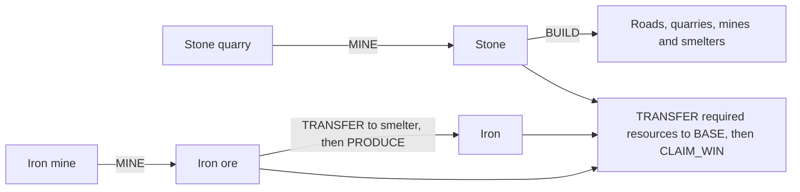
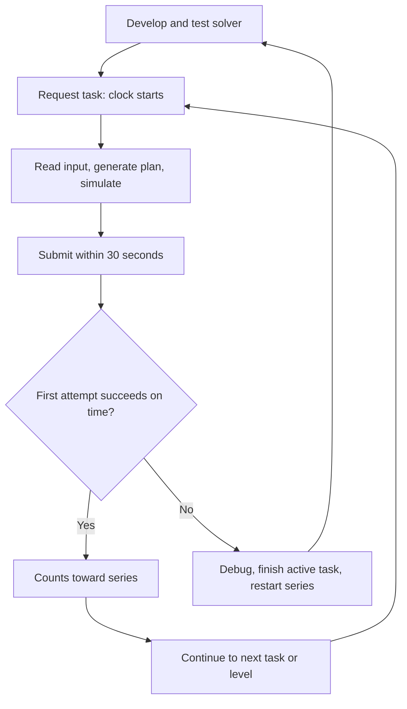

# Blade Runner recruitment solver

One Python 3.13 application solves all three stages of a deterministic logistics
game. It generates an ordered JSON action plan; the server receives the answer,
not Python code. The adopted solver completed 31 levels and 81 required series
positions: 93 submitted plans passed, 88 on time and five late.

**Ready for human review:** all 658 retained task/control records match the adopted
versions, 115 portable tests and 367 historical tests pass, and a fresh extracted
package installs and runs independently. Historical game results refer to the
research versions that actually ran, not a new server run of the packaged code.

Start with the [recruiter report](docs/reports/recruitment-delivery-report.md) for
the problem, conditional proofs, measured progression, all three stage chapters,
work-time accounting and remaining issues. The
[concluded whiteboard](.github/spec-driven-delivery/solution-whiteboard.md#final-adopted-solution)
contains the detailed adopted design and retained research history.

## Review the code

The solver tries validated shortcuts, then memoized DFS. Whole production
projects order choices. Optimistic bounds and DP reject proven dead branches;
failed greedy probes never reject a state. Time exhaustion returns UNKNOWN.

| Responsibility | Read first |
| --- | --- |
| Public solve/replay contract | [api.py](game_solver/solver/api.py) |
| Stage 1 geometry, search, selected cache and DP | [stage1.py](game_solver/solver/stage1.py), [stage1_preset.py](game_solver/solver/stage1_preset.py), [capital.py](game_solver/solver/capital.py) |
| Stage 2 typed resources and additional probes | [stage2.py](game_solver/solver/stage2.py), [resource_guidance.py](game_solver/solver/resource_guidance.py) |
| Stage 3 manufacturing, project ordering and on-demand DP | [stage3.py](game_solver/solver/stage3.py) |
| Independent raw-action legality | [reference.py](game_solver/solver/reference.py), [stage2_reference.py](game_solver/solver/stage2_reference.py), [stage3_reference.py](game_solver/solver/stage3_reference.py) |
| Single submission, recovery and verified progression | [runner.py](game_solver/solver/runner.py), [child.py](game_solver/solver/child.py) |
| Regressions and old/new comparison | [tests](game_solver/tests), [run_regressions.py](game_solver/tests/run_regressions.py) |

Stage 3's adopted probe settings are 512 initial decisions per policy, 512 DFS-state
interval and 32 later decisions per policy. These limit optional rollouts, not the
full search. Earlier stage presets retain their own measured settings.

## What you are building

Your program reads a map, starting resources, goal, and turn limit, then generates a plan to build, mine, deliver resources, and claim victory. Like LeetCode, tasks test a general solution. Here, your code runs locally and you submit its **action plan**, rather than code for the server to execute.

| Term | Meaning |
| --- | --- |
| Stage | One of three groups of levels; later stages add capabilities. |
| Level | A step within a stage; completing its required series unlocks the next level. |
| Series | Tasks required to complete a level; they may have different types. |
| Task | One input: map, starting resources, goal, and turn limit. |
| Plan | A JSON list of turns, each containing ordered actions. |
| Capabilities | Available resources, terrain, structures, actions, costs, and restrictions. |

Finish every level to unlock the next stage. Capabilities accumulate: Stage 3
includes the structures and actions from Stages 1 and 2.

| Stage | Levels / required series positions | New decision |
| --- | --- | --- |
| 1 | 17 / 17 | Spend stone to grow stone production, then retain enough to meet the goal. |
| 2 | 7 / 30 | Balance stone investment against ore production; ore cannot pay building costs. |
| 3 | 7 / 34 | Supply ore to smelters and schedule iron production before turns run out. |

The goal is the task's `level_goal`, not a fixed resource for the whole stage.
Stone remains construction money and can also be a goal. Ore can be a goal or
smelter input; iron is manufactured. Only the required stock **at the base**
counts toward victory. Local tests also cover goals requiring several resources.



After Stage 3, the organizers provide the recruitment next steps. Game-plan
submission and handing over this source package are separate activities.

## Timing and progression

There are **two separate limits**:

- **Game turns:** achieve `level_goal` within `max_turns`. Each task starts with one `BASE`, no other structures, and a resource goal at that base.
- **30 seconds:** each task in a series must succeed on its **first submission within 30 seconds of creation** to count toward advancement.

Creating a task starts the clock. Viewing stages, listing existing tasks, or fetching an existing task does not create one or restart its clock. Only one unfinished task is allowed at a time.

If you fail or miss the deadline, you must still finish that task with a correct submission. The current level's series resets; the next request starts the series again. Completed levels stay completed. Reuse your solver, but do not assume new tasks have identical maps.

```text
Required series: A passes → B passes → C passes → level complete
If C fails:     finish C → restart at A → pass the whole series again
```

**You do not write the solver in 30 seconds.** Develop and test on local examples or known tasks beforehand. A fresh task's exact input is revealed after creation. If it exposes a missing strategy, take time to debug, finish it, and retry the series with improved code.



## Shared rules and stage additions

| Available from | Structure | Cost in stone | Purpose |
| --- | --- | --- | --- |
| Stage 1 | `BASE` | Already present | Stores resources; its inventory pays for construction. |
| Stage 1 | `ROAD` | 1 | Carries transfers between storage structures. |
| Stage 1 | `STONE_QUARRY` | 10 | Mines up to 5 stone per turn on a stone node. |
| Stage 2 | `IRON_MINE` | 15 | Mines up to 5 ore per turn on an ore node. |
| Stage 3 | `SMELTER` | 20 | Converts up to 2 ore into 2 iron per turn on ordinary terrain. |

Capability **interfaces** describe abilities: `Buildable` permits construction; `Storage` holds resources; `Transport` forms routes; `Extraction` permits mining; `Production` permits recipe processing; `BaseOnly` makes inventory spendable for building. Action fields specify required inputs and types.

| Action | Inputs | Rule |
| --- | --- | --- |
| `BUILD` | `x`, `y`, `type` | Pay from base; build adjacent to an existing structure. |
| `MINE` | `x`, `y` | Mine each extractor at most once per turn; output stays there. |
| `TRANSFER` | `path`, `resource`, `amount` | Positive amount; storage endpoints, transport-only intermediate tiles, at least three coordinates. |
| `PRODUCE` (Stage 3) | `x`, `y` | Activate each smelter at most once per turn; consume its stored ore and store the iron there. |
| `CLAIM_WIN` | `x`, `y` | Claim at the base after its inventory meets the goal. |

Extractors must match the node's `resource_allow`; other structures cannot occupy
resource nodes. Construction uses an empty tile next to an existing structure;
our supported model uses up/down/left/right adjacency. A legal transfer needs
road tiles between storage endpoints: two adjacent storage buildings alone are
not a route. Mining income must reach the base before it can fund construction.

In Stage 3, transfer ore into a smelter **before** `PRODUCE`, then transfer its iron
to the base. Production automatically runs as many complete cycles as the stored
ore allows, up to two. One ore produces one iron; no ore makes the action fail.
To preserve ore for an ore goal, feed only what you want to consume. All buildings
share the stone budget; a useful project includes both its producer and the roads
needed to connect it. Shared roads can make several producers cheaper.

A turn can contain many actions **executed in order**; each sees earlier results. Actions may repeat unless restricted. Storage is unbounded. Every submission starts from the original task state: previous submissions leave no buildings or resources behind.

The documented map bounds are 25×25 with at most 24 resource nodes.
`PLANNED_ROAD` tiles suggest routes; they are not built roads. Alternative routes
are allowed. More production can help, but spending too much stone or building
it too late can leave no winning continuation.

### Stage 1: a three-turn example

Assume a base with 11 stone, a stone node two tiles away, and a goal of 15 stone within three turns. This is an illustration, not a fetched task.

```text
[BASE (0,0)] — [build ROAD (1,0)] — [build QUARRY on stone (2,0)]
```

| Turn | Ordered actions | Base stone afterward |
| --- | --- | --- |
| 1 | Build road (−1), build quarry (−10), mine 5, transfer 5. | 5 |
| 2 | Mine 5, transfer 5. | 10 |
| 3 | Mine 5, transfer 5, `CLAIM_WIN` at `(0,0)`. | 15 |

All transfers use `[(2,0), (1,0), (0,0)]`. Four actions in turn 1 still use only one game turn.

### Stages 2 and 3: ore and iron examples

For an ore goal, start with 16 stone and place an ore node at `(2,0)`.
Build the same road at `(1,0)`, build an `IRON_MINE` for 15 stone, mine 5 ore,
transfer it to the base, then claim a goal of 5 ore. All of this fits in one turn.
Stone is now zero; it cannot be replaced by the ore you collected.

For an iron goal, use this layout and start with 36 stone:

```text
BASE (0,0) — ROAD (1,0) — IRON_MINE (2,0)
                  |
             SMELTER (1,1)
```

| Same turn, in order | Result |
| --- | --- |
| Build road, mine and smelter (1 + 15 + 20 stone). | Base stone becomes 0. |
| `MINE` at `(2,0)`. | Mine holds 5 ore. |
| Transfer 2 ore along `[(2,0),(1,0),(1,1)]`. | Smelter has its input; mine retains 3 ore. |
| `PRODUCE` at `(1,1)`. | Smelter holds 2 iron. |
| Transfer 2 iron along `[(1,1),(1,0),(0,0)]`, then `CLAIM_WIN`. | Base meets a goal of 2 iron in one turn. |

These are illustrative local examples. A fresh server map may need more roads,
stone investment or several producers; the solver must choose from its actual
input rather than copy these plans.

## Setup and commands

Install [uv](https://docs.astral.sh/uv/) and Python 3.13. From the project root:

```bash
cd game_solver
uv sync --frozen
```

No credentials are needed for offline work. From the project root, run a fixed
sample through the real isolated child and strict replay:

```bash
./submit.sh --stage 3 --offline-smoke
```

To solve a task JSON locally or import the API:

```bash
cd game_solver
uv run --frozen python -m solver --stage 3 task.json > answer.json
uv run --frozen python -m unittest discover -s tests -t .
uv run --frozen python -m tests.run_regressions --suite all --output regression-results.json
```

```python
from solver import solve
result = solve(level, stage=3, seconds=24.0)
# result["plan"] is present only for a validated FEASIBLE answer.
```

The full portable corpus has 93 task records / 92 distinct inputs, plus 108 Stage 1,
150 Stage 2 and 307 Stage 3 control configurations. Those include impossible cases,
relay-premise differences and forced-search controls. Tests carry truth/witnesses;
the runtime solver receives only the task and its budget.

### Explicit live commands

Copy `game_solver/.env.example` to `game_solver/.env` and configure privately:

```dotenv
GAME_SERVER_BASE_URL=https://bladerunner.reef.pl/
GAME_SERVER_TOKEN=<your token from the game webpage>
```

Install dependencies before timed attempts. From the project root:

```bash
./submit.sh --stage 3 --check             # GET-only readiness check
./submit.sh --stage 3 --verify TASK_ID    # GET-only result verification
./submit.sh --stage 3 --submit-one        # create/solve/submit one fresh task
./submit.sh --stage 3 --loop              # recover pending task, then verified loop
```

Choose stage 1, 2 or 3 explicitly; the loop never enters another stage. Use one loop
at a time. Startup recovery keeps the pending task's original clock, submits at
most one validated answer, verifies the resulting series/reset, then continues.
New failure, lateness, ambiguous credit or inconsistent progression stops it.
Creation retries/reconciliation are bounded; submissions are never retried.
A completed stage makes no writes. Private temporary receipts retain original
inputs, plans, timing and GET verification. An accepted POST alone proves no credit.

## Code limits and delivery

The proofs assume the documented local model: cardinal adjacency, renewable
exact-five extraction, unlimited storage, ordered free legal transfers and
BASE-funded construction. Independent raw replay checks plans; neither local
replay nor observed server acceptance proves every unseen contract variant.
Finite search is complete without limits, but worst-case time/space are
exponential. No minimum-turn optimum or universal 30-second guarantee is claimed.

The original starter simulator is permissive and remains separate; it is not the
legality oracle. The official runtime imports no research/benchmark modules and
changes no sockets/environment on import. Only the explicit offline child denies
networking. Original research sources, receipts and prior reports stay preserved
in the owner-held workspace; they are not required to run the release.

The local source ZIP contains the official application, tests/fixtures, reports,
graphs, concluded design, compact evidence and checksums. It excludes credentials,
Git data, virtual environments, caches, raw conversation and bulk research. The
three exported historical chapters identify original source hashes and portable
evidence locations; some historical whiteboard links refer to the unbundled lab.
Nothing is published, emailed or merged by building the package.
