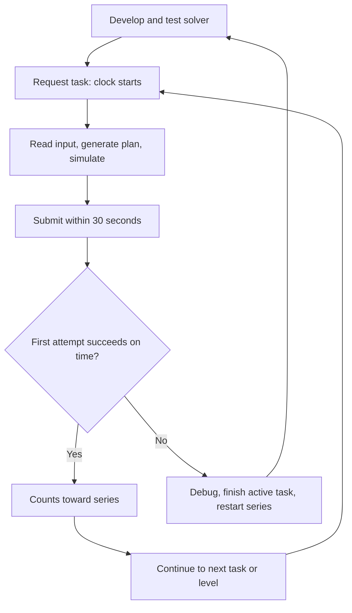

# Blade Runner recruitment game

Build a Python solver for the [recruitment game](https://bladerunner.reef.pl/), complete all three stages, then send the source code for review. This is a deterministic logistics puzzle: the same map and plan produce the same result. You play through an API, rather than by clicking on the board.

**Current state:** the starter package is extracted. Its `ramp_up` strategy only solves the introductory level. No tasks have been requested or submitted during this project setup.

## What you are building

Your program reads a map, starting resources, goal, and turn limit, then generates a plan to build, mine, deliver resources, and claim victory. Like LeetCode, tasks test a general solution. Here, your code runs locally and you submit its **action plan**, rather than code for the server to execute.

| Term | Meaning |
| --- | --- |
| Stage | One of three groups of levels; later stages add capabilities. |
| Level | A step in the fixed progression. Stage 1 has 17 levels. |
| Series | Tasks required to complete a level; they may have different types. |
| Task | One input: map, starting resources, goal, and turn limit. |
| Plan | A JSON list of turns, each containing ordered actions. |
| Capabilities | Available resources, terrain, structures, actions, costs, and restrictions. |

Finish every level to unlock the next stage. After Stage 3, the organizers email information about next steps.

## Timing and progression

There are **two separate limits**:

- **Game turns:** achieve `level_goal` within `max_turns`. Each task starts with one `BASE`, no other structures, and a goal requiring an amount of one resource at that base.
- **30 seconds:** each task in a series must succeed on its **first submission within 30 seconds of creation** to count toward advancement.

Creating a task starts the clock. Viewing stages, listing existing tasks, or fetching an existing task does not create one or restart its clock. Only one unfinished task is allowed at a time.

If you fail or miss the deadline, you must still finish that task with a correct submission. The current level's series resets; the next request starts the series again. Completed levels stay completed. Reuse your solver, but do not assume new tasks have identical maps.

```text
Required series: A passes → B passes → C passes → level complete
If C fails:     finish C → restart at A → pass the whole series again
```

**You do not write the solver in 30 seconds.** Develop and test on local examples or known tasks beforehand. A fresh task's exact input is revealed after creation. If it exposes a missing strategy, take time to debug, finish it, and retry the series with improved code.



## Stage 1 rules

| Structure | Cost | Purpose |
| --- | --- | --- |
| `BASE` | Already present | Stores resources; its inventory pays for construction. |
| `ROAD` | 1 stone | Carries transfers between storage structures. |
| `STONE_QUARRY` | 10 stone | Stores output; mines up to 5 stone per turn on a stone node. |

Capability **interfaces** describe abilities: `Buildable` permits construction; `Storage` holds resources; `Transport` forms routes; `Extraction` permits mining; `BaseOnly` makes inventory spendable for building. Action fields specify required inputs and types.

| Action | Inputs | Rule |
| --- | --- | --- |
| `BUILD` | `x`, `y`, `type` | Pay from base; build adjacent to an existing structure. |
| `MINE` | `x`, `y` | Mine each extractor at most once per turn; output stays there. |
| `TRANSFER` | `path`, `resource`, `amount` | Positive amount; storage endpoints, transport-only intermediate tiles, at least three coordinates. |
| `CLAIM_WIN` | `x`, `y` | Claim at the base after its inventory meets the goal. |

Extractors must match the node's `resource_allow`; other structures cannot occupy resource nodes. Transfers require a connected route. Mining income must reach the base before it can fund construction.

A turn can contain many actions **executed in order**; each sees earlier results. Actions may repeat unless restricted. Storage is unbounded. Every submission starts from the original task state: previous submissions leave no buildings or resources behind.

Maps are at most 25×25 with at most 24 resource nodes. `PLANNED_ROAD` tiles suggest routes; they are not built roads. Alternative routes are allowed. Building everything can waste resources and turns; practical heuristics usually suffice. Turn limits are usually single or low double digits.

### A two-turn example

Assume a base with 11 stone, a stone node two tiles away, and a goal of 10 stone within two turns. This is an illustration, not a fetched task.

```text
[BASE (0,0)] — [build ROAD (1,0)] — [build QUARRY on stone (2,0)]
```

| Turn | Ordered actions | Base stone afterward |
| --- | --- | --- |
| 1 | Build road (−1), build quarry (−10), mine 5, transfer 5. | 5 |
| 2 | Mine 5, transfer 5, `CLAIM_WIN` at `(0,0)`. | 10 |

Both transfers use `[(2,0), (1,0), (0,0)]`. Four actions in turn 1 still use only one game turn.

## Setup and commands

Use Python 3.13 and [uv](https://docs.astral.sh/uv/). From the project root:

```bash
cd game_solver
cp .env.example .env
uv sync
```

Set `.env` as follows, replacing the example's server address. Keep `.env` and the token out of Git and the final ZIP. Install dependencies before timed attempts.

```dotenv
GAME_SERVER_BASE_URL=https://bladerunner.reef.pl/
GAME_SERVER_TOKEN=<your token from the game webpage>
```

**List existing tasks** without creating or submitting one:

```bash
uv run python main.py tasks
```

**Debug an existing task:** replace `TASK_ID`. This shows the simulated plan, then asks `Submit plan?`; answer **`n`** to avoid submission. Its original deadline continues.

```bash
uv run python main.py solve-task ramp_up --stage 1 --task-id TASK_ID --show-board --show-plan --plan-step
```

**Attempt advancement:** first implement `strategies/my_strategy.py`; that name is a placeholder below.

```bash
uv run python main.py advance my_strategy --no-visualize
```

`advance` reuses a suitable unfinished task or creates a new one, generates the plan, and **submits automatically without confirmation**. `--loop` repeats advancement. For existing tasks, `solve-task ... --auto-submit` also submits automatically. `solve-interactive` browses existing tasks, pauses by default, and asks before submission unless `--auto-submit` is set. Use step-through views for debugging, not timed attempts.

The API uses bearer-token authentication:

```text
POST /api/stage/{stage}/tasks/request                 create next task
GET  /api/stage/{stage}/tasks/{task_id}                read input
POST /api/stage/{stage}/tasks/{task_id}/submit         send {"plan": [[actions...], ...]}
GET  /api/stage/{stage}/progress                      check advancement
```

Stages, capabilities, task lists, and a level schema are also available. Check the submission result **and stage progress**; an HTTP response alone does not prove advancement.

## Code, limits, and delivery

| Location | Purpose |
| --- | --- |
| [main.py](game_solver/main.py) | CLI: fetch, simulate, display, submit. |
| [strategies/](game_solver/strategies/) | Your solving logic; extend `BaseStrategy`. |
| [game_simulation/](game_solver/game_simulation/) | Local board, structures, inventory, actions. |
| [api_client/](game_solver/api_client/) | Requests and input/output models. |
| [visualizers/](game_solver/visualizers/) | Board, inventory, plan views. |
| [Starter README](game_solver/README.md) | Framework and command details. |

Strategies yield actions, which immediately update shared local state. Mining flags reset each turn. Emit `ClaimWinAction` when the goal is met. A default 100-iteration guard prevents endless action-generation loops.

**The starter simulator is not a complete validator.** It permits negative build balances, lacks full placement and transfer-route checks, does not reject repeated mining, and does not validate the goal when applying `CLAIM_WIN`. Add checks or enforce these rules in your strategy. Local success does not guarantee server acceptance.

Remaining work: build and test a general solver, complete every series under its limits, and deliver readable source code. Later stages may require extending models and simulation as well as strategies; inspect their capabilities when unlocked. LLM assistance is allowed.

After completing the game, email a source-code ZIP to **hiring2@reef.pl** with subject **`Code Solution - [Your Name and Surname]`**. Game submissions contain plans; the final ZIP contains code.

Rules here come from the game page and supplied starter package. This README describes Stage 1 capabilities; later stages must be checked when available.
