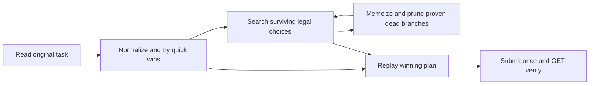
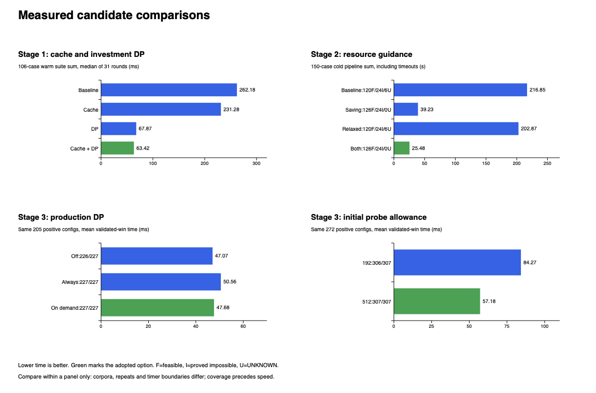
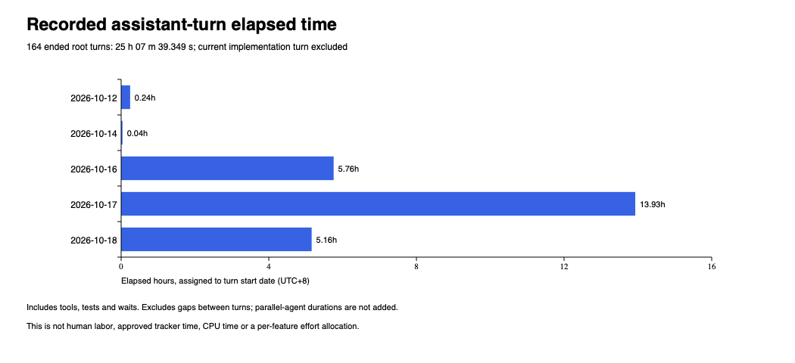

# Blade Runner: from a puzzle model to a measured solver

**Ready for human review.** All three game stages are complete. The official
application, regression corpus and submission helper passed local migration
validation and fresh extracted-package checks. Historical game/experiment
results below describe the versions that actually ran.

## Background and outcome

The recruitment task is a deterministic logistics game accessed through an API.
Each case supplies a map, starting resources, a goal at BASE and a game-turn
limit. A Python program generates an ordered JSON action plan; that plan is
submitted to the server. Later stages add ore mining and iron manufacturing.

There are two limits: fit the game turns, and pass on the first submission within
30 seconds of server task creation. Several actions can occur in one turn, so
mine/transfer/build order and cash after every action matter. A final balance
alone does not establish legality.

| Stage | Capability added | Levels | Required series positions | Tasks | Timely passes | Late passes |
| --- | --- | ---: | ---: | ---: | ---: | ---: |
| 1 | Stone and roads | 17 | 17 | 19 | 17 | 2 |
| 2 | Ore and typed investment | 7 | 30 | 36 | 34 | 2 |
| 3 | Smelters and iron | 7 | 34 | 38 | 37 | 1 |
| Total | All stages complete | 31 | 81 | 93 | 88 | 5 |

All 93 submitted plans passed on their only submission. Five were late, so this
was not one uninterrupted perfect progression run. Series resets lost four
previous credits in Stage 2 and three in Stage 3: 88 timely flags minus seven lost
credits give 81 required positions. Final GET records show no pending task.
There are 93 task IDs and 92 distinct input hashes; two task records share an input.

Our aim was to develop offline and make each timed submission deliberate. When
real tasks exposed a gap, we preserved the input and failed observation, diagnosed
it locally and improved the solver before resuming. We did not assume that a new
seed would reproduce the old map or erase the earlier failure from the evidence.

The three stage chapters retain every task input, turn/action count, timing and
incident: [Stage 1](stage-1-report.md), [Stage 2](stage-2-report.md),
[Stage 3](stage-3-report.md).

| Historical timely observations | Median in-process solver time | Median server task-clock time |
| --- | ---: | ---: |
| Stage 1 | 0.648 ms | 1.481 s |
| Stage 2 | 20.249 ms | 1.499 s |
| Stage 3 | 127.156 ms | 1.799 s |

Different stages have different inputs and timer wrappers. These are historical
observations, not cross-stage speedups. Server creation-to-pass time owns
eligibility; client acquisition can begin before actual creation. Neither clock
difference nor summed client windows isolates CPU, network or project labor.

## Solution in plain words

We combine exact search with cheap ways to finish or prove a branch cannot win:

1. **Memoized DFS** explores remaining legal choices and remembers complete normalized states. Identical states have identical futures; producer counts alone are not enough.
2. **Greedy probes** try short deterministic policies. A successful plan is replayed; a miss always leaves full search available.
3. **Project ordering** ranks a producer together with its required roads, using cash, income, goal gap and remaining turns. It changes priority, not which legal alternatives exist.
4. **Optimistic pruning and DP** solve an easier resource/funding problem. Failure even with these advantages proves a real continuation impossible. Repeated subproblems are cached.

Stage 1 adds one-quarry and waiting completions, connectivity reuse and investment
DP. Stage 2 keeps stone and ore separate and adds saving-aware and relaxed-resource
policies. Saving-aware can wait for a useful investment instead of spending its
capital immediately. Stage 3 makes production optional, orders whole projects,
and enables production DP only after initial probes miss.

The adopted Stage 3 settings are 512 internal decisions per initial policy,
32 per later policy, at every 512 full-search states. These optional allowances
are not a global state cap or submitted action count. A decision may expand into
many mining/transfer actions. Deadline exhaustion returns UNKNOWN.

## Correctness: the guarantee and its boundary

Proofs apply to the stated local model: cardinal neighbors, one initial BASE,
renewable five-unit extraction, unlimited storage, BASE-funded construction and
free ordered transfers with ROAD-only interiors. Conservative plans replay under
both retained storage-relay interpretations. Acceptance of these plans does not
prove full equivalence to every possible server rule.

**Normalization is exact.** Compatible storage connected through legal road paths
can exchange stock freely. We keep one total per resource component at a canonical
root. Adjacent storage alone does not create a road connection. Mining early is
safe because it consumes nothing and storage is unbounded. Every raw winner has
a normalized construction trace with sufficient cash at every prefix; normalized
moves expand into legal raw actions.

**Manufacturing remains optional.** Feeding exactly one or two ore to an unused
smelter preserves partial-production choices. Eagerly consuming all ore would be
wrong for a mixed ore/iron goal. Activation flags remain in the state key.

**Pruning is one-directional.** Pool remote stock, grant free roads or assume early
producer access. Every real winner projects into this easier game. Its failure
proves real failure; its success only means 'not ruled out'. DP work-budget skips
weak-pass rather than inventing impossibility. A failed heuristic never becomes
a dead-state proof.

For example, the Stage 1 DP stores minimum stone F(d,q), with d future turn advances
and q already-mined quarries. Finish costs the goal amount; waiting credits 5 q.
Building pays 10 before returning 5. Thus F(0,q)=goal, and later rows minimize
`goal`, `max(0,F(d-1,q)-5q)` and `max(10,F(d,q+1)+5)` where another site exists.
Even pooled wealth below this free-road relaxation cannot fund a real winner.
Stage 2 adds typed ore demand; Stage 3 adds conversion capacity and factory funding.

**Completeness needs time.** Full state identity includes topology, stock, turn
and used production activations. Every affordable legal build, production choice
and relevant turn advance survives ordering. Builds occupy a new cell, production
uses an activation and END advances finite time; the normalized graph is finite.
Memoized DFS with sound cuts is complete if allowed to exhaust it. A stopped
search can still contain a winning state, so UNKNOWN is distinct from INFEASIBLE.

Worst-case work and memory remain exponential. With V cells, K nodes and T turns,
resource units are bounded by M=initial total+5 KT. A loose state bound is
`T*12^V*(M+1)^(3V)`. Work includes state expansion, graph/order/bound calculations,
DP, probes and raw-plan replay; memory includes states, caches and paths. No
polynomial complexity, minimum-turn optimality or universal 30 s claim is made.
The [concluded design](../../.github/spec-driven-delivery/solution-whiteboard.md#mathematical-guarantees-and-limits)
contains precise invariants, recurrences and links to the full derivations.

## How measurements changed the design

We fixed inputs/baselines, retained every result and compared coverage before
latency. Tiny exhaustive oracles, witnesses and independent impossibility
certificates supply expectations; replay does not import candidate search.
Observed development cases are not called untouched heldouts after tuning.

### Stage 1: remove repeated geometry, then reject bad investments

Counters exposed repeated transfer-tree construction. Topology caching can reuse
geometry across inventory changes. Separate investment DP catches bad capital
branches that a loose production upper bound misses.

| Variant | Median warm suite solve sum, ms | All 108 cold cases |
| --- | ---: | --- |
| baseline | 262.179 | 66 wins /42 proofs /0 UNKNOWN |
| cache | 231.278 | 66 wins /42 proofs /0 UNKNOWN |
| dp | 67.871 | 66 wins /42 proofs /0 UNKNOWN |
| both | 63.418 | 66 wins /42 proofs /0 UNKNOWN |

The warm sum covers 106 common cases in 31 aligned rounds and excludes startup.
Two slow cases were retained in the cold 108 but excluded from every warm arm
by the declared rule. Cache+DP lowers the warm suite sum 75.8%. DP had little
benefit on the original small/easy groups; adding bad-investment controls exposed
where it helps. Larger cache alternatives also had memory and lookup costs.

### Stage 2: faster losing searches were not enough

A pruning/reuse bundle cut time on 81 common winning inputs 6.5%, but all variants
still missed the same six known-solvable cases in its 111-case study. Total time
moved only 0.2% because deadline misses dominated. We investigated investment
ordering instead of presenting that small speed gain as a solved coverage gap.

| Policy | Wins / proofs / UNKNOWN,150 cases | Observed pipeline sum,s |
| --- | --- | ---: |
| baseline | 120 /24 /6 | 216.854 |
| saving | 126 /24 /0 | 39.228 |
| relaxed | 120 /24 /6 | 202.866 |
| both | 126 /24 /0 | 25.483 |

Saving-aware closed the six gaps. Relaxed guidance initially showed no extra
coverage, so we retained a declared economic challenge pool to evaluate it.
Five of seven selected baseline-miss challenges met the repeated 2× speed/work
rule. Both policies were retained. These are selected development challenges,
not server-frequency estimates. The full economic study had 912 runs including
preselected repeats; the table includes real timeout durations.

### Stage 3: stronger checks, paid for on demand

Production DP supplied evidence that ordering alone could not. Always running
it also charged easy initial wins. We compared off, always on and on demand.

| Production DP | Reliable in all 3 rounds | Mean validated win, same 205 positive configurations |
| --- | ---: | ---: |
| Off | 226/227 | 47.07 ms |
| Always on | 227/227 | 50.56 ms |
| On demand, adopted | 227/227 | 47.68 ms |

The DP-off miss was an independently proven impossible control, not a false
infeasibility verdict. On-demand retained 227/227 and lowered mean winning time
5.7% versus always-on, with interval 512 and identical ordering/probes.

### A useful policy stopped just before success

Stage 3 task `3f0d26c4` used 13.173 s in acquisition; its remaining 11.302 s solver
allowance returned UNKNOWN without submitting. Local diagnosis found the capital
probe stopped at 192 internal decisions on a viable path. The productive network
was already built; 256 decisions completed that same policy. This isolated a
truncated optional rollout, with no evidence that pruning removed its valid path.

We tested larger later probes and different intervals, then compared initial
192/512 at fixed interval 512/later 32 over 307 configurations/293 maps, three cold
rounds per arm: 1842 actual runs, including every timeout and regression.

| Initial allowance | Reliable configurations | Mean validated win, same 272 positives | Max worker RSS |
| --- | ---: | ---: | ---: |
| 192 | 306/307 | 84.27 ms | 54.69 MiB |
| 512, adopted | 307/307 | 57.18 ms | 52.69 MiB |

Common winning time fell 32.1%. The failed map changed from three 30 s UNKNOWNs
to three 0.457–0.486 s wins. Two long-horizon controls slowed 0.354/0.590 s; those
regressions remain disclosed. This experiment isolates initial allowance, not
all simultaneous live setting changes. The resumed script verified late cleanup
and series reset, then counted all 18 fresh tasks at 1.218–3.537 s server time.
The cleanup's 11,623 s task age includes waiting/investigation, not hours of search.

## Test policy, observability and remaining delivery work

We used tiny raw-action oracles, independent feasible/impossible controls,
random/adversarial maps, tight funds/turns, mixed resources, planned roads, shared
infrastructure and long production horizons. Probes-disabled controls force full
search so an easy greedy-only corpus cannot hide fallback defects. Observed
passed and failed tasks remain regression inputs.

Metrics include verdict/plan, timing boundary, CPU/RSS where measured, expansions,
duplicates, bound/DP calls and skips, cache behavior and probe policy/work. Frozen
sources/fixtures and raw rows make comparisons auditable. Missing phases/counters
stay unavailable; profiler overhead is not confused with ordinary runtime.

The last research adoption validation passed 367 tests across 42 isolated modules,
307 Stage 3 configuration outcomes and 55 saved Stage 1/2 maps. All 38 submitted Stage 3
plans also replayed under both modes. This is broad evidence, not measured 100%
branch coverage or coverage of every possible map.

The official package now contains all 93 task records and 92 distinct inputs,
including the 18 fresh Stage 3 maps. It retains 108/150/307 local stage controls and
three earlier stopped observations. Observed task IDs remain associated with
original inputs, source hashes, witnesses and counted/late outcomes.

| Promotion check | Current evidence |
| --- | --- |
| Stage 1 selected cache/DP extraction | 24 basic cases: identical adopted/official plans, verdicts and semantic counters |
| Typed-stage extraction | 67 matching-preset cases plus 38 explicit unrestricted controls:105 identical comparisons |
| Independent semantics | 23 focused model tests, including 20925 forward-enumerated investment-threshold checks |
| Submission runner | 88 fake-client tests; no live task calls |
| Package/process boundary | Four focused tests: saved witnesses, import/child boundary, token stripping, offline CLI |
| Actual isolated child | Three stage smokes and the previously stopped Stage 3 map pass locally |
| Complete corpus and clean ZIP | 658/658 adopted/official comparisons match; fresh locked install, 115 portable tests and all three offline smokes pass |

`game_solver/solver/` separates the stage engines, pure helpers, independent
validators and runner. Stage 1 no longer needs temporary global monkeypatches;
its model explicitly supplies the selected bound to both DFS and greedy probes.
Imports leave sockets/environment unchanged. Network denial happens only inside
the explicit solver child, after normal SSL setup. Functions document state,
units, bound direction, DP invariants and error meanings. The original research
and historical source hashes are preserved.

The thin offline entry point generates answers from original task JSON.
`submit.sh` uses the same package for all stages, defaults to a GET-only check,
and requires explicit live modes to create/submit. It preserves one submission,
bounded creation reconciliation, deadline accounting and numeric progression/
reset verification. The original starter simulator is not our legality oracle.

After both retained reviewers approved the exact implementation audit, the
complete migration run passed. Every record below matched the adopted version's
verdict, plan and non-time search counters. Winning plans were replayed against
the original input; matching typed plans passed both retained relay modes.

| Final local corpus | Records/configurations | FEASIBLE | INFEASIBLE | UNKNOWN |
| --- | ---: | ---: | ---: | ---: |
| All observed server task records | 93 | 93 | 0 | 0 |
| Stage 1 controls | 108 | 66 | 42 | 0 |
| Stage 2 controls | 150 | 126 | 24 | 0 |
| Stage 3 controls, including forced search | 307 | 273 | 34 | 0 |
| Total | 658 | 558 | 100 | 0 |

The 93 task records include every passed case and the previously stopped maps;
repeated inputs retain their separate task associations. The 115 portable tests
passed, and all 367 historical tests passed again in 42 isolated modules. These
suites overlap in assertions; their counts are not added as distinct coverage.

A fresh extracted copy installed only the lockfile's dependencies, then passed
all 115 portable tests and the three stage smoke paths. Its imports resolved
inside the extracted application, with research and .env absent. The reviewed
32-file implementation digest stayed unchanged throughout these checks.
The slowest observed saved-task subprocess was 0.530 s; the slowest adversarial
Stage 2 control was 16.482 s. These validation timings include startup/solve/JSON,
exclude parent replay, and overlapped other checks; they are not a new controlled
speedup benchmark or server creation-to-pass guarantee.

[Final migration evidence](evidence/migration-full.json) records every outcome,
input hash, plan hash, raw-replay modes, old/new equality and validation boundary.
The source ZIP has an explicit file allowlist, content inventory and checksums.
It excludes credentials, raw conversation, Git/venv/cache data and bulk lab
output. Exported historical chapters retain their original measurements and
identify compact evidence/source hashes; the frozen whiteboard is byte-identical.
Historical timings have not been relabeled as refactored-code measurements.

## Time spent: the available measurement

The conversation records explicit start/end events and duration_ms. Pairing by
turn ID gives **164 ended assistant turns totaling 25 h 07 m 39.349 s**:162 completed
turns at 24 h 48 m 01.492 s and two interrupted turns at 19 m 37.857 s. Coverage is
12 October 22:47 through 18 October 19:21(UTC+8). The 140 h 33 m 51 s calendar span includes
gaps; those gaps are excluded from the 25 h 07 m total. The current implementation
turn is open and excluded. At the 19:47 snapshot it had 24 m 45.831 s observed elapsed,
recorded separately, not added to the authoritative ended-turn sum.

This is **assistant-turn elapsed time**, including generation, tools, tests,
benchmarks and waits. It is not human labor, tracker-approved time, CPU time or
summed parallel-agent labor. No ended root turns overlap. Explicit wait/sleep
calls total 47 m 30.484 s, already included; other waiting is also included, so
subtracting it would not produce an active-work total.

| Turn start date,UTC+8 | Ended turns | Recorded elapsed |
| --- | ---: | ---: |
| 2026-10-12 | 20 | 00:14:37.362 |
| 2026-10-14 | 1 | 00:02:10.548 |
| 2026-10-16 | 46 | 05:45:25.722 |
| 2026-10-17 | 52 | 13:55:43.556 |
| 2026-10-18 | 45 | 05:09:42.161 |

Each turn belongs to its start date. The [sanitized per-turn ledger](evidence/conversation-turn-times.csv)
and [audit record](evidence/conversation-time-audit.json) preserve boundaries,
recorded durations and source-line references. Keyword tags describe requests,
not measured per-feature effort; they are not a timesheet. Raw private
conversation is excluded from delivery material.

Why did this take longer than the live solver runs? We derived the model,
created cause-bearing controls, implemented and compared alternatives, retained
negative results, diagnosed failures, repeated cold/warm measurements, and
reviewed proofs and reports. Repeated 30 s misses and PoCs cost elapsed engineering
time. This evidence-first process costs more than changing a heuristic and
immediately submitting. The logs cannot precisely allocate human effort among
these activities, and no such allocation is invented.

## Open issues and reading order

All five issues were OPEN in the report's [GitHub readback](evidence/issues-readback.json):

| Issue | Further improvement / boundary |
| --- | --- |
| [#1 Deadline allocation](https://github.com/hhhhhusky777/blade_runner/issues/1) | Slow acquisition plus hard fallback still needs authoritative task-age accounting and combined validation. |
| [#2 Model/contract boundary](https://github.com/hhhhhusky777/blade_runner/issues/2) | Keep adjacency, extraction and relay premises explicit; plan acceptance is not full model equivalence. |
| [#3 Phase timing](https://github.com/hhhhhusky777/blade_runner/issues/3) | Separate acquisition/startup/replay/submit/readback and investigate upstream delay without guessing its cause. |
| [#4 Stage 2 reuse plus guidance](https://github.com/hhhhhusky777/blade_runner/issues/4) | Benchmark the existing combination rather than assume individual benefits compose. |
| [#5 Incomplete-probe reuse](https://github.com/hhhhhusky777/blade_runner/issues/5) | Reuse partial progress for ordering/calculation; a greedy miss must never become a dead-state proof. |

Start with this report, then the three stage chapters for all task rows, the
[concluded design](../../.github/spec-driven-delivery/solution-whiteboard.md#conclusion-candidate-c1)
for precise proofs, then [the review guide](../../README.md#review-the-code) for
the official package and reproducible offline commands. Compact
[delivery evidence](evidence/delivery-evidence.json) binds tables/figures to source
hashes and defines each comparison. The owner retains full raw research; a reader
need not inspect gigabytes of trials to understand the solution.

[Python 3.13 entry-point guidance](https://docs.python.org/3.13/library/__main__.html)
and [PyPA layout trade-offs](https://packaging.python.org/en/latest/discussions/src-layout-vs-flat-layout/)
support code organization. Project-specific proofs come from invariants and
independent validators; improvement claims come from controlled comparisons.
The result is an evidence-driven general solver that completed the observed
recruitment progression, with its limitations and remaining work stated openly.
