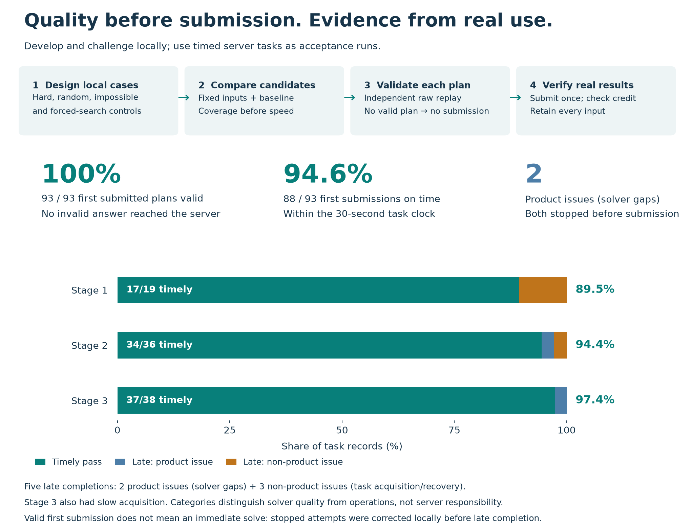
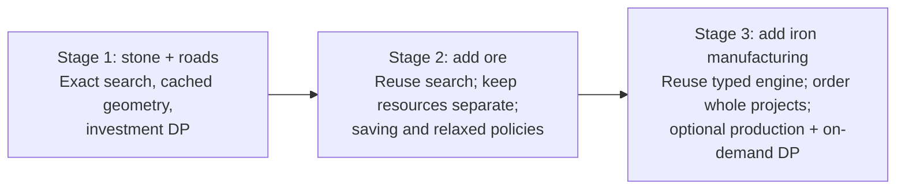
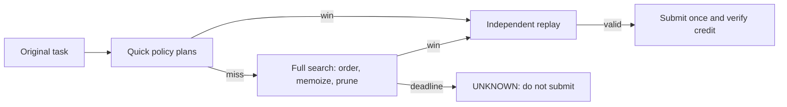
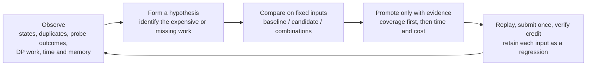
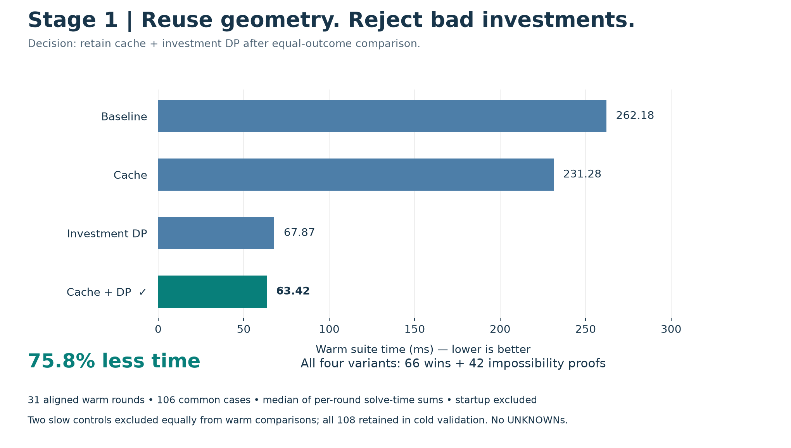
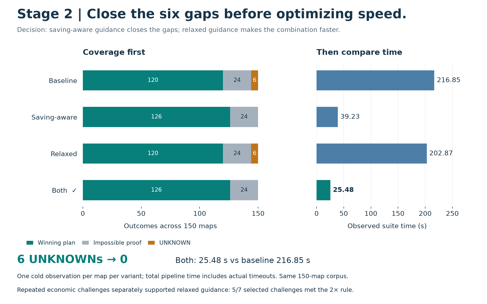
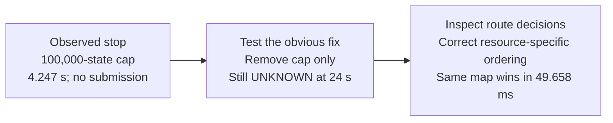
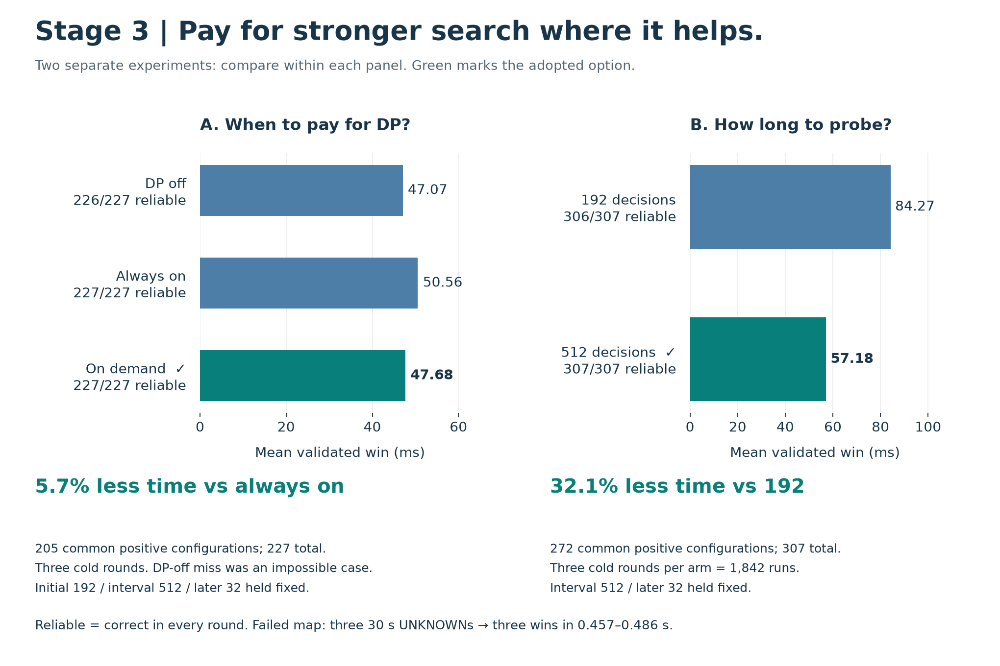
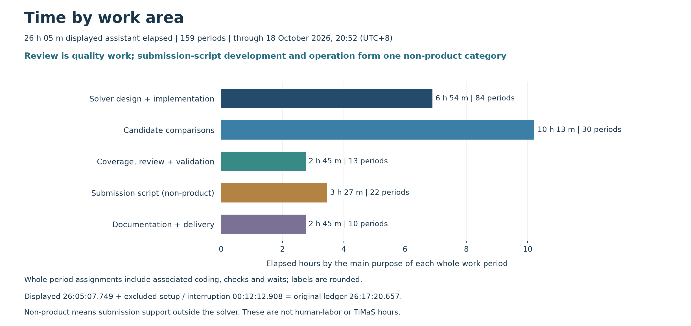

# Blade Runner: an evidence-led path through three stages

**31 levels completed · 81 required series positions · 93 valid plans.**
One Python application handles the full game. It reads a map and resource goal,
then returns an ordered JSON plan within the game's turn limit. Advancement also
requires the first submission within 30 seconds of task creation.

**Quality advantage: validate locally before live acceptance.** Hard local cases,
fixed-baseline comparisons and independent plan replay reduced delivery risk
before submission. The chosen delivery standard treated live tasks as customer
acceptance runs: a missed deadline was a delivery failure, even if recovered
later. Local cases were the main development laboratory. Any live gap was
investigated locally, and every observed input became a regression. The aim was
to handle each live input with the care expected for customer work.

**Read the rates separately:** all 93 plans were valid on their first and only
submission; 88 arrived on time. **Product issues** mean solver gaps: two tasks
(Stages 2 and 3) stopped before submission. **Non-product issues** mean task
acquisition or recovery incidents: three other tasks were late. These labels
distinguish solver quality from submission operations; they do not assign blame
to the server. All five tasks were eventually completed; series resets lost
seven earlier credits.

The shared engine tries quick policy plans, then searches remaining choices and
remembers visited states. It prunes only proven dead branches. A failed quick
plan leaves full search available. **DP** means saving answers to repeated funding
or production subproblems.

**Observability was part of the design.** Search counters, timings, probe and
pruning outcomes, failure reasons and saved cases made performance and errors
inspectable. Building and checking that evidence took engineering time; it
supported diagnosis and baseline comparisons before selecting improvements.

## Stage 1 — build a correct search, then remove repeated work

**New problem.** Stone is both construction money and the goal. Roads enable
transport; quarries create income. A profitable final balance is insufficient:
every construction action must be affordable when it executes.

**Design.** Model topology, inventory, turn and used activations. Search legal
continuations, remember equivalent states, and try cheap completion policies.
A producer and its connecting roads are one investment. Independent raw-action
replay checks the resulting plan against the original map.

**Observation → decision.** Counters exposed repeated connectivity work. Caching
reuses routes when the network is unchanged. Investment DP rejects states that
cannot afford the goal even in an easier game with free roads. DP showed little
benefit on easy inputs; bad-investment controls revealed where it mattered.

**Adopted:** cache + investment DP: **75.8% lower warm suite time**, equal
outcomes. The cold corpus retains two slow cases omitted equally from warm timing.

**Stage 1 delivery summary**

| Measure | Result |
| --- | --- |
| Progression | 17/17 levels; 17 required series positions completed |
| First submitted plan valid / timely | **19/19 (100%)** / **17/19 (89.5%)** |
| Observed maps and starting resources | Largest 25×24; 1–23 stone sites; 12–19 starting stone |
| Goals and limits | 15–300 stone; 4–14 turns |
| Timely solver time: median / maximum | 0.648 / 14.181 ms |
| Timely server clock: median / maximum | 1.481 / 2.815 s |
| Final local controls | 108: 66 winning plans, 42 impossibility proofs, zero UNKNOWN |
| Late-task issues | **0 product; 2 non-product** |

**Integration lesson:** task-ID handling and timeout recovery caused two late
tasks. The corrected runner locates an existing task before creating another
and verifies progression. The upstream timeout cause remains unconfirmed.

## Stage 2 — preserve capital while introducing a second resource

**New problem.** Ore cannot pay construction costs. Building the nearest
producer can spend the stone needed for a better investment. The Stage 1 search
is reused with separate stone and ore inventories and resource-aware routes.

**Observation → decision.** A pruning/reuse candidate improved common wins by
6.5%, yet still missed the same six known-solvable cases. Across all 111 inputs,
the time reduction was only 0.2%; the bundle was not adopted.
The comparison paired saving-aware policies, which can wait to fund a useful
project, with relaxed-resource guidance, which uses an easier economic model
to suggest quick plans. These policies guide search; their failure never proves
impossibility.

**Adopted:** both policies. Saving-aware guidance closed all six gaps. Relaxed
guidance added no standalone coverage in this corpus. In a separate challenge,
five of seven selected economic cases met a repeated 2× speed/work
criterion. That evidence justified keeping it. Selected development challenges
are not estimates of how often such maps occur on the server.

**The product issue shows why counters matter:**

Removing the state cap alone was insufficient. The corrected map remains a
regression; the final solver uses only a time limit.

**Stage 2 delivery summary**

| Measure | Result |
| --- | --- |
| Progression | 7/7 levels; 30 required series positions completed |
| First submitted plan valid / timely | **36/36 (100%)** / **34/36 (94.4%)** |
| Observed maps and starting resources | Up to 25×25; 3–20 stone / 0–7 ore sites; 12–23 starting stone |
| Goals and limits | 32 ore tasks (5–250); 4 stone tasks (25–180); 6–18 turns |
| Timely solver time: median / maximum | 20.249 / 203.250 ms |
| Timely server clock: median / maximum | 1.499 / 3.201 s |
| Final local controls | 150: 126 winning plans, 24 impossibility proofs, zero UNKNOWN |
| Late-task issues | **1 product; 1 non-product** |

**Two late tasks:** the product issue above and a non-product acquisition
timeout with no solver execution. One long successful client run spent 21.923 s
acquiring the task but only 89 ms solving it. Separate timing boundaries
distinguished acquisition delay from search cost.

## Stage 3 — schedule manufacturing and pay for stronger checks on demand

**New problem.** Smelters consume ore to make iron. Ore may also be required at
the base, so production must stay optional. The state retains resource types and
per-turn activation flags. Tasks without an iron goal can reuse earlier engines.

**Design.** Order whole production projects using goal gap, funds and remaining
turns. Add production DP to reject impossible funding/conversion schedules,
but activate it only after initial quick plans miss. The proof direction stays
the same: if even the easier problem cannot win, the real branch cannot win.

**Decision A: on-demand DP.** It retained all 227 reliable configurations and
reduced mean winning time 5.7% versus always on. Instrumentation explains why:
DP queries fell from 183,045 to 38,235 across the study; initial-probe queries
fell from 144,399 to zero. Strong pruning remained available for fallback.

Not every plausible policy helped. An earlier state-triggered probe experiment
on eight controls reduced expansions 6.3% but increased CPU time 21.1%. The
interval trigger stayed. Counting fewer states alone would have selected the
wrong improvement.

**Decision B: longer initial probes.** The live miss consumed 13.173 s acquiring
the task, then exhausted its 11.302 s solver allowance. A local trace found a
useful policy truncated at 192 decisions; allowing 256 finished it. A comparison
tested 192 against 512 with the interval fixed at 512 and later probes at 32.

Across 1,842 runs, initial 512 raised reliability from 306/307 to 307/307 and
reduced common winning time 32.1%. The failed map changed from three 30-second
misses to three wins in 0.457–0.486 s. Two long-horizon controls slowed by
0.354/0.590 s; these costs remain in the evidence. The adopted settings are
**512 initial decisions / 512-state interval / 32 later decisions** per policy.

**Stage 3 delivery summary**

| Measure | Result |
| --- | --- |
| Progression | 7/7 levels; 34 required series positions completed |
| First submitted plan valid / timely | **38/38 (100%)** / **37/38 (97.4%)** |
| Observed maps and starting resources | Up to 25×25; 3–21 stone / 0–7 ore sites; 12–21 starting stone |
| Goals and limits | 30 iron tasks (5–300); 4 ore (5–100); 4 stone (25–180); 6–27 turns |
| Timely solver time: median / maximum | 127.156 / 4,232.246 ms |
| Timely server clock: median / maximum | 1.799 / 8.956 s |
| Final local controls | 307 configurations: 273 winning plans, 34 impossibility proofs, zero UNKNOWN |
| Late-task issues | **1 product; 0 non-product**; acquisition delay also contributed to the product case |

After correcting the solver gap, all 18 fresh tasks counted, at 1.218–3.537 s
server time. The old task was completed late before the series restarted.
Slow acquisition contributed to that incident; the original solver also missed
a separate full 30-second local run.

**What the delivered code demonstrates**

| Client concern | Reviewable evidence |
| --- | --- |
| Correctness and requirements | Ordered-action replay; exact state identity; optional manufacturing; proven optimistic cuts. Full search is complete if exhausted under the declared model; deadline exhaustion returns UNKNOWN. |
| Validation before acceptance | Tiny exhaustive oracles, known witnesses, impossible/random/adversarial cases, tight resources, shared roads and forced full-search controls. All 93 live records / 92 distinct inputs retained. |
| Maintainable Python | One application for all stages; documented, typed functions. A public solve entry calls the stage engines; independent validators check plans; a separate runner handles requests, deadlines and submission. |
| Delivery verification | Delivery migration: 658/658 regressions, 115 portable tests and strict type checks passed; 367 historical tests also passed. A fresh package passed tests and all three offline smokes. The later API cleanup passed 116 tests and all 93 saved-task regressions with unchanged plans. |
| Independent judgment | Retain negative results and regressions; compare combined candidates; distinguish solver time from acquisition and server task age. |

**Why the search is correct within its model.** Collecting available free
mining income at the base early preserves later construction options.
Manufacturing stays optional because it consumes ore. The search remembers the
full map, stocks, turn and used production actions, so merging identical states preserves future choices.
Every real win must also work in the easier game used by a pruning check;
failure there safely rejects the real branch. Search order and failed quick
probes remove no legal alternatives. Exhausting the finite search proves no
solution exists; hitting the deadline returns UNKNOWN. Independent replay checks
every returned action and the final goal.

These arguments assume up/down/left/right adjacency, renewable extraction of
five units per turn, construction paid from the base, matching-resource relay
rules and unlimited storage. Time grows with visited states, work per state and
optional probes/DP; memory grows with stored states
and caches. Both can grow exponentially. Local coverage establishes neither a
universal 30-second guarantee nor correctness under different server rules.

Summary timing covers timely tasks only. Solver times exclude startup, network
and the runner's outer replay. Stage 2/3 timers include internal replay; Stage 1's
greedy path can include it too. Server time runs from task creation to the valid
submission. Different inputs and timer scopes prevent cross-stage speedup claims. Live inputs had no mixed
resource goals; the local controls cover additional combinations.

**Time accounting: development, comparison and validation**

Work covered **five delivered areas**: the stone search; the ore extension;
manufacturing; the submission/recovery script; and the portable regression and
review package. The submission script is **non-product support**, separate from
the solver. Beyond implementing these, the work deliberately
included candidate comparisons, adversarial controls and retained negative
results. This also included building observability: instrumentation, benchmark
reporting and failure diagnostics that supplied evidence for solver improvements.
Passing the observed game and establishing evidence for future changes are
different scopes.

The table groups **159 whole assistant work periods** by their main deliverable.
Design, implementation and diagnosis belong together. Dedicated reviews join
coverage and validation as quality work. Submission-script development and live
operation form one non-product category.

| Primary purpose | Periods | Recorded elapsed (h:mm:ss) |
| --- | ---: | ---: |
| Solver design and implementation, including requirements and diagnosis | 84 | 6:53:39 |
| Comparing candidates, including experimental code and repeated runs | 30 | 10:13:15 |
| **Quality:** coverage, review and validation | 13 | 2:45:25 |
| Submission script: development, execution and recovery **(non-product)** | 22 | 3:27:26 |
| Documentation, packaging and delivery | 10 | 2:45:23 |
| **Displayed subtotal** | **159** | **26:05:08** |

**Comparisons and quality work account for 12 h 59 m.** The quality row includes
**30 m 39 s of dedicated reviews** previously grouped with development. Reviews
embedded in other implementation or comparison periods cannot be timed separately.
Whole periods
include related coding, tests and waits; combined activities are assigned to
their main deliverable, with the original classification and uncertainty retained
in the audit. These are not exclusive coding or test-runtime totals. The script
row includes operation and recovery, not just script coding. No time is counted
twice.

Observability work is included in these existing periods under their main
deliverable, not added as another time category. The ledger does not isolate
its hours, so no separate total is claimed.

The displayed subtotal excludes **10:52.224** of environment/workflow handling
and an interrupted period with no recorded work (**1:20.684**). Adding those to
**26:05:07.749** reconciles to the unchanged **26:17:20.657** original ledger.
Displayed rows are rounded independently. The
original stage totals remain approximately 5 h 23 m / 6 h 58 m / 11 h 35 m,
plus shared and mixed-stage work.

The game-completion turn ends after **24:15:44** recorded elapsed; later
reporting and delivery add **2:01:37** through the frozen cutoff of
18 October 2026, 20:52 (UTC+8). Tools, tests, waits and agent coordination are
included. Gaps and later report revisions are excluded; parallel agents are not
added again. This measures assistant-turn elapsed, not human labor or TiMaS time.

**What the extra scope bought.** Baseline/candidate/combined comparisons exposed
coverage gaps, measured speed gains and rejected misleading improvements. The
Stage 3 initial-probe study alone used 1,842 runs; its adopted setting removed a
known miss while recording the cases that slowed. Saved inputs, raw-action
replay and reproducible checks now let future changes be evaluated before live
acceptance. These are concrete quality assets; future maintenance savings have
not been measured.

**How to compare the time fairly.** Recruitment feedback on 20 October cites
about 21 tracked hours against roughly 3 hours for internal developers and
3–6 hours for candidates. That figure has not been reconciled with a TiMaS
export and cannot be replaced by this differently measured ledger. The original
brief described time as supplementary, but also set an expectation of a few
hours. The broader comparison program was a deliberate scope choice, not an
unstated requirement. The evidence supports its measured outcomes; it does not
show that every experiment was necessary, that faster solutions had lower
quality, or that skipping the work would have produced this solver in a few
hours. Under a tighter budget, retain correctness checks and representative
regressions, agree the reliability target, and timebox optional tuning.

**Remaining solver work**

- Confirm uncertain adjacency, mining and transfer rules.
- Compare route-cache reuse with the adopted guidance.
- **Use greedy-probe results to guide fallback search:** test whether partial
  progress can identify promising branches, guide the fallback policy and search
  order, and avoid repeating calculations. Probe results provide hints; a probe
  miss must never mark a state impossible or remove legal choices. Compare time
  to a validated win and added overhead against the current solver.

These are recorded follow-ups, with no unmeasured benefit claimed.

The delivery ZIP contains code, locked dependencies, reproducible offline
commands, tests, this report and compact supporting evidence. Charts compare
fixed inputs and retain failed outcomes; saved measurements and file checksums
make the results traceable. Credentials and raw private conversation are excluded.

## References

These sources informed the design and experiments. The game's pruning proofs
and chosen settings were derived and tested for this solver; the cited planners
and optimization packages are not runtime dependencies.

| Source consulted | Contribution to this solver |
| --- | --- |
| David Churchill and Michael Buro (AIIDE, 2011), [Build Order Optimization in StarCraft](https://ojs.aaai.org/index.php/AIIDE/article/view/12435). | Treat construction as a schedule constrained by available resources; prioritize useful investments while preserving fallback search. |
| Jörg Hoffmann, [Metric-FF: algorithmic principles](https://fai.cs.uni-saarland.de/hoffmann/metric-ff.html), author documentation. | Use easier resource-planning problems to guide choices. In this solver, heuristic failure never proves impossibility or removes a legal action. |
| Amanda Jane Coles et al. (JAIR, 2013), [A Hybrid LP-RPG Heuristic for Modelling Numeric Resource Flows in Planning](https://arxiv.org/abs/1402.0564). | Account for production and consumption together: spending ore on iron changes what remains for other goals. This informed the funding/production DP, without importing an LP solver. |
| David Tolpin et al. (IJCAI, 2013), [Towards Rational Deployment of Multiple Heuristics in A*](https://www.ijcai.org/Proceedings/13/Abstracts/106.html). | Defer expensive reasoning until it is useful. This motivated testing production DP after initial probes miss; the implementation retains its existing depth-first search. |
| SCIP Optimization Suite, [How to add primal heuristics](https://www.scipopt.org/scip/doc/html/HEUR.php), official documentation. | Separate probe priority, frequency and timing; compare the cost of unsuccessful probes against earlier winning plans. Final intervals came from local experiments. |
| Chris Jones, [Effective Troubleshooting](https://sre.google/sre-book/effective-troubleshooting/), Google SRE. | Start from measured symptoms, test one explanation at a time and distinguish search cost from acquisition delay before choosing a correction. |
