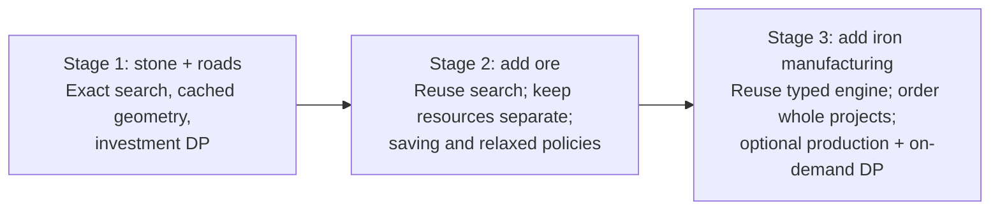
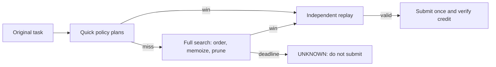
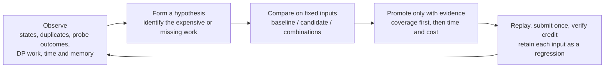
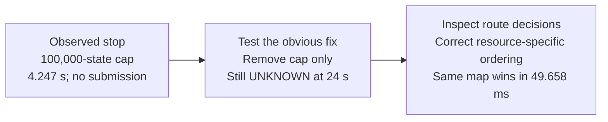
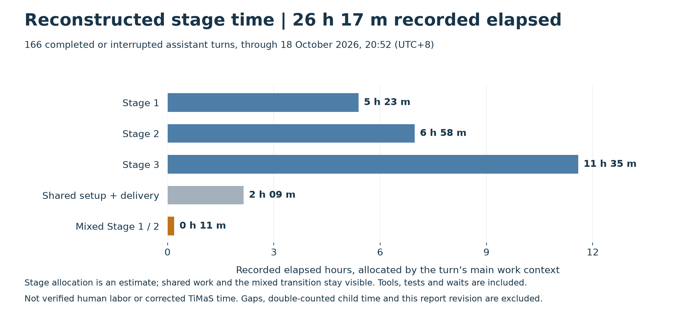

# Blade Runner: an evidence-led path through three stages

**31 levels completed · 81 required series positions · 93 valid plans.**
One Python application handles the full game. It reads a map and resource goal,
then returns an ordered JSON plan within the game's turn limit. Advancement also
requires the first submission within 30 seconds of task creation.

The assignment asks for requirement understanding, complex problem solving,
Python coding, independent judgment, time accounting and work in the remote
environment. This report follows the decisions that demonstrate those skills.
Detailed task ledgers and proofs are linked beneath each stage.

**Delivery approach:** develop and compare locally; treat timed server runs as
acceptance tests. All 93 submitted plans passed independent replay and
passed game validation. Two live cases exposed solver weaknesses—one each in
Stages 2 and 3—and stopped before submission. Three other late tasks exposed
acquisition/recovery gaps. Thus 88 tasks passed on time and five were completed
late; resets lost seven earlier credits. The record supports reduced delivery
risk, not a claim that every unseen input will finish within 30 seconds.

The shared engine tries quick policy plans, then searches remaining choices and
remembers visited states. It prunes only proven dead branches. A failed quick
plan leaves full search available. **DP** means saving answers to repeated funding
or production subproblems.

## Stage 1 — build a correct search, then remove repeated work

**New problem.** Stone is both construction money and the goal. Roads enable
transport; quarries create income. A profitable final balance is insufficient:
every construction action must be affordable when it executes.

**Design.** Model topology, inventory, turn and used activations. Search legal
continuations, remember equivalent states, and try cheap completion policies.
A producer and its connecting roads are one investment. Independent raw-action
replay checks the resulting plan against the original map.

**Observation → decision.** Counters exposed repeated connectivity work. Caching
reuses routes when the network is unchanged. Investment DP rejects states that
cannot afford the goal even in an easier game with free roads. DP showed little
benefit on easy inputs; bad-investment controls revealed where it mattered.

**Adopted:** cache + investment DP, with **75.8% lower warm suite time** and equal
outcomes. The comparison includes the baseline and each improvement separately;
the cold corpus retains the two slow cases omitted equally from warm timing.

| Live result | Local evidence | Median timely solver / server time |
| --- | --- | --- |
| 17/17 levels; 19 valid plans; 17 on time | 108 controls: 66 wins, 42 impossibility proofs | 0.648 ms / 1.481 s |

**What escaped local checks:** no observed solver miss. Two deadlines were lost
to task-ID response handling and creation-timeout recovery. The corrected runner
locates an existing task before creating another and verifies progression after
submission. Upstream delay itself was not diagnosed as a server defect.

[Full Stage 1 report: inputs, timings and both incidents](stage-1-report.md).

## Stage 2 — preserve capital while introducing a second resource

**New problem.** Ore cannot pay construction costs. Building the nearest
producer can spend the stone needed for a better investment. The Stage 1 search
is reused with separate stone and ore inventories and resource-aware routes.

**Observation → decision.** A pruning/reuse candidate improved common wins by
6.5%, yet still missed the same six known-solvable cases. That was insufficient.
We compared saving-aware policies, which can wait to fund a useful project,
with relaxed-resource guidance, which uses an easier economic model to suggest
quick plans. These policies guide search; their failure never proves impossibility.

**Adopted:** both policies. Saving-aware guidance closed all six gaps. Relaxed
guidance added no standalone coverage in this corpus, so we challenged it
separately: five of seven selected economic cases met a repeated 2× speed/work
criterion. That evidence justified keeping it. Selected development challenges
are not estimates of how often such maps occur on the server.

**The live solver gap shows why counters matter:**

The counterexample ruled out “just search longer” as a sufficient correction.
The final solver uses time limits without that state cap, and the saved map
remains a regression.

| Live result | Local evidence | Median timely solver / server time |
| --- | --- | --- |
| 7/7 levels; 36 valid plans; 34 on time | 150 controls: 126 wins, 24 impossibility proofs | 20.249 ms / 1.499 s |

**Two late tasks:** the solver gap above and an acquisition timeout with no
solver execution. One long successful client run spent 21.923 s acquiring the
task but only 89 ms solving it. Separate timing boundaries prevented us from
mistaking acquisition delay for search cost.

[Full Stage 2 report: inputs, timings, diagnosis and remaining gaps](stage-2-report.md).

## Stage 3 — schedule manufacturing and pay for stronger checks on demand

**New problem.** Smelters consume ore to make iron. Ore may also be required at
the base, so production must stay optional. The state retains resource types and
per-turn activation flags. Tasks without an iron goal can reuse earlier engines.

**Design.** Order whole production projects using goal gap, funds and remaining
turns. Add production DP to reject impossible funding/conversion schedules,
but activate it only after initial quick plans miss. The proof direction stays
the same: if even the easier problem cannot win, the real branch cannot win.

**Decision A: on-demand DP.** It retained all 227 reliable configurations and
reduced mean winning time 5.7% versus always on. Instrumentation explains why:
DP queries fell from 183,045 to 38,235 across the study; initial-probe queries
fell from 144,399 to zero. Strong pruning remained available for fallback.

**Decision B: longer initial probes.** The live miss consumed 13.173 s acquiring
the task, then exhausted its 11.302 s solver allowance. A local trace found a
useful policy truncated at 192 decisions; allowing 256 finished it. We compared
192 against 512 with the interval fixed at 512 and later probes at 32.

Across 1,842 runs, initial 512 raised reliability from 306/307 to 307/307 and
reduced common winning time 32.1%. The failed map changed from three 30-second
misses to three wins in 0.457–0.486 s. Two long-horizon controls slowed by
0.354/0.590 s; these costs remain in the evidence. The adopted settings are
**512 initial decisions / 512-state interval / 32 later decisions** per policy.

| Live result | Local evidence | Median timely solver / server time |
| --- | --- | --- |
| 7/7 levels; 38 valid plans; 37 on time | Final 307 configurations: 273 wins, 34 impossibility proofs | 127.156 ms / 1.799 s |

After correcting the solver gap, all 18 fresh tasks counted, at 1.218–3.537 s
server time. The old task was completed late before the series restarted.
Slow acquisition contributed to that incident; the original solver also missed
a separate full 30-second local run.

[Full Stage 3 report: inputs, timings and the failed-map investigation](stage-3-report.md).

**What the delivered code demonstrates**

| Recruiter concern | Reviewable evidence |
| --- | --- |
| Correctness and requirements | Ordered-action replay; exact state identity; optional manufacturing; proven optimistic cuts. Full search is complete if exhausted under the declared model; deadline exhaustion returns UNKNOWN. |
| Validation before acceptance | Tiny exhaustive oracles, known witnesses, impossible/random/adversarial cases, tight resources, shared roads and forced full-search controls. All 93 live records / 92 distinct inputs retained. |
| Maintainable Python | One application for all stages; pure helpers, stage modules, independent validators and a separate submission runner. [Code reading guide](../../README.md#review-the-code). |
| Delivery verification | 658/658 adopted-to-official comparisons match; 115 portable tests and 367 historical tests pass. Suites overlap. A fresh extracted ZIP installs and runs all three offline smokes. |
| Independent judgment | Retain negative results and regressions; compare combined candidates; distinguish solver time from acquisition and server task age. |

These are bounded results, not 100% coverage of possible maps. Search remains
exponential in the worst case. [Concluded proofs and assumptions](../../.github/spec-driven-delivery/solution-whiteboard.md#mathematical-guarantees-and-limits)
and [final migration evidence](evidence/migration-full.json) provide the detail.
Historical timings describe the versions that ran; different stage inputs and
timer wrappers are not a cross-stage speed comparison.

**Time accounting and scope choice**

The tracker total is known to be inaccurate. These estimates reconstruct this
conversation's ended assistant turns: **Stage 1 ≈ 5 h 23 m; Stage 2 ≈ 6 h 58 m;
Stage 3 ≈ 11 h 35 m**, plus shared work and an unsplit transition. They include
tools, experiments and waits, and exclude gaps and this report revision. They
cannot establish human hours or replace the requested TiMaS record.
[Allocation method and uncertainty](evidence/stage-time-audit.json) and a
[sanitized turn ledger](evidence/stage-turn-times.csv) make the estimate auditable.

The effort grew with the model: investment tests in Stage 1; resource policies
in Stage 2; manufacturing, probe scheduling and repeated comparisons in Stage 3.
This was a deliberate investment in local evidence before acceptance runs.
We retain the cost as part of the engineering trade-off, not a claim that a
longer process is inherently better.

**Remaining work is explicit:** improve [deadline allocation](https://github.com/hhhhhusky777/blade_runner/issues/1),
clarify [model boundaries](https://github.com/hhhhhusky777/blade_runner/issues/2),
add [phase timing](https://github.com/hhhhhusky777/blade_runner/issues/3),
test [reuse plus guidance](https://github.com/hhhhhusky777/blade_runner/issues/4),
and investigate [partial-probe reuse](https://github.com/hhhhhusky777/blade_runner/issues/5).
These are follow-ups rather than unreported fixes in this release.

The local ZIP contains code, locked dependencies, tests, this report, all three
stage chapters and compact evidence. It excludes credentials and raw private
conversation. [Chart data and method](evidence/visual-report.json) bind the figures
to the preserved experiments. The [README](../../README.md#setup-and-commands)
provides reproducible offline commands.
