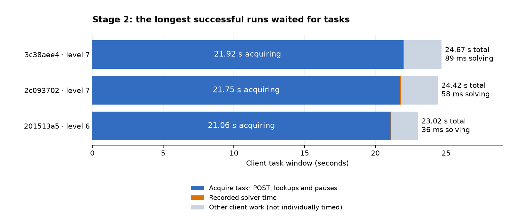

# Stage 2 delivery report

Stage 2 is complete: all **7 levels** are server-verified, with no unfinished
tasks. Across **36 distinct tasks**, all submitted plans passed on their only
submission. **34 counted and two were late completions**. The required series
contain 30 tasks in total; four earlier counted credits were lost when late
completion reset partial series (two credits each in levels 3 and 6).
This is an interim client report; reconcile all stages after Stage 3.

## Delivered behavior

Stage 2 adds iron ore. Roads cost 1 stone, quarries cost 10 stone, and iron mines
cost 15 stone. The validated plans mine 5 units per extractor per mining turn.
Stone funds construction and can also be a goal; ore can be a goal. A plan must
transfer resources to BASE and meet the original goal within its turn limit.

The local solver tries original greedy policies, then relaxed-resource and
saving-aware policies when needed, then exact search with memoization and
optimistic pruning. Stone-only maps can reuse the Stage 1 engine. Independent
replay checks the plan before one submission; server task flags and exact
series progress determine whether the loop continues.

Every successful live solve expanded only one search state: 35 used an original
greedy probe and one used relaxed guidance. Engines were 34 typed Stage 2 runs
and two Stage 1 dispatches. There was **one live relaxed-policy success and no
live saving-policy success**. Saving remains supported by the separate hard
local cases; these live maps do not establish full-search or pruning coverage.

## Measured results

These summaries describe the final successful plan-generation observations.
The original stopped solver run and failed creation call remain separately
reported below; they are not erased or counted as additional tasks.

| Measure | Observed result |
| --- | --- |
| Level completion | 7/7; 100% |
| Game-plan passes | 36/36; 100%, one submission per task |
| Tasks counting toward progression | 34/36; 94.4%; two late recoveries |
| Counted server time, n=34 | Median 1.499 s; mean 1.661 s; range 1.283–3.201 s |
| Counted solver time, n=34 | Median 20.249 ms; maximum 203.250 ms; total 1.062 s |
| All 36 successful solver runs | Median 21.175 ms; total 1.167 s |
| Counted client windows, n=34 | Median 4.662 s; maximum 24.672 s; sum 228.598 s |
| Older creation POST duration, n=20 | Median 1.474 s; maximum 7.111 s |
| Latest complete acquisition helper, n=14 | Median 5.116 s; maximum 21.923 s |
| Validation | All 36 plans replay in both rule interpretations: 72 passes; current regression validation has 219 passing local tests |

- **Solver:** recorded in-process model/search/plan/replay wall timer; excludes child startup, outer validation/encoding and network. Stage 1 dispatch is included in the Stage 2 wrapper's timer. This is not CPU time or a fresh benchmark.
- **Server:** task creation to successful submission, measured by the server. This owns eligibility. Late rows include investigation and waiting before cleanup, not server CPU time.
- **Client:** local start before creation through final task/progress verification, excluding earlier preflight, CLI startup and gaps between tasks. Two cleanup receipts lack comparable complete client durations; `—` means unmeasured.
- **Creation/acquisition:** older 20 receipts time only the creation POST. Latest 14 time POST plus ID lookups and pauses. **Do not pool these different boundaries.**

Summed client windows are not project elapsed time. Differences between client
and server clocks cannot isolate network or server processing time. Configurations
changed during delivery, so these observations are not a controlled before/after
speed comparison. Live CPU time, peak memory and each individual fetch/startup/
replay/submit/verification duration were not recorded.

The live inputs cover 12–25 columns, 9–25 rows (largest 25×25), 3–20 stone sites,
0–7 ore sites, 15–100 PLANNED_ROAD tiles, 12–23 starting stone and zero starting
ore. Goals were **32 ore-only and four stone-only, with no mixed goal**. Positive
goals range from 5–250 ore or 25–180 stone. Turn limits were 6–18; plans used
4–18 turns and 11–444 actions. PLANNED_ROAD is unbuilt terrain, not a free road.
These inputs do not cover every combination supported by the capabilities.

## Every task input and timing

S/O means stone/ore, including node counts and inventories at BASE. Goals of
zero mean that resource is not required. Short IDs identify rows; full IDs,
original sources and all numeric values are in the linked metrics file.
Turns are used/allowed. All rows ultimately passed on their first submission.

| Task | Level | Map | Sites S/O | Start S/O | Goal S/O | Turns | Solver ms | Server s | Client s | Result |
| --- | ---: | --- | ---: | ---: | ---: | ---: | ---: | ---: | ---: | --- |
| 3a5156a6 | 1 | 12×9 | 3/1 | 15/0 | 0/5 | 6/6 | 3.964 | 1.283 | 2.789 | Counted |
| 5a92dc59 | 2 | 17×13 | 3/2 | 17/0 | 0/5 | 6/7 | 4.227 | 1.357 | 2.907 | Counted |
| d1f340b6 | 2 | 12×10 | 5/2 | 16/0 | 0/100 | 16/16 | 20.167 | 1.629 | 3.114 | Counted |
| e8efefa0 | 2 | 18×10 | 4/3 | 19/0 | 0/40 | 9/9 | 16.892 | 2.016 | 3.657 | Counted |
| 6de39d3b | 3 | 20×14 | 4/2 | 15/0 | 0/100 | 15/17 | 6.836 | 1.358 | 2.862 | Counted |
| e08425c4 | 3 | 18×12 | 5/3 | 15/0 | 0/28 | 10/10 | 6.312 | 1.417 | 2.978 | Counted |
| 8086d0d8 | 3 | 23×16 | 5/6 | 15/0 | 0/175 | 14/14 | 45.764 | 46248.142 | — | Late |
| 33d85abc | 3 | 18×17 | 4/5 | 15/0 | 0/10 | 5/7 | 16.942 | 1.370 | 3.322 | Counted |
| 1a148135 | 3 | 22×12 | 6/2 | 15/0 | 0/10 | 4/9 | 5.550 | 1.409 | 3.372 | Counted |
| dd98201c | 3 | 17×14 | 5/5 | 15/0 | 0/76 | 11/11 | 35.957 | 1.469 | 3.381 | Counted |
| 8c8e7ca1 | 4 | 16×12 | 6/5 | 16/0 | 0/5 | 7/7 | 9.290 | 1.415 | 3.846 | Counted |
| 6bbac837 | 4 | 24×14 | 10/3 | 18/0 | 0/52 | 11/11 | 6.927 | 1.339 | 4.458 | Counted |
| 80d3a113 | 4 | 24×16 | 13/2 | 15/0 | 0/5 | 7/7 | 19.562 | 1.587 | 4.914 | Counted |
| 5e508463 | 4 | 17×17 | 10/6 | 16/0 | 0/16 | 8/8 | 23.515 | 1.416 | 5.338 | Counted |
| 936ff6e7 | 4 | 18×15 | 10/4 | 15/0 | 0/100 | 12/12 | 29.855 | 1.447 | 3.523 | Counted |
| 3cd00f89 | 4 | 18×18 | 14/3 | 15/0 | 0/100 | 11/13 | 30.349 | 1.421 | 4.177 | Counted |
| d77fef6a | 5 | 24×25 | 5/7 | 20/0 | 0/250 | 18/18 | 88.439 | 1.531 | 4.867 | Counted |
| 1fd4d746 | 5 | 23×24 | 6/5 | 15/0 | 0/10 | 6/8 | 20.168 | 1.363 | 3.779 | Counted |
| 84c109a2 | 5 | 24×23 | 6/6 | 23/0 | 0/52 | 11/12 | 44.916 | 1.391 | 3.841 | Counted |
| c542bf09 | 6 | 24×25 | 20/3 | 20/0 | 0/16 | 4/7 | 9.929 | 1.401 | 6.596 | Counted |
| 3f7d3976 | 6 | 23×24 | 15/7 | 17/0 | 0/5 | 6/8 | 22.967 | 1.653 | 9.830 | Counted |
| fc441739 | 6 | 24×24 | 17/6 | 15/0 | 0/100 | 12/12 | 59.040 | 2804.840 | — | Late |
| 4df36a5a | 6 | 25×23 | 15/7 | 15/0 | 0/52 | 10/10 | 47.017 | 1.479 | 7.368 | Counted |
| b6701755 | 6 | 24×24 | 19/4 | 17/0 | 0/5 | 6/7 | 22.021 | 1.862 | 9.045 | Counted |
| 1b047e1c | 6 | 25×24 | 19/4 | 19/0 | 0/100 | 12/12 | 203.250 | 1.851 | 7.211 | Counted |
| 201513a5 | 6 | 24×23 | 19/3 | 16/0 | 0/100 | 12/14 | 35.810 | 2.156 | 23.016 | Counted |
| 82364dcc | 6 | 25×23 | 15/7 | 15/0 | 0/28 | 9/9 | 34.667 | 1.518 | 6.380 | Counted |
| a351d232 | 6 | 24×23 | 15/7 | 15/0 | 0/100 | 13/13 | 63.089 | 1.685 | 9.534 | Counted |
| 2c093702 | 7 | 25×24 | 19/4 | 15/0 | 0/100 | 12/12 | 58.039 | 3.201 | 24.419 | Counted |
| f46f40bb | 7 | 23×25 | 16/6 | 15/0 | 25/0 | 5/6 | 4.421 | 2.305 | 5.661 | Counted |
| 3c38aee4 | 7 | 25×25 | 18/6 | 15/0 | 0/100 | 11/11 | 89.013 | 2.111 | 24.672 | Counted |
| 1877bb7b | 7 | 25×24 | 20/3 | 17/0 | 0/5 | 5/7 | 49.974 | 2.518 | 9.280 | Counted |
| fd0ffd28 | 7 | 24×25 | 18/5 | 15/0 | 0/5 | 5/6 | 20.330 | 1.550 | 6.859 | Counted |
| 506d4406 | 7 | 13×13 | 12/0 | 12/0 | 180/0 | 11/11 | 4.288 | 1.837 | 3.405 | Counted |
| c0cfbfb0 | 7 | 16×16 | 5/0 | 20/0 | 75/0 | 9/9 | 3.387 | 1.454 | 2.875 | Counted |
| f06405b9 | 7 | 24×24 | 20/3 | 15/0 | 25/0 | 5/7 | 4.417 | 1.671 | 5.322 | Counted |

## Why the long runs were long

Gray is the combined remainder: client window minus acquisition minus recorded
solver time. Its individual phases were not separately timed.

| Task | Client s | Acquisition s | Solver ms | Server s |
| --- | ---: | ---: | ---: | ---: |
| 3c38aee4 | 24.672 | 21.923 | 89.013 | 2.111 |
| 2c093702 | 24.419 | 21.746 | 58.039 | 3.201 |
| 201513a5 | 23.016 | 21.062 | 35.810 | 2.156 |

**Confirmed: acquisition dominates these successful tails.** The longest run,
`3c38aee4`, sent one creation POST, hit ReadTimeout, then used nine GET lookups;
the ninth found the task. Solving took only 89 ms. Across the latest 14 tasks,
six creation ReadTimeouts recovered successfully, with exactly one creation
POST and one submission per task. The remaining eight also used GET to obtain
a missing response ID. The exact upstream cause of delayed creation/visibility
is **unknown**: the receipts do not distinguish service queueing, map generation,
network behavior or clock offsets. More CPU workers would not remove this wait.

The slowest successful solver was a different task, `1b047e1c`: 203.250 ms on a
25×24 map. Original probes missed; relaxed guidance found a 12-turn plan with
341 actions. Its guide recorded 1,059 project evaluations and 48.567 ms. This is
a useful live guidance example, not a search timeout.

| Incident | Cause judgment and impact | Correction / evidence |
| --- | --- | --- |
| `8086d0d8` originally stopped after 4.247 s /100,000 states without submitting; client window 7.944 s | Confirmed implicit state cap. Also a resource-specific route-ordering defect: removing only the cap still returned UNKNOWN at 24 s /486,786 states. | With the route correction and the same old cap, the map passed the original probe in 49.658 ms /one state. Five fixed child checks took 0.085–0.087 s. Cap subsequently removed. |
| Its eventual pass reported 46,248.142 s | Original task age through deferred cleanup, including intervening solver research and waiting; not 12.8 hours of search. Recovery solve: 45.764 ms. | One legal late submission, no credit; level 3 series reset 2/3→0/3. |
| `fc441739` creation hit the old 10 s read timeout | Confirmed creation-call timeout: 10.003 s; stopped client window 11.107 s. That receipt has no task ID, solver run or submission. Later GETs establish the task existed. Upstream delay cause unknown. | Reconcile the pending task rather than creating another. Its eventual legal late pass at task age 2,804.840 s used a 59.040 ms solve and reset level 6 series 2/6→0/6. |
| Earlier loop paused after `5a92dc59` already counted | Confirmed client rejection of the server's ready_for_gate label for a partial series; not a failed plan. | Accept the observed label while checking exact numeric series advancement. |

## What we missed and what remains

**Confirmed integration gap: slow acquisition can starve full search.** The
current runner conservatively starts its budget before the creation request,
while the server starts eligibility at actual task creation. It gives the
solver at most `min(24, 25 − elapsed)` seconds. The fast live probes hid the
interaction between long acquisition and a hard fallback case.

A [controlled local diagnostic](../../experiments/stage2_research/latency_budget_diagnostic.json)
combined the recorded 21.923 s acquisition delay with existing known-solvable
case `economic-challenge-pool-034`. The actual offline solver child received
3.013 s, returned UNKNOWN at its time limit, and submitted nothing.
This safely reproduces budget exhaustion for that combination. The fake client
injects the aggregate delay; it does **not** reproduce HTTPX traffic, a live
server failure or clock synchronization. Earlier frozen ample-budget runs
solved this case with both policies in about 15.46 s; that is a feasibility
reference, not a matched speedup comparison or minimum solve time.

**Separate unresolved local search cost:** case034 visits 377,886 distinct
states and skips 681,600 duplicate attempts in every one of the 12 frozen
variant/round observations. Both added policies miss; all four variants reach
the same expansion count. One recorded `both` run takes 15.472 s of pipeline
wall time and 15.453 s of child CPU time: this offline fallback is CPU-heavy,
although the long live client runs are acquisition-heavy. Memoization is
already removing substantial duplicate work. A bounded
[3-second instrumented prefix](../../experiments/stage2_research/profile_stage2_fallback.json)
adds useful localization: connectivity-tree access took 0.850 s of self time
across 587,571 calls (including cache hits), and connection-route search took
0.736 s across 12,426 calls. Together they account for about 53% of profiled
self time. Cumulative times overlap and must not be summed. Profiling changes
throughput; this prefix is not a full-run hotspot proof or a benchmark, as
[Python's profiler guidance](https://docs.python.org/3.13/library/profile.html)
explains.

The live path uses `improvements=none`. An experimental geometry-reuse candidate
already exists separately; its combination with `guidance=both` was not part of
the adopted economic study. Benchmark that existing combination on034 and
representative controls before adding another cache or selecting an optimization.
The profile supports that candidate investigation; it does not prove a speedup.

| Gap / priority | Next step / boundary | Status |
| --- | --- | --- |
| [P2: combined acquisition and search budget](https://github.com/hhhhhusky777/blade_runner/issues/1) | Validate authoritative task-age accounting and slow acquisition plus hard fallback before claiming unattended Stage3 deadline readiness. | Offline reproduction; guard unchanged |
| [P2: rule/model boundary](https://github.com/hhhhhusky777/blade_runner/issues/2) | Read Stage3 capabilities; reconcile cardinal adjacency, mining and relay premises or define a conservative supported domain. Extend strict replay before timed tasks. | Carryover assumptions; no known unfinished Stage1/2 progression |
| [P3: comparable phase timings](https://github.com/hhhhhusky777/blade_runner/issues/3) | Record named phases in existing receipts; preserve missing old values and distinguish POST-only from full acquisition. | Upstream delay cause unknown; nonblocking discovery |
| [P3: geometry reuse plus guidance](https://github.com/hhhhhusky777/blade_runner/issues/4) | Benchmark the existing combination on034 and controls before adoption. | Combined benefit untested; nonblocking discovery |
| Live fallback / resource combinations | Live samples lack mixed goals and starting ore; local cases cover these. Include them in combined delay/fallback validation. | Coverage limitation, included in issues1/2; no new server task needed |
| Resolved: hidden state cap and route ordering | Preserve time-only limits and the same-map regression. | Fixed before successful cleanup |
| Resolved: manual recovery and response handling | Preserve startup recovery, bounded GET reconciliation and local stop-boundary tests. | Generic startup path tested locally; real resets previously used reviewed one-off scripts |
| Resolved: latest29 maps absent from solver regressions | All36 maps now regenerate through the actual offline submission child and strict replay. | 36/36 pass; original frozen benchmarks unchanged |

Separate local research remains necessary: with both guidance policies, the
frozen 150-map study found 126 feasible plans and 24 infeasibility proofs, with
no UNKNOWNs in that corpus. Baseline and relaxed-only each left six UNKNOWNs.
Saving closed those six gaps; relaxed accelerated five selected economic
challenges. These results justify retaining both policies, but not universal
30-second solvability. The retained 034 example still requires substantial
full search in ample-budget observations.

## Regression coverage update

All36 retained server maps are now automatic solver regressions, including the
latest29 additions. The [index](../../experiments/stage1_poc/stage2-live-regressions.json)
binds original receipt hashes, task IDs, maps and saved witnesses. The actual
offline submission child regenerates36 winning plans under a24s solver budget,
without a state cap. Saved and fresh plans each pass both independent replay
modes:144checks. [Results](../../experiments/stage2_research/live-map-regression-results.json)
retain every per-map outcome; these are local observations, not new server credit.

The new child pipeline timer includes startup and outer replay: median0.064s,
max0.253s, sum2.815s. Do not compare it directly with the earlier in-process solver
timer. [Current validation](../../experiments/stage2_research/live-map-regression-validation.json)
passes219 tests across23 fresh-process modules and verifies all42 historical
frozen sources unchanged. This closes the retained-map regression gap; it does
not establish unseen-map coverage. Stage3 read-only discovery can proceed while
P3 follow-ups remain open.

## Evidence and evaluation scope

[Task metrics](../../experiments/stage2_research/stage2-task-metrics.json) bind all
36 rows to original file hashes and JSON pointers. They retain both historical
stopped observations separately and record all 72 replay results. Original maps,
plans, solver statistics, server flags and historical source bindings remain
in [first submission](../../experiments/stage2_research/first-submit.json),
[initial loops](../../experiments/stage2_research/loop-results.json),
[guidance run](../../experiments/stage2_research/guidance-live-results.json), and
[final completion](../../experiments/stage2_research/creation-retry-live-results.json).
See [same-map solver triage](../../experiments/stage2_research/state-cap-and-routing-triage.json),
[local benchmark analysis](../../experiments/stage2_research/economic-analysis.json),
[historical startup-recovery validation](../../experiments/stage2_research/startup-recovery-validation.json)
and the [whiteboard](../../.github/spec-driven-delivery/solution-whiteboard.md)
for detailed experiments and boundaries.

This investigation changes no solver, retry policy or deadline. It creates no
server task, submits nothing and starts no Stage 3 work. Stage 2 meets the
observed progression requirement. The next performance risk to address is
**deadline composition under slow acquisition**, rather than more CPU for the
already-fast successful live probes. Preserve Stage 1's historical report and
reconcile the client assessment after all stages are complete.
