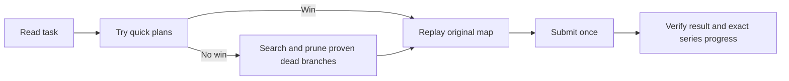
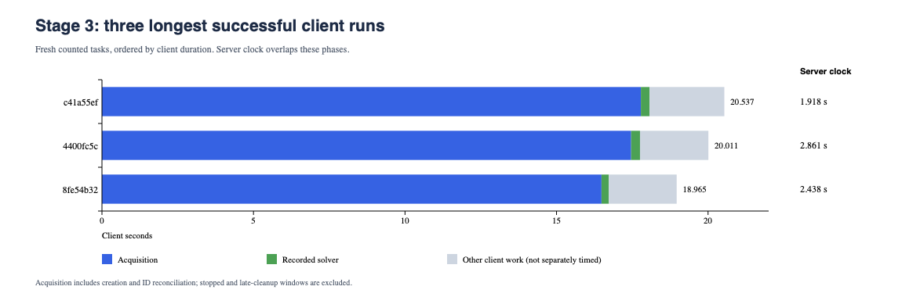

# Stage 3 delivery report

Stage 3 is complete: all **7 levels** are server-verified, with no unfinished
tasks. Across **38 distinct tasks**, all38 submitted plans passed on their only
submission. **37 counted and one was a late completion**. The required series
contain34 positions; three earlier level6 credits were lost when the late
completion reset its partial series. All three game stages are now complete.

## Delivered behavior

Stage3 adds smelters: each costs20 stone and converts up to2 ore into2 iron per
turn, at one ore per iron. Roads cost1 stone, quarries10 and iron mines15;
extractors supply5 units per mining turn in the validated plans. Stone funds
construction. Stone, ore or iron can be a goal, and required inventories must
reach BASE before CLAIM_WIN within the task's turn limit. PLANNED_ROAD marks
unbuilt terrain, not a free connection.

The solver ranks a producer and its required roads as one project. It first
tries quick greedy policies. If those fail, it searches remaining choices,
remembers duplicate states and enables production DP: a table for an easier
production problem. Only proven failure of that easier problem rejects a branch;
a greedy miss does not prove impossibility. Tasks with no iron goal reuse the
Stage2 engine and replay against the original Stage3 input.

The adopted settings allow512 internal decisions **per initial probe policy**,
then32 per later policy, triggered every512 full-search states. These allowances
limit optional probes; full search has only its wall deadline, with no state
cap. A solver decision can expand into many BUILD/MINE/TRANSFER actions, so
these numbers are not submitted action counts.

Of the38 final successful runs,30 used native Stage3 and eight reused Stage2.
The native engine found29 wins through probes and one through full search
(450 expanded states). Stage2 reuse had seven greedy wins and one waiting
completion. All10 native fresh tasks after adoption won at the root; seven
delegated tasks expanded one state and the waiting case expanded11. The initial
unsuccessful attempt is retained separately below; it is not an extra task or
submission.

## Measured results

The first two columns keep different inputs/settings separate. The pooled
column describes all timely passes; it is not a controlled speed comparison.
The expired task's11,623.168s server age is excluded from all three columns.

| Measure | Original timely tasks, n=19 | Adopted fresh tasks, n=18 | All timely tasks, n=37 |
| --- | ---: | ---: | ---: |
| Server seconds: median / mean / maximum | 1.712 /2.285 /8.956 | 1.859 /2.000 /3.537 | 1.799 /2.147 /8.956 |
| Solver milliseconds: median / mean / maximum | 113.090 /345.130 /4232.246 | 212.541 /183.592 /449.432 | 127.156 /266.544 /4232.246 |
| Solver seconds: sum | 6.557 | 3.305 | 9.862 |
| Client seconds: median / maximum / sum | 5.718 /20.011 /152.332 | 13.066 /20.537 /208.416 | 7.400 /20.537 /360.747 |
| Acquisition seconds: median / maximum | 2.861 /17.461 | 10.172 /17.784 | 5.321 /17.784 |

All38 successful solver observations total10.321s; the cleanup solve adds0.459s.
There were39 recorded live-path solve attempts:38 successful final observations
and one earlier UNKNOWN. Final plan pass rate is38/38; timely-task rate is37/38
(97.4%). Neither rate erases the original stop.

- **Solver:** recorded in-process model/search/plan/replay wall time. Excludes child startup, outer validation/encoding and network; not CPU time.
- **Server:** server task creation to successful submission; this owns the30-second eligibility check. Late recovery includes investigation and waiting, not server CPU time.
- **Client:** fresh attempt start before creation through task/progress readback. Excludes preflight, CLI startup and gaps between tasks. The cleanup's5.959s recovery-only window is not comparable and is shown as `—` in the table.
- **Acquisition:** creation request through task-ID reconciliation, including GET lookups and pauses. It can include waiting before actual server task creation.

Summed windows are not project elapsed time. Client/server clock differences
cannot isolate network or server processing. Live CPU time, peak memory and
individual fetch/startup/replay/submit/readback durations were not measured.

Inputs cover9–25 columns and9–25 rows, up to25×25 cells;3–21 stone sites,
0–7 ore sites and10–100 planned-road tiles. Starting stone is12–21; all tasks
start with zero ore and iron. Goals are30 iron-only (5–300),four ore-only
(5–100) and four stone-only (25–180), with **no mixed goal**. Limits are6–27
turns; successful plans use5–27 turns and17–2821 raw actions. These are observed
inputs, not all supported combinations or minimum-turn solutions.

## Every task input and timing

S/O/I means stone/ore/iron at BASE. Sites count stone/ore nodes. Turns are
used/allowed; raw actions include mining, transfer and the final claim. Rows
follow level and original task creation order. Every row ultimately passed on
its first submission; the late row uses its successful recovery solve.

| Task | Level | Map | Sites S/O | Start S/O/I | Goal S/O/I | Turns | Actions | Solver ms | Server s | Client s | Result |
| --- | ---: | --- | ---: | ---: | ---: | ---: | ---: | ---: | ---: | ---: | --- |
| f4e3e56a | 1 | 9×9 | 3/1 | 16/0/0 | 0/0/5 | 8/8 | 72 | 5.371 | 1.403 | 2.982 | Counted |
| 7971372b | 2 | 13×11 | 5/4 | 15/0/0 | 0/0/28 | 12/13 | 209 | 50.124 | 1.653 | 3.893 | Counted |
| bbea0c3c | 2 | 17×11 | 4/3 | 15/0/0 | 0/0/28 | 13/13 | 182 | 55.045 | 1.448 | 3.189 | Counted |
| c1798d18 | 2 | 16×14 | 5/3 | 15/0/0 | 0/0/40 | 14/14 | 266 | 72.720 | 1.663 | 3.527 | Counted |
| da4e75f6 | 3 | 24×15 | 5/6 | 17/0/0 | 0/0/150 | 23/23 | 595 | 185.298 | 2.245 | 5.485 | Counted |
| 938260b2 | 3 | 21×15 | 6/3 | 15/0/0 | 0/0/28 | 11/12 | 238 | 89.432 | 1.535 | 3.688 | Counted |
| cac1da90 | 3 | 17×16 | 4/2 | 20/0/0 | 0/0/100 | 20/20 | 356 | 40.368 | 1.552 | 3.091 | Counted |
| 90ea9be9 | 4 | 23×12 | 6/5 | 19/0/0 | 0/0/5 | 9/9 | 151 | 74.276 | 1.571 | 5.943 | Counted |
| 1bb42b33 | 4 | 20×15 | 11/3 | 15/0/0 | 0/0/52 | 13/14 | 538 | 113.090 | 1.575 | 7.234 | Counted |
| 09f38bea | 4 | 20×14 | 9/4 | 15/0/0 | 0/0/52 | 14/14 | 492 | 104.639 | 1.696 | 4.360 | Counted |
| 5af0cfaa | 4 | 22×17 | 11/5 | 15/0/0 | 0/0/52 | 16/16 | 786 | 168.852 | 2.263 | 10.943 | Counted |
| 243268f7 | 4 | 22×18 | 13/4 | 15/0/0 | 0/0/252 | 26/26 | 1151 | 4232.246 | 8.956 | 16.130 | Counted |
| 95ecb1b6 | 4 | 17×13 | 10/2 | 15/0/0 | 0/0/100 | 17/18 | 603 | 93.915 | 2.435 | 5.718 | Counted |
| 4a10c2e3 | 5 | 24×25 | 6/7 | 16/0/0 | 0/0/52 | 15/16 | 320 | 198.568 | 2.539 | 6.926 | Counted |
| 4769ae3f | 5 | 23×23 | 6/3 | 18/0/0 | 0/0/10 | 11/11 | 190 | 127.156 | 2.332 | 5.231 | Counted |
| 3fbf4469 | 5 | 25×25 | 7/6 | 21/0/0 | 0/0/97 | 19/19 | 665 | 142.818 | 1.712 | 9.843 | Counted |
| a861a2c8 | 6 | 25×24 | 16/7 | 16/0/0 | 0/0/100 | 18/18 | 1120 | 307.790 | 1.970 | 15.931 | Counted |
| af43ce79 | 6 | 25×23 | 15/7 | 15/0/0 | 0/0/16 | 11/11 | 445 | 202.442 | 2.006 | 18.209 | Counted |
| 4400fc5c | 6 | 24×24 | 16/7 | 16/0/0 | 0/0/52 | 15/16 | 617 | 293.321 | 2.861 | 20.011 | Counted |
| 3f0d26c4 | 6 | 24×24 | 16/7 | 15/0/0 | 0/0/252 | 24/25 | 1997 | 458.763 | 11623.168 | — | Late |
| 619b18e4 | 6 | 24×25 | 20/3 | 15/0/0 | 0/0/252 | 27/27 | 2344 | 404.219 | 2.301 | 15.835 | Counted |
| 9a740494 | 6 | 25×24 | 17/6 | 15/0/0 | 0/0/52 | 15/15 | 951 | 270.351 | 2.481 | 18.272 | Counted |
| c41a55ef | 6 | 25×25 | 18/6 | 15/0/0 | 0/0/52 | 14/14 | 1226 | 284.629 | 1.918 | 20.537 | Counted |
| 6cc5f85a | 6 | 24×25 | 18/5 | 15/0/0 | 0/0/300 | 25/26 | 2821 | 449.432 | 3.537 | 16.285 | Counted |
| 25be1d20 | 6 | 25×23 | 17/5 | 17/0/0 | 0/0/100 | 18/18 | 1251 | 357.452 | 2.229 | 17.427 | Counted |
| f6eadbf2 | 6 | 23×24 | 16/6 | 15/0/0 | 0/0/16 | 11/11 | 517 | 183.895 | 1.539 | 14.092 | Counted |
| c4f0e92d | 7 | 23×24 | 19/3 | 15/0/0 | 25/0/0 | 5/6 | 17 | 5.566 | 1.559 | 4.436 | Counted |
| 6f1465d8 | 7 | 23×25 | 16/6 | 15/0/0 | 0/0/100 | 18/18 | 998 | 319.694 | 2.726 | 12.891 | Counted |
| 8b87c9a9 | 7 | 13×13 | 12/0 | 12/0/0 | 180/0/0 | 11/11 | 444 | 5.652 | 1.441 | 2.907 | Counted |
| 3a9d316b | 7 | 23×25 | 15/7 | 15/0/0 | 0/100/0 | 12/12 | 172 | 50.725 | 1.799 | 7.400 | Counted |
| 94f3997d | 7 | 24×23 | 18/4 | 15/0/0 | 0/5/0 | 7/7 | 51 | 23.564 | 1.509 | 6.555 | Counted |
| 525297e5 | 7 | 25×24 | 17/6 | 15/0/0 | 0/100/0 | 12/12 | 169 | 72.803 | 1.218 | 7.573 | Counted |
| 506c277f | 7 | 23×25 | 16/6 | 19/0/0 | 29/0/0 | 6/7 | 22 | 14.778 | 1.494 | 5.232 | Counted |
| e0247a12 | 7 | 25×23 | 17/5 | 18/0/0 | 0/5/0 | 6/7 | 44 | 21.744 | 1.630 | 7.577 | Counted |
| 36f3734e | 7 | 16×16 | 5/0 | 14/0/0 | 75/0/0 | 10/10 | 53 | 5.476 | 1.484 | 2.974 | Counted |
| 4dd4cd60 | 7 | 23×24 | 19/3 | 15/0/0 | 0/0/252 | 26/26 | 2348 | 333.970 | 2.332 | 13.240 | Counted |
| 67b098cf | 7 | 25×23 | 17/5 | 15/0/0 | 0/0/52 | 15/15 | 786 | 259.512 | 2.372 | 16.217 | Counted |
| 8fe54b32 | 7 | 25×25 | 21/3 | 15/0/0 | 0/0/28 | 12/12 | 753 | 241.187 | 2.438 | 18.965 | Counted |

## Why the long runs were long

Blue acquisition, green solver and gray unmeasured remainder add to the local
client window. Server time overlaps those phases and is shown separately.
The chart excludes the initial stopped attempt and late cleanup.

| Task | Client s | Acquisition s | Solver ms | Server s |
| --- | ---: | ---: | ---: | ---: |
| c41a55ef | 20.537 | 17.784 | 284.629 | 1.918 |
| 4400fc5c | 20.011 | 17.461 | 293.321 | 2.861 |
| 8fe54b32 | 18.965 | 16.484 | 241.187 | 2.438 |

Acquisition accounts for about87% of these three client windows. The longest,
`c41a55ef`, hit a5s creation ReadTimeout; its ninth GET lookup found the task.
Across all37 timely tasks,18 creation ReadTimeouts reconciled successfully
(six original,12 after adoption), with one creation request and one submission
per task. Receipts do not identify whether upstream queueing, map generation,
visibility delay or network behavior caused the wait. Extra solver workers
would not remove that acquisition delay.

The slowest successful solver was a different task: `243268f7`, level4,
22×18, goal252 iron,26 turns. It searched450 states and produced1151 actions
in4.232s; server time was8.956s. In the later controlled local comparison,
initial512 solved that saved map at the root in about0.285s versus3.985s with
initial192 (three-run means, interval512 fixed). This benchmark is separate
from its original live timing.

## The missed deadline and correction

| Event | Evidence and effect |
| --- | --- |
| Level6 task `3f0d26c4` first stopped | Acquisition13.173s; remaining solver allowance11.302s returned UNKNOWN after785 states; client window26.114s. No submission occurred. The original default also failed a separate local30s run. |
| Cause isolated locally | The initial capital probe stopped after192 internal decisions on a viable path. It had built the useful production network; allowing256 decisions completed the same policy at253 iron within24/25 turns. Raw replay accepted the plan and its prefixes passed the bounds. This was a truncated optional rollout, with no evidence of wrong pruning. |
| Alternatives compared | Larger later-probe allowances32–512 at interval512 all missed this map; interval128/256 with later256 also missed. A policy trigger could win but caused substantial fallback overhead in the broader corpus. These results do not prove all other combinations fail. |
| Adopted correction | Increase initial allowance to512 and interval to512; retain later32, exact actions, ordering and pruning. Full regression comparison and actual submission-child checks passed before resuming. |
| Late cleanup and restart | Same task/input, one legal submission; solver0.459s. Server age11,623.168s means no credit. Script verified level6 series3/6→0/6 before fresh creation, then counted all18 new tasks and stopped at Stage3 completion. |

The runner conservatively budgets from before the creation request; the server
clock starts at actual task creation. Slow acquisition can therefore leave too
little search time. The adopted fast plan closes this observed failure; it does
not establish a general solution to budget composition or universal30s coverage.
The5s creation wait and GET reconciliation remain bounded; an ambiguous
submission is never automatically repeated.

## Controlled local validation and remaining limits

The initial-allowance experiment fixes interval512 and later32 in both arms:
307 configurations over293 maps,three cold runs per arm (1842 actual runs).
It includes forced-DFS duplicates and known-impossible controls.

| Initial allowance | Reliable configurations, all three runs | Common passing-case mean validated-win time |
| --- | ---: | ---: |
| 192 | 306/307 | 84.27ms |
| 512, adopted | 307/307 | 57.18ms |

The mean improves32.1% across272 common feasible configurations; the pending
map changes from three30s UNKNOWNs to three wins in0.457–0.486s. Two long-horizon
controls regress by0.354/0.590s. Maximum worker memory is54.69/52.69MiB for
192/512; these are local benchmark values, not live measurements. The experiment
isolates the initial allowance; it is not a joint128-versus512 interval study or
a same-input live before/after comparison.

Final adoption validation passes367 tests across42 modules, all307 expected
configuration outcomes, and55 saved Stage1/2 maps through the Stage3 adapter.
Unchanged passing isolated tests have explicit retained source-bound reuse;
changed tests reran and partial failures remain in the evidence. This report
also independently replays all38 submitted plans in both relay interpretations:
76 passes. These reporting checks make no server calls or new solver runs.

| Remaining boundary | Meaning / next step |
| --- | --- |
| Deadline composition | [Issue1](https://github.com/hhhhhusky777/blade_runner/issues/1): slow acquisition plus hard fallback still needs authoritative task-age accounting and combined validation. |
| Reuse failed-probe progress | [Issue5](https://github.com/hhhhhusky777/blade_runner/issues/5): retain useful ordering hints and calculations; a failed greedy probe must never become an impossibility proof. |
| Model and live coverage | Four-neighbor transport and conservative resource-relay plans are the tested domain. Both replay modes pass these plans, but full server equivalence is unproven. Live samples have no mixed goals or starting ore/iron; local cases cover additional combinations. See [Issue2](https://github.com/hhhhhusky777/blade_runner/issues/2). |
| Timing detail | [Issue3](https://github.com/hhhhhusky777/blade_runner/issues/3): finer phases and upstream acquisition causes remain unmeasured. |
| Retained-map regression coverage | All20 maps known before adoption are in the307-configuration suite, including the failed map. The18 fresh maps are retained and replayed here; they have not yet been added to that frozen automatic solver-regression corpus. |

## Evidence and evaluation scope

[Task metrics](../../experiments/stage3_research/stage3-task-metrics.json)
bind all38 task rows and the original stopped observation to receipt hashes
and JSON pointers. They include inventories, nodes, plans' turns/actions,
all timing definitions, chart values, replay results and the executed aggregation
source. Original maps/plans/statistics/flags remain in the
[first-phase index](../../experiments/stage3_research/remaining-loop-results.json)
and [resumed-run receipts](../../experiments/stage3_research/probe512-resume-results.json).
[Final independent GET verification](../../experiments/stage3_research/probe512-final-verification.json)
confirms all7 levels done and no pending task.

[Local comparison analysis](../../experiments/stage3_research/root512-analysis.json),
[adoption validation](../../experiments/stage3_research/root512-adoption-validation.json)
and the [whiteboard](../../.github/spec-driven-delivery/solution-whiteboard.md)
retain detailed proofs, diagnostics and limitations. The adopted source is
`stage3.py` SHA256 `2e28abd335d7d1f80534e2f691c546051c137c6c88ce622a48f2ef766e2a9d52`;
the adapter is `73de73b862776905ef13bf936f6c3a82b51c646e15ee42c85955e9da02299fc0`.
The resumed-run summary binds those sources. Earlier receipts do not embed a
per-attempt solver-source hash; retained historical snapshots are separate
provenance evidence. Configurations changed during delivery.

Stage3 meets the observed game progression requirement. Passing these samples
does not prove every pruning rule, unseen-map coverage, minimum-turn optimality
or a universal30-second runtime bound. Stage1/2 reports remain historical;
a combined client assessment can reconcile all three stages separately.
